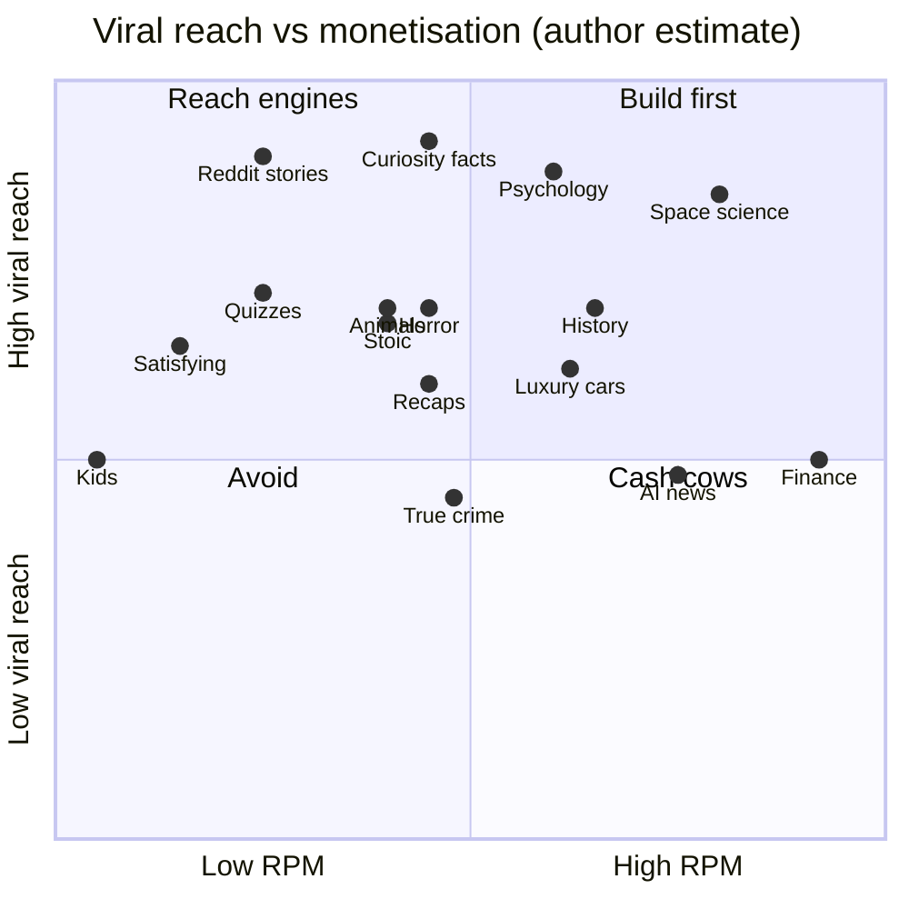
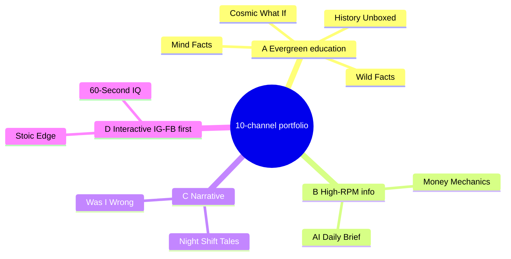

# 02 — Niche Selection & 10-Channel Portfolio

> Status: research draft · Researched: 2026-10-16 · Scope: faceless, mostly AI-produced channels on YouTube (Shorts + long-form), Instagram Reels, Facebook Reels/Pages, scheduled through Buffer.

**About the numbers.** YouTube does not publish RPM by niche, and the only datasets taken from creator Studio accounts come from a vendor (AIR Media-Tech). Everything else is creator-reported or modelled. Subscriber counts are third-party snapshots, so check them on the live channel before quoting them. Any figure marked *(est.)* is my own judgement and has no measured source.

---

## 1. TL;DR

- **Most of the money comes from long-form YouTube.** In AIR's 274-channel study, Shorts RPM was about **3–14% of long-form RPM** in most niches. Facebook Reels typically pays about **$0.02–$0.20 per 1,000 views**. Instagram has no general ad revenue share. So Shorts and Reels bring in the audience, and long-form plus affiliate links bring in the revenue.
- **Policy risk now outweighs copyright risk.** YouTube's "inauthentic content" policy (July 15, 2025) and Meta's "unoriginal content" crackdown (July 14, 2025) both name the cheap faceless templates explicitly: "narrative stories with only superficial differences", "slideshows that all have the same narration", and "simply stitching together clips". **Using AI is allowed. Mass-produced templates are not.**
- **Portfolio design.** 10 channels across 4 risk buckets: evergreen education, high-RPM info, narrative/story, and interactive/IG-first. No more than 2 channels sit in the high-policy-risk bucket.
- **Excluded:** sports highlights, movie/anime recaps, kids/nursery, compilations or reposts, and health myths. The reasons are in §5.

---

## 2. Platform & policy constraints that shape the choice

| Constraint | What it says | Implication for us |
|---|---|---|
| YouTube "inauthentic content" (renamed from "repetitious", 15 Jul 2025) | Not monetisable: "content that looks like it's made with a template", "AI-generated content made with generic or unoriginal templates giving the impression of mass production" | Every channel needs a distinct format bible, varied hooks and visuals, real scripting, and fact-checking. A different voice/style per channel does **not** make it safe on its own. |
| YouTube "reused content" | Not allowed: "Short videos you compiled from other social media websites", "Clips… edited together with little or no narrative" | Rules out compilation, repost, sports and recap channels. |
| YouTube enforcement | Reported Jan 2026: 16 channels terminated (~35M combined subs) under this policy (via aituber.app citing The Next Web). Enforcement extends to all channels "owned or operated by the impacted creator" (fan-trailer case). | **A violation on one channel can spread to all 10.** Isolate risky channels on separate brand accounts. Payouts usually share one AdSense account per payee, so isolation is only partial (see §7). |
| Meta "unoriginal content" (14 Jul 2025) | Repeat reusers "lose access to Facebook monetization programs for a period of time" and get "reduced distribution on everything they share". "Simply stitching together clips or adding your watermark does not qualify as meaningful enhancement." | Post native, original renders to FB/IG. Never cross-post with TikTok/YouTube watermarks. |
| YouTube Shorts view counting (31 Mar 2025) | A view now counts on every start or replay. Monetisation and YPP use **"engaged views"**. | Headline Shorts views overstate earnings. Plan revenue on engaged views. |
| YouTube synthetic-content disclosure | Realistic AI-generated content must be labelled | Label realistic AI visuals. Disclosure does not demonetise. |
| Unverified | One 2026 source (OutlierKit) claims YouTube will require **10M qualified Shorts views per 90 days** to keep earning Shorts revenue share from 1 Feb 2027. I could **not** confirm this on an official page. | Check the YouTube Creator Blog before relying on Shorts-only monetisation. |

---

## 3. Revenue reality (per 1,000 views)

| Surface | Typical range | Source quality |
|---|---|---|
| YouTube long-form, Education & Science | **$10.22 median** (P25–P75 $2.31–$19.50) | AIR, 300 channels, May 2025–May 2026, Studio data |
| YouTube long-form, Entertainment | $2.43 median ($0.88–$5.02) | AIR (same) |
| YouTube long-form, Business & Finance | $2.01 median ($0.73–$5.17) **but n<10** | AIR (directional). Conflicts with creator-reported **$10–$25+** for faceless finance (OutlierKit compilation). Treat finance as "high, but variable". |
| YouTube long-form, Gadgets & Tech | $2.33 median ($0.70–$3.71) | AIR. Blog CPMs for "AI & tech" run $8–20 (CPM, not RPM) |
| YouTube long-form, Kids & Teens (MFK) | **$0.33 median** | AIR |
| YouTube Shorts (all niches) | ~3–14% of long-form; roughly **$0.02–$0.45** across sources | AIR 274-channel study and blogs |
| Facebook Reels (Content Monetization) | **$0.02–$0.20** typical; $1–5 claimed for US-heavy premium niches | Vendor blogs only, no Meta data |
| Instagram Reels | No general ad revenue share. Bonuses are invite-only and unpredictable. | Multiple 2026 guides |

**Worked example (est.):** 10M Shorts views/month at $0.05 is about **$500**. 300k long-form views at $8 is about **$2,400**. To get the money, add long-form to every channel where the niche supports it.

---

## 4. Niche scoring matrix

Each criterion is scored 1–5. **5 is always good**: Policy Risk 5 means low risk, and Saturation 5 means uncrowded. Weighted total = Viral×2 + Supply + RPM×1.5 + Policy×2 + AI-fit + Saturation (max 42.5). Scores are my judgement, informed by the sources below; rows are grouped by theme, not strictly sorted by total.

| # | Niche | Supply | Viral (Shorts/Reels) | RPM long / Shorts | Policy risk | AI-fit | Saturation | **Total** | Proof channels (third-party snapshot) |
|---|---|---|---|---|---|---|---|---|---|
| 1 | Space / science / "what if" | 5 | 5 | 5 ($10+ Edu&Sci) / low | 4 | 5 | 2 | **37.5** | What If 8.9M, Ridddle 5.7M, Kurzgesagt 23.3M |
| 2 | Psychology / human-behaviour facts | 5 | 5 | 4 / low | 4 | 5 | 2 | **36** | Psych2Go 13M, Practical Wisdom 2M+ |
| 3 | History stories / dark history | 5 | 4 | 4 / low | 4 | 5 | 3 | **35** | Biographics 4M+, RealLifeLore 8M+ (geo/history) |
| 4 | Interesting facts / curiosity (3D style) | 5 | 5 | 3 / low | 3 | 4 | 1 | **30.5** | Zack D. Films 27.6M, Bright Side 40M+ |
| 5 | Personal finance / money facts / business stories | 5 | 3 | 5 ($10–25 reported) / low | 4 | 4 | 2 | **32.5** | Economics Explained 2.3M, Coffee Break 2M+ |
| 6 | Horror / scary stories (original) | 5 | 4 | 3 / low | 3 | 4 | 2 | **29.5** | Mr. Nightmare 6.8M, Scary Pumpkin 3.7M |
| 7 | AI news / AI tools | 5 | 3 | 4 ($8–20 CPM blogs) / low | 4 | 4 | 1 | **30** | 10X Income ~300K; niche "increasingly saturated" (Yoola) |
| 8 | Quizzes / riddles / brain teasers | 5 | 4 | 2 / low | 3 | 5 | 2 | **29** | Riddle 7M+ |
| 9 | Animal / nature facts | 5 | 4 | 3 / low | 4 | 3 | 3 | **31.5** | *(not verified; widely covered genre)* |
| 10 | Stoic / philosophy / motivation | 5 | 4 | 3 / low | 2 | 5 | 1 | **27.5** | Pursuit of Wonder 3.5M, Einzelgänger ~2.4M (unverified) |
| 11 | Reddit / AITA story narration | 5 | 5 | 2 / low | 1 | 5 | 1 | **26** | rSlash ~1.9M, Updoot Studios ~380K |
| 12 | Luxury / cars / "how the rich live" | 4 | 4 | 4 (Transport $5.69, n<10) / low | 3 | 3 | 2 | **29** | TheRichest 16M+ |
| 13 | True crime summaries | 5 | 3 | 3 (advertiser-unfriendly topics) / low | 3 | 3 | 2 | **26.5** | Fern 4.5M (docs) |
| 14 | Satisfying / ASMR clips | 4 | 4 | 2 / very low | 2 | 3 | 1 | **23** | *(mostly reposts; reuse risk)* |
| 15 | Health myths / longevity | 5 | 3 | 4 / low | 2 (medical misinfo) | 3 | 3 | **27** | *(YMYL; accuracy liability)* |
| 16 | "Boring history for sleep" long-form | 5 | 1 | 4 / n/a | 1 | 5 | 1 | **21** | Sleepless Historian (2.3M-view video), named in 404 Media's AI-slop exposé |
| 17 | Sports highlights / edits | 5 | 5 | 2 / low | 1 (copyright) | 2 | 1 | **23** | Kapwing test channel: 1.1M views but unmonetised after 6 months |
| 18 | Movie / anime recaps | 4 | 4 | 3 / low | 1 (copyright plus market-substitute claims) | 3 | 1 | **22.5** | Fan-trailer channels demonetised in 2025 |
| 19 | Kids / nursery | 5 | 3 | 1 ($0.33 MFK) | 1 (COPPA) | 4 | 1 | **19.5** | n/a |

---

## 5. Niches rejected (and why)

| Niche | Why not |
|---|---|
| Sports highlights / edits | League footage gets claimed or struck. It also fits "reused content" exactly, and YouTube can extend enforcement to every channel the operator owns. |
| Movie / anime recaps | Studio footage dependency. Big fan-trailer channels (Screen Culture, KH Studio) were demonetised in 2025, including their alternative channels. |
| Kids / nursery | Made-for-kids status removes comments, end screens and personalised ads. Median RPM is $0.33. COPPA liability sits with the operator. |
| Satisfying / ASMR clips | Supply depends on footage we don't own. Original generation is possible but has the lowest RPM. Candidate for a later experiment only. |
| Health myths | Medical-misinformation policy plus AI hallucination risk. One wrong claim costs reach and trust. |
| "Boring history for sleep" | Named as AI slop by 404 Media (Sep 2025) and Der Standard. Looks like a direct enforcement target. |
| True crime | Real victims raise defamation and accuracy risk, and many topics are advertiser-unfriendly. It is a *bench* option if a channel underperforms. |

---

## 6. Recommended 10-channel portfolio

> **Superseded.** The final portfolio, tilted toward US ad value and with cartoon and avatar presenters, is in [12-final-portfolio.md](12-final-portfolio.md). The analysis below is kept for reference.

Risk buckets: **A** Evergreen education (low policy risk), **B** High-RPM information, **C** Narrative/story (higher reach, higher inauthentic-content risk), **D** Interactive/IG-FB-first.

| # | Channel concept (working name) | Bucket | Platforms | Format | Cadence (per platform) | Monetisation potential | Why |
|---|---|---|---|---|---|---|---|
| 1 | **"Cosmic What If"**: space and science hypotheticals | A | YT Shorts + YT long-form, IG, FB | 30–50s Shorts; 8–15 min long-form explainer | 2 Shorts/day; 1 long-form/wk | **High**: Edu&Sci is the highest measured median ($10.22) | Top score. Proven by What If (8.9M) and Ridddle (5.7M). Infinite questions. AI visuals suit space well. |
| 2 | **"Mind Facts"**: psychology and human behaviour | A/D | YT Shorts, IG (lead), FB | 20–40s text-led Reels/Shorts; monthly long-form compilation essay | 2/day | Medium | Very shareable on IG/FB ("send this to someone who…"). Psych2Go has 13M. Cite studies to show it isn't templated. |
| 3 | **"History Unboxed"**: dark or weird history stories | A | YT Shorts + long-form, FB (lead), IG | 45–60s story Shorts; 10–20 min mini-doc | 1–2 Shorts/day; 1 long-form/wk | Med-High | FB's older audience over-indexes on history. Evergreen and searchable. Avoid the "sleep history" template. |
| 4 | **"Money Mechanics"**: finance facts, how companies make money, money history | B | YT long-form (lead) + Shorts, IG, FB | 8–12 min animated-chart explainers; 30s "how X makes money" Shorts | 3 long-form/2 wk; 1 Short/day | **Highest per view** (est. $8–20 long-form; AIR's own finance sample is small) | The RPM anchor of the portfolio. Shorts feed the long-form. Affiliate links (brokers, apps) add revenue. Must avoid giving advice (disclaimers). |
| 5 | **"AI Daily Brief"**: AI news and tool demos | B | YT Shorts + weekly long-form roundup, IG, FB | 30–45s "new tool does X" Shorts with screen recordings; 10 min weekly roundup | 1–2 Shorts/day; 1 long-form/wk | Med-High (tech CPMs, affiliate/SaaS sponsors) | News supply is infinite and it fits our own AI stack. Saturated, so differentiate with hands-on demos rather than headline reading. |
| 6 | **"Night Shift Tales"**: original horror micro-fiction | C | YT Shorts + long-form, IG, FB | 50–60s Shorts; 15–30 min narrated anthology | 1 Short/day; 1 long-form/wk | Medium (long watch time) | Mr. Nightmare (6.8M) and Scary Pumpkin (3.7M) prove the format. Use **original** AI-assisted stories with a recurring narrator, a "world" and series arcs, to avoid "superficial differences". |
| 7 | **"Was I Wrong?"**: relationship/workplace dilemma stories (AITA-style, rewritten and original) | C | IG (lead), FB (lead), YT Shorts (no YT monetisation reliance) | 45–60s narration with gameplay-free, themed visuals; end with a "vote in comments" CTA | 2/day | Low (reach engine) | The highest raw virality of any niche. **Highest policy risk**: YouTube's policy wording targets exactly this, so lead on IG/FB, don't scrape Reddit verbatim, and use it to build audience rather than revenue. |
| 8 | **"60-Second IQ"**: quizzes, riddles, visual puzzles | D | YT Shorts, FB (lead), IG | 15–30s countdown puzzles; answer revealed at the end | 2–3/day | Low-Med | Comment and replay bait boosts distribution. Riddle has 7M+. Very cheap to generate. Vary puzzle types weekly so it doesn't look templated. |
| 9 | **"Wild Facts"**: animal and nature facts | A | YT Shorts + long-form, FB (lead), IG | 30–45s fact Shorts using licensed stock or AI animation; 10 min "top 10" long-form | 2 Shorts/day; 2 long-form/mo | Medium | Broad, family-safe and advertiser-friendly. Strong on FB. Use licensed (Storyblocks/Pexels) or generated footage only, never ripped nature docs. |
| 10 | **"Stoic Edge"**: applied philosophy, short essays not quote slideshows | D | IG (lead), FB, YT Shorts + long-form | 30s voiced micro-essays with cinematic AI visuals; 10–15 min long-form essays | 2/day; 2 long-form/mo | Low-Med (books/journals affiliate) | Pursuit of Wonder (3.5M) and Einzelgänger show depth works. Quote slideshows are named risky (Yoola: "mass-produced motivational videos"), so do essays. |

**Bench (swap in if a channel stalls after ~90 days):** Luxury/cars ("how the rich live", TheRichest 16M+), true-crime summaries, AI-generated original "satisfying" loops.

### Volume check for Buffer (est.)
About 1.5–2.5 short posts/day × 10 channels × 3 platforms comes to **~45–75 scheduled posts/day**, plus ~10–12 long-form uploads/week. Buffer's channel limits and plan tiers need confirming in the scheduling doc. Note that YouTube long-form usually needs YouTube Studio for chapters, end screens and thumbnails.

---

## 7. Operating rules that keep the portfolio monetisable

1. **One format bible per channel.** Each one sets its own hook styles, visual language, narrator persona and series formats. If two channels' videos can be swapped, that is a template signal.
2. **Human editorial pass on every script.** Fact-check (AI hallucination was a key lesson in Kapwing's test), add an original angle, and vary structure.
3. **Native, watermark-free renders per platform** (Meta penalises watermarks and duplicates).
4. **No third-party footage unless licensed.** Use music from the YouTube Audio Library or Meta Sound Collection only.
5. **Isolate risk.** Keep Bucket C channels (6, 7) on separate brand accounts. Caveat: YouTube enforcement can follow common ownership, so isolation lowers the chance of a spillover but does not remove it.
6. **Label realistic synthetic media** as YouTube requires.
7. **Kill or pivot at 90 days** if a channel is below ~1k engaged views per Short on average *(est. threshold)*. Kapwing's test averaged ~19k views per video and still only reached 1k subs in 157 days, so "fast" is relative.

---

## 8. Honest expectations

- **"0 to a million" is an outlier result, not a plan.** Every channel named here is the survivor of a large and mostly invisible pool. OutlierKit reports that only **3.1%** of faceless automation videos beat their channel average by 10×. In Kapwing's controlled test, a channel got 1.1M views in 6 months and was still not monetised.
- The best realistic route is to **concentrate effort**: after 60–90 days, put production into the 2–3 channels that show organic pull.
- **Reddit research gap:** reddit.com blocked automated fetching, so the community evidence (r/NewTubers, r/youtubeautomation, r/SideProject) is indirect and comes through secondary write-ups. Read those subs manually before finalising.

---

## Sources

**Fetched and read directly (2026-10-16):**

- YouTube Help: Channel monetisation policies (inauthentic and reused content): https://support.google.com/youtube/answer/1311392
- Meta for Creators: "Combating unoriginal content" (Jul 14 2025): https://creators.facebook.com/blog/combating-unoriginal-content
- MediaNama on Meta's crackdown: https://www.medianama.com/2025/07/223-meta-cracks-down-on-unoriginal-facebook-content/
- AIR Media-Tech: RPM by niche, 2026 medians: https://air.io/en/youtube-glossary/what-is-youtube-rpm-full-breakdown
- AIR Media-Tech: Shorts RPM niche-by-niche (274 channels): https://air.io/air-data-findings/what-is-youtube-shorts-rpm-in-your-niche-in-2026
- OutlierKit: RPM benchmarks compared: https://outlierkit.com/resources/youtube-rpm-benchmarks/
- OutlierKit: Faceless growth strategy (Jul 2026; channel snapshots): https://outlierkit.com/resources/faceless-youtube-growth-strategy/
- aituber.app: Faceless channels demonetised in 2026: https://aituber.app/blog/faceless-youtube-channels-demonetized-2026/
- Kapwing: We grew a faceless channel to 1,000 subscribers: https://kapwing.com/resources/we-grew-a-faceless-youtube-channel-to-1000-subscribers
- 404 Media: AI "boring history" videos flooding YouTube (Sep 2025): https://www.404media.co/ai-generated-boring-history-videos-are-flooding-youtube-and-drowning-out-real-history/
- FlowShorts: Best faceless YouTube channels (subscriber snapshots): https://flowshorts.app/blog/best-faceless-youtube-channels
- ShortsFast: Faceless channel examples 2026: https://shortsfast.com/blog/best-faceless-youtube-channel-examples-2026/
- Yoola: Faceless niches that still work in 2026: https://yoola.com/blog/best-faceless-youtube-niches-that-still-work-in-2026
- vidIQ: Start a faceless channel in 2026: https://vidiq.com/blog/post/start-faceless-channel-youtube/

**Used through search-result summaries only (not opened in full; lower confidence):**

- Gulf News: YouTube rules effective Jul 15 2025: https://gulfnews.com/technology/youtube-updates-monetisation-policies-ai-and-repetitive-content-ban-begins-july-15-1.500192660
- Search Engine Journal on the YouTube update: https://www.searchenginejournal.com/youtube-monetization-update-spam-not-reaction-channels/550755/
- Kapwing: AI Slop Report: https://www.kapwing.com/blog/ai-slop-report-the-global-rise-of-low-quality-ai-videos/
- vidIQ stats: rSlash: https://vidiq.com/youtube-stats/channel/UC0-swBG9Ne0Vh4OuoJ2bjbA
- FindAChannel: Updoot Studios: https://www.findachannel.net/Channels/updoot-studios/
- OutlierKit channel page: Einzelgänger: https://outlierkit.com/channel/einzelg
- TechSpot: fake-trailer channel demonetisation: https://techspot.com/news/107897-youtube-cracks-down-harder-fake-movie-trailer-channels.html
- PPC Land: Shorts view counting change (Mar 31 2025): https://ppc.land/youtube-changes-how-shorts-views-are-counted-from-march-31/
- AdaptlyPost: Facebook Reels pay per 1,000 views: https://adaptlypost.com/blog/how-much-does-facebook-reels-pay-per-1000-views
- StackInfluence: Instagram Reels creator earnings 2026: https://stackinfluence.com/how-much-do-instagram-reel-creators-earn-2026
- AIR Media-Tech: Made for Kids explained: https://air.io/en/youtube-glossary/what-does-made-for-kids-mean-on-youtube
