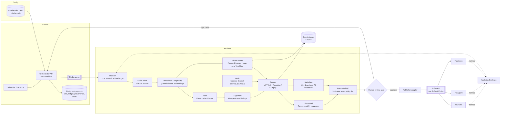
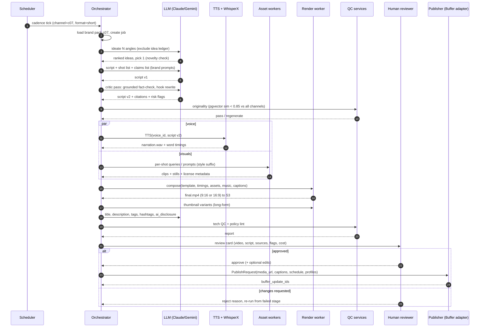

# 04 — Content Production Pipeline: Tooling, Repos, Architecture and Unit Cost

> Status: research and proposal, as of **2026-10-16**. Star counts and last-push dates were read from the GitHub API that day. Vendor prices come from the vendor pricing pages listed under Sources. All per-video costs are **estimates**: re-check before you commit budget.
>
> Scope: an automated pipeline for **10 faceless channels** making Shorts/Reels and 8–10 minute long-form video for YouTube, Instagram and Facebook. Every stage runs automatically up to a **human QA gate**. After the gate, posts go to **Buffer**. The Buffer API has its own doc in this set; this doc only defines the interface point.

---

## 1. TL;DR

- **Build a thin orchestrator; adopt the media workers.** Write a small Python orchestrator (job state in Postgres, a Redis queue, per-channel brand packs in YAML). For the media stages, wrap proven open-source pieces: **MoneyPrinterTurbo** (fork it as the stock-footage/short render worker), **WhisperX / faster-whisper** for word-level captions, and **FFmpeg** for final encodes. Use **Remotion** for branded long-form and thumbnail templates.
- **Best repo to fork: `harry0703/MoneyPrinterTurbo`.** It is MIT-licensed, very active (pushed 2026-10-15), and has a REST API, a CLI batch mode, 9:16/16:9/1:1 output, about 10 LLM providers, about 10 TTS engines, and Pexels/Pixabay/AI-video sources. It does not have a review gate, brand packs, fact-checking, or long-form story structure. We add those.
- **Use OpenMontage for ideas, not code.** It is the strongest "agentic" design (approval gates, 12 pipelines), but its AGPL-3.0 license and coding-assistant-driven runtime don't suit an unattended multi-channel service.
- **Estimated unit cost on the recommended "Standard" tier:** about **$0.40–0.80 per Short** and **$3–5 per 9-minute long-form**. A Budget tier (stock + Kokoro) costs **$0.10–$1** per video. A Premium tier with AI video clips costs **$3–6 per Short** and **$10–35 per long-form**. See §7.
- **The policies are the real constraint.** YouTube's "inauthentic content" policy (renamed July 2025) and Meta's unoriginal-content rules (July 2025, tightened March 2026) both demonetize or demote templated, mass-produced output at the channel level. Variation, originality checks, fact-checking and a human gate are required parts of the pipeline.

---

## 2. Platform policy constraints that shape the design

| Platform | Rule (paraphrased from source) | Pipeline consequence |
|---|---|---|
| YouTube (YPP) | Renamed "repetitious" to **"inauthentic content"** in July 2025. Mass-produced, generic, or interchangeable template videos are ineligible. AI is fine if the video "shows the creator's own vision and adds value". AI personas giving health, legal, financial or political advice can't be monetized. Reused-content violations hit the **whole channel**. | Per-video originality score, template rotation, a unique angle/thesis per script, and no "AI expert" personas in YMYL niches. |
| YouTube disclosure | Realistic synthetic scenes, altered real events, or AI music that is the main focus of the video must be flagged with "AI use" at upload. Scripts, thumbnails, captions and voice-cloned narration don't need disclosure. | Metadata stage outputs `ai_disclosure: true/false` per video. The Buffer hand-off must carry that flag (or the post is held for manual upload). |
| Meta (FB/IG) | From July 2025, reposters of others' content lose monetization and reach. The March 2026 guidelines define "original": remixes count only if they add analysis or new info, and borders, captions or speed changes alone don't. | No raw reposting of third-party clips. Stock footage should be used only as B-roll under original narration, and the source of each asset is logged. |

---

## 3. Open-source repo comparison

Stars and last push come from the GitHub API on 2026-10-16.

| Repo | Stars | Last push | License | What it does | What it lacks for us |
|---|---|---|---|---|---|
| [harry0703/MoneyPrinterTurbo](https://github.com/harry0703/MoneyPrinterTurbo) | 131.8k | 2026-10-15 | MIT | Topic → script → TTS → stock/AI clips → subtitles → music → MP4. Streamlit UI, REST API (`/docs`), CLI batch of up to 100 tasks via JSONL, 9:16/16:9/1:1. LLMs: OpenAI, Claude, Gemini, DeepSeek, Ollama, OpenRouter and more. TTS: Edge (free), Azure, ElevenLabs, Gemini, Fish, Kokoro, Chatterbox, VoxCPM clone. Clips: Pexels, Pixabay, Coverr, Seedance, MiniMax. Subtitles from Edge timestamps or faster-whisper. Docker. | No review gate, brand-pack abstraction, fact-checking, thumbnails, or long-form narrative structure (built for montage-style shorts). Its bundled music was taken from YouTube, so **remove it**. |
| [FujiwaraChoki/MoneyPrinterV2](https://github.com/FujiwaraChoki/MoneyPrinterV2) | 32.1k | 2026-09-15 | AGPL-3.0 | YouTube Shorts automator plus Twitter bot, affiliate and outreach. Cron scheduler, KittenTTS, gpt4free. | "Educational purposes only". Uses gpt4free (ToS risk), browser-style uploading, AGPL. Not production-grade. |
| [FujiwaraChoki/MoneyPrinter](https://github.com/FujiwaraChoki/MoneyPrinter) | 14.1k | 2026-03-26 | MIT | The original MoviePy Shorts generator (script, TTS, Pexels). | Superseded by MoneyPrinterTurbo. Minimal features. |
| [RayVentura/ShortGPT](https://github.com/RayVentura/ShortGPT) | 8.0k | 2025-02-10 | MIT | Short, long-form and translation/dubbing engines, plus an "LLM-oriented editing markup language". ElevenLabs or EdgeTTS, Pexels/Bing assets, Gradio UI. | Labelled "experimental", **stale for about 20 months**, thin docs. Its editing-markup idea is worth borrowing. |
| [gyoridavid/short-video-maker](https://github.com/gyoridavid/short-video-maker) | 1.4k | 2025-06-21 | MIT | Remotion + Kokoro + Whisper.cpp + Pexels. **MCP server and REST API** built to be called from n8n. Portrait/landscape. | English only, Pexels only (no own or AI assets), CPU render, **stale since mid-2025**. |
| [Anil-matcha/AI-Youtube-Shorts-Generator](https://github.com/Anil-matcha/AI-Youtube-Shorts-Generator) | 5.4k | 2026-10-11 | MIT | Long → short clipper: transcribe, LLM virality ranking, dedupe, face-tracked 9:16 crop. | Repurposing only (it needs a long-form source). Its API mode pushes you to a paid backend. Useful for **turning our own long-form into Shorts**. |
| [mutonby/openshorts](https://github.com/mutonby/openshorts) | 6.7k | 2026-10-16 | MIT | Open-source OpusClip-style clip generator (moment detection, 9:16). | Same niche as above. An alternative clipper. |
| [elebumm/RedditVideoMakerBot](https://github.com/elebumm/RedditVideoMakerBot) | 12.5k | 2026-10-13 | GPL-3.0 | Reddit thread → screenshots + TTS over gameplay background (Playwright). No upload. | Single format, and **reused third-party text** is exactly what YT and Meta now demonetize. Don't use. |
| [calesthio/OpenMontage](https://github.com/calesthio/OpenMontage) | 68.7k | 2026-10-12 | AGPL-3.0 | Agentic production system: 12 pipelines (explainer, documentary montage, clip factory, localization…) with human approval gates. Renders with Remotion, HyperFrames or FFmpeg. Providers include Veo, Kling, Runway, FLUX, ElevenLabs, Piper, Suno and Pexels. | Runs **inside a coding assistant** (Claude Code, Cursor…), not as a headless service. AGPL. Self-reported examples cost $0.15–5 per video. Best design reference. |
| [heygen-com/hyperframes](https://github.com/heygen-com/hyperframes) | 64.7k | 2026-10-16 | Apache-2.0 | "Write HTML. Render video." An agent-oriented HTML/GSAP renderer. | A renderer only. A permissive alternative to Remotion's company license. |
| [remotion-dev/remotion](https://github.com/remotion-dev/remotion) | 64.4k | 2026-10-16 | Remotion License | Programmatic React video. Precise templating, Lambda rendering. | Free for teams of ≤3 people. Otherwise **$0.01/render with a $100/mo minimum** (Automators). |
| [remotion-dev/template-tiktok](https://github.com/remotion-dev/template-tiktok) | 288 | 2026-10-12 | (Remotion) | Whisper.cpp word-level TikTok-style captions template. | Template only. A good starting point for our caption component. |
| [Vincentwei1021/video-shotcraft](https://github.com/Vincentwei1021/video-shotcraft) | 12.1k | 2026-10-13 | Apache-2.0 | Claude Code/Codex skill: 152 cinematic shot recipes on Remotion. | Product-video oriented, assistant-driven. A source of shot ideas. |
| [m-bain/whisperX](https://github.com/m-bain/whisperX) | 24.6k | 2026-09-26 | BSD-2 | Whisper ASR with forced alignment → **word-level timestamps**, plus diarization. | Needs a GPU for speed. Python only. |
| [SYSTRAN/faster-whisper](https://github.com/SYSTRAN/faster-whisper) | 25.9k | 2026-10-15 | MIT | CTranslate2 Whisper, about 4x faster. Used by MPT. | Word timings are less precise than WhisperX alignment. |
| [m1guelpf/auto-subtitle](https://github.com/m1guelpf/auto-subtitle) | 2.3k | 2024-07-12 | MIT | One-shot Whisper + FFmpeg burn-in. | Unmaintained. No styling or word-level highlighting. |
| [remsky/Kokoro-FastAPI](https://github.com/remsky/Kokoro-FastAPI) | 5.6k | 2026-10-14 | Apache-2.0 | Dockerized OpenAI-compatible Kokoro-82M TTS server (CPU/GPU). | Few voices, no cloning, weaker emotional range than ElevenLabs. |
| [OHF-Voice/piper1-gpl](https://github.com/OHF-Voice/piper1-gpl) | 5.9k | 2026-10-15 | GPL-3.0 | Successor to `rhasspy/piper` (now archived). Fast offline TTS. | Robotic next to Kokoro and ElevenLabs. GPL. |
| [Zulko/moviepy](https://github.com/Zulko/moviepy) | 15.0k | 2026-08-26 | MIT | Python video editing (MPT uses it). | Slow for long renders. v2 API break. |
| [n8n-io/n8n](https://github.com/n8n-io/n8n) | 207.6k | 2026-10-16 | Sustainable Use (fair-code) | Visual workflows. Many community "faceless shorts" templates exist (n8n.io/workflows/20025, Creatomate tutorials). | Poor fit for long GPU jobs, retries over big binaries, or per-channel state. Better as glue (notifications, approvals). |
| [Hritikraj8804/Autotube](https://github.com/Hritikraj8804/Autotube) | 79 | 2025-12-16 | MIT | n8n + FFmpeg Shorts workflow. | Toy scale. Shows the n8n pattern. |

**Conclusion:** none of these repos covers our multi-channel, review-gated, policy-aware needs end to end. MoneyPrinterTurbo is the best media worker to fork because it is permissive, active, API-first and broad on providers. WhisperX, Kokoro-FastAPI and Remotion fill the gaps. AI-Youtube-Shorts-Generator or openshorts can cut Shorts from our own long-form.

---

## 4. Commercial and API building blocks (prices as seen 2026-10-16)

| Stage | Option | Price (as seen) | Notes |
|---|---|---|---|
| Script LLM | **Claude Sonnet 5.5** | $2 in / $10 out per MTok, Batch −50% | Default writer and fact-check critic. |
| | Claude Opus 5.5 / Haiku 5.5 | $4/$20 · $0.10/$0.50 (≤100K prompt) | Opus for long-form outlines; Haiku for metadata, tags and classification. |
| | OpenAI gpt-6.1-sol / gpt-5-mini | $2/$10 · $0.25/$2 | Alternative or second-opinion critic. |
| | Gemini 3.8 Flash / 2.5 Flash-Lite | $0.75/$3.75 (to Dec 31 2026, then 2x) · $0.10/$0.40 | Google Search grounding: 5k free/mo, then $14 per 1k. Useful for fact-check. |
| TTS | **ElevenLabs** Multilingual v2/v3 · Flash | $0.08 · $0.04 per 1K chars. Pro $99/mo = 1.238M chars; Scale $299 = 3.738M | Best quality. Commercial use from Starter up. One voice per brand pack. |
| | OpenAI tts-1 / tts-1-hd / gpt-4o-mini-tts | $15 / $30 per 1M chars; $12 per 1M audio tokens | Cheap. Fewer distinctive voices. |
| | Gemini 3.8 Flash TTS | $9 per 1M audio tokens (to Dec 31 2026) | Multi-speaker. |
| | **Kokoro-82M** (self-host) / Piper / Edge TTS | ~$0 marginal (CPU) | Budget tier. Edge TTS is an unofficial endpoint, so it's a ToS and reliability risk. |
| Image gen | Nano Banana 2.1 (Gemini) | ~$0.034–0.04 per image (1K) | Scene stills, thumbnails. |
| | Gemini 3.1 Flash Image / Gemini 3 Pro image | ~$0.067 / $0.20 per image | Pro for hero thumbnails with text. |
| | FLUX (BFL) | ~$0.048 per image (calculator, 1K) | Strong style control. |
| | Runway gen4_image(_turbo), Seedream 5 | $0.02–0.08 per image | Available through one Runway key. |
| Video gen | **Veo 3.1** Lite / Fast / Standard | $0.05 / $0.10 (720p) / $0.40 per second | Fast is the sweet spot for B-roll inserts. Standard includes audio. |
| | Sora 2 / Sora 2 Pro | $0.10/s (720p) · $0.30–0.70/s | Third-party sources mention a possible deprecation; verify first. |
| | Kling 3.0 | ~$0.06–0.42/s (aggregators; reseller ~$0.075/s) | No public official rate card. Custom plans. |
| | Runway Gen-4 Turbo / Gen-4.5 | $0.05 / $0.12 per second | Image→video. Simple credit model ($0.01/credit). |
| Stock | **Pexels API** | Free. 200 req/hr, 20k/mo (raisable) | Attribution link required. Cache results. |
| | **Pixabay API** | Free. 100 req/60s per key | Must cache 24h. No permanent hotlinking, so download to our store. No bulk scraping. |
| Music | YouTube Audio Library | Free. Monetizable **on YouTube** | The page only promises safety on YouTube; it is silent on IG/FB, so don't rely on it cross-platform. Some tracks are CC and need attribution. |
| | Epidemic Sound Creator / Pro / Business | Pro ~$39.99/mo or ~$204/yr; Business ~$29.99–74.99/mo (third-party trackers) | Creator covers 1 channel per platform, Pro covers 3. **10 channels needs Enterprise or several seats.** Get a quote. |
| | ElevenLabs Music API | $0.15/min, commercial from Starter | Licensed AI music. Simplest cross-platform clearance. |
| | Lyria 3.5 (Gemini) | $0.08 per song | Cheap. Check output terms. |
| | Suno Pro | ~$10/mo, commercial rights on paid plans | Ownership terms changed after the Warner deal (Nov 2025). No indemnity. UMG/Sony suits ongoing. **Medium risk.** |
| Captions | WhisperX / faster-whisper (self-host) | ~$0 (GPU minutes) | Word-level timing for karaoke captions. |
| | OpenAI gpt-4o-mini-transcribe / whisper | $0.003 / $0.006 per min | Fallback if there's no GPU. We also already have the script text, so alignment beats transcription. |
| Editing | FFmpeg | Free | Concat, mixing, loudness (EBU R128 −14 LUFS), burn-in, encode. |
| | MoviePy | Free (MIT) | Fine for Shorts. Slow for 10-minute renders. |
| | Remotion | Free ≤3 people; Automators $0.01/render, $100/mo min | Branded templates, thumbnails (`renderStill`). |
| | CapCut | n/a | **No public automation API.** Materials licensing separates personal-only from commercial assets, and the 2025 ToS content-rights clause is a concern. Use only for manual one-offs. |
| Orchestration | Python + Redis (RQ/Celery/Arq) + Postgres + cron/APScheduler | Infra only | Recommended core. |
| | n8n self-hosted CE / Cloud Starter / Pro | Free (fair-code) / €20/mo 2.5k exec / €50/mo 10k exec | Glue and approvals. Cloud has a 5–40 min execution cap, which rules it out for renders. |

---

## 5. Reference architecture

### 5.1 Components

1. **Brand Pack Registry**: one YAML file per channel in git. It holds niche, voice ID and TTS engine, prompts (ideation, script, hook styles), visual style (palette, fonts, LUT, image-style prompt suffix), music mood whitelist, caption style, thumbnail template, CTA, platform targets, Buffer profile IDs, cadence, and `ymyl: true/false`.
2. **Orchestrator API + Scheduler**: Python (FastAPI). Creates `video_jobs` from cadence rules, drives a per-job state machine, and enqueues stage tasks.
3. **Queue + Workers**: Redis-backed queue. Worker pools: `llm` (CPU), `tts`, `asset` (stock search, image/video gen), `render` (MoneyPrinterTurbo fork / Remotion / FFmpeg; GPU optional), `asr` (WhisperX, GPU).
4. **Stores**: Postgres (jobs, stage outputs, idea ledger, script embeddings via pgvector, asset provenance, review decisions, cost ledger). **Object storage** (S3 or Cloudflare R2): `/{channel}/{job_id}/{stage}/…` for audio, clips, renders and thumbnails. Lifecycle rule: delete intermediates after 30 days, keep finals 1 year.
5. **Quality and Policy Services**: fact-check (claims extraction → grounded verification → citations), originality (embedding similarity against this channel's history and all other channels, n-gram overlap, title dedupe), policy lint (YMYL personas, banned claims, music/asset licence check, AI-disclosure flag), and technical QC (loudness, duration, black frames, caption sync, safe areas).
6. **Review Console**: a small web UI (or Retool/Appsmith) where the human approves, edits or rejects. Slack/Telegram pings come via n8n or a webhook.
7. **Publisher Adapter**: the only module that talks to Buffer. It calls into the Buffer client covered in the Buffer API doc.
8. **Analytics Feedback (later phase)**: pulls per-post metrics and feeds top topics, hooks and retention back into ideation prompts.

### 5.2 Architecture flowchart



### 5.3 Sequence: producing one video



### 5.4 Human review / QA gate (essential, not optional)

Automated checks run before a human sees anything. The human gate is **required for every long-form** and for Shorts until a channel has 30 or more approved videos with fewer than 5% edits. After that, Shorts can switch to **sampled review** (e.g. 1 in 3), plus mandatory review whenever a flag fires.

| Check | Automated | Human |
|---|---|---|
| Facts | Claims extracted. Each claim verified with grounded search (Gemini grounding or a search API + Claude). Unverified claims get rewritten or cut. Citations go in the description for long-form. | Skims the claims table, reads the red flags. |
| Originality / variation | Embedding similarity against the last 200 scripts on **all** channels (threshold ~0.85); title near-dup check; rotation of hook archetypes, template variant, music and voice pacing; a unique "angle" field each video must justify. | "Would this feel interchangeable with our last 5?" |
| Policy | YMYL guard (no AI "expert" persona, adds a disclaimer); provenance check that every asset has a license record; AI-disclosure flag set if realistic synthetic footage is used. | Confirms disclosure and sensitive topics. |
| Technical | −14 LUFS loudness, caption drift < 120 ms, no black or frozen frames, text inside safe zones, duration limits (Shorts ≤ 3 min, Reels ≤ 90 s target). | Watches at 1.5x. |

### 5.5 Multi-channel config: the brand pack

```yaml
# brand_packs/c07_space_facts.yaml  (illustrative)
channel_id: c07
name: "Orbit Minutes"
niche: astronomy explainers
ymyl: false
languages: [en]
formats:
  short: { aspect: "9:16", target_sec: 45, per_week: 7 }
  long:  { aspect: "16:9", target_min: 9,  per_week: 1 }
voice: { engine: elevenlabs, voice_id: "xxxx", model: eleven_multilingual_v2, speed: 1.03 }
llm:   { writer: claude-sonnet-5-5, critic: gemini-3.8-flash+grounding, meta: claude-haiku-5-5 }
prompts:
  ideation: prompts/c07/ideation.md
  script:   prompts/c07/script.md      # persona, tone, banned phrases, hook archetypes
  thumbnail: prompts/c07/thumb.md
visuals:
  sources: [pexels, pixabay, nano_banana, veo_fast]   # in priority order
  ai_video_budget_sec: { short: 0, long: 40 }
  style_suffix: "deep navy palette, cinematic, film grain"
  template: remotion/OrbitLong@v3      # rotated among v1..v3 for variation
captions: { style: karaoke, font: "Inter Black", highlight: "#FFC400", position: center }
music: { source: epidemic, moods: [ambient, wonder], ducking_db: -18 }
publish:
  buffer_profiles: { youtube: "bp_yt_c07", instagram: "bp_ig_c07", facebook: "bp_fb_c07" }
  slots: ["09:00", "17:30"]
  timezone: America/New_York
```

All channels run on **one codebase and one worker fleet**. The brand pack is the only per-channel artefact, and it lives in git so prompt changes are reviewable. Each video records the brand pack version it was built from (`brand_pack@sha`).

### 5.6 Hand-off to Buffer (interface point only)

The Buffer API itself is covered in the Buffer API doc in this set. The pipeline's contract with it:

```python
@dataclass
class PublishRequest:
    job_id: str
    channel_id: str
    profiles: dict[str, str]          # platform -> Buffer profile/channel id
    media_url: str                     # PUBLIC, non-expiring CDN URL (R2 public bucket / Cloudinary), kept 14+ days. NOT pre-signed: Buffer fetches at publish time (see 05 §4)
    thumbnail_url: str | None          # long-form YouTube
    title: str                         # YouTube
    caption_by_platform: dict[str, str]  # IG/FB captions, YT description
    tags: list[str]
    scheduled_at: datetime | None      # None = Buffer queue slot
    ai_disclosure: bool                # maps to Buffer `isAiGenerated` (YT + IG metadata, see 05 §3); FB label still to confirm
    made_for_kids: bool = False

class Publisher(Protocol):
    def submit(self, req: PublishRequest) -> dict[str, str]: ...   # platform -> buffer post id
    def status(self, post_ids: list[str]) -> dict[str, str]: ...
```

The orchestrator writes `PublishRequest` to an outbox table. The adapter is idempotent on `job_id`.

---

## 6. Recommended stack (build vs adopt)

| Layer | Decision | Choice | Why |
|---|---|---|---|
| Orchestration | **Build** (thin) | Python 3.12, FastAPI, Postgres + pgvector, Redis + RQ/Arq, APScheduler | Per-channel state, review gate, cost ledger and retries over large files are core IP, and n8n handles these poorly. |
| Glue / notifications | Adopt | n8n self-hosted CE (optional) | Slack/Telegram approval pings and quick experiments. |
| Short render worker | **Adopt + fork** | MoneyPrinterTurbo (MIT) via its REST API | Saves weeks. We disable bundled music and inject our script, assets and brand style. |
| Long-form + thumbnails | Adopt | Remotion templates (budget for the Automators licence if the team is ≥4 people) or HyperFrames (Apache-2.0) | Branded, versioned, varied templates; `renderStill` for thumbnails. |
| Final encode / audio | Adopt | FFmpeg (loudnorm, ducking, burn-in) | Standard. |
| Captions | Adopt | WhisperX forced alignment to the known script | Word-level karaoke captions. |
| Scripts | Adopt API | Claude Sonnet 5.5 writer, Haiku 5.5 metadata, Gemini Flash + Search grounding critic | Quality plus a cheap grounded fact-check. Batch API (−50%) for the overnight queue. |
| Voice | Adopt API | ElevenLabs Pro → Scale (one voice per channel); Kokoro-FastAPI fallback | Distinct brand voices; vendor-outage fallback. |
| Visuals | Adopt APIs | Pexels/Pixabay first, Nano Banana 2.1 stills, Veo 3.1 Fast for 0–40 s of hero B-roll | Cost-tiered, and the provenance is logged. |
| Music | Adopt | ElevenLabs Music API or Epidemic Enterprise (quote). YT Audio Library for YT-only | Cross-platform clearance for 10 channels. |
| Long → Shorts repurposing | Adopt (phase 2) | openshorts or AI-Youtube-Shorts-Generator in local mode | Shorts cut from our own long-form are original by construction. |
| Avoid | n/a | MoneyPrinterV2 (gpt4free, AGPL), RedditVideoMakerBot (reused content), CapCut automation, Edge-TTS in production | Policy, ToS or reliability risk. |

**Hosting estimate (a guess, not a quote):** one 8 vCPU/32 GB VPS for the API, queue, Postgres and CPU renders (~$40–80/mo), plus an on-demand GPU (e.g. a spot 24 GB card, ~$0.3–0.8/hr) for WhisperX and optional Kokoro, plus R2 storage (~$15/mo per TB, no egress fees).

---

## 7. Cost-per-video estimates (ESTIMATES)

Assumptions: a Short is 45–60 s (about 150 words, ~900 chars). A long-form is 9 min (about 1,350 words, ~8,000 chars, ~60 shots). LLM token totals include ideation, script, critic/fact-check and metadata passes (Short ≈ 15k in / 5k out; long ≈ 80k in / 20k out). Prices are from §4. Self-hosted compute is shown as a small amortized figure.

| Line item | Short: Budget | Short: Standard | Short: Premium | Long: Budget | Long: Standard | Long: Premium |
|---|---|---|---|---|---|---|
| LLM (script, fact-check, meta) | $0.01 (Haiku/Flash) | $0.08 (Sonnet) | $0.10 | $0.05 | $0.40 (Sonnet + grounding) | $0.80 (Opus outline) |
| Voice | $0 (Kokoro) | $0.04–0.07 (11L Flash/v2) | $0.07 | $0 | $0.64 (11L v2) | $0.64 |
| Visuals | $0 (stock) | $0.24 (6 AI stills + stock) | $2.40–4.80 (24 s Veo Fast/Kling, mix) | $0 (stock) | $1.60 (40 stills) + $0–1.00 (0–10 s Veo Fast) | $8–32 (80 s Veo Fast→Std) + $1.60 |
| Music | $0 (YT library*) | $0.15 (11L Music 1 min) | $0.15 | $0* | $1.35 (11L Music 9 min) or sub | $1.35 |
| Captions / ASR | ~$0.005 | ~$0.005 | ~$0.005 | ~$0.05 | ~$0.05 | ~$0.05 |
| Thumbnail | n/a | n/a | $0.07 | $0.04 | $0.15–0.25 (3–4 variants) | $0.40 (Gemini 3 Pro) |
| Render + compute + storage | ~$0.02 | ~$0.03 (+$0.01 Remotion) | ~$0.03 | ~$0.10 | ~$0.15 | ~$0.20 |
| Regeneration buffer (+20%) | ~$0.01 | ~$0.10 | ~$0.55–1.05 | ~$0.05 | ~$0.90 | ~$2.5–7 |
| **Estimated total** | **~$0.05–0.10** | **~$0.40–0.80** | **~$3–6** | **~$0.30–1.00** | **~$3–5** | **~$15–35** |

\*YouTube Audio Library is safe only on YouTube. For IG/FB cross-posts use licensed or AI music, which adds about $0.15 for a Short.

**Fixed monthly costs (estimates):** ElevenLabs Pro $99 → Scale $299; Epidemic Enterprise quote, or ElevenLabs Music on usage; Remotion Automators $100 minimum (if the team is ≥4 people); VPS + GPU + storage $80–200; n8n $0 self-hosted. Buffer is costed in its own doc. Human review time is the largest real cost, at roughly 3–5 min per Short and 15–20 min per long-form.

**Example month (estimate):** 10 channels × 1 Short/day (cross-posted to YT/IG/FB) = 300 Shorts, plus 10 × 2 long-form/week ≈ 80 long-form. On the Standard tier: 300 × $0.60 + 80 × $4 ≈ **$500 variable + ~$400–700 fixed ≈ $0.9–1.2k/mo**, before Buffer and labour. TTS volume would be ≈ 300×0.9k + 80×8k ≈ 0.91M chars, which fits the ElevenLabs Pro plan.

---

## 8. Build plan (suggested phases)

1. **Week 1–2:** fork MPT and run it in Docker behind the orchestrator; set up Postgres schema, brand pack loader, one channel end to end for Shorts; manual review via a simple web page.
2. **Week 3–4:** add WhisperX alignment, the fact-check and originality services, the cost ledger, and the Publisher adapter → Buffer (sandbox profile).
3. **Week 5–6:** Remotion long-form template (3 variants) and thumbnails; onboard channels 2–5; Slack approvals through n8n.
4. **Week 7+:** channels 6–10, long → Shorts repurposing, analytics feedback loop, sampled review for mature channels.

**Key risks:** channel-level demonetization from samey output (mitigated by §5.4); vendor price changes (several Gemini prices double on 2026-12-01/2027-01-01); unclear AI-music rights (Suno); Kling's opaque pricing; Remotion licence threshold; Buffer's AI flag: 05 found an `isAiGenerated` field for YouTube and Instagram; Facebook coverage is unconfirmed, so FB posts flagged `ai_disclosure` need a manual check.

---

## 9. Sources (visited 2026-10-16)

- GitHub REST API repo metadata (stars, pushed_at, license): `https://api.github.com/repos/{owner}/{repo}` for each repo in §3; GitHub search API `https://api.github.com/search/repositories`
- https://github.com/harry0703/MoneyPrinterTurbo
- https://github.com/calesthio/OpenMontage
- https://github.com/gyoridavid/short-video-maker
- https://github.com/FujiwaraChoki/MoneyPrinterV2
- https://github.com/RayVentura/ShortGPT
- https://github.com/elebumm/RedditVideoMakerBot
- https://github.com/Anil-matcha/AI-Youtube-Shorts-Generator
- https://claude.com/pricing
- https://developers.openai.com/api/docs/pricing
- https://ai.google.dev/gemini-api/docs/pricing
- https://elevenlabs.io/pricing/api
- https://docs.dev.runwayml.com/guides/pricing/
- https://bfl.ai/pricing
- https://costbench.com/software/ai-media-apis/kling-api/ and https://evolink.ai/blog/kling-3-api-pricing-integration-guide (Kling, aggregator data)
- https://benchlm.ai/media-pricing/sora and https://magichour.ai/blog/sora-2-pricing (Sora 2, third-party)
- https://www.pexels.com/api/documentation/
- https://pixabay.com/api/docs/
- https://www.remotion.pro/license
- https://n8n.io/pricing/
- https://n8n.io/workflows/20025 and https://creatomate.com/blog/how-to-automatically-create-youtube-shorts-with-n8n
- https://www.epidemicsound.com/pricing/ and https://recurdash.com/subscription-pricing/epidemic-sound (third-party price tracker)
- https://support.google.com/youtube/answer/3376882 (YouTube Audio Library)
- https://support.google.com/youtube/answer/1311392 (YPP monetization: inauthentic/reused content, AI)
- https://support.google.com/youtube/answer/14328491 (altered/synthetic content disclosure)
- https://techcrunch.com/2025/07/14/following-youtube-meta-announces-crackdown-on-unoriginal-facebook-content
- https://techcrunch.com/2026/03/13/facebook-makes-it-easier-for-creators-to-report-impersonators/
- https://www.mediapost.com/publications/article/413530/meta-defines-original-content-tests-protection.html
- https://blog.dubspot.com/ai-music-licensing-explained-2026 and https://www.musicinafrica.net/magazine/suno-adjusts-ai-music-ownership-terms-after-warner-music-partnership (Suno licensing)
- https://autoae.online/blog/is-capcut-free-for-commercial-use (CapCut licensing, third-party)
