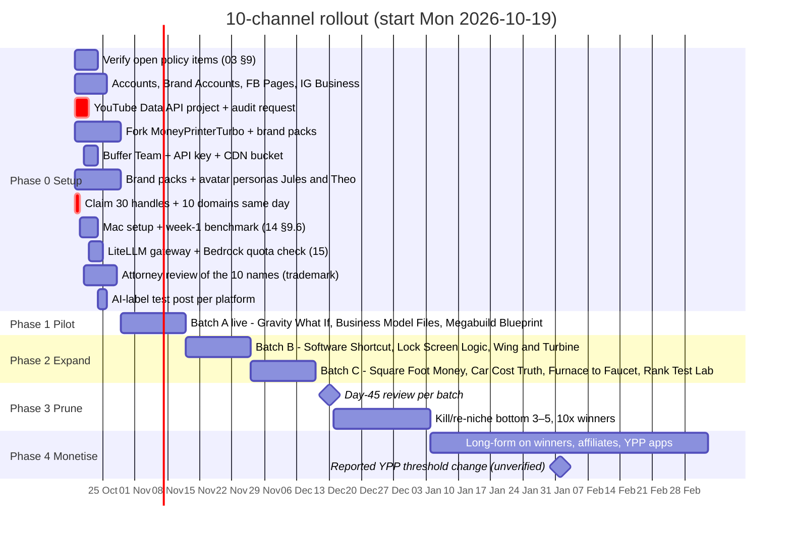
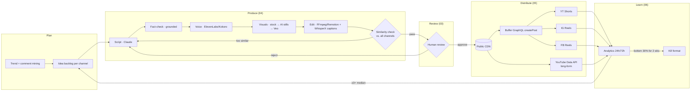

# 07 — Execution Roadmap

This doc combines docs 01–06 into a dated plan. **The channel list and batches follow [12 — Final portfolio](12-final-portfolio.md)**, which replaces 02 §6. The brand names come from [13](13-channel-brands.md). The production stack is local-first on the M4 Pro (14), with Bedrock (15) and agents/MCP (16). Where a number comes from another doc, the section is cited. Figures marked *(est.)* are estimates.

## 1. Principles that shape the schedule

1. **Launch in staggered batches, not all 10 on day 1.** A single policy strike can spread to every channel one owner runs (03 §8.2). Brand-new accounts that post heavily also trigger action blocks (03 §5).
2. **A person reviews every video until a channel has earned trust.** Templated output is the top demonetisation risk on YouTube and Meta (03 §2, 04 §5.4).
3. **Work with the views goal you can actually hit.** The goal is 1M combined views in week 1 (250k committed), not 1M followers (01 §6).
4. **Kill or double down on day 45.** Only 2–3 channels are expected to carry the portfolio (02 §8, 06 §8).

## 2. Timeline

The pilot batch is the three 🟢 faceless channels with the strongest proven faceless leaders: Gravity What If, Business Model Files and Megabuild Blueprint. This proves the core faceless pipeline first. The two avatar channels (Software Shortcut, Rank Test Lab) and the screen-recording channels follow once the review process is stable. The finance and legal channels were removed on 2026-10-16 (12 §2, 17).

## 3. Phase checklists

### Phase 0: Setup (week of 19 Oct)
- [ ] Read the official posts for the three claims backed only by press or blogs: the YPP thresholds from Feb 2027, YouTube's July 2026 AI-persona clarification, and Meta's March 2026 originality update (03 §9).
- [ ] Create one Google account and add a Brand Account per YouTube channel (up to 100 per account, 03 §1). Set up one Facebook Page and one Instagram Business account per brand, linked through Accounts Center.
- [ ] **Start the Google compliance audit on day 1.** Unaudited YouTube Data API projects can only upload *private* videos, and long-form can't go through Buffer (05 §1).
- [ ] Buffer: Team plan (approvals are Team-only), API key, about 30 channels (05 §2). Check the real per-channel price for more than 10 channels at checkout.
- [ ] Media storage: a public R2 bucket or Cloudinary, with a lifecycle rule of 14 days or more. Buffer fetches files at publish time and **rejects pre-signed URLs** (05 §4).
- [ ] Fork MoneyPrinterTurbo (MIT). Remove its bundled music. Add the review gate, the brand pack loader, fact-checking and the cross-channel similarity check (04 §3, §5).
- [ ] Write a brand pack and format guide for each channel: voice, palette, hook styles, banned templates (04 §5.5, 02 §7). Add a persona spec for the two avatar channels (09 §7).
- [ ] Generate the faces for the avatars "Jules" (Software Shortcut) and "Theo" (Rank Test Lab) **ourselves**, never from a real person (09 §3). Toggle Instagram's "AI-generated profile" on both accounts at creation (12 §4).
- [ ] Set up owned test properties for Rank Test Lab (test sites, Search Console) and sandboxed VMs for Lock Screen Logic (17 §Production feasibility).
- [ ] Get a US attorney to clear the 10 names for trademarks (13 §6).
- [ ] Make one test post per platform with `isAiGenerated` set, and check that the label shows in YouTube Studio and the Instagram app (12 §4).
- [ ] Run the pre-launch compliance checklist for each channel (03 §7).

### Phase 1: Pilot (3 channels, 2 weeks)
- [ ] Warm up the new accounts: profile complete, a few manual posts and some genuine activity before scheduling at volume (03 §5).
- [ ] Day 1–3: post 1 video/day per platform. Days 4–14: ramp up to the cadence in 02 §6.
- [ ] Review 100% of videos. Log how long each review takes; this sets how many channels you can staff.
- [ ] Every post sets the AI disclosure (`isAiGenerated` on YouTube and Instagram). Check Facebook labels by hand (05 §3).
- [ ] Watch for reach suppression on API-scheduled posts, which no source confirmed or ruled out (06, §7). Post one native upload as a comparison.
- [ ] Gate to start Phase 2: no strikes and no action blocks, review time per Short under 5 minutes, and at least one video above 3× its channel's median.

### Phase 2: Expand (+7 channels over 4 weeks)
- [ ] Batch B: Software Shortcut (avatar, A/B test against a no-host version), Lock Screen Logic (defensive only), Wing and Turbine (no crash content).
- [ ] Batch C: Square Foot Money, Car Cost Truth, Furnace to Faucet (no DIY how-to), Rank Test Lab (avatar; no income claims).
- [ ] Run the experimentation loop: measure at 24h and 72h; when a video beats its channel median by 3× or more, make 10 variations of it (06 §8).

### Phase 3: Prune (day 45 of each batch)
- [ ] Rank channels by engaged views per week and by growth rate.
- [ ] Kill or re-niche the bottom 3–5. Reserve niches: luxury, true crime (02 §5).
- [ ] Move the freed review time onto the top 2–3 channels.

### Phase 4: Monetise (month 3+)
- [ ] Long-form on the winning formats; YouTube Test & Compare thumbnails (06 §4).
- [ ] Apply for YPP as each channel qualifies. Affiliate links with FTC disclosure in the video and next to the link (03 §4). Watch for an invite to Facebook Content Monetization.
- [ ] Look into digital products and selling channels later (06 §10).

## 4. Targets

From 01 §6. Probabilities are in 01 §5.

| When | Commit | Stretch |
|---|---|---|
| Week 1 (pilot) | 250k combined views | 1M combined views (Cosmic What If carries most of it; the revenue channels lead with long-form) |
| Month 1 | 10k combined followers; 3 IG accounts at 1k (unlocks Trial Reels) | One video over 1M views |
| Day 45 | Bottom 3–5 channels killed or re-niched | 3 channels with a repeatable winning format |
| Month 3 | 1 channel YPP-eligible | 3 YPP-eligible; first affiliate revenue |

## 5. Monthly budget at full run rate *(est.)*

| Item | $/month | Source |
|---|---|---|
| Buffer, about 30 channels (Team) | ~$195 (about $135 on Essentials, which has no approvals) | 05 §2 |
| Production usage: about 300 Shorts + 80 long-form (Standard tier) | ~$500 | 04 §7 |
| Fixed: hosting, Postgres/Redis, ElevenLabs plan, music licence, CDN | $400–700 | 04 §7 |
| Avatars for 2 channels (HeyGen) | +~$200 | 09 §8 |
| Fewer Shorts (revenue channels post ≤5/week) | about −40% of Shorts usage | 08 §8 |
| **Cash total** (cloud-heavy stack in 04) | ~$1,600–2,300 | |
| **Cash total, local-first stack (recommended)** | **~$550–700** | 12 §5 |
| One-off: US attorney trademark review of the names | quote needed | 13 §6 |
| Human review *(est.)*: about 4 min × 300 Shorts + about 25 min × 80 long-form | **~55–65 h**, plus about 15–20 h of screen recording per channel for 3 channels (12 §5) | Re-measure in Phase 1 |

Human review is the binding constraint, not money. If Phase 1 shows it can't be staffed, run fewer channels rather than skipping review.

## 6. End-to-end system

## 7. Decisions needed from the owner

1. **Review capacity.** Who reviews, and for how many hours a week? This decides whether you run 10 channels or 6.
2. **Buffer plan.** Team (built-in approvals) or Essentials plus your own review dashboard (04 §5.4).
3. **Disclosure stance.** Turn on the AI label for every video (recommended, and simplest), or only where the policy strictly requires it.
4. **Ownership.** All channels under one legal entity, disclosed openly. Hiding who owns linked channels makes the risk worse (03 §2).
