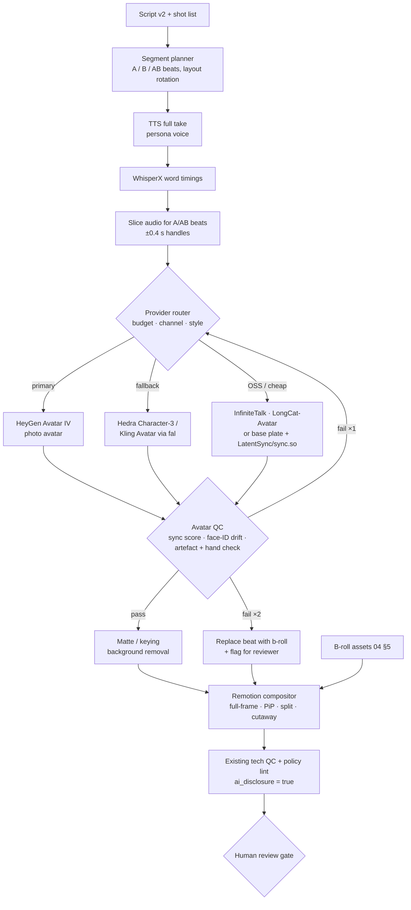

# 09 — AI Avatar Presenters: Tools, Licences, Pipeline Integration and Unit Cost

> Status: research and proposal, as of **2026-10-16**. GitHub stars, licences and push dates come from the GitHub API that day. Prices come from vendor pages or vendor docs where we could reach them, and otherwise from third-party trackers (marked *secondary*). **All cost figures are estimates.** Avatar pricing changed often in 2026, so re-check before you commit budget.
>
> Scope: adding a **fully synthetic on-screen presenter** (realistic or stylised talking head, virtual host, AI influencer) to the pipeline in [04](04-content-pipeline-architecture.md). Cartoon and animated characters, niche choice and policy detail are covered in other docs. Policy rules are cited from [03](03-platform-policies-and-risks.md) and not repeated here.

---

## 1. TL;DR

- **The tooling is ready, and automation works through APIs.** HeyGen, Hedra, Creatify, Captions/Mirage, D-ID, Tavus, Argil, sync.so, Kling Avatar and OmniHuman all have REST APIs. Most bill **per second of output**. A good photo-to-talking-head now costs **about $0.04–0.15 per second** (*est.*).
- **Recommended stack.** Primary: **HeyGen API, Avatar IV Photo Avatar**, created from a synthetic face we generate ourselves (about $3/min self-serve). Fallback: **Hedra Character-3** (about $0.04/s, and also good for stylised faces) or **Kling Avatar 2.0 via fal**. Open-source track: **InfiniteTalk** (Apache-2.0) or **LongCat-Video-Avatar 1.5** (MIT) on rented GPUs, plus **LatentSync** for cheap re-lipsync of a reusable "base plate".
- **Don't make a full-length talking head.** Render **avatar segments only** (hook, bridges, CTA: about 30–40% of a Short and 20–30% of a long-form) and composite them over b-roll in Remotion. This costs less, hides artefacts, and adds the variation the inauthentic-content policy rewards.
- **Added cost per video** (*est.*): **+$0.75–1.50 per Short** and **+$6–12 per 9-minute long-form** on commercial APIs. On self-hosted open source it's **+$0.05–0.40 per Short** and **+$1–4 per long-form**, plus engineering time.
- **Don't put an avatar on Money Mechanics (finance).** AI personas giving finance, health, legal or political advice can't be monetised (03 §2). Psychology (Mind Facts) has to stay "facts", not therapy advice.
- **Watch the licences.** Sonic is CC BY-NC-SA (non-commercial). InsightFace's pretrained face models, which LivePortrait, Hallo and LatentSync use for detection, are **non-commercial research only**. HunyuanVideo-Avatar's licence excludes the EU, UK and South Korea. Hallo3 inherits the CogVideoX licence.
- **Audiences are mixed.** Virtual influencers are losing brand interest and followers (Miquela lost about 142k followers in a year, Digiday Sep 2025). Hidden or late disclosure (Mia Zelu) causes backlash. The disclosed, "obviously a character" host is the safest choice.

---

## 2. Which channels should get a presenter

| # | Channel | Avatar? | Style | Why |
|---|---|---|---|---|
| 1 | Cosmic What If | Light (hook + CTA only) | Stylised, semi-real "mission control" host | The visuals are the star. The host only frames the question |
| 2 | Mind Facts | **Yes** | Realistic, warm, 30s | Talking-head psych facts are a native IG format. No clinical advice (YMYL-adjacent) |
| 3 | History Unboxed | **Yes** | Stylised "museum curator", period props | The persona is a clear character and hard to mistake for a real expert |
| 4 | Money Mechanics | **No** | n/a | YMYL finance: AI-persona advice can't be monetised (03 §2). Stay faceless |
| 5 | AI Daily Brief | **Yes** | Realistic news-desk host, openly AI | The AI-curious audience accepts an AI host, and it's a fast news cadence |
| 6 | Wild Facts | No | n/a | B-roll-led. A host adds cost without retention |
| 7 | 60-Second IQ | **Yes** | Stylised quiz-show host | The host asks and reveals, which works well with FB's comment-to-answer pattern |
| 8 | Night Shift Tales | Optional | Low-key, candle-lit narrator, mostly silhouette | Darkness hides artefacts. The animated route (other doc) may be better |
| 9 | Was I Wrong? | Optional (A/B) | Realistic "reader" reacting | A common format, but at higher risk of feeling interchangeable. Test it against faceless |
| 10 | Stoic Edge | No | n/a | The aesthetic is statues and landscapes. A modern face hurts it |

So **4 channels definitely and 3 optionally** get avatars. The costs in §8 assume 5 avatar channels.

---

## 3. Commercial tools (as seen 2026-10-16)

| Tool | Quality / realism | Max length | API | Price (*est.*, per output) | Synthetic persona? | Languages | Watermark / C2PA |
|---|---|---|---|---|---|---|---|
| **HeyGen** Avatar IV / V / III | Top tier. IV adds gestures and expressions from one photo. V is Digital-Twin only | 30 min (Creator/Pro), 60 min (Business) | **Yes**, REST plus MCP, prepaid per-second wallet ($5 min), no free API credits since Feb 2026, 10 concurrent (*secondary*) | Avatar IV Photo **$0.05/s ≈ $3/min**. V Twin ≈ $4/min. III Twin ≈ $1/min. Photo-avatar creation $1/call (Enterprise rate card: 0.1 cr/s at $0.50/cr) | **Yes**, via Photo Avatar from any image, plus "Generate Looks". Digital Twin (real-person video plus consent) by API is Enterprise only | 175+ languages and accents, US English voices | Free plan watermarked, paid not. C2PA not documented, so assume none and disclose anyway |
| **Synthesia** Express-2 | Very polished, corporate. Full-body, 1080p | No hard cap stated | Yes, but needs Creator/Pro or higher. About 360 API min/yr included | Pro $89/mo (≈60 min/mo). Per-minute volume price not published | **Weak.** Personal avatars need real footage. "Selfie avatars" still experimental | 140+ | Free plan watermarked |
| **D-ID** V4 Expressive | Good head-and-shoulders, a bit "presentational" | **5 min via API** | Yes. Commercial use from the **Launch** plan. Billed in 15 s blocks | Launch ≈ $35/mo, Scale ≈ $139/mo (*secondary*). ≈ $1.5–3/min effective | Yes, from any portrait image | 100+ | Trial watermarked |
| **Captions / Mirage** (Mirage Avatar X) | Very natural UGC-style faces and generated "AI creators" | Not stated | **Yes**, documented API | **$0.15/s** (6 s increments) ≈ $9/min | Yes, generated actors | Multi | Unknown |
| **Hedra** Character-3 / Avatar | Strong expressiveness. Handles stylised, cartoon and non-human faces | 60 s per request on standard plans (FAQ); API ref says up to 10 min (conflict) | **Yes**, v3 async jobs API | **6 credits/s**. Pro $50 for 7,200 credits ≈ **$0.042/s ≈ $2.50/min** | **Yes**, any image | Audio-driven, so any language | Commercial use on all paid plans. Watermark not stated |
| **Tavus** Phoenix | Best for real-time conversational replicas | Not stated | Yes, all tiers | Video generation ≈ $0.80–1.00/min overage (*secondary*). Growth $397/mo | **Weak.** Built around replicas trained on real footage. Stock faces exist | 30+ | Paid plans have no watermark |
| **Argil** | UGC "talking influencer" look, b-roll built in | Not stated | Yes, from Classic $39/mo | 160 credits/min of video plus 20/min of voice. Classic ≈ 25 min/mo. Training free (API doc) | Mostly trained-on-you avatars. Stock avatars pay a royalty | Multi | Classic and up have no watermark |
| **Creatify** Aurora | Good photo-to-video avatars, ad-oriented | v1: 5 min audio. v2: 59.7 s | **Yes** | aurora_v1 1 cr/s. v2 0.4–2.8 cr/s by resolution. API Starter ≈ $99 for 500 cr (*secondary*) → ≈ $0.08–0.20/s | Yes, any image | Audio-driven | Not documented |
| **Arcads** | Huge AI-actor library (1,500+), UGC ads | Short clips | No public API found | Starter ≈ $77–110/mo (*secondary*) | Stock actors only | Multi | n/a |
| **Kling Avatar 2.0** (fal, Kling API) | Very good motion and expressions, half-body | 2–60 s audio per call | **Yes** (fal, Kling) | Std ≈ $0.056/s, Pro ≈ $0.115/s on fal (*secondary*) | Yes, any image | Audio-driven | Kling app adds a visible watermark on free use. API output: verify |
| **OmniHuman 1.5** (ByteDance, BytePlus and resellers) | Among the most natural full-body and gesture results | 5–60 s per call | Via resellers. Official BytePlus price not confirmed | $0.045–0.25/s depending on reseller (*secondary*) | Yes, any image | Audio-driven | Verify |
| **Veo 3.1** (Gemini API / Vertex) | Native dialogue audio with lip-sync in **8 s shots**. Great for cutaway "scenes", not monologues | 8 s per clip | Yes | Fast $0.10–0.12/s, Std $0.40/s, Lite $0.05–0.08/s (*secondary*) | Yes, via reference images, though identity drifts between clips | Multi | **SynthID** invisible watermark on all Veo output. Visible mark now optional in the Gemini app |
| **Sora 2** | n/a | n/a | **Shut down 2026-09-24** (Videos API plus sora-2/-pro) | n/a | n/a | n/a | Don't build on it |
| **sync.so** lipsync-2 / -2-pro / sync-3 | Best-in-class **video-to-video** re-lipsync. Keeps the source performance | Plan cap: 1 min (Hobbyist) to 30 min (Scale) | **Yes** | lipsync-2 $0.04–0.05/s. 2-pro $0.067–0.083/s. sync-3 (4K) $0.107–0.133/s | Works on any base video | Any | No watermark from Creator up |
| **ElevenLabs Avatars** (ElevenCreative, Jun 2026) | New. Script, voice and avatar in one place, with persistent identities from photo or prompt | n/a | **No API confirmed**. Flows node for batches | Not published | Yes, from a prompt | 70+ | Unknown |

**Synthetic, not cloned.** Several vendors (Synthesia personal avatars, Tavus replicas, Argil training, HeyGen Digital Twin) are built around a **real person's consent video**. For a fully synthetic persona, use the **image-to-avatar** routes: HeyGen Photo Avatar, Hedra, Creatify, D-ID, Kling and OmniHuman. Never upload a real person's face (03 §2, impersonation and likeness).

---

## 4. Open-source models

| Model | ★ (2026-10-16) | Licence (code / weights) | GPU (inference) | Max length | Quality notes | Commercial OK? |
|---|---|---|---|---|---|---|
| **InfiniteTalk** (MeiGen) | 8.1k | Apache-2.0. Base Wan2.1-I2V-14B is Apache-2.0 | 24–80 GB, or low-VRAM via Wan2GP. 480p/720p | **Unlimited** (sparse-frame dubbing, I2V and V2V) | Natural head and body motion. Best open "full presenter" | **Yes** |
| **LongCat-Video-Avatar 1.5** (Meituan, May 2026) | 9.2k (LongCat-Video repo) | **MIT** code and weights | 13.6B base. INT8 option. 480p/720p | Minutes-long via video continuation | Whisper-large-v3 audio encoder, multi-character, distilled fast inference | **Yes** |
| **StableAvatar** | 1.3k | MIT | Wan2.1-1.3B base, so consumer GPUs. 480×832 | Infinite length | ID-preserving, no face post-processing | Yes (check the Wan base licence) |
| **EchoMimic v3** (Ant) | 1.1k | Apache-2.0 ("no rights over your generated content") | **12–16 GB** | 138 frames plus long-video CFG | 1.3B, half-body, decent quality | **Yes** |
| **EchoMimic v2** | 4.7k | Apache-2.0 | ≈ 24 GB. Accelerated version ≈ 50 s per 120 frames on A100 | Short clips | Half-body with hand-pose driving | Yes |
| **FantasyTalking** (AMAP) | 1.6k | Apache-2.0. Wan2.1-14B-720P base | 20–40+ GB | Short clips | Good expression and motion | Yes |
| **OmniAvatar** | 1.9k | Apache-2.0 | 14B, multi-GPU or FSDP. 480p only | Overlapping chunks | Full-body, prompt-controllable | Yes |
| **HunyuanVideo-Avatar** (Tencent) | 2.2k | Tencent Hunyuan Community Licence. **Not valid in the EU, UK or South Korea**. Acceptable-use policy (AUP) applies | 24 GB minimum, 96 GB recommended. 10 GB via Wan2GP | 129 frames per clip | Multi-character, emotion control | Restricted. Legal review needed |
| **Hallo2 / Hallo3** (Fudan) | 3.7k / 1.4k | MIT code. Hallo3 is a **CogVideoX-5B derivative**. Uses InsightFace | 24–80 GB | Hallo2: hour-long portrait. Hallo3: short | Hallo2 at 4K, portrait-only. Superseded by Wan-based models | Risky (InsightFace weights, CogVideoX licence) |
| **Sonic** (Tencent) | 3.3k | **CC BY-NC-SA 4.0** | ≈ 24 GB | Long | Good. The README says "license is non-commercial" | **No** |
| **MuseTalk 1.5** (Tencent Music) | 6.7k | MIT code. Weights "available for any purpose, even commercially". Deps (whisper, dwpose, S3FD) have their own licences | **4 GB** min, real-time on a V100 | Unlimited (V2V) | Lip region only, 256 px face. Use it on a base plate | **Yes** (check deps) |
| **LatentSync 1.5 / 1.6** (ByteDance) | 6.1k | Apache-2.0. **InsightFace** used for face alignment | **8 GB** (1.5) / 18 GB (1.6) | Unlimited (V2V) | Strong open V2V lip-sync. 1.6 trained at 512 px | Yes, but swap out the InsightFace weights |
| **LivePortrait** (Kuaishou) | 19.2k | MIT code. Default **InsightFace** detector is non-commercial; MediaPipe alternative in ComfyUI-LivePortraitKJ | 8 GB, real-time | Unlimited | Expression and pose retargeting (video-driven, not audio). Great for idle-motion base plates | Yes, with the MediaPipe swap |
| **SadTalker** | 14.1k | Apache-2.0 (3rd-party components excepted) | 6–8 GB | Unlimited | 2023-era: stiff, obviously AI. Not competitive | Yes, but don't use it |
| **Wav2Lip** | 13.2k | No licence in the repo (the original is non-commercial) | 4 GB | Unlimited | Blurry mouth | **No** |

The **InsightFace** README says its pretrained models are for "non-commercial research purposes only". Any repo that auto-downloads `buffalo_l`/`antelopev2` inherits that, so replace it with a commercially licensed detector (MediaPipe, or RetinaFace trained on permissive data).

---

## 5. Case studies and audience reception (2025–2026)

| Case | What happened | Takeaway for us |
|---|---|---|
| **Lil Miquela** (virtual influencer since 2016) | About 2.5M IG followers, but **lost 141,837 in a year** and sits in the **14th percentile** for engagement (CreatorDB via Digiday, Sep 2025). Brands willing to use AI creators fell from **86% to 60%** (Collabstr). 96% of brands with no plans cite consumer trust (WFA) | The novelty has worn off. Persona alone doesn't drive growth; content value does |
| **Gen Z audience** | 40% of US Gen Z follow a virtual influencer and 33% bought something because of one (Whop survey, May 2025) | Young IG/FB audiences tolerate AI hosts more than brands do |
| **Mia Zelu** (Jul 2025) | AI "attendee" at Wimbledon. 165k followers (sister account 266k). AI disclosure in the bio was missed, and commenters felt deceived once the press revealed it | **Disclose loudly** (bio, first caption line, IG "AI-generated profile" toggle). Late discovery creates the backlash |
| **Tilly Norwood** (Sep 2025) | AI "actress" pitched to agents. Fierce backlash from actors and SAG-AFTRA, and criticism that she was a composite of real women's faces | Don't frame a persona as replacing humans. Check the synthetic face doesn't resemble real people |
| **YouTube Jan 2026 sweep** | 16 channels with about 35M subscribers and 4.7B views **terminated** (Screen Culture, KH Studio…). They shared faceless, TTS-heavy, templated, multiple-uploads-a-day traits (Tubefilter via Flocker) | An avatar doesn't make content "authentic". Variation and editorial value do |
| **YouTube Jul 2026 rule** (*secondary*) | AI avatars that **pose as human experts** (finance, medical, legal) are non-monetisable, and synthetic origin must be disclosed | That's why there's no avatar on Money Mechanics, and why hosts are "characters", not "Dr." or "advisor" |
| **AI-presenter trust study** (RJI, Jun 2026) | Students who built AI news presenters disliked "fake looking" renders, **odd fingers and eyes, and robotic voices**. Trust was higher when the presenter resembled the viewer | QA must catch hands, eyes and monotone delivery. Consider persona demographics per audience |
| **Fanvue AI creators** | AI personas are about 15% of a platform with about $200M ARR. Top AI creators make $20k+/mo (Sacra estimates) | AI personas can monetise off-platform. Not relevant to our niches, but it shows persona IP has value |

**Gap:** we found **no verified public performance data** for AI-avatar-hosted YouTube channels. Channel 1's AI news network was announced for 2024, and we found no 2025–26 status. Treat the avatar as an **A/B experiment per channel** (06 experiment loop), not a default.

---

## 6. Pipeline integration

### 6.1 Where it plugs in

The avatar is a new **`presenter` worker pool** between TTS/alignment and render in 04 §5.2. The script writer gains a **segment planner** that marks each beat as `A` (avatar on screen), `B` (b-roll), or `AB` (avatar picture-in-picture over b-roll). The narration is still **one continuous TTS take**, which keeps the voice consistent. Avatar segments are rendered from **slices of that audio**, padded 0.4 s each side so the cut points land on clean frames.



### 6.2 Segments vs. full video

| Approach | When | Pros | Cons |
|---|---|---|---|
| **Segments only** (default) | All Shorts. Long-form where the avatar is on screen < 40% | You pay only for visible seconds. Each segment is short (< 20 s), so fewer drift artefacts. Fits the 60 s per-call caps (Kling, OmniHuman, Hedra standard) | Seams between segments, so cuts must land on b-roll. More API calls |
| **One continuous take** | Long-form "desk" episodes with > 50% on screen | Continuous gestures and no seams | 3–4× the cost. Long renders drift (identity, lighting) |
| **Base plate + re-lipsync** | High-volume channels, or the open-source track | Render a 60–120 s idle "performance" loop **once per outfit and set**, then lip-sync each new script onto it with LatentSync/MuseTalk/sync.so. Cheapest and most consistent | Gestures repeat. You need several plates per persona and have to rotate them |

### 6.3 Not just a static talking head

- **Layout rotation** (logged per video, so the originality check can enforce variety): (1) full-frame host with slow push-in, (2) **PiP** host bottom corner over b-roll, (3) 9:16 **split screen** with the host on the bottom third, (4) **green-screen host** keyed over b-roll or a chart, (5) cutaway with a voice-only beat. Rule: never more than 6 s of uninterrupted full-frame host in a Short.
- **Camera grammar in Remotion:** a 2–4% zoom per beat, a jump-cut punch-in on emphasis words (from WhisperX timings), and parallax on the keyed host.
- **Hook pattern:** 0–1.5 s b-roll "pattern interrupt", then the host delivers the hook line, then b-roll. The host returns for the reveal and the CTA.
- **Wardrobe and set variants:** 3–5 per persona, rotated so that consecutive videos never repeat the same look.

---

## 7. Persona spec (brand-pack extension)

Add a `presenter` block to the brand pack in 04 §5.5. Version the reference images in object storage and record their hashes. Each video logs `persona@sha`.

```yaml
# brand_packs/c05_ai_daily_brief.yaml  (presenter block, illustrative)
presenter:
  enabled: true
  persona_id: p05_nova
  display_name: "Nova"                     # openly an AI host
  disclosure:
    bio_line: "Nova is an AI-generated host. Scripts researched + reviewed by humans."
    on_screen_tag: "AI host"               # corner bug, first 3 s
    ig_ai_generated_profile: true          # 03 §2, Sep 2026 toggle
    yt_contains_synthetic_media: true
  identity:
    origin: synthetic                      # never a real person's face or voice
    ref_images: [s3://personas/p05/front_v3.png, s3://personas/p05/three_quarter_v3.png]
    lookalike_check: { reverse_image_search: pass, celeb_face_sim_max: 0.35, checked: 2026-10-20 }
    look: "late-20s, androgynous styling, short silver-dyed bob, warm brown eyes, light freckles"
    style: realistic                       # realistic | stylised | silhouette
    framing: chest_up                      # keeps hands out of frame
  voice:
    engine: elevenlabs
    voice_id: "designed-xxxx"              # Voice Design (generated), not cloned
    accent: "General American"
    pace_wpm: 165
    energy: "upbeat, crisp, slight smile"
  wardrobe:                                # rotated, never repeated twice in a row
    - { id: w1, desc: "charcoal bomber, white tee" }
    - { id: w2, desc: "navy turtleneck" }
    - { id: w3, desc: "olive overshirt, mic clip visible" }
  sets:
    - { id: s1, desc: "dark studio, cyan rim light, monitor wall bokeh", plate: s3://personas/p05/plates/s1_w1.mp4 }
    - { id: s2, desc: "keyed: transparent background", matte: true }
  behaviour:
    gestures: moderate                     # Avatar IV / Kling prompt hint
    banned: ["pointing at camera", "holding objects", "eating/drinking"]
    catchphrase: "That's the brief."
  render:
    provider_order: [heygen_avatar_iv, hedra_character3, kling_avatar_std, oss_infinitetalk]
    max_onscreen_ratio: { short: 0.40, long: 0.30 }
    max_segment_sec: 18
    resolution: { short: "1080x1920", long: "1920x1080" }
    layouts: [full, pip_br, split_bottom, keyed_over_broll]
  qa: { sync_min_lse_c: 6.0, face_id_min_cos: 0.80, retries: 1 }   # calibrate on first 50 renders
```

---

## 8. Cost (all **estimates**)

Assumptions: a Short is 45 s with **40% on screen = 18 s** of avatar. A long-form is 9 min with **25% on screen = 135 s**. A +30% retry buffer is added because avatar renders fail more often than stills. GPU prices are RunPod on-demand (L40S $0.79–1.09/h, H100 $1.99–2.89/h). OSS throughput is our assumption: about 1 GPU-hour per 60–90 s of 480–720p InfiniteTalk output on an L40S/H100 class card.

| Option | $/s (*est.*) | Avatar cost per Short (18 s + 30%) | Avatar cost per long-form (135 s + 30%) | Notes |
|---|---|---|---|---|
| HeyGen Avatar IV Photo (self-serve) | 0.050 | **$1.17** | **$8.80** | Recommended primary. Photo-avatar creation $1 per look, one-off |
| HeyGen Avatar III Photo (cheaper engine) | ≈ 0.022–0.043 | $0.51–1.00 | $3.80–7.50 | Less expressive. Good for PiP |
| Hedra Character-3 (Pro plan) | ≈ 0.042 | $0.98 | $7.40 | Best stylised option |
| Kling Avatar 2.0 Std / Pro (fal) | 0.056 / 0.115 | $1.31 / $2.69 | $9.80 / $20.20 | 60 s per call cap |
| OmniHuman 1.5 (resellers) | 0.045–0.25 | $1.05–5.85 | $7.90–43.90 | Big price spread. Vet the reseller's terms |
| Captions / Mirage Avatar X | 0.15 | $3.51 | $26.30 | Premium UGC look |
| sync.so lipsync-2 on a base plate | 0.04–0.05 | $0.94–1.17 | $7.00–8.80 | + one-off plate generation ≈ $5–15 per plate |
| OSS InfiniteTalk / LongCat (rented GPU) | ≈ 0.005–0.02 | $0.12–0.47 | $0.90–3.50 | + setup and maintenance time. Upscale pass included |
| OSS base plate + LatentSync/MuseTalk | ≈ 0.001–0.003 | $0.02–0.07 | $0.20–0.50 | Cheapest. Gestures repeat |

**Total per video** (Standard tier from 04 §7 plus the avatar): **Short ≈ $1.2–2.0** commercial or **$0.45–1.2** OSS. **Long-form ≈ $10–15** commercial or **$4–9** OSS.

**Example month** (*est.*): 5 avatar channels × 30 Shorts + 5 × 8 long-form = 150 Shorts and 40 long-form. Primary HeyGen: 150 × $1.17 + 40 × $8.80 ≈ **$530/mo extra**. Hedra fallback ≈ $440/mo. OSS ≈ $60–170/mo GPU plus engineering time. Human review adds about **+1 min per Short and +5 min per long-form** for the avatar QA items below.

---

## 9. Avatar QA checklist

Automated checks run first, and anything that fails goes to the reviewer card with timestamps.

| Check | Automated | Human (at 1× speed, avatar beats only) |
|---|---|---|
| **Lip sync** | SyncNet LSE-C/LSE-D per segment (threshold calibrated on the first 50 renders). A/V offset ≤ 1 frame (±40 ms) | Plosives p/b/m close the lips. "f/v" touch the teeth. Mouth closes during pauses |
| **Identity drift** | Face-embedding cosine against persona refs, per 1 s sample (use a commercially licensed model, **not** InsightFace weights). Fail below the threshold | Same person from start to end of each segment and across segments |
| **Face artefacts** | Frame-diff spikes, blur or sharpness drop in the mouth crop, eye-blink rate (natural 8–20/min) | Teeth smearing or count changes, tongue mush, eyes not tracking, "dead stare", earrings or glasses flicker |
| **Hands and body** | Hand detector (MediaPipe): if hands are visible, check finger count and flag the frames | Extra or merged fingers, hands melting into clothing. Prefer **chest-up framing** to avoid hands entirely |
| **Hair, edges, background** | Matte edge-quality score after keying. Optical-flow warping in the background | Hair edge shimmer, background walls bending, gibberish text on props |
| **Seams** | Colour and lighting delta between adjacent avatar segments | Jump in outfit, light or head position across cuts. Cuts should land on b-roll |
| **Performance** | Prosody variance from the TTS (flag monotone takes) | Expression matches the line (no smiling at tragic history). Gestures aren't repeated within a video |
| **Policy** | `ai_disclosure=true`, on-screen "AI host" tag present, YMYL lint (no advice phrasing from the persona) | The persona doesn't claim credentials, lived experience or being human |
| **Likeness** | Celebrity and real-person face-similarity scan on new looks (one-off) | New wardrobe or look doesn't drift towards a recognisable real person |

---

## 10. Recommendation

1. **Primary: HeyGen API, Avatar IV Photo Avatar.** Per-second billing, up to 30 min per video, mature REST API, about $3/min, and synthetic personas from our own generated stills. Start on the self-serve wallet, then talk to Enterprise at about 500 min/mo (20 concurrent jobs, burst capacity).
2. **Fallback: Hedra Character-3**, for stylised hosts (History Unboxed, 60-Second IQ) and as failover if HeyGen is down or rejects content. **Kling Avatar 2.0 via fal** is the second fallback (≤ 60 s calls only).
3. **Open-source track: InfiniteTalk (Apache-2.0) or LongCat-Video-Avatar 1.5 (MIT)** on RunPod for full-motion segments, plus **base plate + LatentSync 1.6** (with a non-InsightFace detector) for the cheapest high-volume path. Run a 2-week bake-off (§11) before moving any channel to OSS.
4. **Don't use** Sonic, Wav2Lip, InsightFace-default pipelines or HunyuanVideo-Avatar without legal sign-off, and don't build on the Sora 2 API (shut down).
5. **Roll out per channel as an A/B test:** AI Daily Brief and Mind Facts first (pilot batch B), measuring 3-second hold, average view duration and the share of negative "AI" comments against the faceless version. Expand only if retention is ≥ the faceless baseline.

---

## 11. Open questions to verify

- HeyGen's self-serve API rate card: Avatar IV at $0.05/s comes from the Enterprise card and HeyGen's blog; the help centre implies $4–5/min. Also whether the output carries C2PA.
- Hedra's per-request maximum (60 s FAQ vs 10 min in the API reference) and the dollar price of an API credit.
- Kling, OmniHuman and Creatify output terms: watermark, commercial rights through fal and resellers.
- ElevenLabs Avatars API availability and pricing (it would merge voice and face into one vendor).
- OSS throughput: measure InfiniteTalk and LongCat seconds-per-GPU-hour on an L40S and an H100 before trusting §8.
- The YouTube July 2026 AI-persona rule: confirm the primary policy text (03 §9).

---

## 12. Sources (visited 2026-10-16)

Pages marked † were read from search-result extracts rather than opened in full. Re-open them before you quote figures.

**Commercial**
- HeyGen Enterprise API rate card: https://developers.heygen.com/docs/enterprise-pricing
- HeyGen plans: https://www.heygen.com/pricing
- HeyGen, "Best AI avatar and talking-head APIs (2026)" (vendor blog, Oct 2026): https://www.heygen.com/blog/best-ai-avatar-talking-head-apis
- HeyGen API pricing, third-party roundup: https://admakeai.com/blog/heygen-pricing-explained †
- Synthesia pricing: https://www.synthesia.io/pricing
- Synthesia Express-2 launch: https://www.synthesia.io/post/express-2-is-synthesias-next-chapter-for-full-body-expressive-ai-avatars †
- D-ID pricing comparison (Creatify, competitor): https://creatify.ai/blog/d-id-pricing-(2026)-plans-credits-and-what-you-ll-actually-pay
- D-ID FAQ (5-minute API limit): https://www.d-id.com/faqs/ †
- Captions/Mirage API pricing: https://www.captions.ai/help/docs/api/pricing
- Hedra pricing: https://www.hedra.com/pricing
- Hedra FAQ: https://hedra.com/docs/pages/faq †
- Hedra Character-3 API reference: https://www.hedra.com/docs/api-reference/v3/run-a-model/run-hedra-character-3-hedra-character-3.md †
- Hedra Character-3 at 6 credits/s (secondary): https://usagepricing.com/blueprint/hedra †
- Tavus pricing: https://www.tavus.io/pricing
- Argil API pricing: https://docs.argil.ai/resources/api-pricings
- Argil plans: https://argil.ai/pricing †
- Creatify Aurora API docs: https://docs.creatify.ai/api-documentation/aurora/aurora.md
- Creatify API changelog: https://docs.creatify.ai/api-reference/changelog †
- Arcads pricing (Creatify, competitor): https://creatify.ai/blog/arcads-pricing-(2026)-plans-credits-and-what-you-ll-actually-pay
- sync.so pricing: https://sync.so/pricing
- sync.so models: https://sync.so/docs/models
- Kling Avatar 2.0 pricing (secondary): https://poyo.ai/models/kling-avatar-2-0 †
- OmniHuman 1.5 reseller pricing (secondary): https://apipass.dev/model/omni-human-1-5/bytedance_omni-human-1-5 and https://muapi.ai/vi/playground/omnihuman-1-5 †
- Video model per-second rates, Veo 3.1 and the Sora sunset (InVideo, Aug 2026): https://invideo.io/blog/ai-video-model-pricing
- Sora 2 / Videos API shutdown, 24 Sep 2026: https://techjacksolutions.com/ai-brief/openai-videos-api-sora-2-deprecated-september-2026/ †
- Gemini/Veo SynthID verification: https://support.google.com/gemini/answer/16722517?hl=en-GB †
- Gemini visible-watermark toggle: https://searchenginejournal.com/google-lets-you-turn-off-visible-watermarks-in-gemini/586145 †
- ElevenLabs Avatars launch (Jun 2026): https://www.createwith.com/tool/elevenlabs/updates/elevenlabs-launches-avatars-in-elevencreative-for-lip-synced-talking-head-video-
- RunPod GPU pricing: https://www.runpod.io/pricing

**Open source** (stars and licences via api.github.com)
- InfiniteTalk: https://github.com/MeiGen-AI/InfiniteTalk
- LongCat-Video and Avatar 1.5: https://github.com/meituan-longcat/LongCat-Video
- StableAvatar: https://github.com/Francis-Rings/StableAvatar
- EchoMimic v3: https://github.com/antgroup/echomimic_v3
- EchoMimic v2: https://github.com/antgroup/echomimic_v2
- FantasyTalking: https://github.com/Fantasy-AMAP/fantasy-talking
- OmniAvatar: https://github.com/Omni-Avatar/OmniAvatar
- HunyuanVideo-Avatar and its licence: https://github.com/Tencent-Hunyuan/HunyuanVideo-Avatar
- Hallo2: https://github.com/fudan-generative-vision/hallo2
- Hallo3: https://github.com/fudan-generative-vision/hallo3
- Sonic (CC BY-NC-SA): https://github.com/jixiaozhong/Sonic
- MuseTalk: https://github.com/TMElyralab/MuseTalk
- LatentSync: https://github.com/bytedance/LatentSync
- LivePortrait: https://github.com/KlingAIResearch/LivePortrait
- SadTalker: https://github.com/OpenTalker/SadTalker
- Wav2Lip: https://github.com/Rudrabha/Wav2Lip
- InsightFace model licence: https://github.com/deepinsight/insightface
- Wan2.2: https://github.com/Wan-Video/Wan2.2

**Case studies and reception**
- Digiday, virtual influencers and waning brand interest (Sep 2025): https://digiday.com/media/in-graphic-detail-virtual-influencers-click-with-young-audiences-yet-brands-interest-wanes/
- Khaleej Times, Mia Zelu at Wimbledon: https://www.khaleejtimes.com/business/tech/mia-zelu-wimbledon-ai-influencer
- CBC, Tilly Norwood backlash: https://www.cbc.ca/lite/story/1.7647478 †
- RJI, young adults building AI news presenters (Jun 2026): https://rjionline.org/news/new-research-reveals-who-young-adults-choose-to-deliver-news-when-ai-gives-them-control/
- Flocker, YouTube Jan 2026 terminations: https://flocker.tv/posts/youtube-inauthentic-content-ai-enforcement/
- YouTube Jul 2026 AI-persona monetisation rule (secondary, Spanish): https://ecosistemastartup.com/?p=93345
- Sacra, Fanvue AI-creator revenue: https://sacra.com/c/fanvue/ †
- Channel 1 AI news plans (2023–24): https://www.bostonglobe.com/2024/01/02/business/now-ai-will-bring-you-nightly-news/ †
