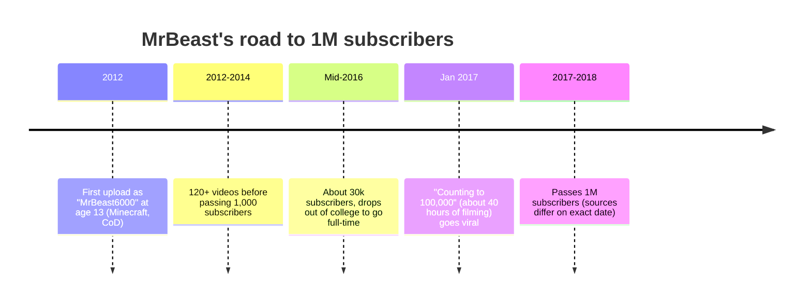
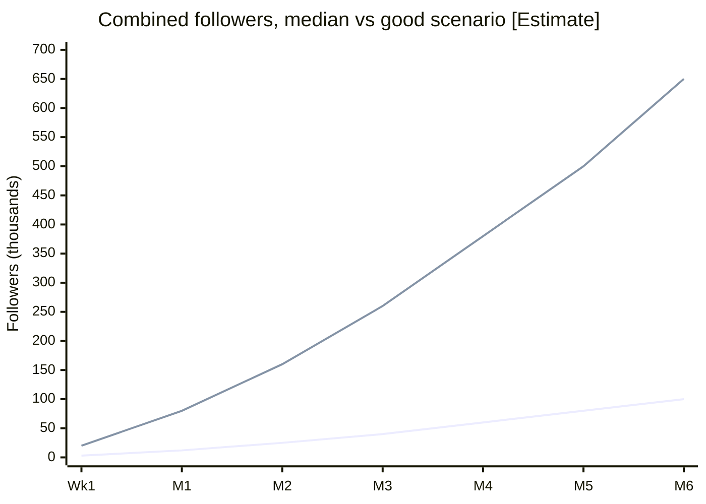

# 01 — Reality Check and Goals

> **Status:** reference · **Updated:** 2026-10-16 · **Related:** [06 Growth playbook](06-growth-playbook.md), [07 Execution roadmap](07-execution-roadmap.md), [12 Final portfolio](../2-channels/12-final-portfolio.md)

> Status: research draft, 2026-10-16. Scope: 10 faceless, AI-produced channels across YouTube Shorts, Instagram Reels and Facebook Reels, scheduled through Buffer.
> Convention: **[Sourced]** means a figure taken from a cited source. **[Estimate]** means our own judgement, built from the sourced base rates below. Treat every estimate as a planning assumption that real data should replace within 30 days.

---

## 1. TL;DR

- **"0 to a million in a week" is achievable for *views*, not for *followers*.** One Short or Reel that breaks out can collect 1M+ views in a few days. Gaining 1M *followers* in a week has only been documented for already-famous people. Cristiano Ronaldo's channel passed 1M subscribers in under 90 minutes on 21 Aug 2024 because he already had hundreds of millions of fans elsewhere. We have no audience to bring over.
- **The base rates are harsh [Sourced, vidIQ, Jul 2026, 61.2M channels]:** 40.6% of channels with at least one subscriber reach 1k subscribers. Only 7.9% reach 10k, 1.3% reach 100k and 0.13% reach 1M.
- **Volume helps but guarantees nothing [Sourced, vidIQ, Sep 2026, 32.9M channels]:** among channels under 1k subscribers, 30.8% of those that uploaded 52 or more videos in 360 days crossed 1k. For those that uploaded 1 to 11 videos, the figure was 1.9%.
- **A documented faceless AI test:** Kapwing posted 60 videos (58 Shorts), reached 1k subscribers in 157 days and about 1.1M total views, and earned $0. None of its six internal testers reached monetisation within six months.
- **MrBeast was not a week-one story.** He uploaded from Feb 2012 and had about 30k subscribers by mid-2016. He passed 1M around 2017, after the "counting to 100,000" video. Years of obsessive iteration on CTR and retention came first.
- **Reframed North Star:** *1M combined views in week 1 (stretch), 10k combined followers by day 30, at least one channel YPP-eligible by day 90, and a kill/scale decision on every channel by day 45.*

---

## 2. Growth benchmarks: what actually happens

### 2.1 Population base rates (YouTube)

| Milestone | Share of channels that ever reach it | Source |
|---|---|---|
| 100 subs | 68.2% | vidIQ subscriber benchmarks, snapshot 20 Jul 2026 |
| 1,000 subs | 40.6% | same |
| 10,000 subs | 7.90% | same |
| 100,000 subs | 1.30% | same |
| 1,000,000 subs | 0.13% | same |

The sample is 61.2M channels with at least one public subscriber, so it already excludes empty channels. vidIQ also reports **median monthly subscriber gains** of +13 for channels with 1k–9.9k subscribers, +109 for 10k–99k and +672 for 100k–999k. Most channels that pass a milestone still grow slowly afterwards. In a separate CreatorDB study of 2.15M tracked channels, about **63% did not grow at all** over a 30-day window. Only about 76.7k channels have ever crossed 1M.

**Upload volume is the one lever we control [Sourced, vidIQ Sep 2026]:** the share reaching 1k within 360 days, by number of new uploads, was 0.20% for none, 1.86% for 1–11, 8.65% for 12–51 and 30.77% for 52 or more. vidIQ says this is a correlation, not proof that uploading causes growth. It is still the strongest argument for automation: 10 channels posting daily clear the 52-upload bar in under two months.

### 2.2 Documented case studies (fast and slow)

| Case | What happened | Date | Lesson | Source |
|---|---|---|---|---|
| UR Cristiano (Ronaldo) | 1M subs in under 90 minutes, reportedly 10M+ in about a day | 21 Aug 2024 | Speed like this comes from fame imported from elsewhere. The format had little to do with it. | Gulf News, Daily Pakistan |
| Bandar Apna Dost (India, AI-generated monkey Shorts) | About 2.07B views across 500+ videos. Kapwing estimates about $4.25M a year, a Social Blade-based estimate. | Reported Dec 2025 | Faceless AI *can* reach huge scale with a recognisable recurring character and hundreds of uploads. | Kapwing AI Slop Report, via TechSpot / Medianama |
| Cuentos Facinantes (US, Spanish-language AI) | About 5.95M subs and 1.28B views | Reported Dec 2025 | The winners are series built on recognisable IP and themes. | same |
| Kapwing internal faceless test | 1k subs in 157 days, 60 uploads, about 1.1M views, best video about 216k, $0 earned | Jun–Nov 2024 | This is the realistic median for a competent team. Growth came from narrowing to one niche and using search-style titles. | Kapwing blog |
| Unnamed creator (LinkedIn) | 6 months of AI Shorts ended at 640 subscribers | 2025 | Tools alone do not produce growth. | LinkedIn post (anecdotal) |
| AI slop survivorship | NeoMam later reported that 16 of Kapwing's top-100 AI channels had been deleted or had content removed | 2026 | Platform enforcement is a real tail risk for mass-produced AI channels. | NeoMam (secondary, unverified) |

Kapwing's report also found that 21% of the first 500 Shorts shown to a fresh account were AI-generated, and 33% were "brainrot". We are entering a crowded feed. Supply is not scarce; attention is.

### 2.3 Platform rules that cap the "fully automated" fantasy

- **YouTube (15 Jul 2025):** YPP's "repetitious content" policy was renamed and clarified as **"inauthentic content"**, targeting mass-produced, repetitive videos. AI use itself is allowed if the final output is original and adds value. Coverage cites YouTube's Rene Ritchie calling it a "minor update". Enforcement is still the main risk for 10 look-alike channels.
- **Facebook (Jul 2025):** Meta lowered distribution of unoriginal or reposted content. Accounts that repeatedly repost can lose monetisation. Meta removed about 10M impersonator profiles in H1 2025.
- **Instagram (2021 → Apr 2026):** Reels carrying other apps' watermarks are made less discoverable. Accounts that "mostly share content from others that you didn't make or meaningfully edit" are not recommended to non-followers. In Apr 2026 this extended from Reels to photos and carousels.
- **Shorts views:** since 31 Mar 2025, a Shorts "view" counts any start or replay. The stricter older count is now **"engaged views"**, and that is what YPP eligibility uses. Headline view counts therefore look inflated compared with what pays.

### 2.4 Guru claims vs reality

| Typical "YouTube automation" course claim | What the evidence says |
|---|---|
| "Faceless channels make $10k/mo passively" | Shorts RPM is cents. AIR Media-Tech's 2025 average is $0.33 per 1k views in the US and $0.01–0.10 in most other markets ([06](06-growth-playbook.md)). 10M Shorts views a month pays roughly $100–$3,300. |
| "Monetised in 30 days" | YPP needs 1k subs **plus** 10M qualified Shorts views in 90 days, or 4k long-form watch hours. Kapwing's six testers all missed it at six months. |
| "Just post AI videos daily, the algorithm does the rest" | Volume is necessary (see the 52+ uploads data) but not sufficient. Mass-produced, repetitive content is now explicitly demonetisable. |
| "Proven playbook, guaranteed" | The FTC has sued at least four "automation"/passive-income operations since mid-2023, including Click Profit (permanently banned from the industry, Aug 2025) and Ascend Ecom (at least $25M allegedly lost by consumers). These schemes market heavily on YouTube, Instagram and TikTok. |

The *mechanics* in these courses (hooks, volume, niching) are mostly right. The *timelines and income claims* are mostly marketing.

---

## 3. What MrBeast actually did

### 3.1 The grind (timeline)

It took him roughly **five years and hundreds of uploads** to reach 1M. What happened in between was analysis: he and his friends studied what made videos retain viewers.

### 3.2 Principles from "How to Succeed in MrBeast Production"

This is a leaked onboarding PDF that circulated in Sep 2024 and was summarised by Simon Willison. Its authenticity has not been officially confirmed.

| Principle | Memo quote | What it means for us |
|---|---|---|
| Three metrics rule everything | CTR, AVD, AVP: "you must get their AVD and AVP as high as possible." | For Shorts, the CTR-equivalent is *viewed vs swiped away*. AVD/AVP stay the same. |
| Packaging comes first | "The creative process for every video... starts with the title and thumbnail." | Write the hook and first frame before the script. |
| Packaging sets expectations | "The title and thumbnail... set the expectations for the viewer." | The first second must deliver what the cover or title promised. |
| The opening is sacred | "The first minute of each video is the most important minute." | For a 30s Short, the "first minute" is the first 1–3 seconds. |
| Show, don't tell | "Stop telling people what they will be watching and start showing them." | Open with the payoff image, not "In this video...". |
| Re-engagement | Re-engagements are "highly interest[ing]" beats that fit the story. Minutes 1–3, 3–6 and 6–end each have a defined job. | Put a visual or story change every 2–4 seconds. |
| Never signal the end | "Don't ever signal the end of the video unless it's to build hype for the... payoff." | No outros. End on a line that loops into the opening. |
| No dull moments | "No dull moments in videos." | Cut any second that doesn't advance curiosity. |
| Wow factor | "It's important we never lose our wow." | Every video needs one moment worth sending to a friend, which is Instagram's top unconnected signal. |
| A-players learn | A-players are "obsessive, learn from mistakes, coachable." | Our automation must include a learning loop, not just a posting loop. |

MrBeast's scale comes from production budgets and thousands of iterations. We can copy the **discipline** (packaging first, retention obsession, ruthless iteration) cheaply. We cannot copy the spectacle.

---

## 4. Views vs followers

| | 1M views | 1M followers |
|---|---|---|
| What it takes | One breakout Short or Reel, or the sum across 30 accounts | Sustained hits *plus* a reason to follow (a series or character) |
| Week-1 feasibility | Plausible as a stretch goal | Not realistic without an existing audience |
| Why the gap | Shorts and Reels feeds serve non-followers. Views are cheap. | Most viewers swipe on. Follow rates on viral Shorts are typically well under 1%. **[Estimate]** |
| Pays? | Only engaged/qualified views, and only after YPP or Meta eligibility | Followers unlock monetisation thresholds and trial reels (IG needs 1k followers) |

---

## 5. Probability-weighted outcome table

**[Estimate]** The assumptions: 10 niches × 3 platforms = 30 accounts, 1–2 posts per channel per day, AI production with human QA on hooks, no paid promotion and no existing audience. The probabilities come from the vidIQ base rates (adjusted upward for high volume) and the Kapwing case. Each row is a mutually exclusive outcome for the whole portfolio. These are planning numbers, not forecasts.

### Combined views (all 30 accounts)

| Outcome | Week 1 | Month 1 | Month 3 | Month 6 |
|---|---|---|---|---|
| Low | < 100k: **35%** | < 1M: **30%** | < 5M: **25%** | < 20M: **25%** |
| Base | 100k–1M: **45%** | 1M–10M: **45%** | 5M–50M: **45%** | 20M–200M: **45%** |
| Good | 1M–10M: **17%** | 10M–100M: **20%** | 50M–500M: **25%** | 200M–1B: **25%** |
| Breakout | > 10M: **3%** | > 100M: **5%** | > 500M: **5%** | > 1B: **5%** |

### Combined followers (all 30 accounts)

| Outcome | Week 1 | Month 1 | Month 3 | Month 6 |
|---|---|---|---|---|
| Low | < 1k: **50%** | < 3k: **30%** | < 10k: **25%** | < 30k: **25%** |
| Base | 1k–10k: **40%** | 3k–30k: **50%** | 10k–100k: **45%** | 30k–300k: **45%** |
| Good | 10k–100k: **9%** | 30k–300k: **17%** | 100k–1M: **25%** | 300k–1M: **20%** |
| Breakout | > 100k: **1%** (1M: ~0%) | > 300k: **3%** | > 1M: **5%** | > 1M: **10%** |

### Milestones

| Milestone | P(by month 1) | P(by month 3) | P(by month 6) |
|---|---|---|---|
| Any single Short or Reel ≥ 1M views | 25% | 50% | 65% |
| ≥ 1 channel meets YPP (1k subs + 10M Shorts views/90d) | 5% | 25% | 45% |
| ≥ 1 IG account at 1k followers (unlocks trial reels) | 55% | 85% | 95% |
| Any channel penalised (demonetised, unrecommendable or removed) | 10% | 25% | 35% |
| Portfolio ad revenue > $1k/month | 2% | 15% | 30% |

**How to read this:** the *median* path is about 100k–1M views and a few thousand followers in month 1, with growth concentrated in 2–3 channels that find a repeatable series. "1M followers in a week" sits in the far tail at roughly 0%.

*Lower line: median scenario. Upper line: good scenario (about 75th percentile). The MrBeast/Ronaldo line would leave the chart in week 1.*

---

## 6. Reframed goals and North Star metrics

### 6.1 North Star

> **Weekly engaged/qualified views across the portfolio**: the views that actually count toward monetisation, as opposed to raw plays. It is the leading indicator of both revenue and follower growth.

### 6.2 Staged targets

| Horizon | Goal | Type |
|---|---|---|
| Week 1 | All 30 accounts live with ≥ 7 native posts each. **1M combined views (stretch). 250k combined views (commit).** | Output + views |
| Week 2 | Identify the top 3 channels by views-per-post and viewed-vs-swiped rate | Learning |
| Month 1 | **10k combined followers.** ≥ 1 video ≥ 1M views. ≥ 3 IG accounts at 1k followers (trial reels unlocked). | Followers |
| Day 45 | **Kill/scale review:** retire or re-niche the bottom 3–5 channels and move their production capacity to the winners | Portfolio |
| Month 3 | ≥ 1 YouTube channel YPP-eligible. 100k combined followers (stretch). First affiliate or digital-product revenue. | Monetisation |
| Month 6 | 2–3 "hero" channels at ≥ 100k followers on their best platform. Portfolio revenue covers tooling costs. | Business |

### 6.3 Guardrail metrics (must not regress)

- **Zero** community-guideline strikes. **Zero** "not eligible for recommendation" flags in IG Account Status.
- Fact-error rate < 1 per 50 videos, since AI scripts hallucinate and Kapwing viewers called errors out in comments.
- Each channel looks visibly distinct (voice, palette, format), which reduces the risk of an "inauthentic / mass-produced" judgement.

---

## Sources

Some pages blocked direct fetching (e.g. TechSpot, Thurrott, NBC); those are cited from search-result summaries of the same URLs.

- vidIQ Research: YouTube subscriber benchmarks 2026: https://vidiq.com/research/youtube-subscriber-benchmarks-2026/
- vidIQ Research: Uploads and reaching 1,000 subscribers: https://vidiq.com/research/youtube-uploads-1000-subscribers/
- vidIQ: YouTube subscriber growth statistics: https://vidiq.com/blog/post/youtube-subscriber-growth-statistics/
- CreatorDB: State of the creator economy: https://creatordb.app/research/state-of-the-creator-economy/
- Kapwing: We grew a faceless YouTube channel to 1,000 subscribers: https://kapwing.com/resources/we-grew-a-faceless-youtube-channel-to-1000-subscribers
- TechSpot: Over 21% of YouTube is now AI slop (Kapwing report): https://www.techspot.com/news/110735-over-21-youtube-now-ai-slop-report.html
- Medianama: AI slop videos on YouTube: https://www.medianama.com/2025/12/223-ai-slop-videos-youtube
- NeoMam: YouTube AI slop report: https://neomam.com/projects/youtube-ai-slop-report/
- LinkedIn creator post (anecdotal): https://pk.linkedin.com/in/faadixd
- Gulf News: Ronaldo YouTube record: https://gulfnews.com/sport/football/cristiano-ronaldo-breaks-world-record-with-new-youtube-channel-1.1724306414865
- Daily Pakistan: Ronaldo 1M in 90 minutes: https://en.dailypakistan.com.pk/21-Aug-2024/cristiano-ronaldo-breaks-youtube-records-gaining-1-million-subscribers-in-90-minutes
- Simon Willison: How to succeed in MrBeast production: https://simonwillison.net/2024/Sep/15/how-to-succeed-in-mrbeast-production/
- Alexander Jarvis: Memo text, How to succeed in MrBeast production: https://www.alexanderjarvis.com/memo-how-to-succeed-in-mrbeast-production/
- Creator Handbook: Leaked MrBeast document takeaways: https://www.creatorhandbook.net/leaked-document-allegedly-reveals-mrbeasts-secrets-to-youtube-success-the-key-takeaways/
- Looper: The untold truth of MrBeast: https://www.looper.com/711096/the-untold-truth-of-mrbeast/
- YouTube Help: YPP overview and eligibility: https://support.google.com/youtube/answer/72851
- Tubefilter: YouTube changes how Shorts views are counted (Mar 2025): https://www.tubefilter.com/2025/03/26/youtube-shorts-views-counting-stats/
- Thurrott: YouTube "inauthentic" content update: https://www.thurrott.com/?p=323183
- BetaNews: YouTube monetisation guidelines vs AI slop: https://betanews.com/2025/07/10/youtube-is-fighting-ai-slop-with-new-monetization-guidelines/
- Influencer Marketing Hub: Facebook push against unoriginal content: https://influencermarketinghub.com/facebook-push-against-unoriginal-content/
- The Star: Facebook purge of spammy and unoriginal content: https://www.thestar.co.uk/business/consumer/facebook-deletes-accounts-purge-on-spam-5236208
- SociallyIn: Instagram repost/originality update (Apr 2026): https://sociallyin.com/blog/instagram-algorithm-update-repost/
- Tubefilter: Instagram de-prioritises TikTok-watermarked Reels: https://tubefilter.com/2021/02/10/instagram-reels-with-tiktok-watermark-less-discoverable/
- NBC News: FTC on "passive income" automation schemes: https://www.nbcnews.com/news/rcna172871
- FTC case listing (Click Profit): https://oig.ftc.gov/legal-library/browse/cases-proceedings?page=2
- AIR Media-Tech: Shorts RPM by country: https://air.io/en/monetization/what-rpm-can-you-expect-from-shorts-in-2025
