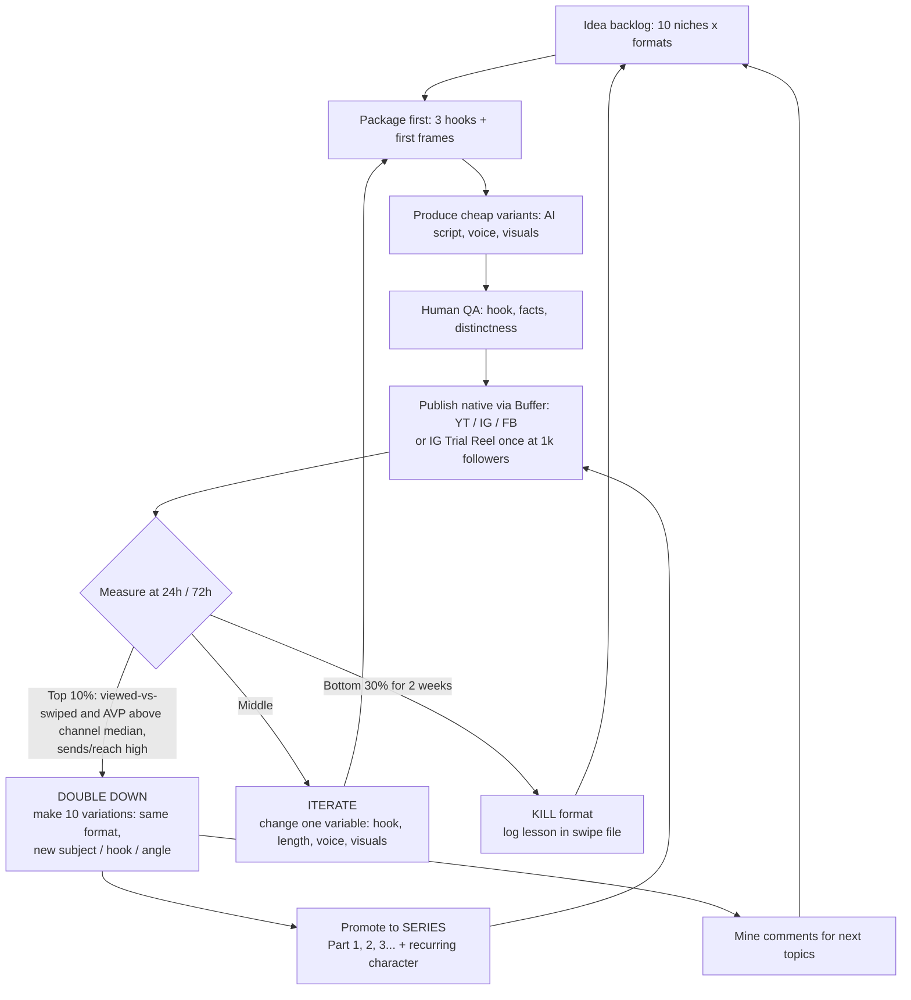

# 06 — Growth Playbook

> **Status:** current · **Updated:** 2026-10-16 · **Related:** [01 Reality check](01-reality-check-and-goals.md), [07 Execution roadmap](07-execution-roadmap.md), [05 Buffer distribution](../5-automation/05-distribution-buffer.md)

> Status: research draft, 2026-10-16. Companion to [01-reality-check-and-goals.md](01-reality-check-and-goals.md).
> **[Official]** = stated by YouTube or Meta, or their executives. **[Practitioner]** = a widely used creator heuristic that is not officially confirmed. **[Estimate]** = our own planning number.

---

## 1. The top rules (read this if nothing else)

1. **Packaging first.** Write the hook line and first frame before the script, as MrBeast does with the title and thumbnail.
2. **Win the first 1–3 seconds or nothing else matters.** On Shorts the main signal is *viewed vs swiped away*.
3. **Optimise for sends, not likes, on Instagram.** Sends per reach matter most for reaching non-followers. [Official, Mosseri]
4. **Post native, clean, original files to each platform.** No watermarks from other apps and no straight reposts of other people's content. [Official]
5. **Run the loop:** test many cheap variants → measure at 24–72h → make 10 variations of each winner → kill losers fast.

---

## 2. Hooks: the first 1–3 seconds

YouTube does not publish hook rules. YouTube's Shorts lead Todd Sherman said **"the audience is the algorithm"**: Shorts are shown to a seed audience, then expanded or throttled depending on whether those viewers watch or swipe [Official, via SEJ/Outlier Kit]. The formulas below are [Practitioner] patterns. Each video must open with **visual + on-screen text + spoken line delivering the same promise at the same time**.

| # | Formula | Template | Faceless example |
|---|---|---|---|
| 1 | Result first | "[Shocking end state]... here's how." | Open on the collapsed bridge, then "This bridge fell in 4 seconds." |
| 2 | Curiosity gap | "Nobody talks about why [X]." | "Nobody explains why pilots dim cabin lights." |
| 3 | Contrarian | "[Common belief] is wrong." | "Goldfish memory is a myth." |
| 4 | Stakes/countdown | "You have 3 seconds to spot..." | Spot-the-difference series |
| 5 | List with a payoff tease | "3 [things]. #1 is insane." | Count down so the best item comes last, which keeps viewers watching |
| 6 | Direct callout | "If you [identity], stop scrolling." | "If you own a cat, watch this." |
| 7 | Mid-action cold open | Start mid-motion with no intro, logo or "hey guys" | AI animation already in motion at frame 1 |
| 8 | Question they want answered | "What happens if [scenario]?" | "What if the Moon disappeared?" |

**Hook QA checklist (human-in-the-loop):** frame 1 is visually striking with no black or logo frame. Text is readable in about 1 second at ≤ 7 words. The promise in the first second matches the title or cover. Nothing in the first 3 seconds is pure setup.

---

## 3. Retention editing and loops

From the MrBeast memo: "Stop telling people what they will be watching and start showing them". Use re-engagements, "No dull moments", and never signal the end. Applied to short form [Practitioner]:

- **Change something every 2–4 seconds:** a cut, zoom, new visual, text pop or sound cue.
- **Open loops:** tease the payoff early ("the last one is the craziest") and pay it off in the final second.
- **Cut the air:** no pauses between sentences. Speed narration to roughly 1.1–1.2× if the AI voice drags.
- **Length:** both platforms now allow up to 3 minutes. YouTube made Shorts up to 3 minutes for square or taller video from 15 Oct 2024, and Instagram made Reels up to 3 minutes in Jan 2025 [Official]. For new faceless channels, default to **15–45s** so completion and replay rates stay high. Increase length only on formats where AVP holds. [Practitioner]
- **Loop structure:** make the final line flow grammatically into the first line ("...and that's why" → "this bridge fell in 4 seconds"), or match the last frame to the first. A replay now counts as a view on Shorts (since 31 Mar 2025) and lifts AVP above 100%. [Official for view counting; loop benefit is Practitioner]
- **No outros or "subscribe" end cards in the last second.** If you ask for a follow, ask mid-video and tie it to the series ("Part 2 tomorrow"). Kapwing found explicit subscribe asks matter *more* for faceless channels.

---

## 4. Packaging process (titles, covers, thumbnails)

1. **Ideate 10 titles or hooks per concept.** Use an LLM to generate them and a human to pick 3.
2. **Shorts:** the title and first frame are the packaging. Feed viewers barely see titles, but search and the channel page show them, so write titles in search-friendly language ("Is Simone Biles injured?" worked for Kapwing).
3. **IG/FB Reels:** design a cover frame with large text for the profile grid. The on-screen hook text does the CTR work in the feed.
4. **Long-form (when a channel graduates):** use YouTube **Test & Compare**. It tests up to 3 titles and/or thumbnails, picks the winner by **watch time** (not CTR), and runs for a few days up to 2 weeks. It is desktop-only. **It is not available for Shorts.** [Official, YouTube Help]
5. Keep a **packaging swipe file**: every winner's hook text, first frame and title, tagged by formula number (section 2).

---

## 5. How the algorithms work (2025–2026, what's officially known)

### YouTube Shorts
- **Seed-and-expand:** each Short goes to a small test audience, and distribution grows or shrinks with their watch-vs-swipe behaviour. Sherman said Shorts may get "a few hundred or thousand views" and then stall while the system looks for an audience. [Official, via coverage]
- **Key Studio metric:** *Viewed vs swiped away* (Analytics → Content → Shorts).
- **View counting:** since 31 Mar 2025, any play or replay counts as a view. **Engaged views**, the old stricter count, determine YPP eligibility. [Official]
- **Originality:** the YPP "inauthentic content" clarification (15 Jul 2025) targets mass-produced or repetitive content. AI is allowed when the result is original and adds value. [Official, via coverage]
- Shorts views often keep accruing weeks after posting, as Kapwing observed, so don't delete slow starters too early.

### Instagram Reels (Mosseri, Jan 2025 series)
- "The top three signals... are **watch time, likes and sends**." Watch **average watch time, likes per reach and sends per reach**. "Likes are slightly more important for connected content, and **sends are slightly more important for unconnected content**." [Official]
- "Sends per reach" is described as one of the most important signals. Claims that a send is "3–5× a like" come from third parties and are **unverified**.
- **Originality:** Reels with other apps' logos are not recommended. Your *own* logo is fine. Accounts that mostly share content they didn't make or meaningfully edit are not recommended to non-followers, a rule extended to photos and carousels on 30 Apr 2026. Cropping, speed changes, watermarks or credit tags alone do **not** count as meaningful edits. Check **Account Status**. [Official, via coverage]
- **Trial Reels:** these are shown to non-followers first and hidden from the grid and from followers until you share them. Metrics appear after about 24h. Since Jul 2025 the feature is open to public accounts with **≥ 1,000 followers**, so new accounts can't use it in week 1. [Official, via coverage]

### Facebook Reels
- Meta says it is "rewarding original content creators for driving deeper engagement, longer watch time, and qualified views". Unoriginal reposts get reduced distribution and can lose monetisation (Jul 2025 crackdown). New dashboard metrics: **Qualified Views, Earnings Rate (per 1k qualified views), Non-Qualified Views**. [Official]

---

## 6. Posting frequency

| Phase | Per channel per platform | Rationale |
|---|---|---|
| Days 1–14 (explore) | **2/day** Shorts, 1–2/day Reels | Maximise shots on goal. vidIQ found that 52+ uploads in a year correlates with a 30.8% chance of reaching 1k, versus 1.9% for 1–11 uploads. [Sourced] |
| Days 15–45 (focus) | 1–2/day on formats that cleared the bar | Spend capacity on winners |
| Day 45+ (scale) | 1–3/day on hero channels. Kill or re-niche the rest. | Quality per post rises as the format matures |

Volume must not come at the cost of distinctness. Thirty near-identical accounts is exactly the "mass-produced" pattern the platforms penalise. [Estimate/Practitioner]

---

## 7. Cross-posting rules (one video → YT Shorts + IG Reels + FB Reels)

1. **Render one clean master per video:** 9:16, 1080×1920, no platform watermark. Never download from one app and re-upload to another.
2. **Upload natively to each platform via Buffer's API publishing.** Do not rely on in-app "share to" chains. We found no official statement that API-scheduled posts are penalised; treat that worry as unverified, but monitor reach of scheduled posts against manual posts in week 1.
3. **Vary per platform:** caption, hashtags, cover frame, and optionally on-screen CTA wording. Hook and body can stay identical, because cross-posting your *own* original content is not "reposting others' content".
4. **IG ↔ FB:** you can share an IG Reel to the linked FB Page. Uploading natively via Buffer gives you separate captions and cleaner analytics, so prefer it.
5. **Audio:** use licence-free or AI-generated music. Unlicensed tracks get muted, blocked or excluded from monetisation (Meta Non-Qualified Views).
6. **Stagger by 0–6h** if you want to learn each platform's response independently. Simultaneous posting is fine otherwise.

---

## 8. The experimentation loop

**The "1 winner → 10 variations" rule:** when a video beats the channel's median views by 3× or more, freeze its *format* (structure, length, pacing, voice) and vary one thing at a time. That variable is usually the subject ("hardest routine on beam" → floor → vault), then the hook formula. Kapwing's pattern was "Hardest routine on ___", which produced about 10 topics at under 20 minutes each. The largest AI channels (Bandar Apna Dost, Cuentos Facinantes) are recurring characters or IP run as series.

**Other growth levers:**
- **Series formats:** numbered parts, a recurring AI character, "Day N of..." formats. These give viewers a reason to *follow*, which turns views into followers.
- **Comment-driven content:** pin a question ("Which country next?"), then make the most-liked answer the next video and reply to the comment with it.
- **Collabs:** IG **Collab posts** (co-authored and shown to both audiences) between our own channels in adjacent niches, and later with external creators. Cross-promote hero channels from weaker ones.
- **Trial Reels A/B (≥ 1k followers):** post 2–3 hook variants of the same Reel as trials and share the winner to followers.
- **YouTube Test & Compare:** for long-form videos only.

---

## 9. KPI dashboard

| Metric | Target **[Estimate]** | Where to find it |
|---|---|---|
| Viewed vs swiped away (Shorts) | ≥ 70% viewed is good, < 50% needs a new hook | YT Studio → Analytics → Content → Shorts |
| Average % viewed / AVP (Shorts) | ≥ 80% for < 30s, > 100% means loops work | YT Studio → video → Engagement |
| Engaged views (90d, rolling) | 10M per channel to reach YPP | YT Studio → Analytics (Advanced mode) |
| Subs per 1k engaged views | ≥ 1 is fine, ≥ 3 is strong | YT Studio (Subscribers ÷ Engaged views) |
| IG average watch time | ≥ 60% of Reel length | IG Insights → Reel → Watch time |
| IG sends per reach | ≥ 1% is good, ≥ 3% is breakout | IG Insights (Shares ÷ Accounts reached) |
| IG likes per reach | ≥ 3% | IG Insights |
| IG follows per reel | Track the trend | IG Insights → Reel → Follows |
| FB Qualified Views / Earnings Rate | Track the trend, Non-Qualified < 20% | FB Professional Dashboard → Monetization |
| Views per post (median, per channel) | Beat the previous 14-day median | Buffer analytics / native |
| Hit rate (posts ≥ 3× channel median) | ≥ 10% of posts | Our sheet / DB |
| Account health | 0 strikes, all "recommendable" | YT Studio, IG Account Status, FB Support Inbox |

Review cadence: a **daily** 15-minute triage (24h numbers), a **weekly** portfolio review (rank channels, reallocate production), and a **day-45** kill/scale decision.

---

## 10. Monetisation

### 10.1 Eligibility (official)
- **YouTube YPP (ads):** 1k subscribers **plus** 4k public long-form watch hours in 12 months, **or** 10M qualified Shorts views in 90 days. Shorts feed watch time does not count toward the 4k hours. Shorts ad revenue goes into a pool, and creators receive **45%** of their allocated share (announced at launch in 2022–23).
- **Facebook Content Monetization:** a single program covering Reels, long-form, Stories, photos and text. It replaced Performance Bonus, Ads on Reels and In-stream ads, which ended 31 Aug 2025. It is **still largely invite-only**. Creator Fast Track (Mar 2026) pays creators with ≥ 100k followers elsewhere $1k–3k a month for 3 months. Meta paid creators about $3B in 2025, 60% of it via Reels.
- **Instagram:** there is no general ad-revenue share. Bonuses are invite-only and vary by region. Subscriptions reportedly need about 10k followers (third-party claim). Gifts have a low threshold. Brand deals, via the Creator Marketplace, are the main income source.

### 10.2 Revenue table (RPM = creator earnings per 1,000 views, **all estimates**)

| Stream | Rough RPM / value | Unlocks at | Notes |
|---|---|---|---|
| YT Shorts ads | **$0.01–$0.33** (US avg about $0.33, India about $0.01 per AIR 2025) | YPP | Strongly geography-dependent. English/US audiences matter. |
| YT long-form ads | **$1–$8** typical. Finance $10–25+. | YPP | Q4 CPMs run 30–40% above other quarters. Graduating hero channels to long-form is the biggest RPM lever. |
| FB Reels (Content Monetization) | **$0.02–$0.20** (outliers $0.30+) | Invite | Paid on *qualified* views only |
| IG Reels native | ~$0 for most. Bonuses invite-only. | Invite | Don't model it |
| Brand deals (IG/YT) | Commonly quoted at about $10 per 1k followers per post, which is a widely cited heuristic, not verified **[Estimate]** | About 10k+ engaged followers | Faceless accounts earn less than personality accounts |
| Affiliate links | Varies. Bio link, pinned comment, YT description. | Day 1 | Works best in product-adjacent niches (tech, finance, home) |
| Digital products | Prompt packs, templates, guides at $5–$49 | Day 1 | Highest margin. Needs an audience with intent. |
| Selling channels | About **12–36× monthly net profit** (Flippa). Faceless channels get a premium. | Stable revenue for 3–6+ months | Platforms: Flippa, Empire Flippers, Fameswap |

**Worked example [Estimate]:** a hero channel with 10M Shorts views a month, 60% from the US, UK and Canada, earns roughly 10,000 × ~$0.20 ≈ **$2k/month** from Shorts ads. The same audience moved to 500k long-form views at a $4 RPM earns about $2k more. Shorts ad revenue alone will not fund 10 channels. The model is **Shorts for reach → long-form, affiliate and products for revenue → channel sale as an exit**.

---

## Sources

Some pages blocked direct fetching (for example TechSpot and Thurrott). Those are cited from search-result summaries of the same URLs.

- YouTube Help: YPP eligibility: https://support.google.com/youtube/answer/72851
- YouTube Help: Test & compare titles/thumbnails: https://support.google.com/youtube/answer/13861714
- Social Media Today: YouTube adds title testing (Jul 2025): https://www.socialmediatoday.com/news/youtube-adds-title-testing-youtube-studio/753015/
- Search Engine Journal: Thumbnail A/B testing to all channels: https://searchenginejournal.com/youtube-rolls-out-thumbnail-a-b-testing-to-all-channels/519281
- Search Engine Journal: YouTube explains the Shorts algorithm: https://www.searchenginejournal.com/youtube-explains-how-shorts-algorithm-works/494953/
- Outlier Kit: Shorts algorithm in YouTube's words: https://outlierkit.com/resources/youtube-shorts-algorithm/
- vidIQ: Shorts algorithm: https://vidiq.com/blog/post/youtube-shorts-algorithm/
- Tubefilter: Shorts view counting change: https://www.tubefilter.com/2025/03/26/youtube-shorts-views-counting-stats/
- vidIQ Research: uploads vs 1k subscribers: https://vidiq.com/research/youtube-uploads-1000-subscribers/
- ppc.land: Shorts extended to 3 minutes: https://ppc.land/youtube-expands-shorts-duration-to-3-minutes/
- Business Today: Instagram 3-minute Reels (Jan 2025): https://www.businesstoday.in/technology/news/story/instagram-head-announces-big-changes-3-minute-reels-and-new-look-for-profile-grid-461527-2025-01-21
- Social Media Today: Instagram algorithm insights 2025 (Mosseri): https://www.socialmediatoday.com/news/instagram-shares-algorithm-insights-2025/738034/
- Search Engine Journal: Sends matter more than ever: https://searchenginejournal.com/instagram-algorithm-shift-why-sends-matter-more-than-ever/521389
- Social Media Today: Own logo on Reels is OK: https://www.socialmediatoday.com/news/instagram-clarifies-that-including-your-own-logo-on-a-reel-is-ok/730852/
- Fast Company: Mosseri on originality/aggregators: https://www.fastcompany.com/90744109/instagram-tiktok-algorithm-adam-mosseri
- SociallyIn: Instagram originality expansion (Apr 2026): https://sociallyin.com/blog/instagram-algorithm-update-repost/
- Social Samosa: Wider access to Trial Reels: https://www.socialsamosa.com/news-2/instagram-introduces-wider-access-trial-reels-9493132
- Net Influencer: Instagram Trial Reels: https://www.netinfluencer.com/instagram-new-trial-reels/
- Meta Newsroom: Creator Fast Track (Mar 2026): https://about.fb.com/news/2026/03/creator-fast-track-grow-your-audience-earn-money-on-facebook/amp/
- Buffer: How to make money on Facebook (2026): https://www.buffer.com/resources/how-to-make-money-on-facebook/
- Post Bridge: Facebook Reels pay per 1,000 views: https://post-bridge.com/blog/how-much-does-facebook-reels-pay-per-1000-views
- Influencer Marketing Hub: Facebook vs unoriginal content: https://influencermarketinghub.com/facebook-push-against-unoriginal-content/
- AIR Media-Tech: Shorts RPM by country: https://air.io/en/monetization/what-rpm-can-you-expect-from-shorts-in-2025
- Outlier Kit: RPM benchmarks by niche: https://outlierkit.com/resources/youtube-rpm-benchmarks/
- NBC News: YouTube Shorts revenue sharing (45%): https://www.nbcnews.com/tech/youtube-shorts-revenue-sharing-partner-program-music-license-rcna48635
- Flippa: YouTube channel valuation guide: https://flippa.com/blog/how-much-is-my-youtube-channel-worth-a-complete-valuation-guide/
- Gumlet: How to monetize Instagram: https://www.gumlet.com/learn/how-to-monetize-instagram/
- Kapwing: Faceless channel to 1k subscribers: https://kapwing.com/resources/we-grew-a-faceless-youtube-channel-to-1000-subscribers
- Alexander Jarvis: MrBeast production memo: https://www.alexanderjarvis.com/memo-how-to-succeed-in-mrbeast-production/
- Simon Willison: MrBeast memo summary: https://simonwillison.net/2024/Sep/15/how-to-succeed-in-mrbeast-production/
