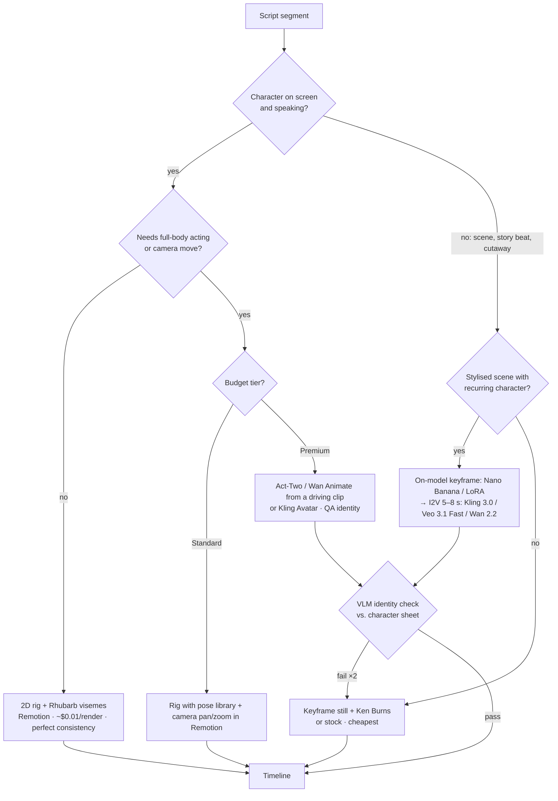
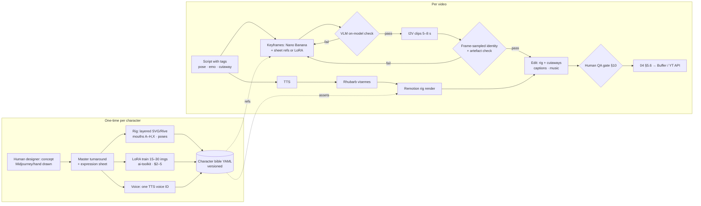

# 10 — Cartoon and Animated AI Characters: Consistency, Animation, Repos, Cost and QA

> Status: research and proposal, as of **2026-10-16**. GitHub stars, licences and last-push dates were read from the GitHub API that day. Prices come from vendor pages where possible; anything from aggregators or blogs is marked *(secondary)*. Every cost figure is an **estimate**.
>
> Scope: recurring **cartoon, anime or stylised 3D characters** as hosts or story casts for the 10 channels. This doc extends [04](04-content-pipeline-architecture.md) (pipeline, base vendor prices, base cost per video) and assumes the policy rules in [03](03-platform-policies-and-risks.md). It doesn't repeat them. Realistic avatars, niche choice and policy each have their own docs.

---

## 1. TL;DR

- **Consistency is the whole game, and generative video still drifts.** Every AI image or video tool "mostly" keeps a character on-model for a few shots. None is reliable over hundreds of videos without a reference pack and a QA gate. The only approach that is **100% consistent** is a **rigged 2D puppet** (Rive, Spine, Live2D, or SVG layers in Remotion), because the character is the same asset every time.
- **Recommended: a hybrid.** A **rigged 2D mascot** delivers every talking segment: lip-sync from Rhubarb visemes, rendered in Remotion, costing about $0.01 per render. **AI image-to-video cutaways** (Kling 3.0, Veo 3.1 Fast, or Wan 2.2 self-hosted), seeded from on-model keyframes, cover the "story" shots. Talking parts are where viewers notice drift; cutaways are where AI looks impressive.
- **The cheapest, most consistent styles** are flat 2D vector with thick outlines, a limited palette, and simple shapes (in the spirit of Kurzgesagt or Duolingo). Next come **cel-shaded anime "chibi-less" adults** and **stylised 3D clay**. Avoid painterly or semi-realistic styles, which drift the most, and characters with fine patterns (logos, stripes, freckles).
- **Estimated cost per Short** *(est.)*: rig-only about **$0.35–0.70**, which matches the Standard tier in 04. Hybrid with 10–15 s of AI cutaways is about **$1.2–2.5**. Fully AI lip-synced is about **$5–9**. **Per 9-minute long-form:** rig-only about **$3.5–6**, hybrid with about 60 s of cutaways about **$10–16**, fully AI about **$60–110**. See §8.
- **Kids are the main hazard.** YouTube treats animated characters as a made-for-kids signal. AI kids' cartoons were the main target of 2025–2026 terminations and demonetisations (WIRED, NYT, Fairplay). Design characters with an **adult coding**: adult voice, adult topics, no child protagonists, no nursery palette. Set "Not made for kids" on purpose (§9).
- **Best channel fits:** Money Mechanics, Mind Facts, Cosmic What If, Night Shift Tales and Was I Wrong? (strong). History Unboxed, 60-Second IQ and Stoic Edge (medium). **Wild Facts** (cartoon animals read as kids' content) and **AI Daily Brief** (needs screen captures) are a poor fit (§6).

---

## 2. Character consistency: image generation (keyframes and reference packs)

| Tool | How it keeps a character | Consistency on cartoon IP *(our judgement)* | Cost | API for automation | Commercial terms | Notes and limits |
|---|---|---|---|---|---|---|
| **Nano Banana Pro** (Gemini 3 Pro Image) / Nano Banana 2.x | Multi-image reference: up to **14 refs**, about **5 characters** tracked *(secondary)* | High for flat 2D; good for multi-character scenes | ~$0.034–0.067 per 1K image (04 §4); Pro ~$0.20 | Yes (Gemini API) | Google gen-AI terms; SynthID watermark | Best default keyframe engine. Tag refs as "character_1 = image 1". |
| **GPT Image 2** (OpenAI) | Reference-based edit: up to **16 refs** *(secondary)* | Good; drifts over long chat sessions | ~$0.006 / $0.053 / $0.21 per 1024² (low/med/high) *(secondary)*, plus input tokens for refs | Yes | OpenAI terms; you own output | Strong at text in images. Re-feed the canonical sheet each call; don't chain outputs. |
| **FLUX.1 Kontext pro/max** (BFL) | In-context edit from one ref image | High for pose and expression edits of one character | **$0.04 / $0.08 per image** (BFL credits) | Yes (BFL, fal, Replicate) | Pro/max outputs are commercial; *dev* weights are non-commercial | Good for expression sheets from a master image. |
| **Ideogram Character** (3.0/4.5) | Character reference: 1–5 refs in the app, **1 in the API** | Built for faces; cartoon input isn't documented | Credits; per image on resellers | Yes (`/v1/ideogram-v3/generate`, `character_reference_images`) | Commercial use allowed under ToS | Best for typography-heavy thumbnails featuring the mascot. |
| **Midjourney V7** `--oref` / `--cref` | Omni-reference: 1 image, `--ow` weight | Good style; reported failure rate over 50% *(secondary)* | From $10/mo | **No official API.** ToS bars automation *(secondary)* | Paid plans are commercial | Use **by hand only**, to design the master sheet. Never in the pipeline. |
| **Character LoRA** (Flux, SDXL, Wan) | Fine-tune on 15–30 on-model images | **Highest of the generative options** once trained | fal turbo Flux trainer **$2.40 per 1k steps**; self-host is ~free | Yes (fal, Replicate, or self-host with ai-toolkit or kohya) | Flux **dev** base is non-commercial for the weights. Use Flux pro fine-tune or an SDXL/Apache base, or confirm the BFL licence | One LoRA per character. Retrain after any redesign. Version it in the bible. |
| **ComfyUI** workflows (IPAdapter, PuLID, ControlNet, LoRA stacks) | Composable: LoRA, ref, pose ControlNet | Highest control; needs an operator | GPU time only | Yes (ComfyUI HTTP API, headless) | ComfyUI is GPL-3.0 (fine to run as a service); check each model's licence | Best for batch keyframes with locked pose and camera. |

**Rule:** the **character sheet is the source of truth**, never "the last good frame". Every generation call gets the canonical turnaround plus the expression sheet as references (or the LoRA), so drift can't build up across videos.

---

## 3. Animating characters

### 3.1 Comparison table

| Approach / tool | Type | Consistency | Cost per second *(as seen)* | API | Commercial / licence | Length limit |
|---|---|---|---|---|---|---|
| **Kling 3.0 std/pro, O3** | I2V, start/end frame, multi-ref | Good with start frame; identity drifts after ~5 s | $0.09 / $0.12 per s silent, $0.13 / $0.17 with audio (Runway API) | Yes (Kling direct, Runway, fal) | Paid output is commercial | 5–10 s per clip (15 s on some tiers) |
| **Kling AI Avatar / lip-sync** | Image + audio → talking clip | Good on stylised or cartoon faces *(secondary)* | ~$0.045–0.09 per s *(secondary)* | Via resellers | Commercial on paid plans | Up to 5–10 min per job *(secondary, conflicting)* |
| **Veo 3.1 Fast / Standard** ("Ingredients to video") | I2V with **up to 3 ref images** | Very good for character plus scene | $0.10–0.15 per s (Fast) / $0.20–0.40 per s | Yes (Gemini API, Vertex, Runway) | Google terms; SynthID | 8 s per clip; extend is possible |
| **Runway Gen-4 Turbo / Gen-4.5** | I2V | Good | **$0.05 / $0.12 per s** | Yes (one key, also resells Kling, Veo, Wan, Hailuo) | Paid plans are commercial | 5–10 s |
| **Runway Act-Two** | Performance capture (driving video → character) | High for face and body acting | **$0.05 per s** | Yes (`act_two`) | Commercial | Short clips |
| **Hailuo 2.3 / MiniMax H3** | I2V | Good motion; average identity | Hailuo 2.3: $0.28 per 6 s at 768p; H3 ~$0.08 per s *(secondary)* | Yes (MiniMax, Runway `h3_max` $0.05–0.08 per s) | Commercial on paid plans | 6–10 s (Hailuo); up to 15 s (H3) |
| **Pika 2.5 / Pikaformance** | I2V, lip-sync | Average | n/a | Unclear: web-first, partly through fal *(secondary)* | Paid plans | Short clips. **Don't build on it.** |
| **Wan 2.2 (open)** I2V-A14B, TI2V-5B, **S2V-14B**, **Animate-14B** | I2V; speech→video; motion transfer and character replacement | Good; best of the open models; LoRA-able | Self-host GPU: ~$0.02–0.10 per s *(our est.)*. 5B runs on a 24 GB GPU; 14B needs 80 GB | Self-host (ComfyUI, Diffusers) | **Apache-2.0** (weights and code) | ~5 s per clip at 720p; S2V follows the audio |
| **Wan 2.5 / 2.6 / "wan3"** | I2V with audio | Good | Runway `wan3` $0.05–0.20 per s | API only | Commercial through the API; **weights not open** *(secondary)* | Up to 15 s |
| **HunyuanVideo 1.5** (open) | T2V, I2V | Good | Self-host; **14 GB VRAM** with offload | Self-host | Tencent Hunyuan Community licence (historically excluded EU, UK and South Korea; **verify**) | ~5 s (121 frames) at 480/720p |
| **Viggle** | Motion transfer (meme dances) | Good for full body; weak on faces | ~$0.01 per s API *(secondary)* | Unclear *(conflicting)* | Paid plan needed; free tier is watermarked | Short |
| **Hedra Character-3** | Image + audio → talking | Good on cartoons and non-humans | 3–6 credits per s ($15 = 1,500 credits) *(secondary)* | Yes (developer platform) | Paid plans | Per-second billing |
| **Adobe Character Animator** | Layered PSD/AI puppet, live lip-sync | **Perfect** (it's a rig) | CC Pro ~$70/mo (Starter free) *(secondary)* | **No headless API** | Commercial | Unlimited. Manual or semi-manual only. |
| **Reallusion Cartoon Animator 5** | 2D rig, auto lip-sync, motion library | **Perfect** | ~$149 perpetual *(secondary)* | No (desktop; scriptable only in a limited way) | Royalty-free output, YouTube OK (staff forum post) | Unlimited |
| **Live2D Cubism** | Mesh-deformed 2D rig (VTuber style) | **Perfect** | PRO subscription; "for business" licence needed above ¥10M annual sales | SDK (Web/Unity) can be driven headless | Video output OK. SDK publishing needs a contract per work | Unlimited |
| **Rive** | Vector state-machine rig | **Perfect** | Free (splash screen) / Cadet $9 per seat per mo | Runtimes (JS, etc.); render frames headless | Paid plans remove the splash | Unlimited; MP4/WebM export |
| **Spine** | Bone-based 2D skeletal rig | **Perfect** | Essential/Pro one-off licence (verify price) | Runtimes; Rhubarb plugin | Commercial | Unlimited |
| **Remotion + SVG/PNG puppet** | Code-driven layers: mouth from Rhubarb visemes, blinks, poses | **Perfect** | **$0.01 per render** (Automators, $100/mo minimum); free for teams of 3 or fewer | Yes (it *is* code) | Company licence | Unlimited |

### 3.2 What the rig approach looks like

The puppet is 10–30 layers: body poses (4–6), head angles (3), eyes (open/half/closed plus 4 emotions), brows (5), and **mouths A–H plus X** (Rhubarb's Preston-Blair set). **Rhubarb Lip Sync** turns the TTS WAV (plus the script text, for accuracy) into a JSON cue list. A Remotion component then swaps the mouth sprite on each cue, blinks every 2–6 s at random, and picks a pose and emotion from tags the LLM adds to the script (`[pose:point][emo:smug]`). Output is deterministic: the same script and audio give the same video. That makes QA trivial and drift impossible.

---

## 4. Open-source repos (GitHub API, 2026-10-16)

| Repo | What it does | ★ | Licence | Last push | Verdict |
|---|---|---|---|---|---|
| [Wan-Video/Wan2.2](https://github.com/Wan-Video/Wan2.2) | T2V, I2V, TI2V-5B, S2V, **Animate-14B** (motion transfer and replacement) | 17,957 | Apache-2.0 | 2026-09-21 | **Self-host engine for cutaways and replacement** |
| [kijai/ComfyUI-WanVideoWrapper](https://github.com/kijai/ComfyUI-WanVideoWrapper) | Wan nodes for ComfyUI (I2V, Animate, LoRA) | 6,734 | Apache-2.0 | 2026-05-24 | Use with Wan |
| [Comfy-Org/ComfyUI](https://github.com/comfyanonymous/ComfyUI) | Node graph runtime with HTTP API | 137,770 | GPL-3.0 | 2026-10-16 | Keyframe and I2V worker |
| [Tencent-Hunyuan/HunyuanVideo](https://github.com/Tencent-Hunyuan/HunyuanVideo) / [-1.5](https://github.com/Tencent-Hunyuan/HunyuanVideo-1.5) | T2V and I2V | 12,625 / 4,570 | Tencent community licence | 2026-10-08 / 04-10 | Backup; check territory clause |
| [Tencent-Hunyuan/HunyuanVideo-Avatar](https://github.com/Tencent-Hunyuan/HunyuanVideo-Avatar) | Audio-driven talking characters (incl. stylised) | 2,180 | Tencent community licence | 2025-12-16 | Evaluate for cartoon lip-sync |
| [MeiGen-AI/InfiniteTalk](https://github.com/MeiGen-AI/InfiniteTalk) / [MultiTalk](https://github.com/MeiGen-AI/MultiTalk) | Long-form audio-driven talking video, multi-speaker | 8,075 / 3,002 | Apache-2.0 | 2026-05-22 | Best open AI lip-sync for long takes |
| [Fantasy-AMAP/fantasy-talking](https://github.com/Fantasy-AMAP/fantasy-talking) | Wan-based talking portrait | 1,629 | Apache-2.0 | 2026-01-26 | Alternative |
| [KlingAIResearch/LivePortrait](https://github.com/KlingAIResearch/LivePortrait) | Portrait reenactment (incl. animal mode) | 19,243 | Code MIT; some dependencies non-commercial (verify) | 2026-06-01 | Quick expression transfer onto stills |
| [Doubiiu/ToonCrafter](https://github.com/Doubiiu/ToonCrafter) | Cartoon in-betweening between keyframes | 6,036 | Apache-2.0 | 2025-03-19 | Niche; stale |
| [HVision-NKU/StoryDiffusion](https://github.com/HVision-NKU/StoryDiffusion) | Consistent self-attention for comic/story panels | 6,475 | Apache-2.0 | 2024-09-26 | **Superseded** by multi-ref image APIs and LoRA |
| [ostris/ai-toolkit](https://github.com/ostris/ai-toolkit) | LoRA trainer (Flux, Wan, SDXL…) | 12,316 | MIT | 2026-10-15 | **Character LoRA trainer** |
| [kohya-ss/sd-scripts](https://github.com/kohya-ss/sd-scripts) | LoRA trainer (SDXL, Flux) | 7,244 | Apache-2.0 | 2026-09-24 | Alternative |
| [HKUDS/ViMax](https://github.com/HKUDS/ViMax) | Agentic idea/script/novel → storyboard → video; consistency checks with a VLM; Nano Banana, Veo, Seedance | 12,667 | MIT | 2026-09-30 | **Best story-pipeline reference.** Borrow the reference manager and VLM selection |
| [ZC89757/story-claw](https://github.com/ZC89757/story-claw) | Novel → episode: base ref per character, "stage" variants, VLM gate on first and last frame, ComfyUI LTX-2.3 I2V | 29 | MIT | 2026-10-11 | Small, but a good **consistency-gate design** to copy |
| [neopen/story-shot-agent](https://github.com/neopen/story-shot-agent) | Script → shot list → video prompts (LangGraph) | 225 | MIT | 2026-10-14 | Shot-planning ideas |
| [IgorShadurin/app.yumcut.com](https://github.com/IgorShadurin/app.yumcut.com) | Prompt → vertical AI video app | 892 | NOASSERTION | 2026-09-03 | Reference only |
| [showlab/MovieAgent](https://github.com/showlab/MovieAgent) | Multi-agent movie generation (research) | 368 | none | 2025-03-26 | Research only |
| [DanielSWolf/rhubarb-lip-sync](https://github.com/DanielSWolf/rhubarb-lip-sync) | Audio → mouth-shape cues (A–H, X) as JSON/TSV | 2,654 | MIT-style (GitHub shows NOASSERTION; verify) | 2026-06-16 | **Core of the rig path** |
| [remotion-dev/remotion](https://github.com/remotion-dev/remotion) | React video rendering | 64,453 | Remotion company licence | 2026-10-16 | **Rig renderer** (already in 04) |
| [rive-app/rive-runtime](https://github.com/rive-app/rive-runtime) | Rive state-machine runtime | 1,227 | MIT | 2026-10-16 | Rig alternative to SVG layers |

The "AI cartoon channel automation" repos on GitHub (searches for "ai cartoon video generator" and "ai animated story youtube automation") are almost all 0–1★ hobby projects. **None is worth forking.** Extend the 04 orchestrator instead, and copy patterns from ViMax and story-claw.

---

## 5. Recommended approach

### 5.1 Decision tree: choosing an animation approach per segment



### 5.2 Character production pipeline



### 5.3 Character bible spec (one file per character, in the brand pack)

```yaml
# brand_packs/c04_money_mechanics/characters/penny.yaml   (illustrative)
id: penny_v3                     # bump the version on ANY visual change; old videos keep the old id
channel: c04_money_mechanics
role: host                       # host | recurring_cast | extra
audience_coding: adult           # REQUIRED. Never 'kids' (see doc 10 §9)
persona:
  species: anthropomorphic piggy bank (ceramic)   # non-human, not a real person, no third-party IP
  age_read: "30s, wry, ex-accountant"
  voice: { provider: elevenlabs, voice_id: "VOICE_ID", speed: 1.05 }
  catchphrase: "Follow the money."
  never_says: [investment advice, "guaranteed", price predictions]   # finance AI-persona risk
visual:
  style: flat 2D vector, 4px dark outline, no gradients, no texture
  palette: { body: "#E8A0A8", outline: "#2B2233", accent: "#F2C14E", eyes: "#2B2233" }
  silhouette: round body, coin slot on top, stubby legs, gold monocle on LEFT eye only
  invariants:                    # checked by the VLM gate on every keyframe
    - monocle on left eye
    - coin slot visible from front and 3/4 views
    - exactly 4 legs, no fingers (hoof nubs)
    - no text on body
  forbidden: [realistic skin, human hands, extra limbs, logos, child-like proportions]
refs:
  turnaround: s3://brand/c04/penny_v3/turnaround.png      # front, 3/4, side, back
  expressions: s3://brand/c04/penny_v3/expressions.png    # neutral, smug, shocked, sad, thinking, laugh
  lora: { base: flux-pro-finetune, uri: "fal://lora/penny_v3", trigger: "pnnypig", weight: 0.85 }
rig:
  engine: remotion-svg           # remotion-svg | rive | spine | live2d
  asset_dir: rigs/penny_v3/
  mouths: [A, B, C, D, E, F, G, H, X]   # Rhubarb set
  poses: [idle, point_left, point_right, shrug, facepalm, celebrate]
  blink_interval_s: [2, 6]
generation:
  keyframe_model: nano-banana-pro
  i2v_model: { default: kling-3.0-std, fallback: wan2.2-i2v-a14b }
  max_cutaway_s_per_short: 15
  prompt_prefix: "pnnypig, flat 2D vector cartoon piggy bank, thick dark outline, gold monocle on left eye"
  negative: "photorealistic, 3D render, extra legs, human hands, text, watermark"
qa:
  vlm_identity_threshold: 0.8    # 0–1 score vs turnaround
  max_regens: 2
disclosure: { yt_altered_content: per-video rule in 03, caption_tag: "#AIanimation" }
```

---

## 6. Which channels suit a cartoon host?

| Channel | Fit | Suggested character / use | Watch-outs |
|---|---|---|---|
| **Money Mechanics** | **Strong** | Rigged mascot host (e.g. the piggy-bank example) + Remotion charts | YouTube's reported July 2026 clarification names **AI personas on finance** as a risk (03 §9; secondary). The mascot explains and never advises. Disclaimers. Human-written outline. |
| **Mind Facts** | **Strong** | Small brain or "inner critic" character reacting to facts; IG carousel stills from the same sheet | Avoid a clinical or therapy tone |
| **Cosmic What If** | **Strong** | Astronaut or robot narrator (rig) + AI I2V space cutaways where the character appears | Keep science claims fact-checked; the cartoon look doesn't excuse errors |
| **Night Shift Tales** | **Strong** | Recurring narrator (night-guard character) + adult horror cast in a dark 2D or anime style through I2V | Gore limits for ads; dark palette helps the adult coding |
| **Was I Wrong?** | **Strong** | Recurring "jury" mascot + story cast per episode (microdrama format) | Adult themes, cartoon look: never cute or childlike designs (Fruit Love Island criticism, §7) |
| **History Unboxed** | Medium | "Archivist" mascot narrator; historical scenes as I2V | Don't caricature real historical people in a demeaning way; violent history needs an ad-safe treatment |
| **60-Second IQ** | Medium | Quiz-host mascot, **rig only** (cheapest channel) | Quizzes plus a cartoon host can look kid-directed. Keep adult topics and an adult voice. |
| **Stoic Edge** | Medium | Minimalist marble-bust "Marcus" character, sparse animation | Aesthetic is usually live-action or statue; A/B test before you commit |
| **AI Daily Brief** | Weak | Optional corner avatar over screen captures | Speed matters more than character; news plus an AI persona brings trust risk |
| **Wild Facts** | **Avoid** | Keep realistic footage | Cartoon animals are the strongest "made for kids" signal, and FB is the lead platform |

---

## 7. Case studies (2025–2026)

| Case | What happened | Lesson |
|---|---|---|
| **Italian brainrot** (Tralalero Tralala, Ballerina Cappuccina…), Jan 2025 → | AI-generated absurd characters spread on TikTok. The first notable Tralalero video got **17M plays**, and Ballerina Cappuccina got **55M+ views** in H1 2025, "mostly from tweens". Mainstream press framed it as a kids' phone trend. | Recurring, weird, **named** characters with a sound hook spread fast and remix well. But the audience skewed young, so the same play on YouTube invites MFK classification. Original characters can be owned; memes can't. |
| **Fruit Love Island** (ai.cinema021), Mar 2026 | Anthropomorphic-fruit spoof of Love Island: 22 episodes of 2–4 min, **300M+ views**, about **3.2M followers**, an episode with **39M** views. Clips were later removed from the creator's accounts, and ITV warned against "unauthorised commercial use" of its brand. Copycats followed. The creator says each episode takes hours of regenerating. | **A serial format with a recurring cast works.** Don't parody a trademarked show. Critics called it "slop", and mature themes in a cute style drew child-safety concerns. |
| **AI kids' cartoons: WIRED (May 2025), NYT, Fairplay (Mar 2026)** | WIRED flagged 70+ channels with violent or sexualised AI cartoons aimed at kids. YouTube **terminated 2 and demonetised 3**. After NYT reporting, 5 channels were removed from YPP. 200+ advocacy groups asked YouTube to ban AI slop from kids' surfaces, estimating top channels earned more than $4.25M a year. Feb 2026 coverage says the problem persists. | The highest-enforcement zone on the platform. **Never make kid-directed or kid-appealing AI cartoons.** |
| **Kaiju and dinosaur animation channels**, Feb 2026 | Established AI-assisted animation channels reported demonetisation under the updated inauthentic-content rules, with no clear guidance (Creator Handbook). | Even "real" animators get caught. Document human creative input per video (script, storyboard, character design, edit decisions). See 03. |
| **AI story channels** (secondary audits) | Autonolab lists small AI story channels with outsized views per subscriber (e.g. "Ai Phenomena": 35k subs, ~921k average views) and calls the niche "very crowded". | Growth is possible, but the bar is retention plus a distinctive recurring character, not volume. |
| **Reception baseline** | "AI slop" was Merriam-Webster's 2025 word of the year (per OpenArt). Corridor's AI-anime backlash (2023) shows anime fandoms are especially hostile to AI. | Avoid presenting AI output as "anime". Use an original house style and disclose it. Expect hostile comments in anime and art communities. |

---

## 8. Cost estimates (ESTIMATES; prices from §2–3 and 04 §4)

Base pipeline (LLM, TTS, music, captions, render) is taken from 04 §7: about **$0.30–0.60 per Short** and **$3–5 per long-form**. Lines below are what the cartoon layer **adds**.

| Line item | Short (45–60 s): rig only | Short: hybrid | Short: full AI | Long 9 min: rig only | Long: hybrid | Long: full AI |
|---|---|---|---|---|---|---|
| Base pipeline (04) | $0.30–0.60 | $0.30–0.60 | $0.30–0.60 | $3–5 | $3–5 | $3–5 |
| Rig render (Remotion + Rhubarb) | ~$0.01–0.03 | ~$0.01–0.03 | n/a | ~$0.05–0.15 | ~$0.05–0.15 | n/a |
| On-model keyframes (Nano Banana ~$0.04–0.07) | 0–2 stills $0.10 | 3–4 stills $0.15–0.30 | 8–10 stills $0.40–0.70 | 10 stills $0.50 | 20–30 stills $1–2 | 90 stills $4–6 |
| I2V cutaways (Kling 3.0 std $0.09/s, Veo Fast $0.10–0.15/s, Wan self-host ~$0.03/s) | — | 10–15 s → $0.30–2.00 | 45–60 s lip-synced and I2V at $0.13–0.17/s → $6–10 | — | ~60 s → $2–9 | 540 s → $50–90 |
| VLM QA checks (Gemini Flash) | ~$0.01 | ~$0.02 | ~$0.05 | ~$0.05 | ~$0.10 | ~$0.30 |
| Regeneration buffer (+25% of gen) | ~$0.03 | $0.10–0.60 | $1.5–2.7 | ~$0.15 | $0.8–2.8 | $13–24 |
| **Estimated total** | **~$0.35–0.70** | **~$1.2–2.5** (self-host Wan: ~$0.8) | **~$5–9** (cheaper with Wan self-host, but lower quality) | **~$3.5–6** | **~$10–16** | **~$60–110** |

**One-time cost per character** *(est.)*: concept and sheet $0–300 (in-house plus Midjourney sub, or a freelance designer), rig build $300–1,500 freelance (or about 1–3 days in-house), LoRA training $2–5, Rive Cadet $9/mo if used. **Monthly at the 04 run rate** (300 Shorts + 80 long-form), assuming 5 cartoon channels on hybrid (150 Shorts, 40 long-form) and the rest Standard: about +$150–300 for Shorts and +$280–440 for long-form, so **about +$450–750 a month** over the 04 budget. That's affordable, but only on the strong-fit channels.

---

## 9. Staying out of "made for kids"

YouTube's MFK factors include **animated characters**, subject matter, child actors, songs and the language used (03; [YT 9528076](https://support.google.com/youtube/answer/9528076)). For every cartoon channel:

1. **Adult coding in the bible** (`audience_coding: adult`): adult voice and vocabulary, adult concerns (money, work, relationships, fear, philosophy), no child protagonists, no toy or nursery look, and no songs or nursery rhymes.
2. **Style**: muted or dark palettes, thick-line editorial styles, and dry humour. Avoid pastel round "baby" proportions (big head, tiny body) unless the tone is clearly adult.
3. **Topics never touched**: kids' TV IP (Minions, Peppa, Cocomelon lookalikes), toys, colours and ABCs, unboxing.
4. **Settings**: channel default "No, not made for kids", set per video through the API (`madeForKids: false`, 05). Use mature metadata and tags, and never kid keywords.
5. **Monitor**: if analytics show a large share of under-18 or "kids" traffic, or if comments read as children, review the format. Don't wait for YouTube to reclassify.

---

## 10. QA checklist (cartoon layer, added to the 04 §5.4 gate)

**Automated (blocking):**
- [ ] Every keyframe passes the VLM identity check against the turnaround (score ≥ threshold) and the bible `invariants` (monocle side, limb count, palette within ΔE tolerance).
- [ ] I2V clips sampled at 1 fps: no identity swap, extra limbs or fingers, melting, off-model colours, stray text, or watermarks. Last frame matches the next shot's first frame where shots cut together.
- [ ] Lip-sync: Rhubarb cue coverage over 95% of voiced audio, and no mouth-open frames during silence longer than 300 ms.
- [ ] Character `version` in the video matches the current bible (or a deliberate legacy id).
- [ ] No third-party IP or celebrity likeness (VLM plus a logo detector). No real-person caricature without a review flag.
- [ ] `audience_coding: adult`, `madeForKids=false`, and AI disclosure fields set as in 03.

**Human (3–5 min per Short, 15–25 min per long-form):**
- [ ] Watch the full video at 1x. Does the character "feel" the same as the last five uploads? (Use a side-by-side strip.)
- [ ] Is the tone adult? Would a parent think this was made for their 8-year-old?
- [ ] Is there any uncanny or disturbing frame that could read as "distressing content" (03)?
- [ ] Is the variation real? Compare against the last 10 videos so it isn't the same pose, background and joke structure (the inauthentic-content risk).
- [ ] Log human creative input: script edits, storyboard picks, regenerations rejected. This is evidence for YPP appeals.

---

## 11. Open questions to verify

1. The Hunyuan community licence's territory clause and the Flux dev weights licence, before using either commercially.
2. Kling's official per-second lip-sync and avatar rates (only reseller figures were found).
3. Whether YouTube's "altered or synthetic" disclosure is required for **stylised** AI animation (03 owns this).
4. Midjourney ToS on automation (no official API). For now, assume manual design work only.
5. Wan 2.5/2.6/"wan3" weights: reported as API-only. Check Wan's Hugging Face before planning to self-host them.

---

## 12. Sources (visited or searched 2026-10-16)

- Runway API pricing (act_two, gen4, Kling, Veo, Wan3, Hailuo3, h3 rates): https://docs.dev.runwayml.com/guides/pricing/
- Ideogram Character: https://ideogram.ai/features/character
- BFL pricing (Kontext): https://docs.eu.bfl.ai/quick_start/pricing
- Veo 3.1 in the Gemini API (reference images): https://developers.googleblog.com/introducing-veo-3-1-and-new-creative-capabilities-in-the-gemini-api/
- Veo 3.1 Ingredients to Video: https://blog.google/innovation-and-ai/technology/ai/veo-3-1-ingredients-to-video/
- Nano Banana Pro, 14 refs *(secondary)*: https://www.atlascloud.ai/blog/guides/nanobanana-14-reference-images-consistency
- GPT Image 2 pricing *(secondary)*: https://aireiter.com/blog/gpt-image-2-api-pricing
- Midjourney Omni-Reference guide *(secondary)*: https://www.aiarty.com/midjourney-guide/midjourney-omni-reference.htm
- Midjourney API status *(secondary)*: https://www.wireflow.ai/blog/best-midjourney-api-tools-in-2026
- fal turbo Flux trainer: https://fal.ai/models/fal-ai/turbo-flux-trainer
- Kling API pricing *(secondary)*: https://costbench.com/software/ai-media-apis/kling-api/
- Kling Avatar via Pika dev *(secondary)*: https://dev.pika.art/models/kling/kling-lipsync/avatar
- Hailuo 2.3 pricing *(secondary)*: https://magichour.ai/blog/hailuo-23-pricing
- MiniMax H3 *(secondary)*: https://usagepricing.com/blueprint/activity/minimax-2026-07-30-launch
- Hedra plans and pricing: https://www.hedra.com/pricing · https://www.usagepricing.com/blueprint/activity/hedra-2026-07-29-character-3-hailuo-lineup
- Viggle guide *(secondary)*: https://uravation.com/media/viggle-ai-complete-guide-2026/
- Pika API status *(secondary)*: https://apistatuscheck.com/blog/is-pika-down-guide
- Wan 2.2 repo and model list: https://github.com/Wan-Video/Wan2.2
- Wan 2.5/2.6 API-only *(secondary)*: https://vivideo.ai/ai-models/wan-video
- HunyuanVideo 1.5: https://github.com/Tencent-Hunyuan/HunyuanVideo-1.5
- Rhubarb Lip Sync: https://github.com/DanielSWolf/rhubarb-lip-sync
- ViMax: https://github.com/HKUDS/ViMax · story-claw: https://github.com/ZC89757/story-claw
- Rive pricing: https://rive.app/pricing
- Remotion licence pricing: https://www.remotion.dev/docs/license/pricing
- Live2D licence (business threshold): https://www.live2d.com/en/?p=586 · https://help.live2d.com/en/?p=2172
- Cartoon Animator 5 commercial use (forum): https://discussions.reallusion.com/t/commercial-rights/14208
- Adobe Character Animator: https://www.adobe.com/in/products/character-animator.html
- Italian brainrot: https://knowyourmeme.com/memes/italian-brainrot-ai-italian-animals · https://www.news4jax.com/tech/2025/09/05/dont-look-now-but-theres-an-ai-generated-italian-teacup-on-your-childs-phone-what-does-it-mean/
- Fruit Love Island: https://www.c21media.net/news/fruit-love-island-takes-social-media-by-storm-as-ai-microdramas-set-to-surge/ · https://says.com/my/tech/ai-fruit-dating-tiktok
- AI kids' cartoons enforcement: https://www.netinfluencer.com/?p=41833 · https://www.aol.com/finance/more-200-child-advocacy-groups-023209076.html · https://fairplayforkids.org/wp-content/uploads/2026/03/YouTube-Letter-AI-Slop.pdf · https://oecd.ai/en/incidents/2026-02-26-abd8 · https://getcoai.com/news/monster-cats-gnarly-minions-ai-generated-cartoon-gore-floods-youtube-channels/
- Animated channels demonetised (Feb 2026): https://www.creatorhandbook.net/youtube-demonitizes-popular-animated-channels/
- YouTube AI rules 2026 *(secondary)*: https://air.io/en/news-air/how-youtube-treats-ai-in-2026-new-update
- AI story channel audits *(secondary)*: https://blog.autonolab.com/niches/2025-12-25-faceless-youtube-ai-stories/
- Corridor AI anime backlash: https://knowyourmeme.com/memes/corridor-digital-rock-paper-scissors-ai-anime-controversy
- YouTube made-for-kids: https://support.google.com/youtube/answer/9528076
