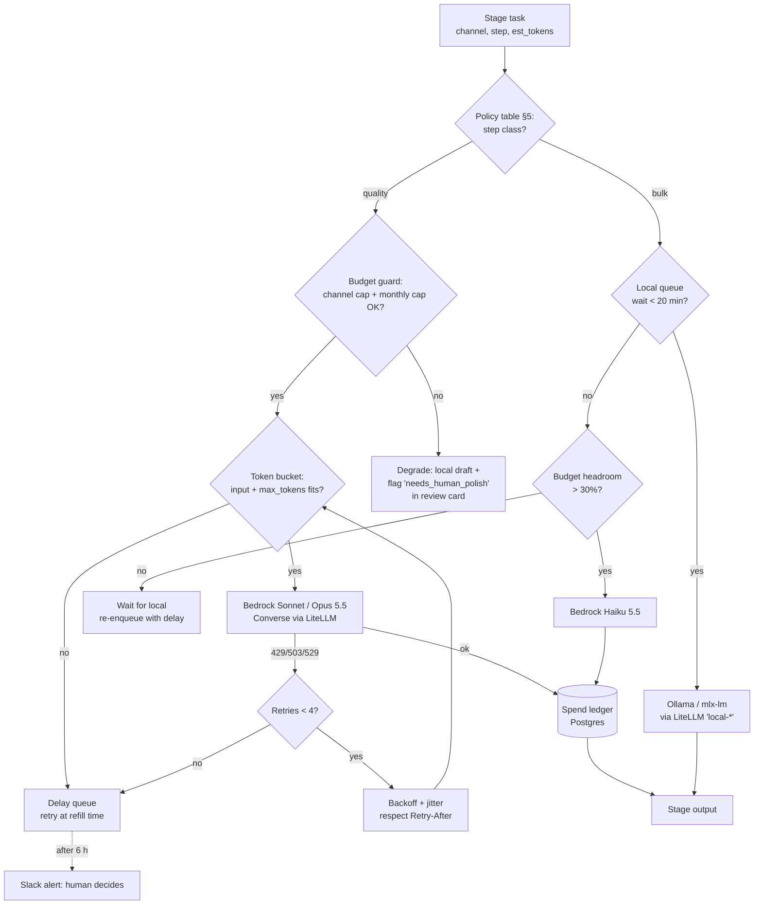

# 15 — Bedrock Hybrid Routing: Local-First, Bedrock Where It Matters

> Status: research and proposal, as of **2026-10-16**. Prices come from the **AWS Price List API** (us-east-1 and us-west-2 offer files, pulled that day) and the Bedrock model cards. The pricing web page renders its tables in JavaScript, so it can't be scraped. Anything per-video or per-month is an **estimate** (marked *est.*). Re-check prices and quotas before you commit budget.
>
> Scope: the 10-channel pipeline in [04](04-content-pipeline-architecture.md) (300 Shorts and 80 long-form a month at full scale). Bulk generation runs locally on the Mac M4 Pro with 24 GB. The local model choice is covered in its own doc. This doc decides **what goes to Amazon Bedrock**, on a small budget with low quotas, and how one gateway routes between the two.

---

## 1. TL;DR

- **Bedrock is for judgement, not volume.** Send the steps where one mistake costs a channel: polishing the final long-form script, fact-checking the accuracy-critical channels (see §5 note: real estate, cybersecurity, home systems, aviation), escalating disputed claims, and long-form titles. Everything else stays local.
- **The default models are Claude Sonnet 5.5** (`global.anthropic.claude-sonnet-5-5`, $2 / $10 per 1M tokens, cache reads $0.10) **and Claude Haiku 5.5** ($0.10 / $0.50). Opus 5.5 ($4 / $20) is the escalation model only. The cheap tier is now Haiku 5.5, which undercuts Nova 2 Lite ($0.30 / $2.50).
- **Surprise 1: Nova Canvas and Nova Reel are past end-of-life.** Their model cards give an EOL date of **2026-09-30**, so don't build on them. On Bedrock today, video means **Luma Ray2** at **$0.75–1.50 per second**, us-west-2 only, **one concurrent job**. That is several times the Veo Fast rate in doc 04, so Bedrock is a poor place for hero clips.
- **Surprise 2: the 5.5-generation Claude models have no Batch, Flex or structured-output support on Bedrock yet** (model cards, 2026-10-16). Use tool use with `toolChoice: auto` and validate the result yourself. The 50% Batch discount only applies to older models (Sonnet 4.6, Haiku 4.5), and even at half price Haiku 4.5 costs more than Haiku 5.5 at full price. **Batch isn't useful here.**
- **The binding constraint is the budget, not the quota.** About 30 Bedrock calls a day *(est.)* fits even small TPM quotas, but the guard still reserves `max_tokens` at admission and counts Opus 5.5 output against quota at **10×** ("burndown"; Sonnet 5.5's rate isn't published).
- **$25 a month covers the core value** (about $20 *est.*: long-form polish, YMYL fact-check, Opus escalation, Guardrails). **$100** adds Sonnet on all Shorts and Stable Image thumbnails. **$300** adds Opus everywhere and some Ray2 clips (§6).
- **Build it as a LiteLLM proxy** in front of Ollama/mlx-lm and Bedrock, with an AWS CLI profile and no keys in config. A Postgres spend ledger and a budget guard decide the route. **Quality steps queue when Bedrock throttles; they never silently drop to local.** Bulk steps that find local busy overflow to Haiku 5.5 (§7).

---

## 2. Bedrock model catalogue (relevant models, us-east-1, USD)

Prices are per 1M tokens unless noted. "Global" means the `global.` cross-Region inference profile. In-Region and Geo (`us.`) profiles are **10% dearer** for Claude.

| Model (Bedrock ID / profile) | Input | Output | Cache read / write (5 min) | Batch / Flex | Notes |
|---|---|---|---|---|---|
| **Claude Opus 5.5** `global.anthropic.claude-opus-5-5` | $4.00 | $20.00 | $0.20 / $5.00 (1 h write $8) | no / no | 1M context, 128K output. Thinking can't be turned off; set effort instead. Output burndown 10× |
| **Claude Sonnet 5.5** `global.anthropic.claude-sonnet-5-5` | $2.00 | $10.00 | $0.10 / $2.50 (1 h write $4) | no / no | Launched 2026-09-28. Cache reads 50% cheaper since 2026-10-07 |
| **Claude Haiku 5.5** `global.anthropic.claude-haiku-5-5` | $0.10 | $0.50 | $0.01 / $0.125 | no / no | Prompts **over 100K tokens cost 5×** ($0.50 / $2.50) |
| Claude Sonnet 4.6 (fallback) | $3.00 | $15.00 | $0.30 / $3.75 | **$1.50 / $7.50** | Batch available (min 100 records/job) |
| Claude Haiku 4.5 | $1.00 | $5.00 | $0.10 / $1.25 | $0.50 / $2.50 | Superseded by Haiku 5.5 on price |
| Nova Micro / Nova Lite | $0.035 / $0.06 | $0.14 / $0.24 | free write | 50% batch | Older, cheap. Fine for classification |
| **Nova 2 Lite** `global.amazon.nova-2-lite-v1:0` | $0.30 | $2.50 | $0.075 / free | $0.15 / $1.25 | 1M context. Caching up to 20K tokens. Flex tier available |
| Nova 2 Pro (preview) / Nova Premier | $1.25 / $2.50 | $10.00 / $12.50 | — | 50% | No reason to pick these over Sonnet 5.5 |
| Nova 2 Omni | $0.30 text in | output image tokens $0.02 per 1K (batch/flex) | — | yes | Multimodal; image output still under evaluation |
| Nova 2 Sonic | $3.00 speech in | $12.00 speech out | — | — | Speech-to-speech conversation, **not narration TTS** |
| gpt-oss-120b / gpt-oss-20b | $0.15 / $0.07 | $0.60 / $0.30 | — | **50% flex and batch** | Same open weights you can run locally |
| DeepSeek V3.2 | $0.62 | $1.85 | — | 50% | |
| Qwen3 Next 80B A3B | $0.14 | $1.20 | — | 50% | |
| Llama 4 Maverick / Scout | $0.24 / $0.17 | $0.97 / $0.66 | — | 50% batch | |
| Mistral Large 3 | $0.50 | $1.50 | — | 50% | |
| Writer Palmyra X5 (us-west-2) | $0.60 | $6.00 | — | — | |
| TwelveLabs Pegasus 1.5 (us-west-2) | $0.00049 per second of input video | $7.50 | — | — | Video understanding (QC of renders) |
| **Stable Image Core / SD3.5 Large / Ultra** (us-west-2) | $0.04 / $0.08 / $0.14 per image | | | | Stability edit tools $0.03–0.60 per image |
| **Luma Ray2** `luma.ray-v2:0` (us-west-2) | $0.75 per second (540p) / $1.50 per second (720p) | | | | Async jobs, **1 concurrent request** (not adjustable) |
| ~~Nova Canvas~~ / ~~Nova Reel~~ | $0.04–0.08 per image / $0.08 per second | | | | **EOL 2026-09-30** (Legacy). Don't use |
| Guardrails (ApplyGuardrail) | $0.15 per 1K text units (content filter, denied topics); $0.10 (PII, contextual grounding); $0.17 (Automated Reasoning) | | | | 1 text unit = up to 1,000 characters. Word filters and regex PII are free |
| Knowledge Bases (managed) | $5 per GB-month of storage; $1 per 1K Retrieve calls; $4 per 1K agentic Retrieve calls | | | | Parsing and embedding included |

Also in the catalogue, but out of scope here: GPT-5.4–6.1 family, Grok 4.x, Kimi K2.5/K3, GLM 4.7/5/5.3, MiniMax M2.x, Gemma 3/4, Nemotron 3. **Amazon Polly** isn't part of Bedrock: generative voices cost $30 per 1M characters, about $27 a month for this pipeline's ~0.91M characters *(est.)*. Kokoro running locally is still the default (doc 04).

---

## 3. Quotas, tiers and throttling

| Item | Default / rule (2026-10-16) | What it means for us |
|---|---|---|
| Sonnet 5.5 cross-Region and global TPM | **6,000,000** per Region (adjustable) | That's the published default. Your *applied* value may be far lower on a new or low-spend account, so check it (below) |
| Opus 5.5 TPM | 30M cross-Region; 15M on-demand in-Region (not adjustable) | |
| Haiku 5.5 TPM | 10M cross-Region | |
| Nova 2 Lite | 8M TPM, 2,000 RPM | |
| Cross-Model Max Tokens Per Day | **700M** per Region, account-wide | Not a concern at our volume |
| Output-token burndown | Opus 5.5, Sonnet 5, Opus 5: **10×**. Claude 4.8: **15×**. Claude 4.7 and older: 5×. Other models: 1× | Sonnet 5.5 isn't listed, so the guard assumes **10×** *(verify)*. Burndown affects quota only; billing is per actual token |
| Admission check | `input + max_tokens` is reserved up front, and the unused part is refunded at the end | **Set `max_tokens` tightly**, or the reservation causes false throttles |
| RPM | Model-specific. Some Claude models have none and are token-limited only | |
| Service tiers | `service_tier`: `default`, `priority` (+75%), `flex` (−50%), `reserved` (minimum 100K input / 10K output TPM, 1–3 month term) | 5.5-generation Claude: **Standard only**. Flex works for Nova 2 Lite, gpt-oss, DeepSeek and Mistral |
| Batch inference | ~50% off. Minimum 100 records per job, 5 GB per job, up to 100 queued jobs. `bedrock-runtime` only | Only older Claude models. Not worth it here |
| Prompt caching | Claude: 5 min or 1 h TTL, minimum 512 tokens per checkpoint, up to 4 checkpoints. Cache reads **don't count toward TPM** | Cache the brand-pack system prompt (~4–6K tokens) per channel |
| Provisioned Throughput / Reserved | About $30–60 per hour per model unit, or a reservation | **Not worth it.** Our whole monthly spend is under one hour of PT |
| Errors | 429 `ThrottlingException` = over quota. 503 = service capacity (not your quota). 529 `overloaded_error` = transient; respect `Retry-After` | Backoff with jitter, bounded concurrency, queue instead of failing (§7.4) |

**Checking and raising quotas.** Applied values (as opposed to defaults):
`aws service-quotas list-service-quotas --service-code bedrock --profile bedrock-pipeline --region us-east-1 --query "Quotas[?contains(QuotaName,'Sonnet 5.5')].[QuotaName,Value]"`.
To raise TPM, file one request against **"Cross-region model inference tokens per minute for <model>"**. Support then offers to raise the on-demand TPM and tokens-per-day quotas with it. AWS says it **prioritises accounts already using their quota**, and it won't raise quotas on Legacy models. So ask after the pilot month shows real usage.

**Cross-Region inference.** Use `global.` profiles: they cost list price and have the widest capacity. Use `us.` only if data residency matters (10% dearer). Ray2 and Stability run in-Region only, in **us-west-2**, so create a second boto3 client for those.

---

## 4. Platform features: what to use

| Feature | Verdict | Why |
|---|---|---|
| **Converse API + tool use** | **Use** | One request shape for every model. It returns `usage` with cache fields for the ledger. Claude 5.5 accepts `toolChoice` **`auto` only** (forced tool use returns 400) |
| Structured outputs (`outputConfig.textFormat`, strict tools) | Use where supported | Supported on Converse and InvokeModel for some models. **Not yet on Sonnet/Haiku 5.5** (model cards). Until it is, use a tool schema plus local `jsonschema` validation and one repair retry |
| Prompt caching (`cachePoint`) | **Use** | The per-channel system prompt is stable, so cache reads cost 5% of input price and skip TPM |
| **Guardrails `ApplyGuardrail`** (standalone) | **Use, under $1 a month** | Content filters, a denied-topics list ("personalised financial/legal/medical advice", as a backstop to doc 11's YMYL rule) and contextual grounding on YMYL scripts against their sources. It runs on local outputs too, because ApplyGuardrail doesn't need a model call |
| Knowledge Bases | Optional ($100 tier) | You already have pgvector (doc 04). A managed KB of IRS, CFPB, CDC and NIH source PDFs for YMYL costs about $3–6 a month *(est.)* and adds citation-grade retrieval |
| Bedrock Agents / **AgentCore** | **Skip** | The orchestrator already owns the state machine. AgentCore runtime and memory are billed separately and solve a problem we don't have |
| Intelligent prompt routing | Skip | Not supported on the 5.5 models. Our router is rule-based |
| Model invocation logging | Use (S3, 30-day lifecycle) | An audit trail for YMYL fact-checks |
| Application inference profiles | **Use, one per channel** | Gives AWS-side cost allocation tags per channel, as a cross-check on the ledger |

---

## 5. Routing policy (per pipeline step)

Assumptions *(est.)*: Short ≈ 150 words and long-form ≈ 1,350 words (doc 04 §7). YMYL channels were 2, 5, 7 and 10 under doc 12's earlier list, which is **120 Shorts and 32 long-form** a month. **Update (2026-10-16, after doc 17):** the finance, tax, insurance and legal channels were removed. The portfolio now has **no core YMYL channels**; only Square Foot Money is conditional. Point the YMYL fact-check budget at **accuracy-critical channels** instead: Square Foot Money (market data), the cybersecurity channel (attack details must be accurate and defensive), the home-systems channel (regional cost figures) and the aviation channel (technical claims). That is roughly the same volume as the original 4-channel assumption, so the $25 tier estimate of about $20 still holds. Token counts include adaptive-thinking output (billed as output), with effort set to `low` or `medium`. Per-video costs use global-profile prices.

| Step | Route | Model | Reason | Tokens per video *(est.)* | Monthly at full scale *(est.)* |
|---|---|---|---|---|---|
| Ideation (angles, novelty vs idea ledger) | **Local** | local 14–32B instruct (local-models doc) | High volume, low stakes, needs many samples | 8K in / 3K out | $0 |
| Outline / shot list | **Local** | same | Templated, structural | 4K / 2K | $0 |
| Script draft | **Local** | same | Bulk words. Quality comes later at polish | Short 4K/1K; long 15K/4K | $0 |
| **Script polish: long-form** | **Bedrock** | **Sonnet 5.5** (Opus 5.5 at $100+ for YMYL) | Retention and voice decide RPM revenue. Inauthentic-content risk rewards a strong rewrite | 12K in (6K cached) / 5K out | 80 × $0.065 = **$5.20** |
| Script polish: Shorts | Bedrock (cheap) | **Haiku 5.5** (Sonnet at $100+) | Haiku 5.5 is cheap enough that the local queue gains nothing | 6K / 1.5K | 300 × $0.0014 = **$0.42** |
| **Fact-check: YMYL** | **Bedrock** | **Sonnet 5.5**, with sources fetched locally and passed in. Disputed claims escalate to **Opus 5.5** | Wrong money, legal or health claims risk the channel (docs 03, 11) | long 25K/4K; Short 8K/1.5K | $2.88 + $3.72 + Opus ~8 × $0.10 = **$7.40** |
| Fact-check: other channels | Local claim extraction → **Haiku 5.5** verify | Haiku 5.5 | Cheap second opinion on long-form | 25K/4K | 48 × $0.0045 = **$0.22** |
| Title / hook variants | Local generates 10 → **Sonnet 5.5** ranks and rewrites the top 3 (long-form only) | Sonnet 5.5 | CTR is the biggest single lever for long-form (doc 06) | 3K / 1.5K | 80 × $0.021 = **$1.68** |
| Metadata, descriptions, tags, captions | **Local** | local | Formulaic | 3K / 1K | $0 |
| Thumbnail text | **Local** (included in the title pass for long-form) | — | 3–5 words | — | $0 |
| Comment mining (weekly clusters → idea ledger) | Local embeddings + clustering → **Haiku 5.5** summarises each cluster | Haiku 5.5 | Long inputs and summaries; keep each prompt under 100K | ~3M in / 0.3M out per month | **$0.45** |
| Translation (optional ES captions) | **Local** draft → Haiku 5.5 QA | Haiku 5.5 | US-first portfolio; low volume | 2K / 1K | < $0.50 |
| Content-safety lint | **Bedrock Guardrails** on every final script | ApplyGuardrail | Independent, policy-shaped check | ~2.5 text units each | **~$0.35** |
| Image generation (stills, B-roll) | **Local** (FLUX/SDXL on M4) or stock | — | Volume (doc 04: 6–40 stills per video). Local is free | — | $0 |
| Thumbnails | Local at $25; **Stable Image Core** ($0.04) at $100; **Ultra** ($0.14) at $300 | Stability (us-west-2) | Thumbnails are worth paying for. 4 variants per long-form | 4 images | $0 / $12.80 / $44.80 |
| Video generation (hero clips) | **Not Bedrock by default.** Use doc 04 vendors (Veo Fast) | Luma Ray2 only in the $300 tier | Ray2 costs $3.75–7.50 per 5-second clip, runs one job at a time, and Nova Reel is gone | 5 s per clip | $0 (or ~$112 at $300) |
| TTS narration | **Local** Kokoro / ElevenLabs (doc 04) | — | Bedrock has no narration TTS. Nova Sonic is conversational; Polly is separate | — | $0 |

**Overflow rule.** If the local queue wait goes over 20 minutes, bulk text steps (ideation through metadata) may overflow to **Haiku 5.5** while budget headroom is above 30%. Running *all* bulk text through Haiku 5.5 would cost only **about $2.60 a month** *(est.: 300 × $0.004 + 80 × $0.018)*. That overflow is a safety valve, not a cost risk.

---

## 6. Monthly Bedrock budget tiers *(est.)*

| Line | $25 tier | $100 tier | $300 tier |
|---|---|---|---|
| Long-form polish | Sonnet 5.5, all 80: $5.20 | Opus 5.5 for 32 YMYL + Sonnet 48: $7.12 | Opus 5.5, all 80: $10.00 |
| Shorts polish | Haiku 5.5: $0.42 | Sonnet 5.5: $11.10 | Sonnet 5.5: $11.10 |
| YMYL fact-check + Opus escalation | $7.40 | $7.40 | $7.40 |
| Non-YMYL fact-check | Haiku (long only): $0.22 | Sonnet long + Haiku Shorts: $4.60 | $4.60 |
| Titles / hooks | Sonnet, long-form: $1.68 | + Sonnet judging Shorts hooks: $5.88 | $5.88 |
| Comment mining, translation QA, Guardrails | $1.30 | $1.30 | $1.30 |
| Knowledge Base (YMYL corpus) | — | $5.50 | $5.50 |
| Thumbnails | local | Core × 320 + 1 Ultra hero per long-form: $24.00 | Ultra × 320: $44.80 |
| Long-form *draft* on Sonnet (instead of local) | — | — | $11.20 |
| Weekly angle scoring per channel (Sonnet) | — | — | $3.20 |
| Luma Ray2 hero clips | — | — | 30 × 5 s at 540p: $112.50 |
| **Subtotal → ×1.25 retries/regens** | **$16.22 → ~$20** | **$66.90 → ~$84** | **$217.50 → ~$272** |
| **What it buys** | Every long-form gets frontier polish and every YMYL claim gets checked. The core risk reduction | Sonnet-quality Shorts, paid thumbnails, citation-grade YMYL retrieval | Opus on all long-form plus a small AI-video budget. **Better use:** put the Ray2 $112 into Veo through doc 04 (about 5× more seconds) |

Per-channel caps (in the guard): **$25 tier: $2 per channel + $5 shared pool**. YMYL channels get **1.5× weight**, because they carry most of the fact-check spend.

---

## 7. Implementation

### 7.1 Router with fallback



Rule: **quality steps never silently fall back to a local model**, because that would defeat the point of the tier. They either queue, or degrade with an explicit flag the reviewer can see.

### 7.2 AWS profile and region (no hardcoded credentials)

```ini
# ~/.aws/config: an SSO or IAM Identity Center profile. The keys live in the SSO cache, never in the repo.
[profile bedrock-pipeline]
sso_session = home
sso_account_id = 111122223333
sso_role_name = BedrockInvokeOnly        # IAM: bedrock:InvokeModel*, Converse*, ApplyGuardrail, StartAsyncInvoke
region = us-east-1
```

Set `AWS_PROFILE=bedrock-pipeline` in the orchestrator's environment. Scope IAM to the model and inference-profile ARNs in this doc. Add an **AWS Budgets** alert at 80% and 100% of the tier as the outer guard.

### 7.3 boto3 Converse with tool use (fact-check)

```python
import boto3, json, jsonschema
from botocore.config import Config

sess = boto3.Session(profile_name="bedrock-pipeline", region_name="us-east-1")
brt = sess.client("bedrock-runtime", config=Config(
    retries={"mode": "adaptive", "max_attempts": 4}, read_timeout=300))

VERDICT_SCHEMA = {"type": "object", "additionalProperties": False,
  "required": ["claims"], "properties": {"claims": {"type": "array", "items": {
    "type": "object", "additionalProperties": False,
    "required": ["claim", "verdict", "source_ids", "fix"],
    "properties": {"claim": {"type": "string"},
      "verdict": {"enum": ["supported", "unsupported", "contradicted", "needs_expert"]},
      "source_ids": {"type": "array", "items": {"type": "string"}},
      "fix": {"type": "string"}}}}}}

tools = {"tools": [{"toolSpec": {"name": "submit_factcheck",
    "description": "Return one verdict per factual claim, citing only the provided source ids.",
    "inputSchema": {"json": VERDICT_SCHEMA}}}],
  "toolChoice": {"auto": {}}}            # Claude 5.5 rejects 'any'/'tool' (400)

def fact_check(channel_system_prompt: str, script: str, sources: list[dict]):
    resp = brt.converse(
        modelId="global.anthropic.claude-sonnet-5-5",
        system=[{"text": channel_system_prompt}, {"cachePoint": {"type": "default"}}],
        messages=[{"role": "user", "content": [
            {"text": "SOURCES:\n" + json.dumps(sources)},
            {"text": "SCRIPT:\n" + script + "\n\nCall submit_factcheck exactly once."}]}],
        toolConfig=tools,
        inferenceConfig={"maxTokens": 4000},            # keep tight: reserved against TPM up front
        additionalModelRequestFields={"output_config": {"effort": "low"}},  # verify field via Converse passthrough
    )
    use = next(b["toolUse"] for b in resp["output"]["message"]["content"] if "toolUse" in b)
    jsonschema.validate(use["input"], VERDICT_SCHEMA)  # no native structured outputs on 5.5 yet
    return use["input"], resp["usage"]   # inputTokens, outputTokens, cacheRead/WriteInputTokens
```

### 7.4 LiteLLM proxy `config.yaml` (one OpenAI-compatible endpoint)

```yaml
model_list:
  - model_name: local-bulk                      # Ollama (OpenAI-compatible)
    litellm_params: {model: ollama_chat/qwen3:14b, api_base: http://localhost:11434}
  - model_name: local-bulk                      # mlx-lm server: same group, load-balanced
    litellm_params: {model: openai/mlx-community/Qwen3-14B-4bit, api_base: http://localhost:8080/v1, api_key: none}
  - model_name: bedrock-haiku
    litellm_params: {model: bedrock/converse/global.anthropic.claude-haiku-5-5,
                     aws_profile_name: bedrock-pipeline, aws_region_name: us-east-1, tpm: 200000}
  - model_name: bedrock-sonnet
    litellm_params: {model: bedrock/converse/global.anthropic.claude-sonnet-5-5,
                     aws_profile_name: bedrock-pipeline, aws_region_name: us-east-1, tpm: 200000}
  - model_name: bedrock-opus
    litellm_params: {model: bedrock/converse/global.anthropic.claude-opus-5-5,
                     aws_profile_name: bedrock-pipeline, aws_region_name: us-east-1, tpm: 100000}

litellm_settings:
  num_retries: 3              # per model group, before fallbacks
  allowed_fails: 3
  cooldown_time: 30
  request_timeout: 600

router_settings:
  enable_pre_call_checks: true
  fallbacks:
    - {"local-bulk": ["bedrock-haiku"]}       # local down/busy → cheap cloud overflow
    - {"bedrock-opus": ["bedrock-sonnet"]}    # quality tier steps down, never to local
  # bedrock-sonnet has NO fallback: the orchestrator catches 429 and re-enqueues (§7.1)

general_settings:
  master_key: os.environ/LITELLM_MASTER_KEY   # virtual keys per channel → per-key max_budget
```

Set the `tpm` values to about 80% of your **applied** quota. Give each channel its own LiteLLM virtual key (`max_budget`, `budget_duration: 30d`), so LiteLLM enforces a second budget layer. The **AWS Bedrock Access Gateway** (aws-samples) is an alternative OpenAI shim, but it is Bedrock-only, so it can't front the local models. LiteLLM is the better fit.

### 7.5 Quota-aware token bucket and budget guard

```python
import time, threading
PRICE = {  # $/1M tokens, global profiles (§2)
  "sonnet-5-5": (2.00, 10.00, 0.10, 2.50), "opus-5-5": (4.00, 20.00, 0.20, 5.00),
  "haiku-5-5": (0.10, 0.50, 0.01, 0.125)}
BURNDOWN = {"sonnet-5-5": 10, "opus-5-5": 10, "haiku-5-5": 10}   # conservative; verify
class TokenBucket:
    def __init__(self, tpm: int):
        self.cap, self.tokens, self.t, self.lock = tpm, tpm, time.monotonic(), threading.Lock()
    def try_take(self, n: int) -> float:          # 0 = admitted, else seconds to wait
        with self.lock:
            now = time.monotonic()
            self.tokens = min(self.cap, self.tokens + (now - self.t) * self.cap / 60); self.t = now
            if n <= self.tokens: self.tokens -= n; return 0.0
            return (n - self.tokens) * 60 / self.cap
    def settle(self, reserved: int, actual: int):  # refund the over-reservation
        with self.lock: self.tokens = min(self.cap, self.tokens + reserved - actual)

def cost_usd(m, u):
    i, o, cr, cw = PRICE[m]
    return (u["inputTokens"]*i + u["outputTokens"]*o
            + u.get("cacheReadInputTokens", 0)*cr + u.get("cacheWriteInputTokens", 0)*cw) / 1e6

def admit(db, bucket, channel, model, est_in, max_out, est_usd):
    spent_month, spent_chan, cap_month, cap_chan = db.budget_state(channel)   # from ledger
    if spent_month + est_usd > cap_month or spent_chan + est_usd > cap_chan:
        return ("degrade", None)                  # local + needs_human_polish flag
    wait = bucket.try_take(est_in + max_out)      # Bedrock reserves input + max_tokens
    return ("queue", wait) if wait else ("go", est_in + max_out)
# after the call: bucket.settle(reserved, u["inputTokens"] + u.get("cacheWriteInputTokens",0)
#                               + u["outputTokens"]*BURNDOWN[model]);  ledger.insert(...)
```

Run one bucket per model, held in Redis if more than one worker process calls Bedrock. Back off on 429/503/529 with `min(60, 2**n) * random()` seconds, and respect `Retry-After`.

### 7.6 Per-channel spend ledger

```sql
CREATE TABLE llm_spend (
  id bigserial PRIMARY KEY, ts timestamptz NOT NULL DEFAULT now(),
  channel text NOT NULL, job_id text NOT NULL, step text NOT NULL,
  route text NOT NULL CHECK (route IN ('local','bedrock')), model text NOT NULL,
  input_tokens int, output_tokens int, cache_read int, cache_write int,
  usd numeric(10,6) NOT NULL DEFAULT 0, outcome text   -- ok|throttled|degraded|error
);
CREATE INDEX ON llm_spend (channel, ts);
-- month-to-date per channel, for the guard and the review card
SELECT channel, sum(usd) AS mtd, count(*) FILTER (WHERE outcome='throttled') AS throttles
FROM llm_spend WHERE ts >= date_trunc('month', now()) GROUP BY channel ORDER BY mtd DESC;
```

Local calls are logged at `usd = 0`, which gives an honest picture of the local vs Bedrock mix. Reconcile the ledger monthly against Cost Explorer: Claude, Stability and Luma are **billed through AWS Marketplace, under the provider's name, not under "Amazon Bedrock"**.

---

## 8. Open questions and verification checklist

1. The **applied** TPM for Sonnet, Haiku and Opus 5.5 on this account (the published default is 6M; new accounts are often lower). Run the CLI query in §3 in Phase 0.
2. Sonnet 5.5's output **burndown rate**. The guard assumes 10×. Compare CloudWatch `OutputTokenCount` with quota usage.
3. When **structured outputs**, **Batch** or **Flex** arrive for the 5.5 models (watch the model cards and What's New). Batch would halve the Shorts polish cost.
4. Whether `output_config.effort` is honoured through Converse `additionalModelRequestFields`. If it isn't, use InvokeModel with the Messages body.
5. Whether **Nova Canvas and Reel** really stop serving after 2026-09-30, and what replaces them (Nova 2 Omni image output?).
6. A side-by-side test in the pilot: local polish vs Sonnet 5.5 polish on 10 scripts, blind-rated, to confirm the polish step earns its $5 a month.

---

## 9. Sources (visited 2026-10-16)

- AWS Price List API (Bedrock, Bedrock Foundation Models, Polly; us-east-1 and us-west-2): https://pricing.us-east-1.amazonaws.com/offers/v1.0/aws/index.json
- Bedrock pricing (tiers, Guardrails, Knowledge Bases, Stability, open-weight models): https://aws.amazon.com/bedrock/pricing/
- Models at a glance: https://docs.aws.amazon.com/bedrock/latest/userguide/model-cards.html
- Claude Sonnet 5.5 model card: https://docs.aws.amazon.com/bedrock/latest/userguide/model-card-anthropic-claude-sonnet-5-5.html
- Claude Haiku 5.5 model card: https://docs.aws.amazon.com/bedrock/latest/userguide/model-card-anthropic-claude-haiku-5-5.html
- Nova 2 Lite: https://docs.aws.amazon.com/bedrock/latest/userguide/model-card-amazon-nova-2-lite.html
- Nova Canvas (EOL): https://docs.aws.amazon.com/bedrock/latest/userguide/model-card-amazon-nova-canvas.html
- Nova Reel (EOL): https://docs.aws.amazon.com/bedrock/latest/userguide/model-card-amazon-nova-reel.html
- Luma Ray2: https://docs.aws.amazon.com/bedrock/latest/userguide/model-card-luma-ai-ray2.html
- Service tiers: https://docs.aws.amazon.com/bedrock/latest/userguide/service-tiers-inference.html
- Token burndown: https://docs.aws.amazon.com/bedrock/latest/userguide/quotas-token-burndown.html
- Runtime quotas and increases: https://docs.aws.amazon.com/bedrock/latest/userguide/quotas-runtime.html
- Service quota defaults: https://docs.aws.amazon.com/general/latest/gr/bedrock.html
- Scaling and error handling: https://docs.aws.amazon.com/bedrock/latest/userguide/scaling-throughput-best-practices.html
- Throttling troubleshooting: https://docs.aws.amazon.com/bedrock/latest/userguide/troubleshooting-api-error-codes.html
- Structured outputs: https://docs.aws.amazon.com/bedrock/latest/userguide/structured-output.html
- Nova pricing overview: https://aws.amazon.com/nova/pricing/
- What's New (Feb 2026 open-weight models): https://aws.amazon.com/about-aws/whats-new/2026/02/amazon-bedrock-adds-support-six-open-weights-models
- What's New (Jun 2026 bedrock-mantle console): https://aws.amazon.com/about-aws/whats-new/2026/06/amazon-bedrock-redesigned-console-optimized-openai-anthropic-compatible-apis/
- LiteLLM Bedrock provider: https://docs.litellm.ai/docs/providers/bedrock
- LiteLLM reliability and fallbacks: https://docs.litellm.ai/docs/proxy/reliability
- Bedrock Access Gateway: https://github.com/aws-samples/bedrock-access-gateway
