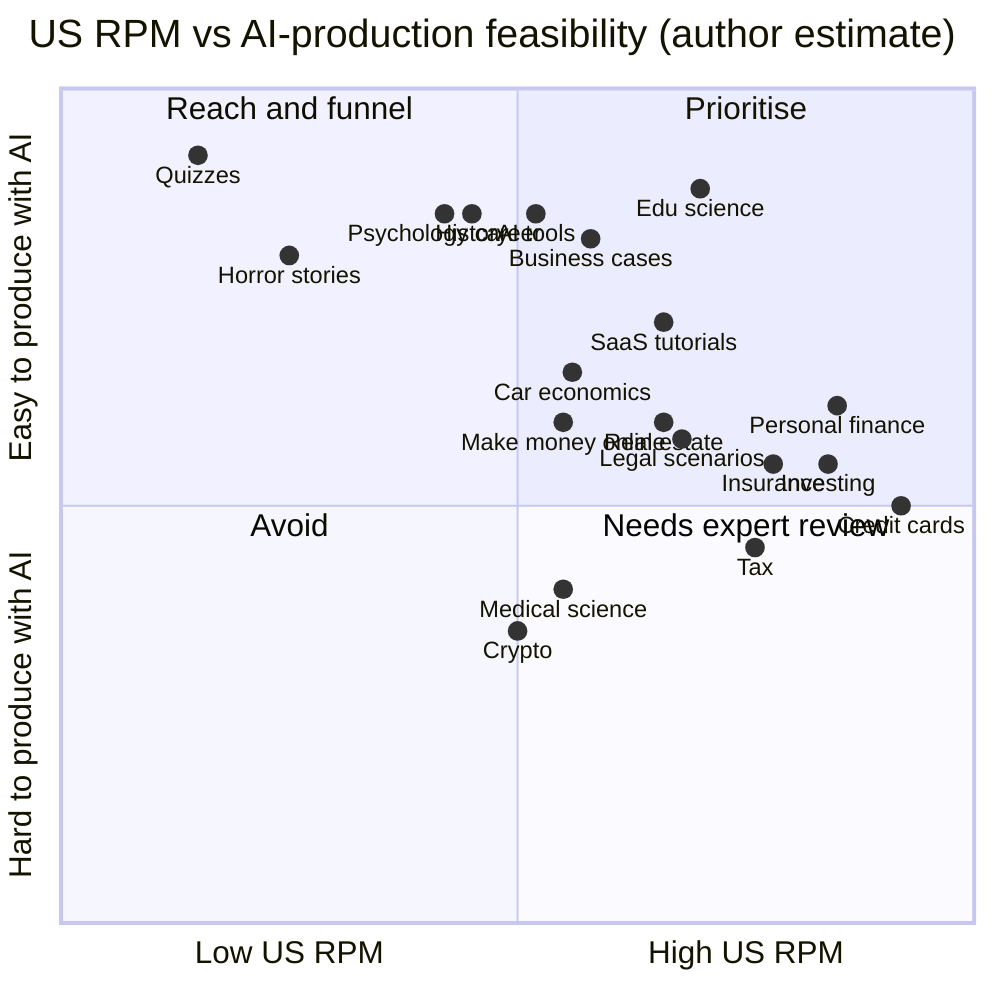
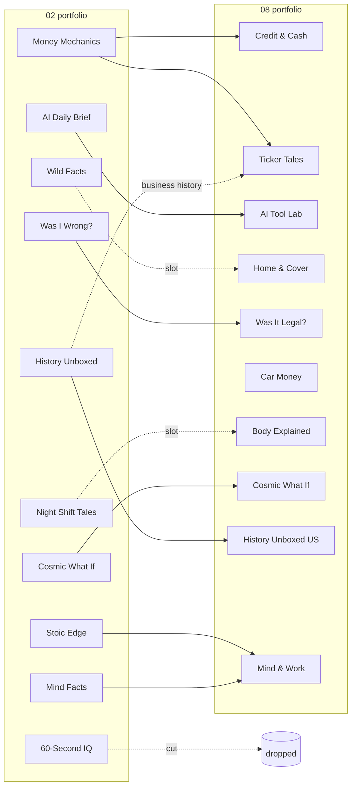

# 08 — High-CPM Niches for a US Audience

> **Status:** reference · **Updated:** 2026-10-16 · **Related:** [12 Final portfolio](12-final-portfolio.md), [17 Replacement niches](17-replacement-niches.md), [03 Platform policies](../3-policy/03-platform-policies-and-risks.md)

> Status: research draft · Researched: 2026-10-16 · Builds on [02](../archive/02-niche-selection.md) (niche scoring) and [03](../3-policy/03-platform-policies-and-risks.md) (policy red lines). Avatar tools, cartoon tools and the AI-persona policy are covered in their own docs. This one covers **which niches earn the most per US view, and how to get US viewers**.

**About the numbers.** No platform publishes RPM by niche or by country. There are three kinds of evidence here, and the labels say which is which:
- **Measured** means taken from creator Studio data. The only such dataset is AIR Media-Tech's: 300 channels, global audience mix, few finance channels.
- **Vendor range** means figures from vidIQ, OutlierKit/Virlo and Lenos, which come from Google Ads benchmarks, creator disclosures and modelling. These are often **CPM** (what advertisers pay), not RPM (what you keep), and they lean towards US-heavy, top-performing channels.
- ***(est.)*** means my own planning figure, made by triangulating the two above. It assumes a mature channel with ≥60% US viewers. Don't treat it as a forecast.

---

## 1. TL;DR

- **Advertiser money is concentrated in finance, insurance, legal and real estate.** Ahrefs (Sep 2026) finds that legal services make up **17.5%** of the 10,000 most expensive Google keywords. LocaliQ's 2025 data has legal as the top industry CPC at **$8.58**, against a **$5.26** average. vidIQ's 2026 Tier-1 YouTube niches are personal finance, insurance, legal, real estate, luxury and health services (RPM **$5–22**).
- **Two figures are measured.** Education & Science has a **$10.22 median** (AIR, measured). Business & Finance has **$2.01**, but on fewer than 10 channels with a global mix (AIR). That gap with vendor finance ranges ($10–26) is mostly **audience geography and channel quality**, not the niche label. A finance channel only earns finance RPM if its viewers are American.
- **US viewers count on Shorts too.** YouTube splits the Shorts pool by "engaged views in each country". But Shorts still pay about **3–14% of long-form** (AIR). Shorts are for discovery and long-form is where the money is, as 02 already concluded.
- **Facebook doesn't publish an RPM.** Content Monetization, which merged in-stream ads, Ads on Reels and the bonus program in Oct 2024, is invite-only. The only per-account measure is the "Earnings Rate" metric in each creator's dashboard. Plan FB revenue as zero until it shows up there.
- **Recommendation.** Rework the 10 channels to **6 high-CPM US channels + 4 education/reach channels** (§8). Cut quizzes, horror and AITA stories. Merge Stoic Edge into a psychology/career channel. Turn "Was I Wrong?" into **legal-scenario cartoons**. In YMYL niches, use **cartoon hosts rather than realistic avatars**, because 03 red line 6 says AI "experts" giving finance, legal or health advice are not ad-eligible (secondary source, Jul 2026).

---

## 2. How US ad value actually works

| Mechanism | Fact | Source | Implication |
|---|---|---|---|
| Long-form share | Creators keep 55% of watch-page ad revenue | OutlierKit, citing YouTube terms | RPM ceiling ≈ CPM × 0.55, minus unmonetised views |
| Shorts share | Shorts Feed ads are pooled. Your share is set by "your portion of total engaged views **in each country**", and you keep **45%**. Music tracks shrink the pool. | YouTube Help 12504220 | US Shorts views earn more than Indian Shorts views. Use **no-music or Audio-Library-free** Shorts to keep the whole pool share. |
| Geography | US is in the top CPM tier with AU, UK, CA and the Nordics. A finance video "might earn $30 CPM" in the US vs "$5 to $8 CPM in tier-3 markets". US viewers earn "3–5× more per view" than India/Brazil. | vidIQ 2026 | A viral Short that pulls 70% South/Southeast Asian views can **cut channel RPM sharply** |
| Country CPM | US average CPM $32.75, AU $36.21, India $0.83 | Lenos, via OutlierKit (vendor) | Treat as directional |
| Finance by country | US $15–26 RPM, UK $12–21, CA $11–19, DE $10–17, BR $1.60–4.20, IN $0.50–1.60 | OutlierKit finance guide (vendor; internally inconsistent) | Tier-1 English markets are almost as good as the US. **Write for the US and accept UK/CA/AU.** |
| Within-niche spread | "The widest published RPM gap between niches is about 7×. The niche you pick moves your earnings less than where you land inside it." | OutlierKit benchmarks | Packaging, length (mid-rolls at 8+ min) and audience matter as much as the niche |

---

## 3. RPM table by niche (US audience)

Abbreviations: PF = personal finance, LF = long-form, SaaS = B2B software, Edu/Sci = education & science. In the "Faceless / avatar fit" column, **F** = faceless b-roll/graphics works, **A** = AI-avatar presenter works, **C** = cartoon character works. "YMYL risk" covers accuracy, advice liability and the 03 red line on AI "experts". Supply and saturation are my judgement on a 1–5 scale (5 = endless supply / uncrowded).

| Niche | Published LF figure (source) | **US LF RPM (est.)** | **US Shorts RPM (est.)**¹ | Why advertisers pay | F/A/C fit | YMYL risk | Supply | Saturation |
|---|---|---|---|---|---|---|---|---|
| Credit cards / credit scores | RPM $16–26 avg (OutlierKit, vendor); CPM $15–50 for PF (vidIQ) | **$10–22** | $0.10–0.35 | Issuers pay huge CPAs per approved card; strongest affiliate economics | F, C (A risky) | High: disclaimers, no "you should get X card" | 4 | 2 |
| Personal finance / budgeting / retirement | RPM $5–17 (vidIQ); $11–19 (OutlierKit) | **$8–18** | $0.08–0.30 | Banks, brokers, robo-advisers, HYSA, fintech apps | F, C | High | 5 | 1 |
| Investing / markets | CPM $20–40 (Virlo); RPM $13–21 (OutlierKit) | **$8–18** | $0.08–0.30 | Brokerages, trading apps, financial newsletters | F, C | High: securities-advice optics | 5 | 1 |
| Insurance (auto, home, life, Medicare) | RPM $7–17, CPM $20–50 (vidIQ) | **$7–15** | $0.07–0.25 | Very high lead values; Medicare/ACA enrolment seasons | F, C | High: state-specific rules | 3 | **4** (few faceless players) |
| Tax (US federal/state, side-hustle tax) | Tax RPM $13–19 (OutlierKit); legal+tax CPM $15–40 | **$7–16**, peaks Jan–Apr | $0.07–0.25 | Tax software, CPAs, payroll | F, C | High: figures change yearly | 3 (seasonal) | 4 |
| Legal / law explainers | RPM $5–15 (vidIQ); legal = 17.5% of top keywords (Ahrefs); top CPC industry $8.58 (LocaliQ) | **$5–14** | $0.05–0.20 | Injury and accident lawyers bid the most expensive clicks on Google | C (scenario cartoons), F | High: "not legal advice", state variance, defamation if real cases | 4 | 3 |
| Real estate / mortgages | RPM $5–13 (vidIQ); CPM $15–30 (Virlo) | **$5–13** | $0.05–0.20 | Lenders, brokerages, proptech | F, C, A | Medium-high | 4 | 2 |
| B2B SaaS / software tutorials | CPM $10–30 (vidIQ, no RPM) → ceiling $5.50–16.50 | **$5–14** | $0.04–0.15 | SaaS free-trial CPAs, plus **sponsorship and affiliate** (recurring commissions) | **A** (PiP over screen recording), F | Low | 5 | 3 |
| AI tools / tech reviews | AI CPM $10–25, tech $5–30 (vidIQ); **Gadgets & Tech measured median $2.33** (AIR, global) | **$4–12** | $0.04–0.15 | AI SaaS, hardware, cloud | A, F | Low | 5 | **1** ("crowded and full of low-quality AI slop", Overseeros) |
| Business case studies | Business CPM $14–35 (OutlierKit guide); **B&F measured $2.01, n<10** (AIR) | **$5–12** | $0.04–0.15 | B2B, finance and software advertisers follow the audience | F, A | Low | 5 | 2 |
| Education / science | **Measured median $10.22** (P25–75 $2.31–19.50); small/medium channels $14.97–18.23 (AIR) | **$6–15** | $0.04–0.20 (AIR: Edu break-even 12.5k–33k Shorts views per 1k LF) | Broad brand demand, EdTech, adult viewers | F, C | Low | 5 | 2 |
| Health / medical science (not advice) | Health services RPM $7–22 (vidIQ); **Health & Sport measured $1.23** (AIR) | **$4–12** (wide) | $0.03–0.15 | Pharma, telehealth, insurers | C (anatomy animation), F | **Very high**: medical misinformation; unproven remedies get no ads (YouTube AFG) | 5 | 3 |
| Luxury / cars / car economics | Luxury RPM $5–17; auto CPM $10–25 (vidIQ); **Transport measured $5.69, n<10** (AIR) | **$5–12** | $0.04–0.15 | Auto OEMs, auto insurance, loans, watches | F, A | Low-medium (car loans) | 4 | 2 |
| Make money online / marketing | CPM $10–25 (vidIQ); side hustles RPM $9–15 (OutlierKit) | **$5–12** | $0.05–0.15 | Course and tool sellers | A, F | Medium: get-rich-quick, FTC | 5 | **1** |
| Career / high-income skills | Edu & career CPM $8–20 (vidIQ) | **$4–10** | $0.03–0.12 | Bootcamps, job platforms | A, C | Low | 5 | 3 |
| Crypto | CPM $15–40 (vidIQ); RPM $9–16 (OutlierKit) | **$3–12, volatile** | $0.03–0.15 | Exchanges, *but* Google restricts crypto ads (below); tracks BTC price, weak in Q4 (MilX) | F | Very high: scams, securities | 5 | 1 |
| *Reference: Entertainment / Gaming / Kids* | Measured $2.43 / $2.05 / $0.33 (AIR) | $1.5–4 / $1.5–3.5 / <$0.5 | ≤$0.05 | Mass brand | — | — | — | — |

¹ Shorts *(est.)* = 3–14% of the long-form planning figure (AIR's measured ratio). The finance Shorts figure is close to vendor figures of $0.04–0.32 (OutlierKit) and $0.08–0.15 (collabpals).

**Crypto ad restrictions.** In the US since Aug 2021, Google has allowed exchange and wallet ads only from advertisers registered with FinCEN plus state money-transmitter licences or bank charters. ICOs, DeFi protocol ads and affiliate/broker-review sites stayed banned (CoinDesk, FXStreet, 2021). Google's 2025 updates covered the UK, Canada and the UAE. A claim of a new US crypto certification from 29 Jan 2026 rests only on a low-authority blog (**verify**). Net effect: a thinner advertiser pool than the CPM headline suggests, plus scam-adjacent brand risk. **Excluded** from the portfolio.

**Make money online is excluded** too. Supply is endless, but so is competition, and "income proof" claims run into FTC endorsement rules (03 red line 14). Legitimate side-hustle *tax and budgeting* topics go into the personal finance channel instead.

---

## 4. US RPM vs AI-production feasibility

Feasibility is about how well a fact-checked, original video can come out of the pipeline in 04 without a credentialed on-camera human. YMYL niches lose points for the extra review they need.

---

## 5. Shorts, Reels and Facebook for US viewers

| Surface | What is known | Planning *(est.)* |
|---|---|---|
| **YouTube Shorts** | Pooled. Paid by engaged views per country; 45% creator share; music reduces the pool (YouTube Help). Shorts pay 3–14% of LF; in Entertainment, channels posting 21+ Shorts/month had LF RPM drop from $4.99 to $1.15 (AIR, within-channel). | US high-CPM niches: **$0.05–0.35**. For revenue channels, keep Shorts to **≤3–5 a week** and point each one at a long-form video (related-video link). |
| **Facebook Content Monetization** | Combines in-stream, Reels ads and the bonus program (Meta, Oct 2024). Invite-only, with an interest form under Professional Dashboard → Monetization. Facebook paid nearly **$3B in 2025**, about 60% of it to Reels. The new "Earnings Rate" metric shows earnings per 1,000 *qualified* views (Meta, Mar 2026). Creator Fast Track guarantees $1k–3k/month for 3 months, but **only for creators with 100k+ followers elsewhere**. | No official RPM. Blog figures range from $0.02–0.20 to "$1–10" because they mix up the different payment programs. **Plan $0.** Revisit after 60 days using Earnings Rate. Older US-skewing FB audiences suit insurance, Medicare, real estate and history. |
| **Instagram** | No general ad revenue share (02 §3) | Funnel and affiliate only |

---

## 6. How to attract (and keep) a US audience

No platform lets organic content target a country, so the audience is decided by **signals**: language, topics, early viewers and keywords. Every lever below is a signal *(mechanism inferred; no platform documents it)*.

**6.1 Language and voice**
- Use **General American** English TTS voices: one distinct, consistent voice per channel (02 §7). No British or Indian-English voices, and don't mix accents within a channel.
- US spelling, `$` amounts, imperial units, MM/DD dates, US idioms and US cultural references (Super Bowl, Thanksgiving, tax day).
- Studio settings: country = **United States**, video language = **English (United States)**, captions in English (US). Upload a clean SRT for every video, which also feeds search.
- Multi-language audio tracks are served by **device language, not location** (Papercup). A Spanish track reaches US Spanish-interface users. That's a later experiment for the finance channels, not a launch feature.

**6.2 Topic localisation: use nouns only Americans search for.** 401(k), Roth IRA, HSA, FICO, W-2/1099, IRS, Medicare Part D, ACA marketplace, HOA, closing costs, PMI, state names ("…in Texas"), Social Security, Costco/Target/Walmart case studies, US court cases and constitutional rights. These raise RPM twice: they attract US viewers *and* match US advertiser keyword lists.

**6.3 Avoiding a geographic mix that drags RPM down**
- Avoid globally viral, low-CPM topics on revenue channels: cricket, Bollywood, generic motivation quotes, "amazing facts" lists. They go viral, then fill the channel with views from India, the Philippines and Indonesia. Put them on reach channels, or not at all.
- Check **Analytics → Audience → Top geographies** every week. If US + CA + UK + AU falls **below about 60% of views** on a revenue channel *(est. threshold)*, find the videos causing it and stop making that format.
- Never buy cheap promotion or engagement (03 red line 9). Paid promotion through YouTube's own tools is allowed, but if used, target the US only *(est.)*.

**6.4 Posting times (ET and PT)**
- The evidence is thin. Sprout's 2026 study (2B engagements, 307k profiles) **excludes YouTube** and reports *local* time. Reposts of earlier Sprout data put YouTube's best time at about **1 pm ET**. A study attributed to Buffer, seen only second-hand, puts it at **Wednesday 4 pm local**.
- **Plan *(est.)*:** long-form at **12–2 pm ET (9–11 am PT)**, Tue–Thu, so it's indexed before the US evening. Shorts and Reels at **12 pm ET** and **7–8 pm ET (4–5 pm PT)**. FB at **9 am–1 pm ET**, which suits older audiences.
- Set Buffer's timezone per profile to `America/New_York`. After 30 days, switch to each channel's "When your viewers are on YouTube" chart. Posting time only nudges which viewers see a video first. It can't target a country.

**6.5 Titles and keywords**
- Write for **US search intent**, using advertiser-adjacent long-tail terms: "how a Roth IRA conversion works (2027 limits)", "what car insurance actually covers after a hit-and-run", "is it legal to record your boss in California".
- Year-stamp anything that changes (tax brackets, contribution limits) and refresh it every January. That builds an evergreen catalogue that peaks seasonally.
- Use Google Keyword Planner CPCs as a **topic-priority signal**: build the content calendar from the highest-CPC questions an explainer can answer honestly.
- Thumbnails show US artefacts: dollar bills, US forms, state outlines. Avoid "get rich" money-pile clichés, which pull MMO-style audiences.

---

## 7. Real faceless / animated channels in high-CPM niches

Subscriber numbers are third-party snapshots. Check them on the live channel before quoting them.

| Channel | Niche | Format | Evidence |
|---|---|---|---|
| How Money Works | Finance and economics | Faceless narrated explainers | vidIQ: US-based, 3.8M views/30d, est. AdSense ~$26.7k/month (vidIQ estimate) |
| Modern MBA | Business case studies | Faceless b-roll and graphics | ~801k–811k subs (OutlierKit; CreatorDB, Jul 2026) |
| Business Casual | Business history | Animated, narrated documentaries | ~1.1M subs (OutlierKit, SponsorRadar). OutlierKit says it has been inactive about 3 years (unverified). |
| The Swedish Investor | Investing books and frameworks | "Illustrated narration" (ShortsFast) | ~967k subs (vidIQ, May 2025) |
| Economics Explained | Macroeconomics | "Maps, charts, and simple animation" | Labelled faceless by OutlierKit and ShortsFast |
| Primate Economics / Casual Finance | Economics / personal finance | Cartoon / stick-figure explainers | ~370k / 300k+ in ~1 yr (vendor listings, low confidence) |
| Company Man, MagnatesMedia, Wall Street Millennial | Business and markets | Faceless documentary / explainer | Named in Overseeros/ShortsFast lists; subs not verified |
| Osmosis from Elsevier | Medical education | Animated illustrated explainers (in-house studio) | ~3.5M subs (vidIQ, Jun 2025). Note: backed by a publisher with clinical review. |
| AI Explained | AI news and analysis | Voice-over plus screen material | ~217k (Oct 2025) → ~436k (Jul 2026) per trackers |
| Courtify | Legal (family-court outcomes) | Faceless narration | Named by OutlierKit; no CPM published |

I found **no verified, monetised realistic-AI-avatar channel in a YMYL niche**. The only "avatar finance" case was a vendor blog citing a Reddit income post I couldn't check. Successful faceless high-CPM channels use **graphics or illustrated characters plus a consistent narrator**, which is evidence for the cartoon/b-roll choices in §8.

---

## 8. Revised 10-channel portfolio (tilted to US ad value)

**Changes from 02:** **Keep** 1 and 3 (History refocused on the US). **Refocus** 4 and 5. **Merge** 2 + 10, and split the business half of 4 into its own channel. **Swap out** 6, 7, 8 and 9. Revenue channels (R) are long-form-first with ≤5 Shorts a week. Reach channels (E) feed the audience and the brand.

| # | Channel (working name) | Niche | From 02 | Role | Presenter format | US LF RPM *(est.)* | Lead platforms | Notes |
|---|---|---|---|---|---|---|---|---|
| 1 | **Credit & Cash** | US personal finance: credit cards, credit scores, HYSA, 401(k)/IRA; **tax series Jan–Apr** | Refocus of #4 Money Mechanics | R | **Cartoon mascot** narrator plus animated charts (Swedish Investor / Casual Finance style) | $8–22 | YT LF, YT Shorts, IG | The anchor channel. Education, not advice. Disclosed card affiliates are the biggest upside. |
| 2 | **Ticker Tales** | Business case studies and "how X makes money" (US companies) | Merge: business half of #4 + business history from #3 | R | **Faceless b-roll + charts**; A/B test an AI-avatar "anchor" intro | $5–12 | YT LF, FB | Proven by Modern MBA, Company Man and How Money Works. Low YMYL risk. |
| 3 | **AI Tool Lab** | AI tools and B2B SaaS **tutorials** (not news) | Refocus of #5 AI Daily Brief | R | **AI avatar** in picture-in-picture over real screen recordings | $5–14 | YT LF, YT Shorts | Tutorials outlast news and earn SaaS affiliate and sponsor money. Hands-on demos set it apart from the slop. |
| 4 | **Home & Cover** | Real estate, mortgages, home and auto insurance, Medicare and ACA basics | New (replaces #6 Wild Facts) | R | **Cartoon / illustrated** household characters | $5–15 | YT LF, **FB** (older US audience) | Few faceless competitors. Peak around open enrolment (§9). State-specific disclaimers. |
| 5 | **Was It Legal?** | US law explained through hypothetical scenarios | Swap of #9 Was I Wrong? (keeps the dilemma hook) | R/E | **Cartoon characters** act out the scenario, then a narrator explains | $5–14 | YT Shorts → LF, IG, FB | Moral-dilemma virality with legal-niche ads. Use fictional people or public court records only. "General information, not legal advice". |
| 6 | **Car Money** | Cost of car ownership, leasing vs buying, luxury and car economics | Promoted from 02's bench (luxury/cars) | R | **Faceless b-roll** (AI renders or licensed footage; no ripped reviews) | $5–12 | YT LF, FB | Pulls auto, insurance and loan advertisers. Check press-kit image rights. |
| 7 | **Body Explained** | How the body and diseases work (medical *science*, no treatment advice) | New (replaces #8 Night Shift Tales) | E/R | **2D/3D anatomy animation** (Osmosis style) | $4–12 | YT LF + Shorts, IG | Highest risk in this portfolio. Needs a paid clinical reviewer *(est. $50–150/script)* or drop it after the pilot. |
| 8 | **Cosmic What If** | Space and science hypotheticals | **Keep** #1 | E/R | **Faceless** 3D / AI visuals | $6–15 | YT LF + Shorts | Highest *measured* niche median (AIR Edu/Sci). Easiest to produce with AI. |
| 9 | **History Unboxed (US edition)** | American history, presidents, inventions, money history | **Keep** #3, refocused on the US | E | **Faceless** b-roll / AI illustrations | $4–10 | FB, YT LF | Edu category. A US focus gets US viewers. Avoid the "sleep history" template (02 §5). |
| 10 | **Mind & Work** | Workplace and money psychology, career skills | **Merge** #2 Mind Facts + #10 Stoic Edge | E | **Cartoon character** (Psych2Go-style) | $4–10 | IG, YT Shorts | IG funnel. Career angle adds education and career advertisers. |

**Dropped:** 60-Second IQ (lowest RPM, templating risk), Night Shift Tales (entertainment RPM), Wild Facts (no US advertiser pull), the AITA story format. **Excluded:** crypto and make-money-online (§3).

**What this changes elsewhere *(est.)*:**
- Five or six YMYL channels mean more fact-checking than the 55 h/month in 07. Budget about **+20–30 h/month**, or freelance reviewers for law, insurance and medicine.
- Shorts volume falls by about 40%, so Buffer load drops, and long-form API uploads rise to about **12–15 a week**.
- The **launch order** changes. Pilot A = Cosmic What If, Credit & Cash and Ticker Tales: one proven-easy channel, one high-RPM, one low-risk. B = AI Tool Lab, Was It Legal? and History US. C = the rest.

**Presenter-format rule of thumb:**
- **Cartoon** wherever the content is YMYL. It's obviously not a real expert, and it builds a mascot brand.
- **AI avatar** only where a "host" helps and nothing is advice (software tutorials, business anchor intros).
- **Faceless b-roll** where the visuals *are* the content (space, cars, history, companies).
- Realistic avatars need disclosure (03 red line 4) and must never present as a credentialed advisor (03 red line 6).

---

## 9. Q4 and seasonality

| Period | Evidence | Action |
|---|---|---|
| **Oct–Dec (peak)** | vidIQ: "Advertisers dump budget before year-end"; some creators see CPMs double or triple. MilX/AIR 300-channel study: median RPM **peaked at $2.35 in Nov**, and **Business & Finance RPM rose about 60% in Q4**. ytshark: Dec 2024 global CPM averaged $5.70, peaking at $6.93 in Cyber Week. | Publish Black Friday and holiday-budget content around **Nov 1–20**. Card and insurance comparison videos do well here. |
| **January (trough)** | vidIQ: the sharpest drops of the year, "50% or more" below Dec. MilX/AIR: median $1.56 in Jan. | Use January for library building and refreshing tax videos. |
| **Feb–Apr** | Tax season lifts finance and legal (vidIQ). Health rises in January. | Credit & Cash runs its tax series from mid-January to Apr 15. |
| **Insurance windows** | Medicare open enrolment is usually Oct 15–Dec 7, and ACA open enrolment usually starts Nov 1 *(dates from general knowledge; verify the 2026–27 dates)*. | Home & Cover: publish enrolment explainers in early October. |
| **Crypto** | "Tracks Bitcoin price rather than season" (vidIQ); a "slow mover" in Q4 (MilX) | Another reason to exclude it. |

**Timing reality.** Today is 16 Oct 2026. New channels won't be YPP-eligible for Q4 2026, given the months 02 and 07 expect. The first monetisable peaks are **tax season (Feb–Apr 2027)** and **Q4 2027**. Build the evergreen Q4 library now, so that it's indexed and ranking by then.

---

## 10. Open questions to verify

1. Whether there's a new US crypto ad certification (Jan 2026 claim). This doesn't affect the plan, because crypto is excluded.
2. The wording of 03's Jul 2026 "AI experts not ad-eligible" rule: does a **cartoon** narrator explaining finance count? Check against the persona-policy doc.
3. Facebook Page country restrictions: they exist in some Page settings, but I haven't confirmed them in the new Pages experience. Restricting reach is a trade-off, so test it on one Page only.
4. All the *(est.)* RPMs. Replace them with each channel's own Studio RPM by geography after 90 days of monetisation.

---

## Sources

**Fetched and read (2026-10-16):**
- AIR Media-Tech, RPM by niche (300 channels, May 2025–May 2026): https://air.io/en/youtube-glossary/what-is-youtube-rpm-full-breakdown
- AIR Media-Tech, Shorts RPM by niche (274 channels): https://air.io/air-data-findings/what-is-youtube-shorts-rpm-in-your-niche-in-2026
- vidIQ, Highest-paying YouTube niches 2026 (CPM/RPM, geography, seasonality): https://www.vidiq.com/blog/post/most-profitable-youtube-niches
- OutlierKit, 19 most profitable niches (Virlo/Lenos CPMs, Oct 2026): https://outlierkit.com/blog/most-profitable-youtube-niches
- OutlierKit, RPM benchmarks compared: https://outlierkit.com/resources/youtube-rpm-benchmarks/
- OutlierKit, Finance-niche RPM guide (sub-niche, country, Shorts): https://outlierkit.com/blog/youtube-rpm-finance-niche
- YouTube Help, Shorts monetisation / revenue sharing: https://support.google.com/youtube/answer/12504220
- YouTube Help, Advertiser-friendly content guidelines: https://support.google.com/youtube/answer/6162278
- Google Ads policy, Financial services / crypto change log: https://support.google.com/adspolicy/answer/7648803
- Meta, Creator Fast Track and Earnings Rate (Mar 2026): https://about.fb.com/news/2026/03/creator-fast-track-grow-your-audience-earn-money-on-facebook/
- MilX, Q4 YouTube earnings explained (MilX/AIR 300-channel study): https://milx.app/en/guidelines/q4-youtube-earnings-explained-how-much-more-creators-make
- Ahrefs, Most expensive keywords (Sep 2026): https://ahrefs.com/blog/most-expensive-keywords/
- Sprout Social, Best times to post (Mar 2026; excludes YouTube): https://sproutsocial.com/insights/best-times-to-post-on-youtube/
- ShortsFast, Best faceless finance channels 2026: https://shortsfast.com/blog/best-faceless-finance-youtube-channels-2026/
- Overseeros, Faceless business case-study channels: https://www.overseeros.com/blog/top-faceless-business-case-study-youtube-channels
- Overseeros, High-income faceless niches: https://www.overseeros.com/blog/high-income-faceless-youtube-niches

**Search-result summaries only (lower confidence):**
- Meta, Facebook Content Monetization launch (Oct 2024): https://about.fb.com/news/2024/10/monetize-content-facebooks-new-streamlined-program/
- LocaliQ/WordStream 2025 Google Ads benchmarks (403 on fetch): https://www.wordstream.com/blog/2025-google-ads-benchmarks · Search Engine Land coverage: https://searchengineland.com/google-ads-costs-rise-again-but-conversions-improve-report-455663
- Focus Digital, CPC by industry 2025: https://focus-digital.co/?p=6055
- CoinDesk, Google allows crypto ads in US with restrictions: https://www.coindesk.com/google-allows-crypto-ads-in-us-with-restrictions
- Google Ads crypto policy updates 2025 (non-US): https://support.google.com/adspolicy/answer/16345928?hl=en
- megadigital.ai, Google crypto ads 2026 (unverified claim): https://megadigital.ai/en/blog/google-ads-crypto-content-policy/
- collabpals, Shorts money calculator: https://www.collabpals.com/tools/youtube-shorts-money-calculator
- AdaptlyPost, Facebook Reels pay: https://adaptlypost.com/blog/how-much-does-facebook-reels-pay-per-1000-views
- ytshark, Dec 2024 CPM: https://ytshark.com/?p=426
- Hypebot, Sprout best times 2025 (ET repost): https://www.hypebot.com/the-best-times-to-post-on-social-media-2025/
- Papercup, multi-language audio served by device language: https://papercup.com/blog/dubbing-youtube-videos
- ytgrowth.io, India vs US RPM tables: https://ytgrowth.io/youtube-earnings/finance/india
- vidIQ stats: How Money Works https://vidiq.com/youtube-stats/channel/%40howmoneyworks/ · The Swedish Investor https://vidiq.com/youtube-stats/channel/UCAeAB8ABXGoGMbXuYPmiu2A · Osmosis https://vidiq.com/youtube-stats/channel/UCNI0qOojpkhsUtaQ4_2NUhQ
- OutlierKit channel pages: Modern MBA https://outlierkit.com/channel/modernmba · Business Casual https://outlierkit.com/channel/businesscasual
- CreatorDB, Modern MBA: https://creatordb.app/creatorstats/modernmba/
- AI Explained stats: https://us.youtubers.me/ai-explained/youtuber-stats
- Autonolab, faceless finance channels (Casual Finance, PrimateEconomics): https://blog.autonolab.com/niches/2026-01-02-faceless-youtube-finance/
