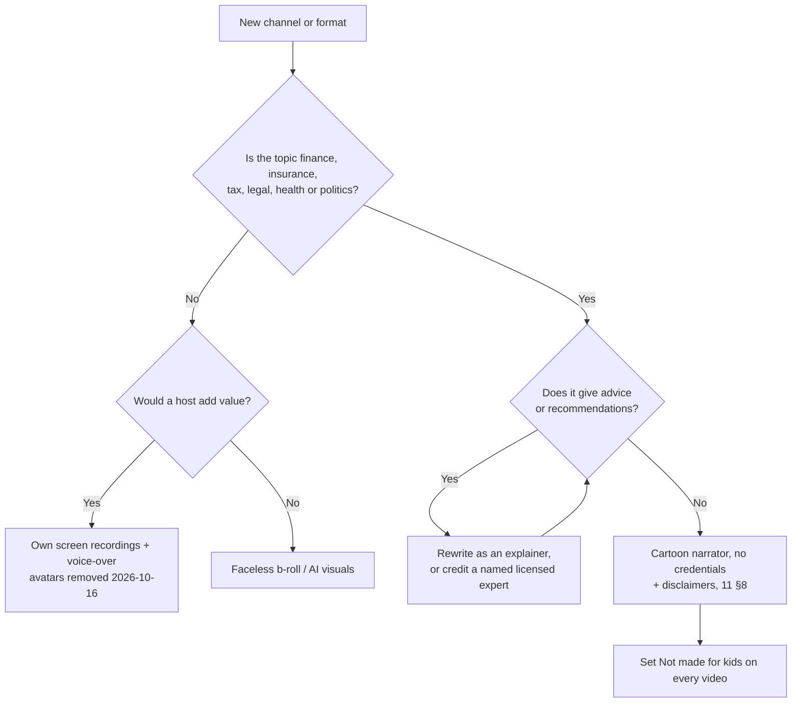

# 12 — Final Portfolio: US High-CPM Channels and Presenter Formats

> **Status:** current · **Updated:** 2026-10-16 · **Related:** [13 Channel brands](13-channel-brands.md), [07 Execution roadmap](../1-strategy/07-execution-roadmap.md), [08 High-CPM US niches](08-high-cpm-us-niches.md), [09 AI avatar presenters (archived)](../archive/09-ai-avatar-presenters.md), [11 Avatar and YMYL policy](../3-policy/11-avatar-and-ymyl-policy.md), [17 Replacement niches](17-replacement-niches.md)

**This doc replaces the portfolio in 02 §6.** It combines the niche research for US ad value (08), the avatar research (09, now archived), the cartoon research (10) and the AI-persona policy check (11). Figures marked *(est.)* are estimates.

> **Update 2026-10-16: HeyGen and AI avatars removed.** All 10 channels are now **faceless** (10 faceless, 0 avatar). Software Shortcut and Rank Test Lab, previously hosted by the AI avatars "Jules" and "Theo", now use our own screen recordings with voice-over, motion graphics and charts. Doc 09 moved to [archive](../archive/09-ai-avatar-presenters.md). Pexels was also dropped as a stock source; Pixabay replaces it.

## 1. The rule that decides presenter format

Under YouTube's **"AI Personas Related to Sensitive Topics"** rule (verified in 11 §1), a channel loses monetisation if an AI persona "presents itself as a human expert providing advice" on health, legal, finance or politics. An AI label or a disclaimer does not change that. That gives three rules:

| Content | Presenter | Why |
|---|---|---|
| Finance, insurance, tax, legal, health (YMYL) | **Cartoon narrator with no credentials**, explaining concepts and never giving advice; or b-roll | It can't read as a "human expert" (11 §6) |
| Non-advice topics where a host adds something (tools, history, science) | ~~AI avatar~~ **not used since 2026-10-16** (HeyGen removed); use faceless screen recordings + voice-over | Audience response to avatars is mixed (09 §5) |
| Anything | **Never** a realistic avatar giving advice; never "Dr.", "CFP" or "Attorney" in a persona's name; never kid-appealing design | Loss of monetisation, FTC and California AB 489 exposure, and the made-for-kids risk (11 §4–5) |

## 2. The 10 channels (final brands)

The names, handles, bios, palettes and starter titles are in [13 — Channel brands](13-channel-brands.md). **On 2026-10-16 the 5 finance, tax, insurance and legal channels were removed** (Plastic Math, Retire Mechanics, Tax Day Decoded, Claim Explained, Was It Legal?), because YouTube's AI-persona rule (11 §1) puts their monetisation at risk. They were replaced with 5 non-sensitive, high-RPM niches chosen in [17](17-replacement-niches.md).

| # | Brand | Handle | Niche | Presenter | US long-form RPM *(est.)* | Policy | Batch |
|---|---|---|---|---|---|---|---|
| 1 | **Square Foot Money** | @squarefootmoney | Real estate market data, mortgages | Faceless maps and charts | $5–13 | 🟡 market data only, no advice | C |
| 2 | **Software Shortcut** | @softwareshortcut | AI and SaaS tutorials | Faceless, own screen recordings + voice-over and motion graphics | $5–14 | 🟢 | B |
| 3 | **Business Model Files** | @businessmodelfiles | How US companies make money | Faceless b-roll and charts | $5–12 | 🟢 | **A (pilot)** |
| 4 | **Car Cost Truth** | @carcosttruth | Cost of buying, leasing and owning a car | Faceless b-roll | $5–12 | 🟢 | C |
| 5 | **Gravity What If** | @gravitywhatif | Space and physics hypotheticals | Faceless 3D/AI visuals | $6–15 | 🟢 | **A (pilot)** |
| 6 | **Megabuild Blueprint** | @megabuildblueprint | Engineering megaprojects: structures, infrastructure, factories | Faceless blueprint/3D cutaways | $6–14 | 🟢 | **A (pilot)** |
| 7 | **Lock Screen Logic** | @lockscreenlogic | Cybersecurity and privacy (defensive only) | Faceless, own screen recordings + attack-flow diagrams | $5–12 | 🟡 no offensive how-tos | B |
| 8 | **Furnace to Faucet** | @furnacetofaucet | How home systems work + US repair costs (no DIY) | Faceless 3D house cutaways + cost cards | $4–10 | 🟡 no live electrical/gas how-tos | C |
| 9 | **Wing and Turbine** | @wingandturbine | Aviation and how planes work (no crashes) | Faceless 3D aircraft systems + diagrams | $5–11 | 🟡 no crash content | B |
| 10 | **Rank Test Lab** | @ranktestlab | Small-business marketing and SEO experiments | Faceless, own test-site screen recordings + voice-over and charts | $6–13 | 🟡 no income claims | C |

**Availability:** every YouTube handle and .com domain returned "free", and a USPTO wordmark search found no live matches (all checked 2026-10-16). Instagram and Facebook are **unverified**, because they can't be checked without logging in. Claim all 30 profiles and 10 domains on the same day.

**Presenter mix:** 10 faceless, 0 avatar (HeyGen removed 2026-10-16).

**Risk profile:** no channel is a core YMYL topic any more, so a single AI-persona enforcement action can no longer hit most of the portfolio. The remaining 🟡 risks are content guardrails within a channel (the red lines in 13 §3 and 17 §Policy screen), not channel-level bars. The pilot is made up of the three 🟢 faceless channels with the strongest proven faceless leaders (Professor Of How 16M, Real Engineering 5.1M, How Money Works).

## 3. Production stack per presenter type

| Format | Primary | Fallback | Self-hosted option | Added cost per Short / per 9-min long-form *(est.)* |
|---|---|---|---|---|
| **Cartoon** (0 channels since 2026-10-16; kept for reference, 10) | Rigged 2D mascot (Rive or SVG layers in Remotion + Rhubarb lip-sync) for all talking parts; Kling 3.0 / Veo 3.1 Fast image-to-video for cutaways from on-model keyframes | Hedra Character-3 for stylised talking shots | Wan 2.2 needs a rented NVIDIA GPU, because it isn't practical on the M4 Pro (14 §7). Train character LoRAs with mflux on Z-Image / FLUX.2 klein (14 §6) | $1.2–2.5 / $10–16 (hybrid, 10 §8) |
| ~~**AI avatar**~~ (0 channels; **removed 2026-10-16** with HeyGen; kept for reference, archived 09) | — | — | — | — |
| **Faceless** (10 channels) | Pipeline from 04: local Z-Image-Turbo 4-bit stills → Pixabay stock → mock placeholder (never published; no Bedrock images since 2026-10-16), Real-ESRGAN upscale, own parallax motion; own screen recordings for Software Shortcut, Lock Screen Logic and Rank Test Lab; Veo for hero shots | — | Fully local on the Mac: Qwen3.5-9B / Gemma 4 12B, Kokoro, parakeet-mlx, Z-Image (14, 18) | $0.40–0.80 / $3–5 (04 §7) |

**Licence traps** (09 §4, 10 §11):
- **Non-commercial:** Sonic, and InsightFace's face models, which LivePortrait, Hallo and LatentSync pull in.
- **Restricted by region:** HunyuanVideo-Avatar's licence excludes the EU, UK and South Korea.
- **Avoid:** the Sora 2 API, which shut down on 24 Sep 2026.
- **Personas from real people:** never build one from a real person's photo or voice.

No channel uses an avatar since 2026-10-16, so the avatar screen-time limits and QA checklist (archived 09 §6.3, §9) no longer apply. The cartoon QA checklist is kept for reference (10 §10).

## 4. Disclosure settings

From 11 §6.1. Set them on every video. **The avatar column is no longer used** (0 avatar channels since 2026-10-16); all 10 channels follow the Faceless column.

| Setting | Avatar channels *(unused)* | Cartoon channels *(unused)* | Faceless (all 10) |
|---|---|---|---|
| YouTube altered/synthetic | On | Off (animation is exempt) | On if it includes realistic AI scenes |
| YouTube audience | Not made for kids | **Not made for kids, per video** | Not made for kids |
| Instagram "AI-generated profile" | **On** at account creation | Off | Off |
| IG/FB "AI info" | On | On if photorealistic elements are used | As needed |
| Spoken and description disclaimer (11 §8) | Required on YMYL | Required on YMYL | Required on YMYL |

Buffer's API has an `isAiGenerated` field for YouTube and Instagram (05 §3). Doc 11 still marks the pass-through of each platform's label as unverified. **Make one test post per platform in Phase 0** and check the label in YouTube Studio and the Instagram app. Until that's confirmed, set the labels by hand.

## 5. Budget and plan with the local-first stack

Most generation runs **on the M4 Pro (14)**, Bedrock handles fact-checking and polishing (15), and agents and MCP handle orchestration (16). Bedrock is text-only (no Bedrock image or video since 2026-10-16). Cloud is used only for AI hero clips and publishing.

| Item | $/month *(est.)* | Source |
|---|---|---|
| Buffer, about 30 channels (Team) | ~$195 | 05 §2 |
| Bedrock: script polish + fact-checks on accuracy-critical channels | ~$20–25 | 15 §5–6 |
| Cloud hero clips (Veo 3.1 Fast) across the 10 faceless channels | ~$100–200 | 17 §Production feasibility |
| Public CDN storage, domains, misc | ~$30–60 | 05 §4 |
| Local TTS, captions, images (Z-Image-Turbo), parallax motion, music, Remotion renders; Pixabay stock (free API key) | $0 (electricity) | 14, 18 |
| **Cash total** | **~$350–500** (was ~$550–700 before HeyGen was removed 2026-10-16; no Bedrock image line was ever counted, so dropping Bedrock images 2026-10-16 leaves it unchanged) | |
| One-off: attorney review of the 10 names (trademarks) | quote needed | 13 §6 |

**People time is the real constraint** *(est.)*:
- **Review:** about 55–65 h a month. The YMYL fact-check overhead is gone, but every video still gets a person's review (04 §5.4).
- **Screen recording:** Software Shortcut, Lock Screen Logic and Rank Test Lab need about 30 min of recording per Short and 2–3 h per long-form (17 §Production feasibility). **Cut their Shorts from the long-form recordings** rather than recording each Short separately. That keeps them to roughly 15–20 h a month each.

**Mac capacity** *(est., 14 §9)*: about 10–15 minutes of machine time per Short and 55–75 minutes per long-form, or about 4.5–6 hours a night at full scale. The screen-recording channels need less. Run the week-1 benchmark (14 §9.6) to replace these estimates with measured numbers.

**Money timing:** new channels won't be monetised in time for Q4 2026. Ad pay is strongest in Q4 (08 §9), so the realistic first strong quarter is **Q4 2027**. Monetisation starts once each channel is in the Partner Program (around month 3 or later).

## Sources

This decision doc has no external sources of its own. It combines [08](08-high-cpm-us-niches.md), [09](../archive/09-ai-avatar-presenters.md) (archived), [10](../archive/10-ai-cartoon-characters.md), [11](../3-policy/11-avatar-and-ymyl-policy.md) and [14](../4-production/14-local-models-mac-m4.md); see their Sources sections for the underlying citations.
