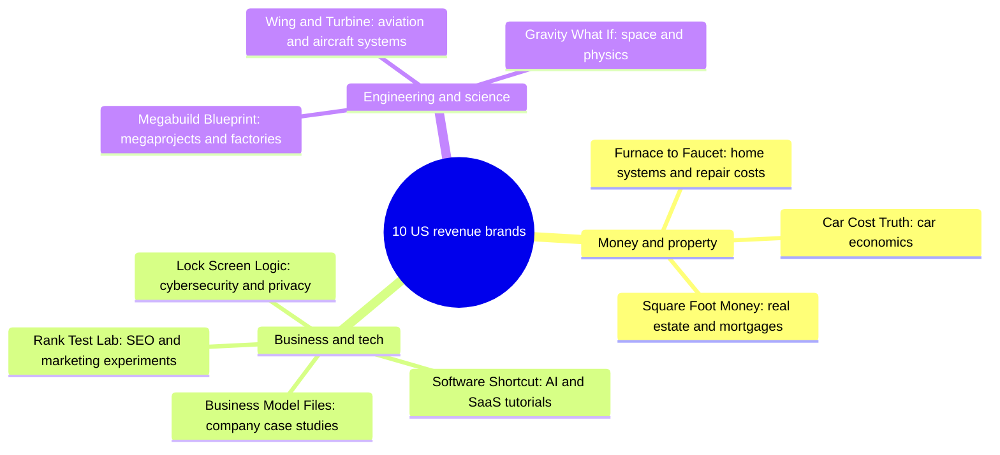

# 13 — Channel Brands: Final Names, Handles and Brand Packs

> **Status:** current · **Updated:** 2026-10-16 · **Related:** [12 Final portfolio](12-final-portfolio.md), [17 Replacement niches](17-replacement-niches.md), [11 Avatar and YMYL policy](../3-policy/11-avatar-and-ymyl-policy.md)

> Status: decision draft · Checked: 2026-10-16 · Builds on [12](12-final-portfolio.md) (niches, presenters), [08](08-high-cpm-us-niches.md) (US RPM), [11 §4–6](../3-policy/11-avatar-and-ymyl-policy.md) (naming red lines) and [17](17-replacement-niches.md) (replacement niches). RPMs are 08's and 17's *(est.)* US long-form planning figures, not forecasts.

**Changes from 12.** (1) Every channel owns **one** subject domain. (2) Five of 12's working names were **already taken on YouTube** (see §6), so the kept niches were renamed. (3) **2026-10-16:** the five YMYL channels (finance, tax, insurance, law) were retired (see the note below §1) and replaced with the five non-sensitive niches picked in [17 §Final decision](17-replacement-niches.md).

## 1. Summary

| # | Brand | Handle | Niche (single domain) | Presenter | US LF RPM *(est.)* | Availability (YT / .com / IG+FB) |
|---|---|---|---|---|---|---|
| 1 | **Square Foot Money** | @squarefootmoney | Real estate and mortgages | Faceless maps, charts and b-roll | $5–13 | likely free / likely free / unverified |
| 2 | **Software Shortcut** | @softwareshortcut | AI and SaaS tool tutorials | Faceless, own screen recordings + voice-over | $5–14 | likely free / likely free / unverified |
| 3 | **Business Model Files** | @businessmodelfiles | How US companies make money | Faceless b-roll + charts | $5–12 | likely free / likely free / unverified |
| 4 | **Car Cost Truth** | @carcosttruth | The economics of buying, leasing and owning a car | Faceless b-roll | $5–12 | likely free / likely free / unverified |
| 5 | **Gravity What If** | @gravitywhatif | Space and physics hypotheticals | Faceless 3D/AI visuals | $6–15 | likely free / likely free / unverified |
| 6 | **Megabuild Blueprint** | @megabuildblueprint | Engineering megaprojects: ground structures, infrastructure, factories (no aircraft) | Faceless isometric/blueprint 3D cutaways | $6–14 | likely free / likely free / unverified |
| 7 | **Lock Screen Logic** | @lockscreenlogic | Cybersecurity and online privacy, defensive and conceptual only | Faceless own screen recordings + attack-flow diagrams | $5–12 | likely free / likely free / unverified |
| 8 | **Furnace to Faucet** | @furnacetofaucet | How home systems work and what repairs cost by US region (no DIY how-to) | Faceless 3D house cutaways + cost cards | $4–10 | likely free / likely free / unverified |
| 9 | **Wing and Turbine** | @wingandturbine | Aviation and how planes work (no crash content) | Faceless 3D aircraft systems + diagrams | $5–11 | likely free / likely free / unverified |
| 10 | **Rank Test Lab** | @ranktestlab | Digital marketing and SEO for small business (B2B), real experiments | Faceless, own test-site dashboards + voice-over and charts | $6–13 | likely free / likely free / unverified |

"Likely free" means `youtube.com/@handle` returned 404 and Verisign RDAP returned 404 for `handle.com` on 2026-10-16. That is a point-in-time check: **register all 30 profiles and 10 domains on the same day**. Instagram and Facebook **cannot be checked reliably without logging in** (Instagram's profile API returned 401, and Facebook returns 200 for any username). No live USPTO wordmark matches all of a brand's distinctive words (§6.2).

**Retired brands (YMYL, removed 2026-10-16):** Plastic Math (credit), Retire Mechanics (retirement), Tax Day Decoded (tax), Claim Explained (insurance) and Was It Legal? (law). YouTube's "AI Personas Related to Sensitive Topics" rule is a channel-level monetisation bar on AI personas presenting finance, legal or health advice, with no exception for disclosure, and it is silent on cartoon personas, so these five carried the portfolio's biggest demonetisation risk ([11 §1](../3-policy/11-avatar-and-ymyl-policy.md), V1). Their handles were never registered.

## 2. Niche changes from 12

| 12 slot | Decision | One-line justification |
|---|---|---|
| Home & Cover (real estate) | **Split → #1 Square Foot Money** | Lenders and proptech buy a different keyword set from insurers ($5–13) |
| AI Tool Lab, Ticker Tales, Car Money, Cosmic What If | **Kept, renamed → #2–#5** | The niches are unchanged. The names are taken on YouTube (§6) |
| Credit & Cash, Home & Cover (insurance), Was It Legal? | **Retired** (YMYL) | AI-persona strike risk (11 §1); see the note in §1 |
| History Unboxed, Mind & Work, Body Explained | **Dropped** | Lowest RPM ($4–10), IG-funnel roles, or "very high" YMYL risk (12 §2) |
| New | **#6 Megabuild Blueprint** | Top score in 17 (26), 🟢 policy; Education & Science is the only robust measured high median ($10.22, AIR) |
| New | **#7 Lock Screen Logic** | VPN, password-manager and security-SaaS sponsors (VPN sponsorship CPM $18–25); A feasibility |
| New | **#8 Furnace to Faucet** | Home improvement is the joint 2nd-most expensive Google Ads industry (CPC $7.85); B once reframed as no-how-to |
| New | **#9 Wing and Turbine** | Transport is a measured $5.69 with the highest ad load (AIR); no AI-persona risk. Replaces Careers (17) |
| New | **#10 Rank Test Lab** | Highest RPM of the five ($6–13); SEO and ads SaaS buy this audience |

**Presenter mix:** **10 faceless**, **0 AI avatar** and **no cartoon channels**. The cartoon rig and budget in 10 and 12 §3 are no longer needed (17), and the HeyGen avatars were removed on 2026-10-16 (see the Retired note below). Every faceless channel gets its own visual grammar (blueprint isometric, screen-plus-flow-diagram, house cutaway, aircraft systems, maps, case files, b-roll, cinematic 3D) to avoid template sameness (03).

**Retired (HeyGen removed 2026-10-16):** the AI-avatar hosts "Jules" (Software Shortcut) and "Theo" (Rank Test Lab) are retired, and their persona specs are no longer maintained. Both channels are faceless; the archived [09](../archive/09-ai-avatar-presenters.md) keeps the avatar research for history.

### 2.1 Domain boundaries (who owns the overlapping topics)

| Topic | Owner | Others may only… |
|---|---|---|
| Auto loans, leases, car insurance premiums | #4 Car Cost Truth | — |
| PMI, escrow, closing costs, home prices, mortgages | #1 Square Foot Money | #8 never covers financing, HELOCs or resale ROI |
| What's inside the house: HVAC, plumbing, roof, electrical, smart-home systems, repair costs | #8 Furnace to Faucet | #1 shows repairs as one line item |
| Company business models (incl. SaaS and airlines) | #3 Business Model Files | #2 teaches tools, never the business; #9 covers the aircraft, not the airline's finances |
| How to use AI and SaaS tools (clicks, setup) | #2 Software Shortcut | #10 shows tool screens only as part of an experiment |
| Marketing tactics, SEO and ad experiments and their results | #10 Rank Test Lab | #2 never runs ranking or ad experiments |
| All security and privacy tools (VPNs, password managers, 2FA, antivirus) | #7 Lock Screen Logic | #2 never covers them; #8 covers smart-home hardware, #7 its security |
| Ground structures, infrastructure, factories, bridges, dams, tunnels | #6 Megabuild Blueprint | #9 covers airports only as aircraft operations |
| Aircraft and flight systems | #9 Wing and Turbine | #6 never covers aircraft or their factories' products |
| Space, rockets, physics hypotheticals | #5 Gravity What If | #6 may cover launch-pad civil works only |

## 3. Brand packs

### 1. Square Foot Money
- **Tagline:** "Housing, priced by the square foot."
- **Positioning:** US housing-market data and the mechanics of buying a home (mortgages, PMI, closing costs), told through maps and charts.
- **Niche and why it pays:** real estate and mortgages, **$5–13**. Lenders, brokerages and proptech advertise here.
- **Presenter:** faceless. Animated maps, data charts, licensed or AI b-roll of houses, and one consistent General American narrator. No host.
- **Palette:** `#1D3557` blueprint · `#A0522D` brick · `#E9D8A6` sand
- **Logo:** a house outline drawn on a square grid, with a "$" in the window.
- **IG bio:** "US housing market data + how mortgages really work. Maps, charts, no hype. 🇺🇸 Not a realtor or lender. Education only."
- **YT description:** "Data-driven explainers on US home prices, mortgages, PMI and closing costs. / Educational only, not financial advice; lender links may be affiliate links."
- **FB category:** Media/news company (secondary: Education website)
- **Starter titles:** Where Your Mortgage Payment Actually Goes (PITI, Explained) · Closing Costs, Line by Line, on a $400,000 Home · What PMI Is and When It Goes Away · Why Austin Home Prices Fell While Ohio's Rose · Escrow Accounts in One Diagram
- **Revenue:** AdSense + **mortgage-rate marketplace and lender lead-gen affiliates**. Meta Special Ad Category rules apply to any paid housing ads (11 §6). No fair-housing steering.

### 2. Software Shortcut
- **Tagline:** "The fastest way through your software."
- **Positioning:** hands-on, real-screen tutorials that get small-business people and professionals from problem to working workflow in AI and SaaS tools.
- **Niche and why it pays:** B2B SaaS and AI tool tutorials, **$5–14**. SaaS free-trial CPAs come with **recurring** affiliate commissions and sponsor demand. YMYL risk is low.
- **Presenter:** **faceless**: our own real screen recordings with an AI voice-over (Kokoro), cursor highlights, motion graphics and callout cards (12 §3). No avatar host since 2026-10-16. AI disclosure stays on (12 §4).
- **Palette:** `#1E1E24` graphite · `#5B4BDB` violet · `#B6F36A` lime
- **Logo:** a cursor arrow that bends into a lightning-bolt shortcut.
- **IG bio:** "Real-screen AI & SaaS tutorials: Notion, Zapier, Sheets, AI tools. AI-voiced. New workflow every week ↓"
- **YT description:** "Step-by-step AI and SaaS tutorials recorded on real screens, from setup to working workflow. / Narration is AI-generated; some links are affiliate links."
- **FB category:** Education website (secondary: Software)
- **Starter titles:** Build a Client Intake Form in Notion in 10 Minutes · Automate Invoice Reminders with Zapier (No Code) · Turn a 40-Page PDF into a One-Page Brief with AI · 5 Google Sheets Formulas That Replace a Paid Tool · Set Up a Shared Inbox for a Two-Person Business
- **Revenue:** AdSense + **recurring SaaS affiliate programs** + tool sponsorships. Under NY GBL §396-b, sponsor reads by the AI narrator carry an on-screen "AI-generated voice" label (11 §4).

### 3. Business Model Files
- **Tagline:** "Every company has a money machine. We open the file."
- **Positioning:** documentary-style breakdowns of how well-known US companies actually make money, using public filings, charts and b-roll.
- **Niche and why it pays:** business case studies, **$5–12**. B2B, finance and software advertisers follow this audience. The format is proven by Modern MBA, Company Man and How Money Works (08 §7).
- **Presenter:** faceless b-roll and charts in a "case file" visual style. (The optional AI-avatar anchor intro from 08 §8 was dropped with HeyGen on 2026-10-16.)
- **Palette:** `#E8D3A2` manila · `#111111` black · `#2F6B4F` ledger green
- **Logo:** a manila folder tab marked "BMF" with a small upward chart line.
- **IG bio:** "How America's biggest companies really make money. One business model, one file, every week. Sources: public filings. 📂"
- **YT description:** "Business case studies on how US companies make money, built from 10-Ks, earnings calls and public data. / Not investment advice; we don't recommend buying or selling any security."
- **FB category:** Media/news company
- **Starter titles:** How Costco Makes Money (It's Not the Groceries) · Why a Chick-fil-A Earns More per Store Than a McDonald's · How Spotify Pays, and Doesn't Pay, Artists · The Hidden Business Model of Airport Lounges · How Waste Management Became a Profit Machine
- **Revenue:** AdSense + **newsletter/sponsor reads** and **business-book and audiobook affiliates**. Fallback handle `@bizmodelfiles`, because the main one is 18 characters.

### 4. Car Cost Truth
- **Tagline:** "The sticker price is just the start."
- **Positioning:** the total cost of buying, leasing, financing and owning a US car, worked out line by line: depreciation, loans, fuel and maintenance.
- **Niche and why it pays:** car economics, **$5–12**. Auto OEMs, lenders and insurers advertise here, and Transport is a measured $5.69 (AIR, 08 §3).
- **Presenter:** faceless b-roll. AI renders or licensed footage, never ripped reviews, and press-kit image rights are checked (08 §8).
- **Palette:** `#2B2D31` asphalt · `#F26B1D` signal orange · `#C7CCD1` chrome
- **Logo:** a speedometer whose needle points to a "$" instead of mph.
- **IG bio:** "What cars really cost: depreciation, loans, leases, fuel, upkeep. 🇺🇸 The 5-year math, not the sticker. Education only."
- **YT description:** "Line-by-line breakdowns of what it costs to buy, lease and own a car in the US. / Educational only, not financial advice; some links are affiliate links."
- **FB category:** Media/news company (secondary: Education website)
- **Starter titles:** The 5-Year Cost of a $35,000 Car, Line by Line · Leasing vs Buying: The Math on a Honda CR-V · Why New Cars Lose About 20% in Year One · What a 72-Month Car Loan Really Costs · EV vs Gas: Total Cost to Own in 5 States
- **Revenue:** AdSense + **car-buying service and auto-loan refinance marketplace affiliates**.

### 5. Gravity What If
- **Tagline:** "Physics, pushed to the edge."
- **Positioning:** cinematic space and physics hypotheticals, scientifically sourced and US-voiced, for curious adults.
- **Niche and why it pays:** education and science, **$6–15**. Education & Science is the highest **measured** median in 08 ($10.22, AIR). This is the lowest-risk revenue channel and the pilot's easy win.
- **Presenter:** faceless 3D and AI visuals with one consistent narrator. AI realistic-scene disclosure is on where it applies (12 §4).
- **Palette:** `#0B1026` deep space · `#2EC4B6` nebula teal · `#FFB627` solar
- **Logo:** a planet whose ring forms a question mark.
- **IG bio:** "What if the Moon were twice as close? Space & physics hypotheticals, backed by real science. New what-if every week 🪐"
- **YT description:** "Cinematic what-if scenarios about space and physics, worked through with real science and cited sources. / Visuals include AI-generated imagery."
- **FB category:** Science website
- **Starter titles:** What If Earth Had Rings Like Saturn? · What If the Moon Were Twice as Close? · What If You Fell into Jupiter? · What If the Sun Became a Black Hole Tomorrow? · What If Earth Stopped Spinning for One Second?
- **Revenue:** AdSense + **telescope and science-gear affiliates** + learning-platform sponsorships.

### 6. Megabuild Blueprint
- **Handle:** @megabuildblueprint (18 characters) · fallbacks @megabuildblueprinthq (20), domain megabuildblueprint.com
- **Tagline:** "Big builds, drawn to scale."
- **Positioning:** how the world's largest ground structures, infrastructure and factories are designed and built (bridges, dams, tunnels, ports, chip fabs, gigafactories), shown as isometric blueprint cutaways with real scale and cost data. Never aircraft.
- **Niche and why it pays:** engineering megaprojects, **$6–14**. It sits in Education & Science, the only robust measured high median ($10.22, AIR); EdTech, industrial and B2B brands sponsor it. Proven faceless leaders: Professor Of How (16M), Real Engineering (5.1M) (17).
- **Presenter:** faceless. Isometric and blueprint-style 3D cutaways that build up layer by layer, timeline and scale diagrams, US-government imagery (USACE, DOT, EIA) and one calm narrator. No host.
- **Palette:** `#0E2A47` drafting blue · `#F5F1E6` vellum · `#E8752A` safety orange
- **Logo:** an isometric I-beam drawn in white blueprint linework, with dimension arrows forming an "M".
- **IG bio:** "How the world's biggest builds actually go up: bridges, dams, tunnels, factories. Drawn to scale, sourced from public filings. 🏗️"
- **YT description:** "Blueprint-style 3D cutaways of megaprojects, from foundations to final cost, built from public engineering and cost data. / Visuals include AI-generated imagery; no TV footage is reused."
- **FB category:** Science website (secondary: Education website)
- **Starter titles:** How the Hoover Dam Was Poured Without Cracking · Inside a TSMC Arizona Chip Fab, Floor by Floor · How the Gotthard Base Tunnel Was Dug Under the Alps · Why the Golden Gate Bridge Needs Painting Forever · How a Gigafactory Turns Raw Lithium into Battery Packs
- **Revenue:** AdSense + **learning-platform sponsorships** (Brilliant-type) + engineering-book and model-kit affiliates.
- **Red lines (17 §Policy screen):** no disaster porn; collapse or disaster episodes use non-exploitative framing and no unsourced death counts; no reused Discovery, "How It's Made" or TV clips, and no others' drone footage; state-backed projects (NEOM, Belt and Road) stay factual, not political.

### 7. Lock Screen Logic
- **Handle:** @lockscreenlogic (15) · fallbacks @lockscreenlogichq, domain lockscreenlogic.com
- **Tagline:** "Security that makes sense before it's needed."
- **Positioning:** how online attacks and privacy leaks work, shown conceptually as attack-flow diagrams, and how to defend against them, shown on our own devices and accounts. Defensive and conceptual only.
- **Niche and why it pays:** cybersecurity and online privacy, **$5–12**. VPNs, password managers, antivirus, identity monitoring and B2B security SaaS sponsor heavily (VPN sponsorship CPM $18–25; 33 VPN/security brands ran 1K sponsored videos in Jul 2026, CreatorDB via 17).
- **Presenter:** faceless. Our own screen recordings of settings and tools, plus animated attack-flow diagrams and cited CVE, FTC and CISA data; one narrator. No hoodie-hacker stock.
- **Palette:** `#121417` terminal black · `#2BD9A0` signal green · `#FFB000` alert amber
- **Logo:** a padlock whose shackle is drawn as a flowchart arrow looping back into the body.
- **IG bio:** "How hacks & privacy leaks actually work, and how to shut them down. Defensive only. Real screens, real settings. 🔒 New breakdown every week."
- **YT description:** "Plain-English explainers on phishing, passwords, 2FA, data brokers and privacy settings, with attack-flow diagrams and real-screen defense steps. / Educational and defensive only; some links are affiliate links."
- **FB category:** Education website (secondary: Science, technology & engineering)
- **Starter titles:** How a Phishing Text Steals Your Login (and the One Setting That Stops It) · What Data Brokers Know About You, and How to Opt Out · Passkeys vs Passwords: What Actually Changes · How SIM-Swap Attacks Work, Diagrammed · 7 Phone Privacy Settings Worth Changing Today
- **Revenue:** AdSense + **password-manager, VPN (privacy only, never geo-unblocking) and identity-monitoring affiliates and sponsors**, disclosed spoken and on screen.
- **Red lines (17 §Policy screen):** no exploit walkthroughs against systems we don't own, no "how to gain unauthorized access", no phishing kits or credential-theft steps, no paywall bypass, no stalkerware, no VPN geo-unblocking pitches; no one else's demo footage. Identity-theft recovery stays general (no finance advice); privacy law stays descriptive (no legal advice).

### 8. Furnace to Faucet
- **Handle:** @furnacetofaucet (15) · fallbacks @furnacetofaucethq, domain furnacetofaucet.com
- **Tagline:** "What's in your walls, and what it costs when it breaks."
- **Positioning:** how a US home's systems work (HVAC, plumbing, roofs, electrical, water heaters, smart-home retrofits), shown in 3D house cutaways, plus dated regional repair-cost cards. Explains and prices; never a DIY how-to.
- **Niche and why it pays:** home systems and repair costs, **$4–10**. Home improvement is the joint 2nd-most expensive Google Ads industry (CPC $7.85, LocaliQ via SEL); home services, HVAC, roofing, solar, home-warranty and tool brands advertise.
- **Presenter:** faceless. 3D cutaway house (Engineering Mindset style) with systems highlighted one at a time, and regional cost cards built from a cited data source (RSMeans, BLS or our own surveys). No hands-on footage.
- **Palette:** `#3B2F2A` walnut · `#D9653B` copper pipe · `#7FA7B8` duct blue
- **Logo:** a house cross-section with one pipe running from a flame at the bottom to a droplet at the top.
- **IG bio:** "How your home's systems work + what repairs cost in your region. HVAC, plumbing, roofs, electrical. Not a contractor. No DIY. 🏠"
- **YT description:** "3D cutaways that show how US home systems work and what repairs typically cost by region, with the year and data source on screen. / Educational only; we're not licensed contractors. Get local quotes. Some links are affiliate links."
- **FB category:** Education website (secondary: Home improvement)
- **Starter titles:** How a Heat Pump Moves Heat Out of Cold Air · What a Water Heater Replacement Costs in 5 US Regions (2026) · Why Roofs Fail at the Flashing, Not the Shingles · Inside Your Electrical Panel: What Each Breaker Protects · Tank vs Tankless: How They Work and What They Cost to Run
- **Revenue:** AdSense + **home-services quote and home-warranty affiliates** + smart-home device affiliates (security features link to #7's topics, not ours).
- **Red lines (17 §Policy screen):** no live-panel or gas "anyone can do it" content; no asbestos or lead how-tos; no AI "licensed electrician" or contractor persona; no fake before/after shots; every cost figure is dated and sourced; no financing (HELOCs, loans, resale ROI) and no code or permit law beyond "check your local code".

### 9. Wing and Turbine
- **Handle:** @wingandturbine (14) · fallbacks @wingturbine, @wingandturbinehq, domain wingandturbine.com
- **Tagline:** "How the airplane actually works."
- **Positioning:** the systems inside modern aircraft (wings, turbofans, flight controls, pressurization, landing gear, autopilot) explained as 3D systems diagrams for adults who fly and wonder. Engineering only, never crashes.
- **Niche and why it pays:** aviation, **$5–11**. Transport is a measured $5.69 with the highest ad load of any niche (2.55 ads/view, AIR); airlines, travel brands, flight schools and aerospace employers advertise.
- **Presenter:** faceless. Original 3D aircraft-system cutaways and animated diagrams, plus public-domain NASA, FAA and DVIDS imagery (no NASA insignia on AI images). One narrator with no pilot or credential claim.
- **Palette:** `#1C2B39` night sky · `#D8DEE4` aluminum · `#3A86FF` nav-light blue
- **Logo:** a turbofan seen head-on, its fan blades forming a stylized wing cross-section.
- **IG bio:** "How airplanes really work: wings, jet engines, cabin pressure, autopilot. 3D diagrams, no drama. ✈️ New system every week."
- **YT description:** "3D explainers on how airliners fly, from lift and turbofans to pressurization and landing gear, sourced from FAA and NASA material. / Visuals include AI-generated imagery; no crash content."
- **FB category:** Science website (secondary: Education website)
- **Starter titles:** How a Turbofan Makes 90% of Its Thrust Without Burning Fuel · Why Airliners Cruise at 35,000 Feet · How Cabin Pressure Is Controlled, Valve by Valve · What Flaps and Slats Actually Do on Landing · How Autopilot Flies a 787
- **Revenue:** AdSense + **flight-simulator, aviation-headset and travel affiliates** + flight-school and aerospace-employer sponsorships.
- **Red lines (17 §Policy screen):** no crash content: no realistic AI crash recreations, no victims in thumbnails, no hijacking detail, no conspiracy pieces; no AI "pilot" persona with credentials; no spotter or cockpit footage, airline ads, airline or Airbus press-kit images, or ATC audio (LiveATC terms unverified).

### 10. Rank Test Lab
- **Handle:** @ranktestlab (11) · fallbacks @ranktestlabhq, domain ranktestlab.com
- **Tagline:** "We test it on our sites so you don't guess on yours."
- **Positioning:** real SEO, local-search and ads experiments run on our own small test sites, with the before/after dashboards shown in full, for US small-business owners and marketers. Results, not promises.
- **Niche and why it pays:** digital marketing and SEO for small business (B2B), **$6–13**, the highest RPM of the five new niches (1of10, OutlierKit via 17). SEO and ads SaaS (Semrush, Ahrefs, HubSpot), website builders and POS brands buy this audience.
- **Presenter:** **faceless**: our own Search Console and analytics screen recordings, before/after ranking charts and motion graphics, with an AI voice-over (Kokoro) (12 §3). No avatar host since 2026-10-16. AI disclosure stays on (12 §4).
- **Palette:** `#16302B` deep teal · `#F4F1EA` chalk · `#FF5A36` result red
- **Logo:** a beaker whose liquid level is a rising bar chart, topped with a "#1".
- **IG bio:** "Real SEO & marketing experiments on our own test sites. Full dashboards, no income claims. AI-voiced. New test every week ↓"
- **YT description:** "Small-business SEO, local search and ad experiments run on sites we own, with the real numbers shown. / Narration is AI-generated. Results vary; no earnings claims. Some links are affiliate links."
- **FB category:** Education website (secondary: Marketing agency is **not** used, to avoid implying a service)
- **Starter titles:** We Published 30 AI Articles on a Test Site. Here's What Google Did · Does a Google Business Profile Post Move Local Rankings? (60-Day Test) · Internal Links vs Backlinks: Which Moved Our Page First · We Ran a $100 Google Ads Test for a Fake Bakery · Schema Markup: Before and After on Our Own Site
- **Revenue:** AdSense + **recurring SEO/ads SaaS and website-builder affiliates** + tool sponsorships. Sponsor reads by the AI narrator carry an on-screen "AI-generated voice" label (NY GBL §396-b, 11 §4).
- **Red lines (17 §Policy screen):** no income guarantees or "make money online"/passive-income framing (FTC earnings-claim risk); no fake-review, bought-follower, bot or black-hat tactics; no undisclosed SaaS affiliate links; experiments only on sites we own.

## 4. Brand map

## 5. Naming rules used

1. **2–3 words**, easy to say aloud, with a handle of **≤20 characters** and no dots or underscores, so it is identical on IG, YT and FB. Facebook usernames need ≥5 characters.
2. **No credential words:** no Dr, MD, CFP, CPA, Attorney, Lawyer, Nurse, Expert, Advisor, Agent, Guru, Pilot, Captain, Electrician, Contractor or Hacker. This follows the FTC net-impression rule, California AB 489 and YouTube's AI-persona rule (11 §4, §6). Narrator names, if any, are plain first names.
3. **Not kid-appealing.** No cute animals, no "kids", "fun" or "ABC" wording, and adult palettes with no primary-colour rainbow (11 §5).
4. **Platform-neutral.** No "Tube", "Gram", "Shorts" or "Reels".
5. **US-English feel**, with US nouns where they help (square foot, car payment, furnace, lock screen).
6. **Searchable and distinct.** Each name contains its domain keyword (square foot, software, business model, car cost, gravity, megabuild, lock screen, furnace/faucet, wing/turbine, rank). No two brands share a suffix or a structural word (Money, Shortcut, Files, Truth, What If, Blueprint, Logic, Lab), and none reuses the retired brands' Math, Mechanics, Decoded or Explained.
7. **No implied authority or affiliation.** No IRS, government, Square (Block), Apple "Shortcuts", TrueCar, airline, Airbus/Boeing or Google look-alike logos, and nothing like "official", "certified" or "approved".
8. **Avoid bad search neighbours.** "Odometer Money" was rejected because search results are dominated by odometer-fraud news, and "Driveway Money" because they are dominated by paving-scam news. "How Jets Fly" was rejected because its results are children's-book titles (rule 3).

## 6. Candidates and availability checks

### 6.1 Candidates per channel (✔ = picked)

Codes: YT taken = `youtube.com/@handle` exists (channel name shown); .com taken = RDAP 200. Everything else was 404 on both.

| # | Candidates and results |
|---|---|
| 1 | Mortgage Math (both taken) · Deed & Dollar (both taken) · Escrow Explained (.com taken) · Home Price Lab (.com taken) · Closing Day Math (free) · Home & Cover (free; misleading) · **Square Foot Money ✔** |
| 2 | AI Tool Lab (both taken) · Tool Stack Lab (both taken) · Workflow Lab (both taken) · Click Path Lab (.com taken) · Automate It Lab (.com taken) · **Software Shortcut ✔** |
| 3 | Ticker Tales (both taken; YT 174 subs) · How They Profit (YT taken) · Margin Story (YT taken) · Business Autopsy (both taken) · Profit Anatomy (YT taken) · Moat Stories (YT taken) · **Business Model Files ✔** |
| 4 | Car Money (both taken) · Dealer Math (both taken) · Lease Lab (both taken) · Cost to Own (.com taken) · Odometer Money / Driveway Money (free; bad search neighbours, §5) · Five Year Cost (free) · **Car Cost Truth ✔** |
| 5 | Cosmic What If (YT taken) · What If Space (both taken) · What If Cosmos (YT taken, 107 subs) · Orbit What If (YT taken) · Cosmic Maybe (free) · Universe If (free; awkward) · **Gravity What If ✔** |
| 6 | Load Path (both taken: "LoadPath") · Steel Span (both taken: "Steelspan Ltd NZ") · Concrete Giants (both taken) · Built at Scale (both taken) · Blueprint Scale (both taken) · How It Stands (both taken) · Megabuild HQ (YT taken) · Rebar and Rivets, Span and Steel, Girder Scale, Megabuild Anatomy, Megaproject Cutaway, Cutaway Megabuilds (free; weaker keyword or less clear on screen) · **Megabuild Blueprint ✔** |
| 7 | Breach Anatomy (YT taken) · Phish Proof (both taken) · Safe Login (both taken) · Threat Flow (both taken) · Attack Surface Map, Privacy Layer, Quiet Packet, Privacy Patch, Breach Flow (.com taken) · Threat Model Plain, Firewall Plain (free; jargon) · Hackproof Habits (free; "hack" invites offensive-content review) · **Lock Screen Logic ✔** |
| 8 | Behind the Drywall (both taken: "BTD SprayFoam") · Inside the Walls, Wall Cavity, Roof and Repair (.com taken) · Attic and Panel, Attic Down Panel (free; awkward) · House Systems Cost, House Cutaway Cost, House Wired Cost (free; flat) · **Furnace to Faucet ✔** |
| 9 | Lift and Thrust (both taken) · Thrust Vector (both taken) · Cruise Altitude (both taken) · Airframe Anatomy (YT taken) · How Wings Work (YT taken) · Wing Load (.com taken) · Lift to Thrust, Jet Stream Notes (free; weather confusion), Airframe Inside, Turbofan Inside, Flight Systems Inside (free; awkward) · How Jets Fly (free; kid-book neighbours, §5) · **Wing and Turbine ✔** |
| 10 | Ranked or Not (YT taken) · Clickproof (both taken) · Ranking Test (YT taken) · Local Rank Lab (both taken) · Small Biz Search Lab (.com taken) · SERP Experiments (free; jargon) · Search Test Kitchen (free; near America's Test Kitchen) · Traffic Experiments, Click Test Lab (free; weaker SEO keyword) · **Rank Test Lab ✔** |

### 6.2 Final-name results

| Brand | YT `@handle` | `.com` RDAP | USPTO (live wordmark with all words) | Web search for exact name | IG / FB | Fallback handle (YT + .com free) | Notes |
|---|---|---|---|---|---|---|---|
| Square Foot Money | 404 → likely free | 404 → likely free | none (live "SQUARE FOOT …" marks are in unrelated fields) | no brand found | unverified | @squarefootmoneyhq | Block owns SQUARE in IC 036, so keep the logo away from Square's style |
| Software Shortcut | 404 | 404 | only dead "SHORTCUT SOFTWARE" marks (cancelled) | no account found | unverified | @softwareshortcuthq | Apple's "Shortcuts" app: don't use its icon style |
| Business Model Files | 404 | 404 | none | only IBM docs on ".bmd business model files" | unverified | @bizmodelfiles (13 characters) | — |
| Car Cost Truth | 404 | 404 | none ("CAR + TRUTH") | no brand; "true cost of owning" articles | unverified | @carcosttruthhq | Keep clear of TrueCar's look |
| Gravity What If | 404 | 404 | none | only "what if there were no gravity" articles | unverified | @gravitywhatifhq | — |
| Megabuild Blueprint | 404 | 404 | none (no live MEGABUILD mark at all) | no brand; only Cities XL and Factorio game "megabase" blueprints | unverified | @megabuildblueprinthq (20) | Gaming neighbours; titles must name the real structure |
| Lock Screen Logic | 404 | 404 | none (no live LOCKSCREEN mark) | no brand; only SmartDeviceLink developer docs and patents | unverified | @lockscreenlogichq | Avoid Apple/Android lock-screen UI in the logo |
| Furnace to Faucet | 404 | 404 | none ("FURNACE + FAUCET") | no brand; only generic furnace and faucet pages | unverified | @furnacetofaucethq | — |
| Wing and Turbine | 404 | 404 | none ("WING + TURBINE") | no brand; only wing-turbine patents and wind-energy papers | unverified | @wingturbine, @wingandturbinehq | Descriptive, so weak trademark of our own |
| Rank Test Lab | 404 | 404 | none ("RANK + TEST + LAB") | no brand; only the statistical "rank test" | unverified | @ranktestlabhq | Never imply Google affiliation |

**What is not verified:**
- **Instagram and Facebook handles.** Check by hand while logged in, by trying to claim each name.
- **Full trademark clearance.** The USPTO query was an automated wordmark search with every word required, so it can miss phonetic or design-mark conflicts. Get the one-off attorney review from 12 §5 to cover the 10 names (IC 041 entertainment/education).
- **YouTube reserved or hidden handles.** A 404 means no public channel, and the handle can still be refused at claim time.

## 7. Sources and checks (all run 2026-10-16)

**Domain (Verisign RDAP; 404 = unregistered, 200 = registered):** `https://rdap.verisign.com/com/v1/domain/{name}.com` for every candidate in §6.1, for example https://rdap.verisign.com/com/v1/domain/gravitywhatif.com, https://rdap.verisign.com/com/v1/domain/megabuildblueprint.com, https://rdap.verisign.com/com/v1/domain/lockscreenlogic.com, https://rdap.verisign.com/com/v1/domain/furnacetofaucet.com, https://rdap.verisign.com/com/v1/domain/wingandturbine.com, https://rdap.verisign.com/com/v1/domain/ranktestlab.com (all 404) and https://rdap.verisign.com/com/v1/domain/loadpath.com, https://rdap.verisign.com/com/v1/domain/insidethewalls.com (200).

**YouTube handles (404 = no public channel; the channel name was read from `og:title` when the response was 200):** `https://www.youtube.com/@{handle}`, for example https://www.youtube.com/@squarefootmoney, https://www.youtube.com/@softwareshortcut, https://www.youtube.com/@businessmodelfiles, https://www.youtube.com/@carcosttruth, https://www.youtube.com/@gravitywhatif, https://www.youtube.com/@megabuildblueprint, https://www.youtube.com/@lockscreenlogic, https://www.youtube.com/@furnacetofaucet, https://www.youtube.com/@wingandturbine, https://www.youtube.com/@ranktestlab. Taken names include https://www.youtube.com/@tickertales, https://www.youtube.com/@aitoollab, https://www.youtube.com/@carmoney, https://www.youtube.com/@cosmicwhatif, https://www.youtube.com/@builtatscale, https://www.youtube.com/@breachanatomy, https://www.youtube.com/@behindthedrywall, https://www.youtube.com/@airframeanatomy and https://www.youtube.com/@localranklab. Control: a random handle (`@qzxv7k2mplrw9`) returned 404 and `@youtube` returned 200, so the method distinguishes the two.

**Instagram / Facebook:** `https://i.instagram.com/api/v1/users/web_profile_info/?username={handle}` returned **401** for every name, including `instagram` itself. `https://www.facebook.com/{handle}` returned **200** even for a random string. Neither can be checked without logging in.

**Trademarks:** the USPTO Trademark Search backend (`POST https://tmsearch.uspto.gov/prod-stage-v1-0-0/tmsearch`, the API behind https://tmsearch.uspto.gov/search/search-information), with a wordmark match on every distinctive word plus an `alive` filter (MEGABUILD BLUEPRINT, MEGABUILD, LOCK SCREEN LOGIC, LOCKSCREEN, FURNACE FAUCET, WING TURBINE, RANK TEST LAB: 0 hits each). Control: TRUECAR returned 5 live hits, so the query works.

**Web searches (exact-phrase):** "Square Foot Money", "Software Shortcut", "Business Model Files", "Odometer Money", "Driveway Money", "Car Cost Truth", "Gravity What If", "Megabuild Blueprint", "Lock Screen Logic", "Furnace to Faucet", "How Jets Fly", "Wing and Turbine", "Rank Test Lab". Notable results:
- Odometer-fraud results: https://www.justice.gov/usao-edny/pr/used-motor-vehicle-dealers-indicted-odometer-tampering-and-money-laundering
- IBM business model files: https://www.ibm.com/docs/en/SSQP76_8.10.x/com.ibm.odm.itoa.develop/modeling_topics/con_bdl_file_editor.html
- Megabuild neighbours: https://citiesxl.fandom.com/wiki/Blueprint · https://forums.factorio.com/viewtopic.php?p=561526
- Lock-screen logic (developer docs): https://smartdevicelink.com/guides/iOS/getting-started/adding-the-lock-screen/
- "How Do Jets Work?" children's book: https://catalog.schaumburglibrary.org/Record/1229325
- Wing-turbine patent: https://patents.google.com/patent/US9631603
- Statistical rank test: https://en.wikipedia.org/wiki/Rank_test

**Internal:** RPMs and advertiser notes from [08 §3, §7–9](08-high-cpm-us-niches.md) and [17](17-replacement-niches.md); presenter rules from [12 §1–4](12-final-portfolio.md) and [09 §3](../archive/09-ai-avatar-presenters.md) (archived); naming, disclosure and made-for-kids rules from [11 §4–6](../3-policy/11-avatar-and-ymyl-policy.md); red lines from [17 §Policy screen](17-replacement-niches.md).
