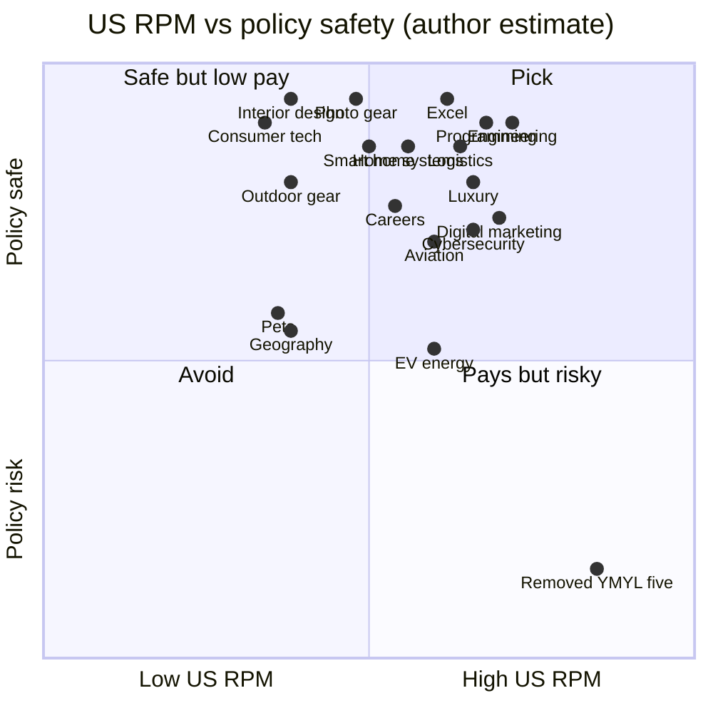

# 17 — Replacement Niches for the 5 Removed YMYL Channels

> **Status:** reference · **Updated:** 2026-10-16 · **Related:** [08 High-CPM US niches](08-high-cpm-us-niches.md), [11 Avatar and YMYL policy](../3-policy/11-avatar-and-ymyl-policy.md), [12 Final portfolio](12-final-portfolio.md), [13 Channel brands](13-channel-brands.md)

> Status: research draft · Researched: 2026-10-16 · Builds on [08](08-high-cpm-us-niches.md) (RPM method), [11](../3-policy/11-avatar-and-ymyl-policy.md) (AI-persona rule), [12](12-final-portfolio.md) and [13 §1–2](13-channel-brands.md) (kept channels, domain boundaries).
> Labels follow 08: **measured** = creator Studio data (AIR Media-Tech, 300 channels, global mix); **vendor** = vidIQ / 1of10 / OutlierKit / SponsorRadar ranges, mostly CPM; ***(est.)*** = my planning figure for a mature channel with ≥60% US viewers. Not a forecast.

## 1. Why the 5 channels were removed

Plastic Math (credit cards), Retire Mechanics (retirement), Tax Day Decoded (tax), Claim Explained (insurance) and Was It Legal? (law) all sit inside YouTube's **"AI Personas Related to Sensitive Topics"** rule, which 11 §0–1 (V1) verified on [YT 1311392](https://support.google.com/youtube/answer/1311392): a channel that uses AI-generated personas to deliver "a human expert providing advice" on **health, legal issues, finances or politics** is "not allowed to monetize", the page lists no exceptions, and neither an AI label nor a disclaimer cures it. The cartoon-narrator workaround in 12 §1 relied on an untested reading (11 §2.2 calls cartoon "Dr. Hoot" a grey zone and assumes it *does* count), the Creator Insider clarification on cartoon personas was never watched (11 §1 open item), and the bar is **channel-level**, so one borderline video can demonetise a whole channel. With 5 of 10 channels in that zone, 12 §2 already flagged the concentration risk; the user has chosen to remove it rather than manage it.

**Kept (not to be overlapped):** Square Foot Money (real estate market data, mortgages), Software Shortcut (AI and SaaS tool tutorials, then avatar "Jules"; faceless since HeyGen was removed 2026-10-16), Business Model Files (how US companies make money), Car Cost Truth (car buying/leasing/owning costs), Gravity What If (space and physics hypotheticals).

## 2. Screening criteria

| # | Criterion | How it was applied |
|---|---|---|
| 1 | High US AdSense RPM | US long-form RPM *(est.)* triangulated from AIR (measured), 1of10, vidIQ, OutlierKit, SponsorRadar, plus Google Ads CPC by industry (LocaliQ) as an advertiser-demand signal |
| 2 | Not health, legal, finance/investing/tax/insurance advice, or politics | Penalty where a niche *drifts* into these (salary negotiation, energy policy, vet health, borders) |
| 3 | Not kids-directed | Penalty for kid-appeal (pets, cute animation) |
| 4 | No overlap with kept channels or each other | Overlap with a kept channel = penalty; **High overlap disqualifies** |
| 5 | Unlimited supply | 1–5 |
| 6 | AI-producible without reused/copyrighted footage | 1–5. Niches that need hands-on product footage (reviews, gear) score 1 |

## 3. Scoring table (all candidates)

**Score = 2 × RPM pts + Shorts + Supply + Saturation + AI fit − Overlap − Policy** (max 30). RPM pts use the midpoint of the *(est.)* range: <$5 = 2, $5–7.99 = 3, $8–9.99 = 4, ≥$10 = 5. Saturation: 5 = uncrowded. Overlap penalty counts **kept channels only**: None/Low 0 · Med 1 · Med-High 2 · High 4 (disqualifying); overlap between candidates is resolved at selection (§5). Shorts potential is about discovery and US-view share, not Shorts RPM, which is $0.05–0.35 *(est.)* for every row (3–14% of long-form, AIR).

| Candidate | Published figures (source) | **US LF RPM *(est.)*** | Shorts | Advertiser categories | Supply | Satur. | AI fit | Overlap with kept / others | Policy | **Score** |
|---|---|---|---|---|---|---|---|---|---|---|
| **Engineering megaprojects / how things are made** | Edu & Science **$10.22 median** (AIR, measured); Transport $5.69 (AIR, n=7) | **$6–14** | 4 | EdTech, industrial/B2B brands, broad brand, Brilliant-type sponsors | 5 | 3 | 4 | Low: Gravity What If owns space/hypotheticals | 0 | **26** |
| **Cybersecurity & online privacy explained** | Technology CPM $5–30, enterprise $20–30 (vidIQ); Tech RPM $6–18 (SponsorRadar); VPN sponsorship CPM $18–25; 33 VPN/security brands ran 1K sponsored videos in Jul 2026 (CreatorDB) | **$5–12** | 4 | VPNs, password managers, antivirus, identity monitoring, security certs, B2B security SaaS | 5 | 3 | 4 | Low: Software Shortcut must not cover security tools | −1 (hacking-instruction limits) | **23** |
| Logistics & supply chain explained *(found)* | Transport $5.69 (AIR); B2B CPM $10–30 (vidIQ) | $5–12 | 3 | Freight, shipping, trucking jobs, B2B software | 5 | 4 | 4 | Med: Business Model Files; Med vs Engineering | 0 | 23 → alt |
| **Home repair & home systems costs** (folds in smart home) | DIY/home RPM $2–4.50 (1of10); DIY CPM $4–15 (vidIQ); home-improvement **CPC $7.85**, joint 2nd-most expensive industry (LocaliQ via SEL) | **$4–10** | 4 | Home Depot/Lowe's, Angi/home services, HVAC, roofing, solar, home warranty, tools | 5 | 3 | 4 | Low: Square Foot Money owns buying/mortgages/closing | 0 | **22** |
| **Careers & job-interview skills (US)** | Education & Career CPM $8–20 (vidIQ) | **$4–10** | 4 | Job boards (Indeed, LinkedIn, ZipRecruiter), resume tools, bootcamps, certifications | 5 | 3 | 4 | None | 0 (keep off salary-investing and employment law) | **22** |
| Excel / data analytics | Tech/software RPM $4–10 (vidIQ via Overseeros) | $5–12 | 4 | Microsoft, BI SaaS, courses | 5 | 3 | 5 | **High: Software Shortcut** (SaaS tutorials) | 0 | 21 ✗ |
| **Digital marketing / SEO for small business (B2B)** | Digital marketing CPM $15–35, **RPM $6–14** (1of10); CPM $12–18 (OutlierKit) | **$6–13** | 3 | SEO/ads SaaS (Semrush, Ahrefs, HubSpot), website builders, agencies, POS | 5 | 2 | 4 | Med: Software Shortcut (tool clicks) and Business Model Files | 0 (avoid MMO framing) | **21** |
| Programming / cloud / dev tutorials | Enterprise/developer CPM $20–30 (vidIQ); coding CPM $3–8 global (fluxnote) | $5–13 (US only; audience skews India) | 3 | Cloud (AWS, Azure, DigitalOcean), dev tools, bootcamps | 5 | 2 | 4 | Med-High: Software Shortcut (AI coding tools) | 0 | 20 |
| Aviation & how planes work | Transport **$5.69** (AIR, measured, n=7, highest ad load 2.55/view) | $5–11 | 4 | Airlines, travel, flight schools, aerospace employers | 4 | 3 | 4 | Low: Gravity owns space; Med vs Engineering | −1 (crash content = sensitive-events ad limits) | 22 → alt |
| Geography & countries | No niche figure; global-viral, low-CPM risk (08 §6.3) | $2–6 | 5 | Travel, language apps, EdTech | 5 | 2 | 5 | None | −1 (borders/politics; non-US views) | 20 |
| Interior design | Lifestyle **$2.98** (AIR, measured) | $2–6 | 5 | Furniture, décor (Wayfair), paint | 5 | 2 | 4 | None kept; overlaps Home systems candidate | 0 | 20 |
| Luxury goods & watches economics | Luxury RPM $5–17, Tier 1 (vidIQ) | $5–14 | 4 | Watches, luxury retail, private banking | 4 | 3 | 2 (branded products, trademarks) | **High: Business Model Files** (how Rolex/LVMH make money) | 0 | 17 ✗ |
| EV & energy tech | Automotive CPM $10–25 (vidIQ) | $5–11 | 3 | EV OEMs, solar, utilities, chargers | 4 | 3 | 4 | Med-High: Car Cost Truth (EVs) | −1 (climate/energy politics) | 19 |
| Smart home tech (standalone) | Tech RPM $4–9 (1of10) | $4–9 | 3 | Smart-home brands, security systems | 3 | 3 | 2 (hands-on) | Med: Home repair, Software Shortcut | 0 | 16 |
| Pets (pet-product advertisers) | No measured figure | $2–6 | 5 | Chewy, pet food, pet insurance | 5 | 1 | 2 | None | −1 (vet health = health; kid appeal) | 16 |
| Photography / creator gear | Tech reviews RPM $4–9 (1of10) | $4–9 | 3 | Camera brands, Adobe, retailers | 4 | 2 | 1 (needs real gear footage) | Low: Software Shortcut (editing apps) | 0 | 16 |
| Outdoor gear | Travel/lifestyle RPM $2–4 (1of10) | $2–6 | 3 | REI-type retail, gear brands | 4 | 3 | 1 | None | 0 | 15 |
| Consumer tech / gadgets / PC hardware | Gadgets & Tech **$2.33 median**, only 34% of views monetised (AIR, measured); RPM $4–9 (1of10) | $2–6 | 4 | Hardware OEMs, retailers | 5 | 1 | 1 (reviews need hands-on) | Med: Software Shortcut | 0 | 13 |

✗ = disqualified on criterion 4. Logistics (23) and Aviation (22) match or beat two picks on raw points but overlap the Engineering pick (ports, canals, jet engines), so they are held as alternates. Aviation also loses the tie-break on supply, a 7-channel RPM sample and crash-content ad limits.

## 4. US RPM vs policy safety

Policy safety = distance from the sensitive-topics rule, ad-suitability limits and kids-directed risk *(author estimate)*.

## 5. Recommendation: top 5 + 2 alternates

| Rank | Niche | US LF RPM *(est.)* | Presenter format | 1-line content angle |
|---|---|---|---|---|
| 1 | **Engineering megaprojects & how things are made** | $6–14 | Faceless isometric/blueprint 3D cutaways + AI stills (a visual style distinct from Gravity What If's space renders) | "How the world's biggest built things actually work": dams, tunnels, factories, bridges, chip fabs, step by step. |
| 2 | **Cybersecurity & online privacy explained** | $5–12 | Faceless: screen recordings from **our own sandboxed VMs** + animated attack-flow diagrams; no hacker-mask clichés | "Anatomy of a breach": how real attacks, scams and data leaks work, and what each one shows about protecting yourself. |
| 3 | **Home repair & home systems costs** | $4–10 | Faceless 3D cutaways of house systems (Engineering Mindset style) + cost cards by US region; no hands-on DIY footage | "What's inside your house and what it costs when it breaks": HVAC, plumbing, roofs, electrical, smart-home retrofits. |
| 4 | **Careers & job-interview skills (US)** | $4–10 | Cartoon role-play cast (adult design; recruiter + candidate) reusing the freed cartoon rig budget; no credentials claimed | "Replay the interview": animated mock interviews that show the answer that fails and the one that gets the offer. |
| 5 | **Digital marketing & SEO for small business (B2B)** | $6–13 | AI avatar host (2nd avatar, non-sensitive topic) over screen captures of **our own test sites and SERPs**; A/B vs no host (12 §1). *Superseded 2026-10-16: faceless, no host (HeyGen removed)* | "We tested it on a real site": SEO, local search, email and ad tactics run on owned test properties, with the results shown. |
| Alt A | **Aviation & how planes work** | $5–11 | Faceless 3D aircraft systems + map animations; no real crash footage | "Why planes do that": the engineering and procedures behind everyday flight. Swaps in for #1 or #4 |
| Alt B | **Logistics & supply chain explained** | $5–12 | Faceless maps, flow animations, AI stills | "How stuff gets to you": ports, trucking, cold chain, last-mile. Swaps in for #1 only (overlaps it) or #5 |

**Why this set.** #1 sits in the only measured top tier (Education & Science, $10.22 median; AIR). #2 and #3 bring advertiser-dense verticals (security software and VPN sponsors; home services at a $7.85 CPC). #4 and #5 bring B2B and job-platform demand at vendor CPMs of $8–35. None touches the four sensitive topics, and none overlaps a kept channel beyond the boundaries in §5.1. Programming (score 20) was close but overlaps Software Shortcut's AI-coding-tool content and pulls a heavily non-US audience. Excel and luxury were disqualified on overlap.

**Real faceless/low-face channels proving the formats** (subscriber counts read from each channel's YouTube page on 2026-10-16):

| Niche | Channel (format) | Subscribers / videos |
|---|---|---|
| Engineering | Professor Of How (faceless 3D) | 16M / 630 |
| Engineering | Real Engineering (narrated, faceless) | 5.12M / 296 |
| Engineering | Jared Owen (faceless 3D) | 4.44M / 121 |
| Engineering | Branch Education (faceless 3D) | 2.77M / 68 |
| Engineering / home systems | The Engineering Mindset (faceless 3D HVAC, electrical) | 4.48M / 318 |
| Engineering | Animagraffs (faceless 3D) | 1.94M / 48 |
| Cybersecurity | The PC Security Channel (screen recording, voice-over) | 645K / 753 |
| Cybersecurity | Seytonic (mostly voice-over news) | 496K / 353 |
| Cybersecurity | All Things Secured (presenter) | 437K / 465 |
| Home repair | Home Repair Tutor (presenter, hands-on) | 729K / 1.4K |
| Careers | Linda Raynier (presenter) | 1.01M / 275 |
| Careers / productivity | Jeff Su (presenter) | 1.93M / 317 |
| Digital marketing | Neil Patel (presenter) | 1.6M / 2.6K |
| Digital marketing | Ahrefs (presenter + screen) | 680K / 430 |
| Aviation | Green Dot Aviation (faceless) | 625K / 101 |
| Aviation | Mentour Pilot (presenter) | 2.52M / 815 |
| Logistics | Wendover Productions (faceless) | 4.92M / 289 |
| Programming (not picked) | Fireship (voice + graphics) 4.3M / 854 · ByteByteGo (faceless animation) 1.43M / 171 | |
| Excel (not picked) | ExcelIsFun (screencast) 1.36M / 3.8K | |

**Gap reading.** Careers and digital marketing have no large faceless leader: the big channels are presenter-led. That means less faceless competition but also no proof that a non-human host holds retention. Test both in the pilot before committing long-form budget.

### 5.1 Domain boundaries (adds to 13 §2.1)

| Topic | Owner | Others may only… |
|---|---|---|
| Home buying, mortgages, PMI, closing costs, home values | Square Foot Money | Home systems mentions resale impact in one line |
| Repair, renovation, HVAC/roof/plumbing costs, smart-home retrofits | Home systems (#3) | Square Foot Money links to it |
| Home insurance (claims, coverage) | Nobody: insurance is out of scope | Home systems may say "check your policy", never explain coverage |
| AI/SaaS tool walkthroughs (incl. marketing SaaS clicks) | Software Shortcut | #5 shows tools only as part of a tested tactic |
| Security software, VPNs, password managers | Cybersecurity (#2) | Software Shortcut never covers them |
| Marketing strategy, SEO, local search, email | Digital marketing (#5) | Business Model Files covers a company's model, not tactics |
| Space, orbital mechanics, physics hypotheticals | Gravity What If | #1 and Alt A stay on Earth and in the atmosphere |
| EVs and car costs | Car Cost Truth | #1 may cover a battery gigafactory as a building, not EV ownership |
| Salary negotiation framed as money, benefits, 401(k) | Nobody (finance) | #4 covers the conversation, never the numbers advice |
| Employment law, discrimination, contracts | Nobody (legal) | #4 never interprets law |

### 5.2 Effect on the presenter mix

After the swap: **7 faceless** (Square Foot Money, Business Model Files, Car Cost Truth, Gravity What If, #1, #2, #3), **2 AI avatars** (Jules, #5 host; both removed with HeyGen 2026-10-16, now faceless) and **1 cartoon** (#4). The cartoon budget line in 12 §5 (~$250–450/month for 5 cartoon channels) shrinks to about one channel's share *(est.)*. The new risk is **template sameness across 7 faceless channels** (03, inauthentic content): give each its own visual grammar, voice and structure, and keep the cross-channel similarity check.

## Policy screen

Screened against YouTube's AI-persona, advertiser-friendly, harmful-content, made-for-kids and firearms policies, Meta's monetisation rules and the FTC Endorsement Guides. Sources are at the end of this section. **No niche is red as a whole. The red items are sub-topics inside a niche.**

| Niche | Verdict | AI-persona rule risk | Limited-ads risk | Copyright trap | Kids risk | Red lines |
|---|---|---|---|---|---|---|
| Engineering megaprojects | 🟢 | Low. Politics only for state-backed projects (NEOM, Belt and Road) | Low–Med. Collapse or disaster episodes need non-exploitative framing | **High**: Discovery or "How It's Made" footage, drone footage | Low | Disaster porn, unsourced death counts, reused TV clips |
| Cybersecurity and privacy | 🟡 | Low. Medium on identity-theft recovery (finance) and privacy law (legal) | **High if offensive**: "how to gain unauthorized access" gets no ads; phishing or credential theft is a strike | Your own screen recordings are fine; others' demo footage is not | Low | Exploit walkthroughs against systems you don't own, phishing kits, paywall bypass, stalkerware, VPN geo-unblocking pitches. **Defensive and conceptual only** |
| Home systems and repair costs | 🟡 | Low. Medium if it drifts into financing (HELOCs, loans, resale ROI) or code and permit law | Medium: amateur live electrical, gas or roofing work | Tool logos are fine as nominative use; others' build footage is not | Low | Live-panel or gas "anyone can do it" content, asbestos or lead how-tos, an AI "licensed electrician" persona, fake before/after shots, undated cost figures |
| Aviation | 🟡 | None | **Med–High around crashes** ("upsetting presentations of accidents" get no ads) | **High**: spotter and cockpit footage, airline ads, ATC audio | Low–Med | Realistic AI crash recreations, victims in thumbnails, hijacking detail, conspiracy pieces, an AI "pilot" persona with credentials |
| Digital marketing and SEO (B2B) | 🟡 | **Medium**: "make money online" and passive-income angles read as finance | Medium: fake reviews, bought followers and black-hat tools count as "enabling dishonest behaviour" | Recordings of SaaS dashboards are usually fine | Low | Income guarantees (FTC earnings-claim risk), fake-review or bot tactics, undisclosed SaaS affiliate links |
| Careers *(not picked)* | 🟡 | **Highest in the list**: salary, 401(k) and equity read as finance; employment, visa and non-compete topics as legal; burnout as health | Low | — | Low | AI "career coach/HR expert" persona, employment-law answers |

The other 11 candidates were screened as well. Consumer tech, programming, smart home, interior design, photography and Excel came out 🟢; luxury, EV, geography, pets and outdoor came out 🟡.

**Rules across the portfolio:**
- **Disclose affiliate links in the video**, spoken and on screen before the endorsement, and again next to the link. "Affiliate link" alone is not enough (FTC). An avatar counts as an endorser, and New York's synthetic-performer law (GBL §396-b) applies to sponsor reads done by an avatar.
- **Toggle "altered or synthetic"** for photoreal renders of real products, places or events.
- **Set "Not made for kids" on every video**, and confirm that Buffer sends `selfDeclaredMadeForKids=false`.

**Not verified:**
- Meta's Content Monetization Policies page did not render.
- The LiveATC terms returned 403, so treat ATC audio as unusable.
- YouTube's rule doesn't say whether animal-health or cartoon personas are covered. The verdicts above use a conservative reading.

Sources: [YT 1311392](https://support.google.com/youtube/answer/1311392) · [YT 6162278](https://support.google.com/youtube/answer/6162278) · [YT 2801964](https://support.google.com/youtube/answer/2801964) · [YT 7667605](https://support.google.com/youtube/answer/7667605) · [YT 2802008](https://support.google.com/youtube/answer/2802008) · [YT 9528076](https://support.google.com/youtube/answer/9528076) · [FTC Endorsement Guides FAQ](https://www.ftc.gov/business-guidance/resources/ftcs-endorsement-guides-what-people-are-asking) · [Microsoft permissions](https://www.microsoft.com/en-us/legal/intellectualproperty/permissions) · [Tubefilter on Meta, Jul 2025](https://www.tubefilter.com/2025/07/15/ai-slop-unoriginal-repetitive-content-monetization-facebook-meta/) (secondary)

## Production feasibility

Graded against the M4 Pro 24 GB stack (14), with stock and cloud costs from 04 §4. Assumes about 30 Shorts and 8 long-form videos per channel per month. All figures are estimates.

| Niche | Grade | Best format | Visual sources | Needs real demos? | Mac min Short / long-form | Cloud $/mo | Originality lever |
|---|---|---|---|---|---|---|---|
| Cybersecurity and privacy | **A** | Motion graphics, diagrams, **your own screen recordings** of settings and tools | Pexels has about 8.7K clips, mostly hoodie-hacker clichés; Pixabay is thin | Partly: settings walkthroughs, which are easy to make yourself | 7–11 / 35–50 | $5–15 | Your own threat-flow diagrams; cited CVE, FTC and CISA data |
| Digital marketing and SEO | **B+** | Screen recordings of **your own test sites**, Search Console and analytics, plus charts | Pexels about 50K, Pixabay about 10K | Partly: real dashboards | 6–10 / 30–45 | $5–15 (HeyGen option removed 2026-10-16) | Real experiments with real numbers. **High slop risk**: the niche is full of AI listicles |
| Aviation | **B** | Diagrams and cutaways (lift, engines) + stock + US-government imagery | Pexels about 4.2K. NASA, FAA, NTSB and DVIDS are public domain (no NASA insignia on AI images). **Airline and Airbus press kits are editorial-only, so don't use them** | No | 9–13 / 50–70 | $15–30 | Original animated diagrams, breakdowns of NTSB reports. AI planes get liveries and engines wrong |
| Engineering megaprojects | **B** | B-roll + diagrams + 3D-style AI stills | Pexels about 3.9K "construction". USACE, DOT and NASA are public domain; Wikimedia per file. Specific factory processes are rarely in stock | No for structures; yes for "how it's made" process footage | 9–14 / 55–75 | $20–40 | Your own timeline and scale diagrams; cost data from public filings |
| Home systems and repair costs | **C → B** when reframed | Stock-led cost charts rate **C**. Reframed as **3D cutaways of house systems** (Engineering Mindset style) + regional cost cards, with **no how-to**, it rates B | Pexels "home repair" about 93K, but generic | **Yes for any how-to**, so don't make how-tos. Generated hands and tools look wrong | 8–12 / 45–60 | $10–20 | Original cost-breakdown charts. You need a real data source (e.g. RSMeans, BLS, or your own surveys); repackaging Angi numbers adds little |
| Careers *(not picked)* | B | 2D cartoon role-play | Generic stock | No | 10–15 / 55–75 | $5–15 | BLS wage data |

The other candidates graded: programming, Excel and geography A; EV B+; interior design B; pets B−; smart home, consumer tech and outdoor C; photography and luxury D. **C and D niches need real products in real hands**, which a faceless AI channel can't fake honestly.

**Notes:**
- **Stock footage is filler, not the main visual.** (The pipeline uses Pixabay since 2026-10-16; Pexels was dropped.) Pexels runs 10–60× Pixabay on every query, but only a few hundred clips per topic actually fit, and competing channels use the same ones. Pexels forbids implying that a pictured brand endorses you.
- **Assume press kits are unusable** (airlines, Airbus, Nasdaq and others are editorial-only). Safe sources: US-government works (NASA, FAA, NTSB, DVIDS, USACE, EIA), Natural Earth (public domain), OSM (ODbL, credit on screen) and Wikimedia (check each file's licence).
- **Screen-recording channels cost people time, not Mac time.** Cybersecurity and marketing need about 5–10 Mac minutes per Short but about 30 minutes of human recording per Short and 2–3 hours per long-form.
- **None of the five needs local AI video**, which 14 §7 rules out anyway. Hero shots go to cloud Veo.

Sources: [Pexels videos](https://www.pexels.com/search/videos/) · [Pixabay videos](https://pixabay.com/videos/search/) · [Pexels licence](https://www.pexels.com/license/) · [NASA media guidelines](https://www.nasa.gov/nasa-brand-center/images-and-media/) · [Natural Earth terms](https://www.naturalearthdata.com/about/terms-of-use/) · [OSM copyright](https://www.openstreetmap.org/copyright) · [Wikimedia reuse](https://commons.wikimedia.org/wiki/Commons:Reusing_content_outside_Wikimedia) · [Airbus Helicopters press terms](https://marketing.helicopters.airbus.com/marketing-content/article?id=1) · [Alaska Air media](https://news.alaskaair.com/images-videos/a321-in-flight/)

## Final decision (combining revenue, policy and feasibility)

| Slot | Niche | Decision | Why |
|---|---|---|---|
| 1 | Engineering megaprojects | ✅ **Pick**, limited to **ground structures, infrastructure and factories** (no aircraft) | Top score (26); 🟢 policy; B feasibility; strongest proven faceless leaders (Professor Of How 16M, Real Engineering 5.1M) |
| 2 | Cybersecurity and privacy | ✅ **Pick**, defensive and conceptual only | $5–12; A feasibility; VPN and password-manager sponsors |
| 3 | Home systems and repair costs | ✅ **Pick, reframed** as how-it-works + what it costs, no how-to | Home-improvement CPC $7.85 is the joint 2nd-highest industry; B once reframed |
| 4 | ~~Careers~~ → **Aviation** | 🔁 **Swapped** | Careers carries the **most AI-persona risk** of any candidate (finance, legal and health sub-topics), which is exactly what the 5 removals were meant to avoid. Aviation has no persona risk; just stay away from crash content |
| 5 | Digital marketing and SEO (B2B) | ✅ **Pick** with guardrails: no income claims, real experiments only | Highest RPM of the five ($6–13); test the AI avatar against a no-host version (avatar removed 2026-10-16: faceless) |

**Domain boundaries:**

| Pair | Boundary |
|---|---|
| Engineering vs Aviation | Engineering covers ground structures and factories; Aviation covers aircraft and flight |
| Home systems vs Square Foot Money | Home systems covers what's inside the house and repairs; Square Foot Money covers buying, mortgages and the market |
| Digital marketing vs Software Shortcut | Marketing covers tactics and results; Software Shortcut covers how to use AI and SaaS tools |
| Cybersecurity vs Software Shortcut | Cybersecurity owns all security tools |

**Presenter mix after the swap:** 8 faceless and 2 AI avatar (Software Shortcut, digital marketing). **Update 2026-10-16:** HeyGen removed, so it is now 10 faceless, 0 avatar (12 §2). **There are no cartoon channels now**, so the cartoon rig and the cutaway budget in 10 and 12 §3 are no longer needed.

## 6. Open questions to verify

1. AIR's Transport (n=7) and Business & Finance (n=3) medians are small samples; Education & Science is the only robust high median. Check real RPM after 90 days.
2. No source publishes a cybersecurity-only or careers-only RPM; both rows are triangulated from Technology and Education & Career CPMs.
3. Whether YouTube treats cyber explainers that show attack steps as "instructional hacking" under harmful-or-dangerous rules (for the Policy screen).
4. Subscriber counts are a single read of each channel page on 2026-10-16; faceless status is my own observation of the channel format.

## Sources

- AIR Media-Tech, YouTube RPM by niche 2026 (measured, May 2025–May 2026): https://air.io/en/air-data-findings/which-youtube-niche-makes-the-most-money-in-2026-ranked-by-real-rpm-and-cpm
- AIR Media-Tech, RPM data from 300 channels: https://air.io/en/air-data-findings/how-much-does-youtube-really-pay-in-2026-real-rpm-data-from-300-channels
- Overseeros, YouTube RPM by niche (summarises AIR + vidIQ, Shorts RPM by country): https://www.overseeros.com/blog/youtube-rpm-by-niche
- 1of10, YouTube CPM and RPM by Niche: 2026 Rate Tables (21 Aug 2026): https://www.1of10.com/blog/youtube-cpm-rpm-by-niche/
- vidIQ, Which YouTube Niches Pay the Most? CPM Rates in 2026 (Apr 2026, reviewed May 2026): https://vidiq.com/blog/post/most-profitable-youtube-niches/
- OutlierKit, 19 Most Profitable YouTube Niches in 2026 (updated 13 Oct 2026): https://outlierkit.com/blog/most-profitable-youtube-niches
- NextGlobalWave, Most Profitable YouTube Niches in 2026: https://www.nextglobalwave.com/?p=6660
- Search Engine Land, Google Ads costs rise again (LocaliQ benchmarks, CPC by industry): https://searchengineland.com/google-ads-costs-rise-again-but-conversions-improve-report-455663
- CreatorDB, YouTube sponsorship rankings, VPN & Security: https://creatordb.app/youtube-sponsorships/vpn/
- SponsorRadar, brands that sponsor tech YouTubers: https://sponsorradar.com/insights/brands-that-sponsor-tech-youtubers
- SponsorRadar, Cybernews channel page (Tech RPM benchmark): https://sponsorradar.com/channels/cybernews
- Fluxnote, YouTube coding channel monetization 2026: https://fluxnote.io/guides/youtube-coding-channel-monetization-2026
- YouTube Help 1311392, YPP policies incl. AI personas on sensitive topics: https://support.google.com/youtube/answer/1311392
- TechCrunch, YouTube clarifies policies around AI slop (20 Jul 2026): https://techcrunch.com/2026/07/20/youtube-clarifies-policies-around-ai-slop-and-upsetting-videos/
- Channel pages read 2026-10-16: https://www.youtube.com/@ProfessorOfHow · https://www.youtube.com/@RealEngineering · https://www.youtube.com/@jaredowen · https://www.youtube.com/@BranchEducation · https://www.youtube.com/@engineeringmindset · https://www.youtube.com/@animagraffs · https://www.youtube.com/@pcsecuritychannel · https://www.youtube.com/@Seytonic · https://www.youtube.com/@allthingssecured · https://www.youtube.com/@HomeRepairTutor · https://www.youtube.com/@LindaRaynier · https://www.youtube.com/@JeffSu · https://www.youtube.com/@neilpatel · https://www.youtube.com/@ahrefscom · https://www.youtube.com/@GreenDotAviation · https://www.youtube.com/@MentourPilot · https://www.youtube.com/@Wendoverproductions · https://www.youtube.com/@Fireship · https://www.youtube.com/@ByteByteGo · https://www.youtube.com/@excelisfun
