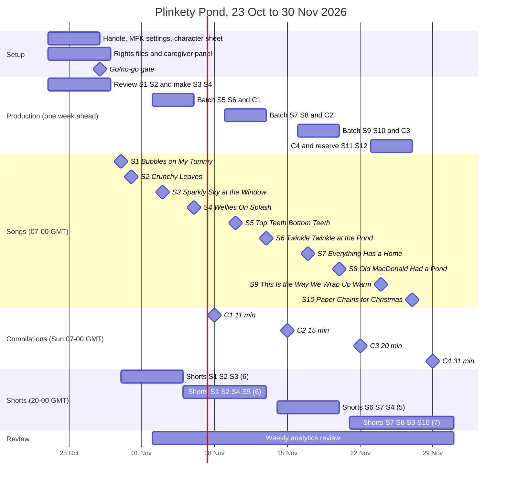

# 28 — Plinkety Pond: launch plan, 23 Oct – 30 Nov 2026

> **Status:** proposed plan · **Written:** 2026-10-23 (a Friday; every weekday below was checked against the 2026 calendar) · **Channel:** Plinkety Pond (`@plinketypond`, unclaimed as of 2026-10-23), original toddler sing-along songs, UK English, made for kids, ages 2–4 with a caregiver · **Builds on:** [26 — Nursery-song channel](../1-strategy/26-nursery-song-channel.md) (genre, IP, compliance, targets), [27 — Episode 01](27-plinkety-pond-episode-01.md) (cast, palette, first song), [`brand_packs/plinkety-pond.yaml`](../../brand_packs/plinkety-pond.yaml) (red lines, banned templates), [19 — Kids opportunity](../1-strategy/19-kids-channel-opportunity.md), [21 — Kids pilot production](../4-production/21-kids-pilot-production.md) and [06 — Growth playbook](../1-strategy/06-growth-playbook.md).
>
> **Who publishes:** a human only. Every video is uploaded **private**, reviewed by a human against the doc 26 §5.4 checklist, and published (or scheduled) by that human in YouTube Studio. No agent uploads, sets visibility, sets the made-for-kids flag, schedules or approves anything. At commit `bfe2d0b`, `studio/publish/gate.py` rejects `made_for_kids=True`, so uploads are manual in YouTube Studio. An **uncommitted, in-progress change** adds a reviewed kids path to the gate: a made-for-kids brand pack, YouTube only, direct API upload, **private only**. If it is reviewed and merged, the human may use it after running `studio approve` themselves. Either way, the final Publish click stays with the human. Never relax the gate beyond that reviewed path.

**Plan in one paragraph.** One setup week, then 2 launch songs on Fri 30 and Sat 31 October. Through November, 2 new songs a week (Tue and Fri), a themed compilation every Sunday that grows from about 11 to about 31 minutes, and 2–3 Shorts per song. **Totals for 30 Oct – 30 Nov: 10 songs, 4 compilations, 24 Shorts (38 public uploads), plus 2 reserve songs produced and banked for early December or as replacements.** Long-form goes out at **07:00 UK (GMT)**, which is 18:00 in Sydney and Melbourne. Shorts go out at **20:00 UK**, which is 07:00 the next morning in Sydney and Melbourne. The plan aims for a coherent, replayable catalogue. It is not a volume play, because volume is exactly what YouTube's 2025–26 enforcement on AI kids content punishes (26 §3.4).

---

## 0. Blockers to clear before the first upload (honest)

| # | Blocker | Owner | What clears it |
|---|---|---|---|
| B1 | **Model weights are not installed.** Project weights were removed on 2026-10-18 (CLAUDE.md). ACE-Step 1.5 is **10.1 GB** (`scripts/setup/models.manifest.yaml`). The disk had **16 GB free on 2026-10-23**, so installing ACE-Step alone would leave about 6 GB, below the 10 GB floor. The stills (Z-Image), upscaling (Real-ESRGAN) and parallax (Depth Anything V2 Small) weights are also removed. | Human (user) | An explicit user request to reinstall, then `make models-dry` and freeing disk first. Agents must not download anything. |
| B2 | **ACE-Step is not wired into the song tool.** `scripts/kids_song/` currently makes a deterministic synthesised backing plus a pitch-mapped Kokoro vocal (`music.py`, `vocal.py`). It has no ACE-Step path. | Orchestrator | Either a reviewed code change to add ACE-Step, or use the existing `kids_song` path for the launch songs. This doc proposes no code. |
| B3 | **The kids publishing path is not merged.** At `bfe2d0b` the gate rejects made-for-kids videos. A private-only reviewed kids path is in progress, uncommitted. | Human / Orchestrator | Until it is reviewed and merged, the human uploads manually in YouTube Studio. After that, the human may use the private-only upload after their own `studio approve`. In both cases the human clicks Publish (26 §3.7). |
| B4 | **Stage-0 gate from doc 26 §4:** 5 adult caregiver reviewers and 1 early-years educator approve the pilot songs, the per-song rights files are complete, and the rights and compliance sections get a media-lawyer sign-off. | Human | Feedback collected 23–28 Oct (no children's data or recordings). |
| B5 | **The handle and trademark are unclaimed or unverified** (27 §1). | Human | Claim `@plinketypond` and the `.com` on day 1, and start UKIPO/EUIPO/IP Australia searches. |
| B6 | **Format risk.** Doc 26 §5.2 warns that stills-with-parallax singalongs sit near the "hard to follow / mass-produced" end of the market. | Human reviewer | Mitigate with a real story per song, fewer and stronger shots held 4 s or longer, characters kept on model, and slow camera moves. If reviewers find a song hard to follow, it does not ship. |
| B7 | **AI-generated melodies.** ACE-Step composes the melody from the lyrics and a style prompt. That output may not be protectable (26 §2.3), and it could drift toward a known tune. | Human reviewer | A listen-through originality check on every take (26 §5.4 item 2). For the public-domain (PD) rhymes, the traditional tune must be accurate, so condition on or hand-check the melody (the `kids_song` melody table already does this). |

**Slip rule.** If B1–B5 are not cleared by the **go/no-go on Wed 28 Oct**, the whole calendar shifts by one week as a block. Bonfire Night (S3) is the only date-bound item. If it can't publish by Tue 3 Nov, it moves to the reserve bank for 2027. A song is never published unreviewed to hold the cadence.

---

## 1. Cadence and why

| Period | Songs | Compilations | Shorts | Human review time |
|---|---|---|---|---|
| Setup week, Fri 23 – Thu 29 Oct | 0 public. Produce and review S1–S4 | 0 | 0 | 6–8 h (four songs, plus caregiver feedback) |
| Launch, Fri 30 – Sat 31 Oct | **2** (S1, S2) | 0 | 2 | — |
| Sun 1 – Sun 8 Nov | 2 (S3, S4) | 1 (~11 min) | 6 | 5–7 h/week from here on |
| Mon 9 – Sun 15 Nov | 2 (S5, S6) | 1 (~15 min) | 4 | |
| Mon 16 – Sun 22 Nov | 2 (S7, S8) | 1 (~20 min) | 4 | |
| Mon 23 – Mon 30 Nov | 2 (S9, S10) | 1 (~31 min) | 6 | |
| Reserve (produced 23–26 Nov) | 2 banked (S11, S12) | — | — | 2–4 h |
| **Total, 30 Oct – 30 Nov** | **10 published + 2 reserve = 12 produced** | **4** | **24** | ≈ 30–40 h |

**Why this cadence and no more.**
- **Review is the bottleneck, and it is the point.** Each song gets 1–2 h of human review against the 12-item checklist in 26 §5.4: originality listen-through, characters on model, imitable-safety check, flashing check, UK language, packaging. Two songs a week is about 2–4 h. With compilations (a full watch-through of 11–31 min), Shorts (about 10 min each), metadata and upload, a person can sustain **5–7 h a week**. More songs would mean thinner reviews.
- **Enforcement punishes volume.** YouTube's "inauthentic content" policy is applied to the whole channel ("mass-produced, generic, repetitive", "made with a template"). The February 2026 suspensions targeted incoherent AI toddler clips (26 §3.4). A new channel posting daily AI songs looks like the channels that were removed.
- **Compilations are where views accrue in this genre** (26 §1.3). Two singles a week build the catalogue that one compilation a week needs. By 29 Nov, 10 songs make a 30-minute compilation without heavy padding.
- **Shorts are trailers, not the product.** 2–3 per song, cut from reviewed masters, cost about 10 minutes of review each. No 30-second autogenerated clips go out as standalone content (26 §3.4).
- **Departure from doc 26, stated openly.** Doc 26 §5.3 recommends a bank of 8 songs before launch and then 1 song a week. This plan follows the user's direction instead: 2 launch songs and 2 a week. It also compresses doc 26's Stage-1 output (12 songs, 3 compilations and about 30 Shorts over 0–3 months) into about 5 weeks. Three safeguards make that acceptable:
  1. Production runs **one week ahead of publishing**, so a song that fails review has a week to be fixed.
  2. Two reserve songs (S11, S12) are banked.
  3. **Automatic downshift:** if a week's review takes more than 2 h a song, or any song fails a safety or originality check twice, drop to 1 song a week from the next week. Use the reserve to fill the gap. Never skip the review.

---

## 2. Song slate (12)

Cast (27 §1, verbatim prompts): **Pebble** (toddler otter, teal), **Fern** (big sister, lilac), **Mum** (coral cardigan), **Bloop** (mint pet frog). **Proposed addition from S3: Dad**, "a big gentle otter with warm russet-brown fur, a cream muzzle and a buttercup-yellow knitted scarf". His fixed colour is yellow. He needs a human sign-off and an entry in the 27 character table before use. **Pond rule:** viewers are human toddlers, so no character swims or plays at the pond edge. The pond is watched from the garden fence, paw in a grown-up's paw.

**Mix:** 9 originals and 3 re-imagined PD rhymes (25%; doc 26 §2.3 suggests about 30%). Halloween (spooky, against the red lines), Remembrance (not for toddlers) and Children in Need or Black Friday tie-ins (branded or commercial) are **deliberately left out**.

| # | Working title | Source | Concept (one line) | Learning goal | Hook line idea | Characters | Length · tempo |
|---|---|---|---|---|---|---|---|
| S1 | **Bubbles on My Tummy** | Original (27) | Bath time: Mum fills and checks the bath, Pebble sits, bubbles pop, a cosy towel | Bath steps with a grown-up; we sit down in the bath | "Bubbles on my tummy, bubbles on my nose. Pop! Pop! Pop!" | Pebble, Mum, Fern, Bloop | **2:00** (extend 27's 60 s cut with a drying verse, a pyjamas verse and a third chorus) · 96 BPM |
| S2 | **Crunchy Leaves** | Original | An autumn walk in the pond-side park; each verse finds a leaf of a new colour | Name 4 colours: red, orange, yellow, brown | "Crunch, crunch, crunchy leaves, tumbling from the big old trees" | Pebble, Fern, Mum, Bloop | 2:15 · 104 BPM |
| S3 | **Sparkly Sky at the Window** | Original, seasonal (Bonfire Night, Thu 5 Nov) | The family watches distant fireworks **through the window** from a warm, lit sitting room, with blankets and Bloop calm indoors | We watch fireworks from inside, with a grown-up; it's fine to cover your ears | "Ooh! — *Ooh!* Aah! — *Aah!* Sparkly sky, so far away" | Pebble, Fern, Mum, Dad, Bloop | 2:00 · 92 BPM |
| S4 | **Wellies On, Splash!** | Original | A rainy day: coat, wellies, hat, then small puddle stomps holding Dad's paw, then drying off inside | Getting dressed for rain, in order | "Wellies on, wellies on, stomp, stomp, splash!" | Pebble, Dad, Fern, Bloop | 2:15 · 108 BPM |
| S5 | **Top Teeth, Bottom Teeth** | Original | Morning teeth with Mum: top, bottom, front, back, rinse the brush, big smile | Brush the top and the bottom teeth, with a grown-up helping | "Top teeth, bottom teeth, swish, swish, swish!" | Pebble, Mum, Fern | 2:00 · 100 BPM |
| S6 | **Twinkle, Twinkle at the Pond** | **PD**: Jane Taylor's words (1806) and the traditional tune (1761), plus new verses | Pebble says goodnight to the moon, the stars and the sleepy pond from the bedroom window | Winding down: naming night-sky things | Traditional verse 1, then "Twinkle, twinkle, over the pond, Bloop gives one last sleepy yawn" | Pebble, Mum, Bloop | 2:30 · 66 BPM |
| S7 | **Everything Has a Home** | Original | A tidy-up song: blocks to the box, books to the shelf, teddy to the bed, counting each one | Put toys back; counting 1–5; teamwork | "Tidy up, tidy up, everything has a home" (not Barney's "Clean up" melody or lyric) | Pebble, Fern, Dad | 2:00 · 104 BPM |
| S8 | **Old MacDonald Had a Pond** | **PD**: "Old MacDonald" (folk, printed 1917), plus new verses | Pond animals and their sounds, seen from the garden fence: duck, frog (Bloop), swan, dragonfly, fish | Animal names and sounds | "And on that pond he had a frog… with a croak, croak here" | Pebble, Dad, Bloop, pond animals | 2:30 · 112 BPM |
| S9 | **This Is the Way We Wrap Up Warm** | **PD**: "Here We Go Round the Mulberry Bush" (traditional), with new routine verses | A cold-morning dressing song: vest, jumper, trousers, socks, coat and mittens, one verse each | Getting dressed in order | "This is the way we pull on our jumper, on a chilly autumn morning" | Pebble, Mum, Fern | 2:15 · 100 BPM |
| S10 | **Paper Chains for Christmas** | Original, seasonal (Advent Sunday is 29 Nov) | The family makes paper chains (paper strips and a glue stick, no scissors for Pebble). Mum hangs them up. They count the loops | Counting 1–5; making things together; waiting | "Loop, loop, a paper chain, longer and longer again" | Pebble, Fern, Mum, Dad, Bloop | 2:15 · 96 BPM |
| S11 *(reserve)* | **Snuggle Down, Little Pebble** | Original lullaby | Bedtime: pyjamas, a story, a cuddle, then the warm night-light glows (never darkness) | The order of the bedtime routine | "Snuggle down, snuggle down, cosy as can be" | Pebble, Mum, Dad, Bloop | 2:30 · 64 BPM |
| S12 *(reserve)* | **One, Two, Three on the Pond** | Original | Counting what's on the pond from the fence: lily pads, ducklings, dragonflies, up to 5 | Counting 1–5 | "One, two, three, what can we see?" | Pebble, Fern, Dad, Bloop | 2:00 · 104 BPM |

**Safety notes by song** (on top of the brand-pack red lines):
- **S3, fireworks.** Nobody handles fireworks, sparklers or matches, and there is no bonfire close-up and no going outside.
  - Fireworks are soft, slow blooms far away behind the glass, with **no flashing or strobing** (WCAG: no more than 3 flashes a second; check the master).
  - The bangs are a soft "whoosh … pop", never a loud sting.
  - The sky is deep dusk-blue, never black, and the room stays warm and lit.
  - Pets stay indoors and calm.
- **S4, puddles.** Ankle-deep puddles on a path only, never the pond edge. A grown-up holds Pebble's paw for every stomp.
- **S5, teeth.** No health claims ("stops germs", "two minutes", "healthy teeth"). A grown-up is present. No running with the toothbrush.
- **S6, star.** A night-sky star only. No face or character for the star (Little Baby Bum's "Twinkle" exclusion, 26 §2.1).
- **S7, toys.** Generic, unbranded, large toys. No small loose parts.
- **S8, pond.** The animals are gentle, with no predators. The characters stay behind the fence.
- **S9, Mulberry Bush tune.** Use only the traditional "This is the way we…" tune and structure. Don't use anything from "The Wheels on the Bus" (26 §2.2).
- **S10, Christmas.** No lit candles. Fairy lights are hung by Mum, and no one pulls cords. No presents or toy brands named, and no "ask for" lines.

**Hemisphere.** S2, S4 and S9 are northern-autumn songs (UK/IE/EU primary). The routine, animal, counting and bedtime songs are evergreen for AU/NZ, where it is late spring. A sunny Christmas verse for AU/NZ is a December candidate, not part of this window.

---

## 3. Calendar, 23 Oct – 30 Nov 2026

**Publish-time choice.** One upload serves every market, so pick the slot by format:

| Slot | UK/IE | CET (EU) | Sydney/Melbourne (AEDT, UTC+11) | Brisbane (AEST) | Perth | NZ (NZDT) |
|---|---|---|---|---|---|---|
| **Long-form: 07:00 GMT** | 07:00 breakfast | 08:00 | 18:00 tea, bath and bedtime | 17:00 | 15:00 | 20:00 |
| **Shorts: 20:00 GMT** | 20:00 parents' evening scroll | 21:00 | **07:00 next day**, breakfast | 06:00 | 04:00 | 09:00 |

Why this split:
- **UK clocks go back on Sun 25 Oct**, so every publish date in this plan is on GMT (UTC+0). Sydney and Melbourne have been on daylight time (UTC+11) since 4 Oct.
- **Long-form at 07:00 GMT** catches the UK breakfast window and weekend-morning TV sessions, which suit compilations, for the primary market. The same upload lands in eastern Australia at 18:00, which is the bath and bedtime window that routine and bedtime songs are about.
- **Shorts at 20:00 GMT** give AU/NZ a morning first push and reach UK parents in the evening.
- **The hour matters less than it looks.** Nursery songs are evergreen, so most lifetime views come through search, suggestions, playlists and compilations days to months later. The hour only shapes the first 24–48 h, so keep it constant.
- **Publishing is still a human act.** The human can either click Publish at the slot or set Schedule in YouTube Studio after review.

**Days:** new songs go out Tue and Fri. The compilation goes out on Sunday, the strongest weekend morning for long sessions. One Short goes out most evenings. The two launch songs fall on Fri and Sat of England's autumn half-term week (most areas, 26–30 Oct; dates vary by council, *unverified*).

Status as of 23 Oct: **Draft**: a version exists. **Writing**: lyrics are in progress. **Planned**: not started. Every row then moves through **Generated → In review → Uploaded private → Published (human)**.

| Date (UK) | Day | Type | Title (≤ 60 chars) | UK / AEDT | Status |
|---|---|---|---|---|---|
| 23 Oct | Fri | Setup | Claim handle and domain; channel set to made-for-kids (human); character sheet incl. Dad; rights files open; caregiver panel invited | — | In progress |
| 26–28 Oct | Mon–Wed | Production | Batch 1 (S3, S4) generated and reviewed; S1 and S2 reviewed and fixed | — | Planned |
| 28 Oct | Wed | Gate | **Go/no-go** (blockers B1–B5) | — | Planned |
| 29 Oct | Thu | Upload | S1–S4 uploaded **private**, metadata from §4 | — | Planned |
| 30 Oct | Fri | Song | Bubbles on My Tummy \| Bath Time Song with Pebble | 07:00 / 18:00 | Draft (60 s → 2:00) |
| 30 Oct | Fri | Short | Pop! Pop! Pop! Bubbles on My Tummy | 20:00 / Sat 07:00 | Draft |
| 31 Oct | Sat | Song | Crunchy Leaves \| Autumn Colours Song with Pebble | 07:00 / 18:00 | Writing |
| 31 Oct | Sat | Short | Crunch, Crunch, Crunchy Leaves | 20:00 / Sun 07:00 | Writing |
| 1 Nov | Sun | Short | Ooh! Aah! Sparkly Sky at the Window | 20:00 / Mon 07:00 | Planned (trailer for S3) |
| 2 Nov | Mon | Short | Is It Bath Time? Yes, It's Bath Time! | 20:00 / Tue 07:00 | Planned |
| 3 Nov | Tue | Song | Sparkly Sky at the Window \| Bonfire Night Song with Pebble | 07:00 / 18:00 | Planned |
| 3 Nov | Tue | Short | Cosy at the Window, Sparkly Sky | 20:00 / Wed 07:00 | Planned |
| 4 Nov | Wed | Short | Red and Gold, Far Away! Sparkly Sky | 20:00 / Thu 07:00 | Planned |
| 5 Nov | Thu | Short | Red, Orange, Yellow, Brown! Crunchy Leaves | 20:00 / Fri 07:00 | Planned |
| 5 Nov | Thu | Upload | S5, S6 and C1 uploaded private | — | Planned |
| 6 Nov | Fri | Song | Wellies On, Splash! \| Rainy Day Song with Pebble | 07:00 / 18:00 | Planned |
| 7 Nov | Sat | Short | Stomp, Stomp, Splash! Wellies On | 20:00 / Sun 07:00 | Planned |
| 8 Nov | Sun | Compilation | First Songs with Pebble \| 11 Min Toddler Singalong | 07:00 / 18:00 | Planned |
| 9 Nov | Mon | Short | Coat, Wellies, Hat! Wellies On, Splash! | 20:00 / Tue 07:00 | Planned |
| 10 Nov | Tue | Song | Top Teeth, Bottom Teeth \| Brushing Teeth Song with Pebble | 07:00 / 18:00 | Planned |
| 10 Nov | Tue | Short | Swish, Swish, Swish! Top Teeth, Bottom Teeth | 20:00 / Wed 07:00 | Planned |
| 11 Nov | Wed | Short | Count the Bubbles with Fern | 20:00 / Thu 07:00 | Planned |
| 12 Nov | Thu | Short | Big Smile! Top Teeth, Bottom Teeth | 20:00 / Fri 07:00 | Planned |
| 12 Nov | Thu | Upload | S7, S8 and C2 uploaded private | — | Planned |
| 13 Nov | Fri | Song | Twinkle, Twinkle at the Pond \| Bedtime Song with Pebble | 07:00 / 18:00 | Planned |
| 14 Nov | Sat | Short | Goodnight, Moon over the Pond | 20:00 / Sun 07:00 | Planned |
| 15 Nov | Sun | Compilation | A Day with Pebble \| 15 Min Routine Songs for Toddlers | 07:00 / 18:00 | Planned |
| 16 Nov | Mon | Short | Bloop's Sleepy Yawn \| Twinkle, Twinkle at the Pond | 20:00 / Tue 07:00 | Planned |
| 17 Nov | Tue | Song | Everything Has a Home \| Tidy-Up Song with Pebble | 07:00 / 18:00 | Planned |
| 17 Nov | Tue | Short | Tidy Up, Tidy Up! Everything Has a Home | 20:00 / Wed 07:00 | Planned |
| 18 Nov | Wed | Short | Drip, Drop, Puddle Stomp with Dad | 20:00 / Thu 07:00 | Planned |
| 19 Nov | Thu | Short | Blocks in the Box! Everything Has a Home | 20:00 / Fri 07:00 | Planned |
| 19 Nov | Thu | Upload | S9, S10 and C3 uploaded private | — | Planned |
| 20 Nov | Fri | Song | Old MacDonald Had a Pond \| Animal Song with Pebble | 07:00 / 18:00 | Planned |
| 21 Nov | Sat | Short | Quack, Croak, Honk! Old MacDonald Had a Pond | 20:00 / Sun 07:00 | Planned |
| 22 Nov | Sun | Compilation | Tidy-Up, Bath and Bedtime Songs with Pebble \| 20 Min | 07:00 / 18:00 | Planned |
| 23 Nov | Mon | Short | Croak, Croak Here! Bloop at the Pond | 20:00 / Tue 07:00 | Planned |
| 24 Nov | Tue | Song | This Is the Way We Wrap Up Warm \| Dressing Song with Pebble | 07:00 / 18:00 | Planned |
| 24 Nov | Tue | Short | Jumper On! This Is the Way We Wrap Up Warm | 20:00 / Wed 07:00 | Planned |
| 25 Nov | Wed | Short | One, Two, Three, Four, Five! Tidy-Up Count | 20:00 / Thu 07:00 | Planned |
| 26 Nov | Thu | Short | Mittens On! This Is the Way We Wrap Up Warm | 20:00 / Fri 07:00 | Planned |
| 26 Nov | Thu | Upload | C4 uploaded private; reserve S11 and S12 banked | — | Planned |
| 27 Nov | Fri | Song | Paper Chains for Christmas \| Advent Song with Pebble | 07:00 / 18:00 | Planned |
| 28 Nov | Sat | Short | Loop, Loop, a Paper Chain! | 20:00 / Sun 07:00 | Planned |
| 29 Nov | Sun | Compilation | Big Plinkety Pond Singalong \| 31 Min Toddler Songs | 07:00 / 18:00 | Planned |
| 30 Nov | Mon | Short | Longer and Longer! Paper Chains for Christmas | 20:00 / Tue 07:00 | Planned |

Shorts per song: S1 3, S2 2, S3 3, S4 3, S5 2, S6 2, S7 3, S8 2, S9 2, S10 2, for **24 in total**.

**Compilation running orders.** Each compilation has its own theme and order and includes that week's new songs (26 §1.3).
- **C1, 8 Nov, about 11 min:** S2, S4, S3, S1, then S2 again. S3 appears here only. After Bonfire weekend it leaves every compilation until 2027.
- **C2, 15 Nov, about 15 min, "a day in order":** S5 (morning), S2, S4, S1, S6 (bedtime), then S4 and S1 again.
- **C3, 22 Nov, about 20 min, evening routine:** S7, S1, S5, S6, then the same four again. It closes on a slower, quieter take of S6.
- **C4, 29 Nov, about 31 min:** S1, S2, S4, S5, S6, S7, S8, S9 and S10 (20 min, without S3), then a "sing it again" round of the 5 songs with the highest average percentage viewed in Studio (about 11 min).

---

## 4. Metadata templates (made for kids)

### 4.1 Title formula

- **Song:** `{Song Title} | {Routine or Theme} Song with Pebble`
- **Compilation:** `{Theme} Songs with Pebble | {N} Min` (add `Toddler Singalong` or `Routine Songs for Toddlers` if it still fits)
- **Short:** `{Hook phrase}! {Song Title}`

Rules:
- 60 characters or fewer, sentence or title case, **no ALL-CAPS words**; exclamation marks only in Shorts, and only where they are the sung lyric.
- No emoji, no "Part 2", no clickbait ("You won't believe", "Best ever"), and no "for babies" (26 §5.4 item 11).
- **Never a competitor's name, character or keyword** (26 §2.1).
- Learning words in a title ("Counting", "Colours") must be delivered by the video.
- UK spelling: colours, mum, wellies, jumper, nappy.

### 4.2 Description template (UK English, parent-facing)

No links of any kind. No "subscribe", "like", "bell" or "watch till the end". No contests or "send us your drawing" requests. No product or brand names. The text is addressed to the grown-up, never to the child.

```text
{Line 1: what happens, for the grown-up}. {Line 2: how to join in together}.
Made for children aged 2–4 to enjoy with a grown-up.

Learning goal: {one sentence, e.g. "Naming four autumn colours: red, orange, yellow and brown."}
Sing-along tip for grown-ups: {one adult-directed activity, e.g. "Collect a few big leaves on your next walk and name the colours together."}

Lyrics
{full lyrics, call-and-response lines in brackets}

Characters
Pebble, a little otter who loves to sing · Fern, Pebble's big sister · Mum · {Dad} · Bloop, the family's pet frog

Credits
Animated and sung with AI-assisted tools, reviewed by our team.
Original music © Plinkety Pond.
{PD songs only: "Traditional rhyme '{name}' ({basis, e.g. words by Jane Taylor, 1806; traditional tune, 1761}), in the public domain. New verses, arrangement and recording © Plinkety Pond 2026."}
```

**Filled example (S1).**

```text
Pebble the otter has a bubbly bath with Mum, who fills the tub and checks the water is warm. Pop the pretend bubbles together and sing "Is it bath time? Yes, it's bath time!"
Made for children aged 2–4 to enjoy with a grown-up.

Learning goal: The steps of bath time with a grown-up, and that we sit down in the bath.
Sing-along tip for grown-ups: At bath time, sing the chorus together and pop a few bubbles on the count of three.

Lyrics
Is it bath time? (Yes, it's bath time!)
Mum fills the tub up, drip, drip, drop … [full lyrics]

Characters
Pebble, a little otter who loves to sing · Fern, Pebble's big sister · Mum · Bloop, the family's pet frog

Credits
Animated and sung with AI-assisted tools, reviewed by our team.
Original music © Plinkety Pond.
```

**Compilation chapters.** Put these in the description. YouTube needs the first chapter at `00:00`, at least 3 chapters, and at least 10 s each.

```text
00:00 Top Teeth, Bottom Teeth
02:00 Crunchy Leaves
04:15 Wellies On, Splash!
06:30 Bubbles on My Tummy
08:30 Twinkle, Twinkle at the Pond
11:00 Wellies On, Splash! (sing it again)
13:15 Bubbles on My Tummy (sing it again)
```

**Lawyer check.** "Original music ©" is the wording the user asked for. Purely AI-generated melodies may not be protectable (26 §2.3), so have the line reviewed with the B4 sign-off. Keep the human-written lyrics and edits in the rights file as the authored work.

### 4.3 Tags, category, playlists

- **Tags** (500 characters or fewer in total; tags play a minor role, and stuffing is a low-quality signal, 26 §3.4). Use 8–12 per video: the channel and character, the routine, the format and the audience. Example for S1, 215 characters: `plinkety pond, pebble the otter, bath time song, bath song for toddlers, toddler songs, nursery songs, uk nursery songs, songs for 2 year olds, songs for 3 year olds, sing along songs, routine songs, preschool songs`. **Never** use a competitor's name, character or song title.
- **Category:** **Education**, for every video, so the series stays consistent. Every song has a stated learning goal it delivers. Music is the only acceptable alternative, and once chosen it must not change between videos.
- **Audience:** "Yes, it's made for kids" on the channel **and** on every video, set by the human. AI disclosure on (26 §3.5). Language: English (United Kingdom).
- **Playlists** (channel-owned, ordered so that autoplay flows; MFK viewers can't save videos, so these are the main way to steer the next view):
  1. New Songs (newest first)
  2. Everyday Routines: bath, teeth, tidy-up, getting dressed
  3. Bedtime Songs (calm order, ending on the slowest)
  4. Autumn and Rainy Days
  5. Animals and Counting
  6. Seasonal: Bonfire Night and Christmas
  7. Plinkety Pond Compilations

  Each video goes in 1–3 playlists.

### 4.4 Thumbnail rules

- A **close-up of one character** (usually Pebble) with **one** prop that is in the video (a bubble, a leaf, a welly, a toothbrush). The frame or prop must appear in the first 30 s.
- **2–3 palette colours** (pond teal `#5EC8C0`, buttercup `#FFD25E`, coral `#FF8C7A`) on cream. The same framing and background treatment every time, so the series reads at a glance.
- **No text,** or at most one or two words added as an overlay in post. Never text inside an AI image.
- **No real children's faces**, no real people, nothing that looks like a competitor character, no shocked or exaggerated faces, and no arrows or circles.
- 1280×720, safe at small sizes, with no flashing elements. A Short's cover frame is picked from the Short.

---

## 5. Growth levers: allowed and banned

| Allowed lever | How we use it |
|---|---|
| Series consistency | The same cast, cottage, palette, title formula and thumbnail look every time |
| Compilations | Every Sunday, themed, growing from 11 to 31 minutes. This is the main watch-time engine |
| Playlists | Seven ordered playlists. Every new song joins New Songs plus its theme playlist |
| Shorts as trailers | 2–3 chorus cuts per song, self-contained, opening on the familiar moment (6 §2, adapted). A trailer for S3 runs before its release |
| Seasonal timing | Bonfire Night (published 3 Nov, ahead of 5 Nov), autumn leaves, rainy days, cold mornings, Advent Sunday (29 Nov) |
| The same characters | Pebble in every song. Dad joins from S3, with Bloop as the recurring comic beat |
| Singalong repetition | Choruses repeat 3–6 times, with call and response and one variable per verse (26 §1.2) |
| "Sing it again" loops | The song's last bar resolves back into the opening call ("Is it bath time…?"), and compilations carry sing-again rounds. This is musical repetition, never an on-screen prompt or a reward |

**Banned:**
- Misleading thumbnails or titles, clickbait and keyword stuffing.
- Engagement bait: "subscribe", "like", "watch till the end", "don't skip", fake rewards (the brand pack's `banned_templates`).
- View buying, paid traffic aimed at children, sub4sub, view exchanges, bot traffic.
- Asking children for comments or data.
- Competitor names or tags.
- Reuploading the same compilation with only a new title.
- Mass-produced, daily, template-only uploads.

**KPIs.** These are honest targets. The stage ranges come from 26 §4. The window-level and per-video numbers are our own estimates, not forecasts. Read the window as the first month of doc 26's Stage 1 (0–3 months, 10 k–100 k cumulative views).

| KPI | Target, 30 Oct – 30 Nov | Source / where |
|---|---|---|
| Cumulative views, all formats | **2 k–20 k** (est.; the bottom of Stage 1 pro-rata). Most new kids channels never reach YPP | 26 §4; Studio → Analytics |
| Views per song, first 28 days | Median **50–500** (est.). Expect 1 or 2 songs to do several times the median | Studio → Content |
| Views per compilation | Should overtake the singles from C3 onward (genre pattern, 26 §1.3) | Studio |
| Average percentage viewed, songs | Baseline = the channel's own first-month median. Gate: the last 4 songs ≥ the first 4 (26 §4, 19 step 5). Working aim ≥ 50% (est., unverified) | Studio → Engagement |
| Shorts viewed vs swiped away | ≥ 70% is good; < 50% means a new opening moment is needed | 6 §9 |
| Returning viewers | Track weekly. Aim for a rising share week on week. ≥ 15–25% by late November (est.) | Studio → Audience |
| Watch hours toward YPP (8 k under the 2027 rule) | Low hundreds at most. **YPP is not reachable in this window.** Revenue = $0 | 26 §4, 19 |
| Views per human review hour | Track. The aim is for it to rise each week | Our sheet |
| Account health | 0 strikes, 0 "limited or no ads", 0 MFK reclassifications | Studio |

The weekly review (Monday, 30 min) ranks songs by average percentage viewed. The top songs get the sing-again slots in the next compilation, and a weak opening moment is fixed in the next Short, never by reposting.

---

## 6. Weekly workflow and roles

Production runs **one week ahead**: the batch made Mon–Wed of week *N* publishes in week *N+1*.

| Day | Work | Who |
|---|---|---|
| **Mon** | Write and generate. An agent drafts the lyrics from §2 within the brand-pack rules, and the human edits them; the lyrics are the authored work. Then generate 4–8 music takes, character stills from the verbatim 27 prompts, parallax motion and a rough assembly (guarded: `make guarded` / `run_guarded.py`, one heavy model at a time). Weekly analytics review (30 min). | Agent drafts; human edits the lyrics; operator runs the tools |
| **Tue–Wed** | Review and fix. The human does the full doc 26 §5.4 checklist per song (1–2 h each): originality listen-through, characters on model, imitable safety, flashing, loudness, UK language, coherence. Fix and regenerate shots or takes. Cut 2–3 Shorts. Assemble the next compilation from the approved masters and watch it through. Caregiver-panel feedback by message (adults only, no children's data). | Human reviewer; agents fix on request |
| **Thu** | **Upload private.** The human uploads (or, once the reviewed private-only kids path is merged, runs it after their own `studio approve`) the week's 2 songs, their Shorts and the compilation in YouTube Studio, fills in the metadata from §4, sets made-for-kids and AI disclosure, adds the thumbnail, playlists and chapters, then sets each video's visibility: **Publish** at the slot or **Schedule** it. | **Human only** |
| **Fri–Sun** | Publishing goes out (human). A 15-minute spot check of the first 24 h for each video: classification, ads status, any "limited" flag. | Human |

| Role | Who | Can | Must not |
|---|---|---|---|
| **Owner / approver / publisher** | The user (human) | Approve each song after the checklist, upload, set MFK and disclosure, schedule or publish, take the go/no-go and downshift decisions | Delegate approval or publishing to an agent |
| **Reviewer** | A human (can be the owner) | Run the §5.4 checklist, reject or ask for fixes | Pass a song with an open safety or originality item |
| **Caregiver panel** | 5 consenting adults and 1 early-years educator | Give feedback on clarity, pace and safety (Stage-0 gate, then spot checks) | Send recordings or names of children |
| **Docs & Brand agent** | Agent | Plan, lyrics drafts, metadata drafts, character-sheet proposals | Upload, approve, set MFK, contact the panel |
| **Script & Policy agent** | Agent | Lint lyrics against `red_lines` and `banned_templates` | Weaken the lint |
| **Production operator** | Human, or an agent on a human request | Run the guarded song tool | Download models, bypass resource stops, relax `gate.py` |
| **Rights** | Human, with a media lawyer before launch | Keep the per-song rights file (composition, lyrics, master, AI-tool terms, PD basis) | — |

---

## 7. Gantt, 23 Oct – 30 Nov



---

## 8. Risks

| Risk | Mitigation |
|---|---|
| The channel reads as mass-produced AI (stills plus parallax) | A story per song, coherent shots, slow pacing, the caregiver panel, and the downshift rule (§1) |
| Models can't be installed within the disk floor (B1) | Free disk first. Launch on the existing `kids_song` synth path if ACE-Step can't be installed |
| A melody resembles an existing song | Listen-through on every take. Reject and regenerate. Rights file per song |
| Fireworks visuals flash | Slow blooms, a flash-rate check on the master (26 §5.4 item 6) |
| Weekly compilations look templated | A distinct theme and order each week, new songs in each, sing-again slots chosen from data |
| The review load slips | Production runs one week ahead, 2 reserve songs, drop to 1 song a week rather than skip review |
| Mislabelling (COPPA, $10 M Disney precedent) | MFK set by a human on the channel and every video. Never marked "not made for kids" to pass any gate (26 §3.1, §3.7) |
