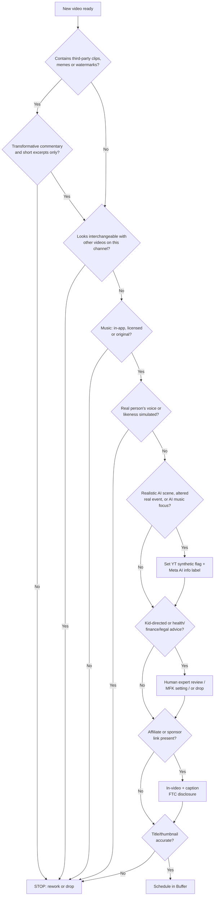
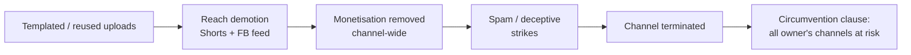

# 03 — Platform Policies and Risks

> **Status:** current · **Updated:** 2026-10-16 · **Related:** [11 Avatar and YMYL policy](11-avatar-and-ymyl-policy.md), [05 Buffer distribution](../5-automation/05-distribution-buffer.md), [06 Growth playbook](../1-strategy/06-growth-playbook.md)

> Researched 2026-10-16. Scope: 10 faceless, AI-produced channels on YouTube, Instagram and Facebook, scheduled through Buffer.
> Policy text is quoted or paraphrased from the linked pages. Items marked **[secondary]** come from press or blog coverage, not the platform's own policy page. Re-verify those before you rely on them. This is not legal advice.

## 0. TL;DR

The plan's main risk is not "AI" as such. It is **scale plus sameness**. YouTube, Meta and Instagram all now
penalise content that is templated, mass-produced, reposted or undisclosed synthetic media. They act at the
**channel or account level**, so one bad format can demonetise a whole channel. YouTube has also been
terminating faceless AI channels in batches since late 2025. Ten channels made from one shared template
pipeline is exactly the pattern these systems are built to catch. To survive, each channel needs a distinct
editorial voice, real research or commentary, honest AI labels, licensed audio, and a slow, organic ramp.

---

## 1. Per-platform rules table

| Topic | YouTube | Instagram | Facebook |
|---|---|---|---|
| **Monetisation entry** | YPP: 1,000 subs **and** 4,000 public long-form watch hours (12 mo) **or** 10M public Shorts views (90 days). Also 2-Step Verification, one linked AdSense, no active strikes ([YT 72851](https://support.google.com/youtube/answer/72851)). **From 1 Feb 2027, new applicants need 8,000 hours or 20M Shorts views.** Existing partners are grandfathered, but must keep 10M Shorts views per rolling 90 days to earn Shorts revenue [secondary: [Shacknews](https://www.shacknews.com/article/150324/youtube-partner-program-minimum-qualified-public-watch-hours-shorts-views), [AIR timeline](https://air.io/en/monetization/youtube-monetization-policy-changes-2026-a-complete-dated-timeline)] | No single ad-revenue program. Bonuses and subscriptions are invite or eligibility based. Originality affects whether content is recommended | **Facebook Content Monetization** merges In-stream ads, Ads on Reels and Performance Bonus. It is **invite-only**, and "you and your content must comply with Meta's policies" ([Meta creators](https://creators.facebook.com/introducing-facebook-content-monetization/)). There is no official public follower threshold. Figures like "10k followers / 600k minutes" are unofficial [secondary: [Buffer](https://www.buffer.com/resources/how-to-make-money-on-facebook/)] |
| **Mass-produced / templated** | "Inauthentic content" (renamed from "repetitious", **15 Jul 2025**). "Generic or repetitive content includes content that looks like it's made with a template." The policy applies to the **whole channel** ([YT 1311392](https://support.google.com/youtube/answer/1311392)). Clarified again on **16 Jul 2026** into three non-monetisable buckets: generic or template content, emotionally manipulative or "unsatisfying" content, and AI personas giving health, finance, legal or political advice [secondary: [OutlierKit Jul 2026](https://outlierkit.com/blog/youtube-updates-july-2026)] | Repetitive content counts as spam ([IG Community Guidelines](https://www.facebook.com/help/instagram/477434105621119)) | Super-short low-value videos and recycled content are demoted ([Meta, 14 Jul 2025](https://creators.facebook.com/blog/combating-unoriginal-content)) |
| **Reused / reposted** | Not allowed: "Clips of moments from your favorite show edited together with little or no narrative", and "Content uploaded many times by other creators". This applies **even with permission** ([YT 1311392](https://support.google.com/youtube/answer/1311392)). From **1 Oct 2026**, Shorts "re-uploaded from other creators without adding anything of your own" get less reach ([PPC Land](https://ppc.land/re-uploaded-shorts-lose-reach-as-youtube-favours-original-clips/)) | Aggregators are not recommended. **[secondary]** An account that reposts others' content 10 or more times in 30 days is removed from recommendations ([Gigazine, 2024](https://www.gigazine.net/gsc_news/en/20240502-instagram-updated-algorithm-prioritizes-original-content)) | Repeat reusers "lose access to Facebook monetization programs for a period of time" and get "reduced distribution on everything they share". Stitching clips or adding a watermark "does not qualify as meaningful enhancement" ([Meta](https://creators.facebook.com/blog/combating-unoriginal-content)). Tightened again in **Mar 2026** [secondary: [TechCrunch 2025](https://techcrunch.com/2025/07/14/following-youtube-meta-announces-crackdown-on-unoriginal-facebook-content)] |
| **AI disclosure** | Disclose realistic content that "Makes a real person appear to say or do something they didn't do", alters real events or places, generates realistic scenes, or uses AI music as the main focus. Scripts, thumbnails, and cloning **your own** voice need no disclosure. Repeat non-disclosure can mean removal or YPP suspension ([YT 14328491](https://support.google.com/youtube/answer/14328491)). Since **May 2026** YouTube labels undetected AI itself and shows the label more prominently [secondary: [TechWyse](https://www.techwyse.com/news/platform-updates/youtube-automatic-ai-labels-disclosure-may-2026)]. API: `status.containsSyntheticMedia` ([YT Data API](https://developers.google.com/youtube/v3/docs/videos)) | You must disclose "photorealistic video or realistic-sounding audio that was digitally created or altered", and "we may apply penalties if they fail to do so" ([Meta manipulated media](https://transparency.meta.com/policies/community-standards/manipulated-media/)). From **Sep 2026**, profiles built around an AI person **must** toggle "AI-generated profile". Without it, they are not recommended to non-followers ([t2online](https://t2online.in/tech/tech-news/instagram-adds-ai-generated-profile-label-to-combat-fakes/2007709)) | Same Meta rule ("AI info" label) |
| **Spam / deceptive** | Bans "Using automated tools or AI to churn out high volumes of similar content with minimal changes", misleading titles and thumbnails, rewards for engagement, and "coordinated networks of channels". 3 strikes in 90 days can mean termination ([YT 2801973](https://support.google.com/youtube/answer/2801973)) | Bans artificial likes and follows, paid engagement, and repetitive comments ([IG CG](https://www.facebook.com/help/instagram/477434105621119)) | Inauthentic Behavior: you may not use "Inauthentic Meta Assets" to deceive people about who is behind them or to "Evade enforcement" ([Meta](https://transparency.meta.com/policies/community-standards/inauthentic-behavior/)) |
| **Multiple accounts** | Allowed. "You can manage up to 100 channels from one Google Account" ([YT 3046356](https://support.google.com/youtube/answer/3046356?hl=en)). Brand Accounts can have several owners and managers ([YT 4642409](https://support.google.com/youtube/answer/4642409)). **But** if one channel is terminated, you may not use, possess or create **any** other channels ([YT circumvention](https://support.google.com/youtube/answer/2802168)) | Up to **5 accounts** can be switched in the app per login ([IG help](https://help.instagram.com/iphone-app/1696686240613595)). Accounts must not be created "to break the guidelines or mislead others" | Pages are unlimited in practice. **[secondary]** About 2 Business Portfolios can be *created* per person, with IG and Page caps per portfolio ([Leadsie](https://help.leadsie.com/article/107-what-is-business-portfolio)) |
| **Impersonation / likeness** | Bans using AI to clone a person's voice or likeness to imply endorsement. "Disclosing AI use does not excuse impersonation". Fan channels must say so ([YT 2801947](https://support.google.com/youtube/answer/2801947)). Likeness detection is live for creators ([TechCrunch](https://techcrunch.com/2025/10/21/youtubes-likeness-detection-technology-has-officially-launched)) | About 10M creator-impersonator profiles were removed in H1 2025 [secondary: [Storyboard18](https://www.storyboard18.com/digital/after-youtube-meta-crackdowns-on-unoriginal-content-removes-10-million-fake-facebook-profiles-74532.htm)] | Same |
| **Kids** | Every video must be marked made-for-kids or not. Getting it wrong has "consequences on YouTube" plus legal exposure under COPPA ([YT 9528076](https://support.google.com/youtube/answer/9528076)) | Under-13s are not allowed to have accounts | Same |

---

## 2. Red lines: things that get you demonetised, suppressed or banned

1. **Templated, interchangeable videos across a channel.** Examples are the same structure with swapped nouns, "characters put in the same situation over and over", slideshows, and stock-footage loops with TTS. This makes the whole channel ineligible for YPP ([YT 1311392](https://support.google.com/youtube/answer/1311392)).
2. **Flooding a channel with AI-churned near-duplicates.** "Using automated tools or AI to churn out high volumes of similar content with minimal changes" is spam ([YT 2801973](https://support.google.com/youtube/answer/2801973)).
3. **Reposting others' clips, memes or videos** without meaningful transformation, even with permission. Watermark swaps and simple stitching are not enough ([Meta](https://creators.facebook.com/blog/combating-unoriginal-content)).
4. **Undisclosed realistic AI**, such as fake real-world events, a real person "saying" things, or AI music as the focus ([YT 14328491](https://support.google.com/youtube/answer/14328491), [Meta](https://transparency.meta.com/policies/community-standards/manipulated-media/)).
5. **Undisclosed AI persona as the face of an IG account.** It is cut from Reels and Explore recommendations ([t2online](https://t2online.in/tech/tech-news/instagram-adds-ai-generated-profile-label-to-combat-fakes/2007709)).
6. **AI "experts" giving health, finance, legal or political advice.** Not ad-eligible on YouTube since Jul 2026 [secondary].
7. **Cloned voice or likeness of a real person or celebrity**, fake endorsements, and fake speeches ([YT 2801947](https://support.google.com/youtube/answer/2801947)). There is also state right-of-publicity liability, for example Tennessee's ELVIS Act, which covers "a simulation of the voice" ([Manatt](https://www.manatt.com/insights/newsletters/client-alert/tennessees-elvis-act-expands-publicity-rights-for)).
8. **Misleading titles or thumbnails, and fake trailers.** YouTube terminated Screen Culture and KH Studio in Dec 2025 [secondary: [OutlierKit](https://outlierkit.com/resources/youtube-ai-slop-crackdown-2026/)].
9. **Fake engagement:** bought followers, views, likes or comments, engagement pods, sub-for-sub, "like to win" giveaways, and comment spam. These are **prohibited on every platform and dangerous**. Do not do it.
10. **Bot or automation networks.** Do not use unofficial auto-follow, auto-like or auto-DM tools, or headless "growth" tools. Posting through Buffer's official API integrations is fine. Engagement automation is not.
11. **Coordinated inauthentic networks:** channels cross-promoting each other to fake popularity, or hiding who runs them ([Meta](https://transparency.meta.com/policies/community-standards/inauthentic-behavior/), [YT 2801973](https://support.google.com/youtube/answer/2801973)).
12. **Ban evasion.** After a termination, YouTube prohibits "using, possessing, or creating any other YouTube channels" ([YT 2802168](https://support.google.com/youtube/answer/2802168)). Meta bans using assets to "Evade enforcement". Antidetect browsers, burner identities and VPN hopping to get around a ban are prohibited. **Do not use them.** They put every linked asset at risk.
13. **Mislabelling made-for-kids content.** This brings COPPA exposure. The amended Rule has had full compliance due since **22 Apr 2026** [secondary: [Mondaq](https://mondaq.com/unitedstates/privacy-protection/1771468/enforcement-begins-soon-for-significant-coppa-rule-amendments)].
14. **Undisclosed affiliate links or sponsorships.** The FTC says "Affiliate link" alone is not adequate ([FTC FAQ](https://www.ftc.gov/business-guidance/resources/ftcs-endorsement-guides-what-people-are-asking)).
15. **Fake or AI-generated reviews and testimonials.** The FTC Consumer Reviews Rule (16 CFR 465) has allowed civil penalties since Oct 2024 [secondary: [Promise Legal](https://blog.promise.legal/startup-central/ftc-influencer-reviews-compliance-startups-2026/)].

---

## 3. What "safe AI content" looks like (positive rules)

- **Add something only you add.** Examples: original research, a point of view, a narrative arc, data, or commentary. YouTube says AI is fine if the creator adds "insight or perspective". Meta wants "creative editing, voiceover, or commentary".
- **Use a distinct format per channel.** Vary hooks, structure, length, pacing, visuals and voice. Do not run 10 channels from one prompt template.
- **Use the same intro and outro if you like**, as long as "the bulk of your content is different". YouTube explicitly allows this.
- **Use AI for scripting, titles, thumbnails and brainstorming.** None of these needs a label. A clone of **your own** voice needs no label either ([YT 14328491](https://support.google.com/youtube/answer/14328491)).
- **Meta caption hygiene:** no links, minimal capitals, and no more than five hashtags. Avoid third-party watermarks.

---

## 4. Copyright and legal

| Area | Rule | Practice |
|---|---|---|
| **Music in Shorts** | Tracks added through the Shorts audio library carry a special Content ID claim that "can't be disputed". The same song added outside the Shorts tools gets standard claims ([YT 13053317](https://support.google.com/youtube/answer/13053317)) | Only use the in-app library, the YouTube Audio Library, or music you own or license. Never bake commercial songs into a file uploaded via Buffer |
| **Music in Reels (business accounts)** | **[secondary]** Business accounts are limited to the commercial-cleared library (Meta Sound Collection). Using other music risks muting, blocking or demotion | Treat every channel as a business. Use licensed stock music or original AI music, disclosed if AI music is the focus |
| **AI music** | If AI music is the "main focus", it must be disclosed on YouTube | Keep generation-tool licence records |
| **Fair use (US)** | Four factors apply: purpose (transformative, commercial?), nature of the work, amount (even a small "heart" can fail), and market effect. "There is no formula" ([copyright.gov](https://www.copyright.gov/fair-use/)) | Recaps and clips should be commentary-led, short, and not a substitute for the original. Fair use is a legal defence, not a platform rule. YouTube's reused-content policy can still demonetise you |
| **Voice cloning / likeness** | YouTube bans implied endorsement and impersonation. Tennessee's ELVIS Act (eff. 1 Jul 2024) protects voice "regardless of whether the sound contains the actual voice or a simulation". The federal NO FAKES Act is pending [secondary: [AIR](https://air.io/en/youtube-hacks/youtube-ai-policy-2026-likeness-detection-and-the-no-fakes-act-what-creators-need-to-know)] | Never clone a real person or celebrity voice or face. Use stock or licensed AI voices with commercial rights |
| **Affiliate / sponsor (FTC)** | Disclose "clearly and conspicuously", **in the video itself** and near the link. Use audio and on-screen text, ideally at the start. Example wording: "I get commissions for purchases made through links in this post" ([FTC FAQ](https://www.ftc.gov/business-guidance/resources/ftcs-endorsement-guides-what-people-are-asking)). Do not rely on platform toggles alone, and avoid "sp" or "collab" ([FTC 101](https://www.ftc.gov/business-guidance/resources/disclosures-101-social-media-influencers)). US law applies if US consumers are foreseeably affected | Put a standard disclosure line in every script template plus a caption snippet |
| **Kids (COPPA)** | "Made for kids" covers subject matter, characters, songs and so on, and creators are responsible for setting it ([YT 9528076](https://support.google.com/youtube/answer/9528076)) | Avoid kid-directed niches entirely (cartoons, nursery content). They bring low RPM and high legal risk |

---

## 5. Account-safety practices (legitimate, ToS-compliant only)

**Structure**
- **YouTube:** use one owner Google Account with 2-Step Verification, and give each channel its own **Brand Account** (up to 100). Add a second human owner as a backup. Keep one AdSense per payee.
- **Meta:** create one real Facebook profile per human operator. Put all Pages and IG professional accounts in **one Business Portfolio** under the real business entity. Give people access by role, rather than sharing passwords. Accounts Center links the IG account to its Page for cross-posting.
- **Instagram app:** you can switch between up to 5 accounts per login. Use Meta Business Suite or Buffer to manage all 10, rather than juggling devices.
- **Separate emails and phones:** these are fine for **organisation and security**, for example a per-channel email alias on a company domain, or a hardware security key. **Do not** use them to disguise common ownership. Meta and YouTube link assets anyway, and hiding ownership turns a single violation into "inauthentic behaviour" or "circumvention".

**Linked-account risk (be honest about it)**
YouTube's termination rule reaches "all of your existing channels". So **one channel's termination can end all 10**. The legitimate mitigation is compliance, not hiding. Keep every channel clean, since the weakest channel sets the risk for all of them. Run riskier experimental formats only after the core channels are stable. Do not run them under a separate fake identity.

**Warming up new accounts** (sensible practice, not an official spec)
- Fill in the profile fully on day 1: name, bio, avatar, links, category. Verify email and phone, and turn on 2FA.
- Weeks 1–2: post 1 piece of content a day per platform, manually or via Buffer. Do some real browsing, replying and following in the niche, at human pace.
- Avoid bursts of follows, likes or DMs. **[secondary]** New IG accounts reportedly have very low action limits, and third-party automation and rapid follow and unfollow trigger action blocks ([Lilach Bullock](https://www.lilachbullock.com/instagram-not-letting-me-follow-anyone/)).
- If you get an action block, **stop the action for 24–48 hours** and check Account Status. Do not switch VPNs or devices to get around it.
- Ramp up cadence only when Account Status is clean and no originality warnings appear. Check FB Professional Dashboard post-level insights for originality flags.
- Stagger channel launches, for example 2–3 a fortnight. Do not create 10 accounts on one day from one IP and device.

---

## 6. Risk register

| # | Risk | Likelihood | Impact | Mitigation |
|---|---|---|---|---|
| R1 | YPP rejection or channel-wide demonetisation for "inauthentic content" | **High** | High | Distinct per-channel format bible; a human editorial pass on each video; a research or commentary layer; a templated-ness audit before applying |
| R2 | YouTube spam termination of a faceless AI channel | Med-High | **Critical** | Avoid upload floods (start at 1/day or less); no misleading thumbnails; no fake trailers or fake news |
| R3 | One termination cascades to all channels (circumvention clause) | Med | **Critical** | Compliance gate on every channel; no fringe or edgy formats; backup owner; keep content archives |
| R4 | Meta reach cut and monetisation loss for unoriginal content | High (if repurposing) | High | Only original renders; no re-uploads of third-party clips; no watermarks; native edits per platform |
| R5 | Undisclosed AI label leads to penalties or YPP suspension | Med | High | Set `containsSyntheticMedia` or the Meta AI toggle by default when realistic. Check that Buffer passes these flags, and if not, set the label manually in the native app |
| R6 | IG AI-persona profile not recommended | High (if using an AI host) | Med | Toggle "AI-generated profile", or use no human-like avatar |
| R7 | Feb 2027 YPP thresholds double for new applicants | **Certain** [secondary] | Med | Plan to reach YPP before 1 Feb 2027, or budget for the 8k-hour / 20M-view path; prioritise long-form for one or two channels |
| R8 | Shorts payouts pause below 10M views per 90 days (existing partners from 2027) | Med | Med | Diversify into long-form, affiliate and sponsors |
| R9 | Copyright claims or strikes from music or clips | Med | High | Licensed or in-app audio only; no movie or TV clips; keep a licence log |
| R10 | Right-of-publicity or impersonation claim (voice clone, celebrity likeness) | Low-Med | High | Hard ban on real-person likeness or voice; review topics that involve real people |
| R11 | FTC action over undisclosed affiliate links or fake reviews | Low | High | Standard in-video plus caption disclosure; no fabricated testimonials |
| R12 | COPPA mislabelling | Low (if avoided) | High | Exclude kids' niches; set the audience setting at channel level |
| R13 | IG action blocks or new-account checkpoints | Med | Low-Med | Gradual warm-up, no engagement automation, staggered launches |
| R14 | Meta FB Content Monetization invite never arrives | Med | Med | Treat FB as distribution; monetise via affiliate or your own products |
| R15 | Health, finance or legal topics with an AI narrator are demonetised | High (in those niches) | Med | Avoid those niches, or use a named, qualified human reviewer and visible sources |
| R16 | Policy changes faster than the playbook | **High** | Med | Monthly policy review; subscribe to YouTube Creator Insider, Meta for Creators and the Tubefilter feeds |

---

## 7. Pre-launch compliance checklist (run per channel)

- [ ] The channel has a written **format bible**: unique premise, voice, structure and visual style, different from the other 9.
- [ ] 10 sample videos reviewed side by side. If they look "made with a template", redesign.
- [ ] Each video has a value layer: research, commentary, narrative or data. It is not just a TTS reading of scraped text.
- [ ] No third-party clips, memes or watermarks. All b-roll is owned, licensed or generated, with a licence log kept.
- [ ] Audio is in-app library, YouTube Audio Library, licensed or original. AI-music-as-focus is disclosed.
- [ ] No real-person voice clone or likeness, and no celebrity "endorsement".
- [ ] AI disclosure set where content is realistic (YT `containsSyntheticMedia`, Meta AI info). IG "AI-generated profile" set if there is an AI host.
- [ ] Titles and thumbnails accurately reflect the content. No fake trailers or fake news.
- [ ] Niche is not kid-directed, and the YT audience setting is "Not made for kids" (or correctly "made for kids").
- [ ] Not giving health, finance or legal advice from an AI persona. Otherwise, a human expert review and sources are shown.
- [ ] Affiliate or sponsor disclosure is in the video (audio and text) and next to links.
- [ ] Account: 2FA on, Brand Account created, backup owner added, assets inside the company Business Portfolio. Credentials are not shared.
- [ ] Buffer connected via the official integration only. No engagement automation tools are connected.
- [ ] Launch cadence plan follows the warm-up in section 5. Launch staggered from the other channels.
- [ ] No bought followers or views, no sub-for-sub, no cross-channel engagement rings.
- [ ] Monitoring: weekly check of YT Studio monetisation status, IG Account Status, and FB Professional Dashboard originality insights.

---

## 8. Diagrams

### 8.1 Is this video safe to publish?

### 8.2 Enforcement escalation (how one channel's problem spreads)

---

## 9. Open questions to verify

> **Update:** the YouTube AI-persona rule and the Instagram "AI-generated profile" label are now **verified from primary sources**, with corrections, in [11 §1](11-avatar-and-ymyl-policy.md#1-verification-table). See 11 §9 for the changes to this risk register.

- Does Buffer pass YouTube `containsSyntheticMedia` and Meta's AI-info flag through its API? If not, set the label in the native apps after scheduling.
- The exact Jul 2026 YouTube policy wording, the Feb 2027 YPP thresholds, and the Mar 2026 Meta originality update rest on secondary coverage. Read the YouTube Blog and Meta Newsroom posts directly.
- Facebook Content Monetization: are invites still the only route in your country?

---

## Sources

**Official pages visited**
- YouTube channel monetization policies (inauthentic and reused content): https://support.google.com/youtube/answer/1311392
- YouTube Partner Program overview and eligibility: https://support.google.com/youtube/answer/72851
- YouTube altered or synthetic content disclosure: https://support.google.com/youtube/answer/14328491
- YouTube spam, deceptive practices and scams: https://support.google.com/youtube/answer/2801973
- YouTube circumvention policy: https://support.google.com/youtube/answer/2802168
- YouTube impersonation policy: https://support.google.com/youtube/answer/2801947
- YouTube made-for-kids: https://support.google.com/youtube/answer/9528076
- YouTube Brand Accounts: https://support.google.com/youtube/answer/7001996
- YouTube create or manage channels: https://support.google.com/youtube/answer/4642409
- YouTube switch between channels (100-channel limit): https://support.google.com/youtube/answer/3046356?hl=en
- YouTube Shorts audio and rights holders (search result): https://support.google.com/youtube/answer/13053317
- YouTube Data API videos resource (search result): https://developers.google.com/youtube/v3/docs/videos
- Meta, Combating unoriginal content (14 Jul 2025): https://creators.facebook.com/blog/combating-unoriginal-content
- Meta, Introducing Facebook Content Monetization: https://creators.facebook.com/introducing-facebook-content-monetization/
- Meta Inauthentic Behavior policy: https://transparency.meta.com/policies/community-standards/inauthentic-behavior/
- Meta Manipulated Media / AI disclosure: https://transparency.meta.com/policies/community-standards/manipulated-media/
- Instagram Community Guidelines: https://www.facebook.com/help/instagram/477434105621119
- Instagram, add multiple accounts (up to 5): https://help.instagram.com/iphone-app/1696686240613595
- FTC, Disclosures 101 for Social Media Influencers: https://www.ftc.gov/business-guidance/resources/disclosures-101-social-media-influencers
- FTC, Endorsement Guides FAQ: https://www.ftc.gov/business-guidance/resources/ftcs-endorsement-guides-what-people-are-asking
- US Copyright Office, Fair Use Index: https://www.copyright.gov/fair-use/

**Reputable coverage and secondary sources visited or cited**
- TechCrunch, Likeness detection launch (Oct 2025): https://techcrunch.com/2025/10/21/youtubes-likeness-detection-technology-has-officially-launched
- TechCrunch, Meta unoriginal content crackdown: https://techcrunch.com/2025/07/14/following-youtube-meta-announces-crackdown-on-unoriginal-facebook-content
- Tubefilter, Meta unoriginal content: https://www.tubefilter.com/2025/07/15/ai-slop-unoriginal-repetitive-content-monetization-facebook-meta/
- PPC Land, Re-uploaded Shorts lose reach (1 Oct 2026): https://ppc.land/re-uploaded-shorts-lose-reach-as-youtube-favours-original-clips/
- Shacknews, YPP thresholds from Feb 2027: https://www.shacknews.com/article/150324/youtube-partner-program-minimum-qualified-public-watch-hours-shorts-views
- AIR Media-Tech, YouTube monetization timeline 2026: https://air.io/en/monetization/youtube-monetization-policy-changes-2026-a-complete-dated-timeline
- AIR Media-Tech, Likeness and NO FAKES: https://air.io/en/youtube-hacks/youtube-ai-policy-2026-likeness-detection-and-the-no-fakes-act-what-creators-need-to-know
- OutlierKit, AI slop crackdown 2026: https://outlierkit.com/resources/youtube-ai-slop-crackdown-2026/
- OutlierKit, YouTube updates July 2026: https://outlierkit.com/blog/youtube-updates-july-2026
- TechWyse, YouTube auto AI labels (May 2026): https://www.techwyse.com/news/platform-updates/youtube-automatic-ai-labels-disclosure-may-2026
- t2online, Instagram "AI-generated profile" label (Sep 2026): https://t2online.in/tech/tech-news/instagram-adds-ai-generated-profile-label-to-combat-fakes/2007709
- Gigazine, Instagram original-content ranking (2024): https://www.gigazine.net/gsc_news/en/20240502-instagram-updated-algorithm-prioritizes-original-content
- Storyboard18, Meta 10M impersonator removals: https://www.storyboard18.com/digital/after-youtube-meta-crackdowns-on-unoriginal-content-removes-10-million-fake-facebook-profiles-74532.htm
- Buffer, How to make money on Facebook: https://www.buffer.com/resources/how-to-make-money-on-facebook/
- Manatt, Tennessee ELVIS Act: https://www.manatt.com/insights/newsletters/client-alert/tennessees-elvis-act-expands-publicity-rights-for
- Mondaq, COPPA amendments enforcement: https://mondaq.com/unitedstates/privacy-protection/1771468/enforcement-begins-soon-for-significant-coppa-rule-amendments
- Promise Legal, FTC reviews compliance 2026: https://blog.promise.legal/startup-central/ftc-influencer-reviews-compliance-startups-2026/
- Leadsie, What is a Business Portfolio: https://help.leadsie.com/article/107-what-is-business-portfolio
- Lilach Bullock, Instagram follow limits and action blocks: https://www.lilachbullock.com/instagram-not-letting-me-follow-anyone/
