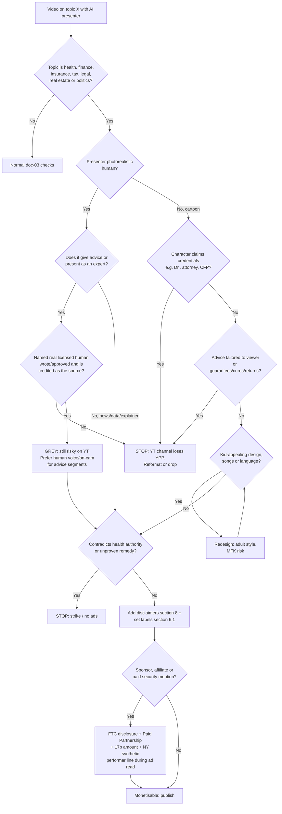

# 11 — AI Avatars, Cartoon Presenters and YMYL Niches

> **Status:** current · **Updated:** 2026-10-16 · **Related:** [03 Platform policies](03-platform-policies-and-risks.md), [09 AI avatar presenters](../4-production/09-ai-avatar-presenters.md), [12 Final portfolio](../2-channels/12-final-portfolio.md)

> Researched 2026-10-16. This doc deepens [03-platform-policies-and-risks.md](03-platform-policies-and-risks.md) and does not repeat it. Read 03 first.
> Scope: high-AdSense US niches (finance, insurance, tax, legal, health, real estate) presented by **realistic AI avatars** or **cartoon characters**, on YouTube, Instagram and Facebook (via Buffer).
> **[official]** means read on the platform's or regulator's own page. **[secondary]** means law-firm or press coverage. This is not legal advice. Get a US attorney to review the finance and health channels before launch.

## 0. TL;DR

1. **Both of doc 03's unverified claims are now confirmed from primary sources**, with small wording corrections (section 1).
2. YouTube's **"AI Personas Related to Sensitive Topics"** rule is a **channel-level** monetisation bar. It lists **no exceptions**: an AI disclosure label does not cure it, and neither does a disclaimer. A realistic AI avatar that "presents itself as a human expert providing advice" on health, legal, finance or politics makes the channel ineligible for YPP.
3. So, for the four core YMYL niches (finance, insurance, tax, legal) and for health, **a realistic avatar host is not a viable YouTube monetisation model.** The workable patterns are:
   - (a) a **real, named human expert** as the source of the advice, with the avatar or cartoon used only as a visual device;
   - (b) **news or explainer content that is not advice**, with a non-human, non-expert framing (a cartoon narrator who never claims credentials);
   - (c) switching the channel to an **adjacent, lower-risk sub-niche** (personal-finance history, "how insurance works" explainers, real-estate market data).
4. On Instagram, a realistic avatar that is the face of the account **should toggle "AI-generated profile"**. If it does not, it risks losing recommendations. The toggle is free, and proactive labelling costs no reach. Turn it on.
5. In US law, the main exposure is not "AI" itself. It is: (i) **implying credentials** the persona doesn't have (FTC Section 5; California AB 489 for health titles); (ii) **personalised investment, legal or tax advice** (Advisers Act, unauthorized practice of law); (iii) **undisclosed paid promotion** (FTC Endorsement Guides, Securities Act §17(b)); (iv) **synthetic performers in ads shown in New York** (GBL §396-b, effective 9 Jun 2026).
6. Cartoons are **not** automatically "made for kids". Adult YMYL subject matter, adult vocabulary and an explicit "Not made for kids" setting on **every video** keep you safe. Avoid child-appealing character design.

---

## 1. Verification table

| # | Claim (from doc 03) | Verdict | What the primary source actually says | Primary source |
|---|---|---|---|---|
| V1 | "YouTube's July 2026 clarification makes AI personas giving health, finance or legal advice ineligible for ads" | **VERIFIED, with corrections.** The rule is about **monetisation (YPP eligibility) of the channel**, not ad suitability per video. It also covers **politics** | Section "AI Personas Related to Sensitive Topics": "This policy refers to channels that use AI-generated personas to deliver information on sensitive topics… any content that presents itself as a human expert providing advice to viewers" on health, legal issues, finances or politics. Channels uploading it "are not allowed to monetize". Examples: an AI "doctor" giving diagnoses or "wellness remedies"; "AI-generated podcast hosts offering financial guidance, investment tips, or wealth management advice"; "AI personas giving legal advice or interpreting laws". The page lists **no allowed examples or exceptions**. The policy page is undated. TechCrunch dates the rollout to **16 Jul 2026** and cites a Creator Insider video by Matt Halprin | [YT 1311392](https://support.google.com/youtube/answer/1311392) **[official]**. Date: [TechCrunch 20 Jul 2026](https://techcrunch.com/2026/07/20/youtube-clarifies-policies-around-ai-slop-and-upsetting-videos/) **[secondary]** |
| V2 | "Since September 2026, Instagram accounts fronted by an AI person must use the 'AI-generated profile' toggle or lose recommendations to non-followers" | **VERIFIED, with corrections.** It was announced **31 Aug 2026**, not September. Instagram's wording is "can and should", not "must". The penalty is "may see limits to their profile's reach" | Instagram renamed its "AI creator" label to "AI-generated profile" for profiles that feature an AI-generated person. "Creators who simply use AI tools as part of their creative process don't need to add the label." Unlabelled profiles that Instagram detects "may see limits to their profile's reach". They are notified in Account Status and can regain recommendation eligibility by adding the label or by appealing. Press reports that the specific loss is **Reels and Explore recommendations to non-followers**, and that proactive labellers see no reach change | [Instagram Creators blog, 31 Aug 2026](https://creators.instagram.com/blog/ai-generated-profile-label) **[official]**. Detail: [t2online](https://t2online.in/tech/tech-news/instagram-adds-ai-generated-profile-label-to-combat-fakes/2007709), [Unite.AI](https://www.unite.ai/instagram-renames-ai-creator-label-and-restricts-unlabeled-ai-generated-profiles/) **[secondary]** |
| V3 | (new) Does an equivalent profile-level label exist on Facebook Pages? | **NOT FOUND** | No official Facebook equivalent was located. On Facebook, rely on the post-level "AI info" disclosure | [Meta Labeling AI Content](https://transparency.meta.com/governance/tracking-impact/labeling-ai-content/) |
| V4 | (new) Meta AI Studio characters as channel hosts | **Closed route** | Update dated 10 Aug 2026: people "will no longer be able to create new AI characters or edit existing ones" in AI Studio | [Meta newsroom (updated)](https://about.fb.com/news/2024/07/create-your-own-custom-ai-with-ai-studio/) **[official]** |

**Open item:** the Creator Insider video (`youtube.com/watch?v=14Vm0CiyUVE`, linked from TechCrunch) was not watched. Watch it to learn how YouTube treats *disclosed* AI hosts and *cartoon* personas. The written policy does not say.

---

## 2. YouTube rules for avatars and synthetic presenters

### 2.1 Altered or synthetic disclosure (what the help page says about a synthetic presenter)
- **Trigger** ([YT 14328491](https://support.google.com/youtube/answer/14328491)): disclose AI content "that seems realistic". The four listed cases are: making a real person say or do something; altering a real event or place; "Generates a realistic scene that didn't actually occur"; and AI music as the main focus. One example that matters for YMYL: "Making it appear as if someone gave advice that they did not actually give."
- **Not addressed:** the page has **no example for a photorealistic invented presenter**, a "digital human", or text-to-speech narration.
- **Our rule:** treat a **photorealistic avatar talking on camera as a "realistic scene that didn't occur"**, and **toggle "Altered or synthetic content" = Yes**. YouTube states that "Disclosing AI content alone won't limit a video's audience or impact its eligibility to earn money", so disclosing costs nothing. Not disclosing risks a forced label and penalties.
- **Cartoon / stylised characters:** these are exempt. The help page lists "an AI-generated or altered animation of a missile in a fully animated video" as needing no disclosure. Where YouTube does label animated content, the label goes in the expanded description, not the player.
- **Voice:** "Cloning one's own voice" is exempt. A **realistic synthetic voice claiming to be a named human** is not exempt.

### 2.2 Inauthentic-content policy as applied to avatar channels
- The AI-persona bar (V1) **sits on top of** the template and mass-production rules in doc 03. An avatar channel can fail **either** rule. Both apply **channel-wide**.
- Allowed under the template rule: "Similar content, like a series following a set of characters across episodes" ([YT 1311392](https://support.google.com/youtube/answer/1311392)). A recurring cartoon cast is fine **if each episode's substance differs**.
- **Grey zone:** the written policy says "AI-generated personas" and "presents itself as a human expert". It does not say whether a **cartoon owl "Dr. Hoot" giving medical advice** counts. Assume it **does** if the character gives advice with expert framing.

### 2.3 Advertiser-friendly guidelines: finance and health ([YT 6162278](https://support.google.com/youtube/answer/6162278))
- **Finance:** there is **no dedicated finance section**. The risk comes through "Enabling dishonest behavior" (products that "help mislead or cheat") and "Sensitive events" (profiting from a tragedy, such as market crashes framed as exploitation). Scams and get-rich-quick content are a Community Guidelines spam issue (doc 03).
- **Health:**
  - Full ads are possible for "Neutral content about viruses, infectious diseases…" and for "Medical or cosmetic procedures that are educational".
  - No ads for "Spreading misinformation that denies established medical and scientific facts" or for "scientifically unproven remedies".
  - Weight-change content aimed at kids gets no ads.
- **Controversial issues** (self-harm, eating disorders, abortion): non-graphic discussion can earn full ads. Graphic content gets none. Focus means a "sustained discussion".

### 2.4 Health source information panels ([YT 12796915](https://support.google.com/youtube/answer/12796915?hl=en), [health.youtube](https://health.youtube/features-application/))
- These are only for **licensed** healthcare professionals or organisations (US among 10 countries). Licences are verified by LegitScript. Applicants must attest to the Health Information Sharing Principles.
- Thresholds: **1,500+ valid public watch hours in 12 months, or 1.5M Shorts views in 90 days**, and no active strikes. Organisations need a licensed professional who oversees content.
- Benefit: a "licensed" label on videos and placement on the "from health sources" shelf.
- **An AI avatar channel cannot qualify** unless a real licensed clinician owns and oversees it. This is the clearest signal of what YouTube wants in health: a credentialed human source.

### 2.5 Medical misinformation policy ([YT 13813322](https://support.google.com/youtube/answer/13813322))
- Removal-level (Community Guidelines, **strikes**):
  - claims that contradict local health authority guidance on **prevention** (vaccines, transmission) or **treatment**;
  - promoting harmful substances;
  - cancer "guaranteed cures", or advice to use alternatives instead of approved care.
- **Educational, documentary, scientific or artistic (EDSA)** context can save borderline videos. "This is not a pass to promote misinformation."
- First violation means a warning. A repeat within 90 days is a strike. Three strikes means termination, which cascades to all channels (doc 03, R3).

---

## 3. Meta (Instagram and Facebook)

| Area | Rule | Source |
|---|---|---|
| Post-level "AI info" | Required for photorealistic video or realistic-sounding audio that was digitally created or altered. Meta also auto-labels when it detects "industry standard AI image indicators" | [Meta labeling](https://transparency.meta.com/governance/tracking-impact/labeling-ai-content/), [Meta Feb 2024](https://about.fb.com/news/2024/02/labeling-ai-generated-images-on-facebook-instagram-and-threads/) |
| IG profile label | "AI-generated profile" toggle, required in practice for any account whose featured person is AI (see V2). **Not needed** for cartoon or mascot accounts that use AI only as a tool | [IG Creators blog](https://creators.instagram.com/blog/ai-generated-profile-label) |
| AI characters | AI Studio can no longer create or edit characters (10 Aug 2026). Build your own avatar, label it, and never imply it is a real person | [Meta](https://about.fb.com/news/2024/07/create-your-own-custom-ai-with-ai-studio/) |
| Branded content | Use the Paid Partnership label for any exchange of value. **Prohibited:** payday loans, paycheck advances, bail bonds, MLM, ICOs, binary options, CFDs. **Pre-authorisation needed:** crypto. **18+ only:** credit cards, loans, insurance | [IG Branded Content Policies](https://help.instagram.com/1695974997209192) |
| Financial ads (affects sponsor deals and boosts) | Credit, loan and insurance ads are 18+. Insurance, mortgage, loan and investment advertisers may need licence verification. US investment ads may not push users into DMs. Ads may not collect bank or card data. US credit, housing and employment ads run under a **Special Ad Category** with restricted targeting | [Meta Financial & Insurance](https://transparency.meta.com/policies/ad-standards/restricted-goods-services/financial-services/), [Discriminatory Practices](https://transparency.meta.com/policies/ad-standards/unacceptable-content/discriminatory-practices/) |
| Creator monetisation | Content Monetization Policies sit "above and beyond" the Community Standards. **Ineligible:** misleading medical information and fact-checked-false content. **Reduced:** death, injury and illness, unless uplifting. Repeat violations remove monetisation account-wide (the help page did not render, so this is from search snippets) | [FB Content Monetization Policies](https://www.facebook.com/business/help/1348682518563619) |

Meta has **no written rule equivalent to YouTube's AI-persona ban** for YMYL. But the FTC rules below and Meta's misinformation monetisation rules apply. Also, YouTube is where the AdSense goal lives, so YouTube's rule is the binding constraint.

---

## 4. US legal layer

| Topic | Rule | Practical consequence |
|---|---|---|
| **FTC Endorsement Guides (2023)** | The definition of "endorsements" was updated to cover "fake reviews, virtual influencers". "A platform's built-in disclosure tool might not be an adequate disclosure" ([FTC Jun 2023](https://www.ftc.gov/news-events/news/press-releases/2023/06/federal-trade-commission-announces-updated-advertising-guides-combat-deceptive-reviews-endorsements)) | An avatar that endorses an affiliate product **is** an endorser. The disclosure must be spoken and on screen, not just the Paid Partnership toggle |
| **Consumer Reviews and Testimonials Rule, 16 CFR 465** (effective **21 Oct 2024**) | Bans fake reviews and testimonials, including by "someone who does not exist" and "AI-generated fake reviews". Civil penalties apply for knowing violations ([FTC press](https://www.ftc.gov/news-events/news/press-releases/2024/08/federal-trade-commission-announces-final-rule-banning-fake-reviews-testimonials)). The FTC's Q&A says there is "no blanket prohibition on the use of AI-generated avatars in marketing", and the rule "is drafted specifically so as to not prohibit companies from using virtual influencers". A testimonial is unlawful only if it is fake or false ([FTC Q&A](https://www.ftc.gov/business-guidance/resources/consumer-reviews-testimonials-rule-questions-answers)) | **Never script "I used this card and saved $3,000"** for an avatar. That is a fabricated experience. Say "This card offers X per its terms" |
| **FTC Section 5, undisclosed AI presenter** | There is **no specific federal rule** requiring every AI presenter to be disclosed. Deception is judged by **net impression**: "there is no AI exception" to consumer protection law. The Government and Business Impersonation Rule has applied since **1 Apr 2024**. The proposed extension to *individuals* was **not confirmed as final** ([FTC Feb 2024](https://www.ftc.gov/news-events/news/press-releases/2024/02/ftc-proposes-new-protections-combat-ai-impersonation-individuals)) | Letting viewers believe a "Certified Financial Planner Sarah" exists is deceptive when the claims rest on her credentials. **Disclose AI, and never invent credentials** |
| **SEC: "investment adviser" and the publisher's exclusion** | *Lowe v. SEC* (1985): a publication avoids adviser status if it is **impersonal**, **bona fide (disinterested)** and of **general and regular circulation** ([Lowe](https://supreme.justia.com/cases/federal/us/472/181/)). SEC Commissioner Uyeda (Dec 2024): a finfluencer who *is* an adviser takes on the full set of adviser rules, but "mere online opinions" do not necessarily make one ([SEC](https://www.sec.gov/newsroom/speeches-statements/uyeda-remarks-iac-121024)) | Stay impersonal. No "DM me your portfolio", no 1:1 Q&A advice, no paid stock-pick tiers. Publish on a regular cadence |
| **SEC anti-touting, Securities Act §17(b)** | It is unlawful to promote a security without disclosing the receipt and amount of consideration ([SEC IAC Nov 2024](https://www.sec.gov/files/sec-iac-finfluencer-recommendation-11222024.pdf)) | Any paid mention of a stock, ETF, token or issuer needs a disclosure of who paid and how much. The simplest policy is **no paid security promotions** |
| **FINRA** | Rule 2210 binds **member firms**, not independent creators. Regulatory Notice **26-14** (proposal, comments closed 11 Sep 2026) would make firms weigh the finfluencer's qualifications ([FINRA 26-14](https://www.finra.org/rules-guidance/notices/26-14)). The 2026 Oversight Report says firms must pre-approve and retain influencer content ([FINRA 2026 report](https://www.finra.org/rules-guidance/guidance/reports/2026-finra-annual-regulatory-oversight-report/communication-with-public)) | Broker or robo-advisor sponsors will **pre-approve your script** and may refuse AI hosts. Budget for this when selling sponsorships |
| **Tennessee ELVIS Act** (2024) | Protects voice and likeness, including simulated voice (doc 03) | Never resemble a real person |
| **California AB 2602 / AB 1836** (effective 1 Jan 2025) | AB 2602: a contract clause for a **digital replica** of a living performer is unenforceable without a reasonably specific description of uses, counsel, or a union. AB 1836: using a **deceased** personality's digital replica without consent means liability of at least $10,000 ([Manatt](https://www.manatt.com/insights/newsletters/client-alert/california-enacts-a-host-of-new-ai-and-digital-rep)) | If an avatar is **trained on a hired actor**, get a written licence with specific uses. Never use a deceased celebrity |
| **California AB 489** (effective 1 Jan 2026) | AI may not use titles or phrases ("Dr.", "M.D.", "nurse") in advertising or functionality that falsely imply a licensed healthcare provider. Each use is a separate offence ([CA Board of Psychology advisory](https://psychology.ca.gov/laws_regs/ab489_advisory.pdf)) | **No "Dr." avatars, no white coats with a stethoscope plus a "doctor" name**, and no "nurse" persona |
| **New York synthetic performer law, GBL §396-b** (effective **9 Jun 2026**) | Anyone who produces an **advertisement** shown to NY audiences must "conspicuously disclose" a synthetic performer when they know one is present. Penalties are $1,000, then $5,000 per violation ([Cooley](https://www.cooley.com/news/insight/2026/2026-01-29-new-york-enacts-synthetic-performer-disclosure-law-for-advertisements-including-those-using-generative-ai)) | Treat **sponsored segments read by an avatar** as ads: add an on-screen "AI-generated presenter" during the sponsor read. Whether organic creator content counts is unresolved |
| **Utah AI Policy Act, as amended by SB 226** (2025; sunset 1 Jul 2027) | Prominent AI disclosure is required in **"high-risk" interactions** by regulated occupations (licensed professions), and whenever a consumer asks ([Perkins Coie](https://perkinscoie.com/insights/update/new-utah-ai-laws-change-disclosure-requirements-and-identity-protections-target)) | Mostly relevant if you add **AI chat or DM bots**. Do not run an AI chatbot that gives personalised finance or health guidance |
| **Unauthorized practice of law** (state rules; general knowledge, not sourced here) | Applying the law to a viewer's specific facts is legal practice | Only discuss "how X generally works". Always say "consult a licensed attorney in your state" |

---

## 5. Cartoon presenters and COPPA / made-for-kids

- **Factors** ([YT 9528076](https://support.google.com/youtube/answer/9528076?hl=en)):
  - subject matter;
  - intended audience and metadata;
  - child actors;
  - "characters, celebrities, or toys that appeal to children";
  - kid-level language;
  - play-acting and other child-appealing activities;
  - songs, stories or poems for children;
  - advertising to children.
- **"Animated content that appeals to everyone" is a general-audience example.** The FTC agrees: "just because your video has bright colors or animated characters doesn't mean you're automatically covered by COPPA" ([FTC 2019](https://www.ftc.gov/business-guidance/blog/2019/11/youtube-channel-owners-your-content-directed-children)).
- YouTube overrides your setting only "in cases of error or abuse". A "13+" disclaimer helps but "doesn't mean that the FTC will automatically deem your content as not made for kids" ([YT FAQ 9684541](https://support.google.com/youtube/answer/9684541?hl=en)).
- **Video-level labels:** the FTC's 2025 complaint against Disney alleges that **channel-level defaults** led to mislabelled videos ([FTC Disney complaint](https://www.ftc.gov/system/files/ftc_gov/pdf/DisneyComplaint.pdf)). Set the label **per video**.

**How to stay "Not made for kids" with a cartoon host**
1. Adult subject matter only: mortgages, 401(k)s, deductibles, W-2s, leases. This is strong evidence of adult intent.
2. Character design: adult proportions and adult clothing (suits, office settings). **Avoid** big-eyed chibi animals, toy-like mascots, primary-colour palettes, and nursery-style music or jingles.
3. Language: adult vocabulary and adult tone. No sing-song narration, rhymes or "kids, let's learn".
4. Metadata: no "kids", "for children" or "learn ABC" tags. Titles should target adults ("…for first-time homebuyers").
5. Set "No, it's not made for kids" on **every upload**, and confirm Buffer sets `selfDeclaredMadeForKids=false`. If it doesn't, set it in Studio.
6. Never mix in kid-directed episodes on the same channel.

---

## 6. Per-niche rules

**Key:** "Avatar" means a photorealistic synthetic human. "Cartoon" means a stylised or animated character. **YT-mon** means a YouTube-monetisable format.

| Niche | Avatar OK? | Cartoon OK? | Required disclaimers | Red lines (never) |
|---|---|---|---|---|
| **Finance / investing** | **No as the advice-giver** (YT AI-persona bar). OK only as an on-screen *reader of a named human analyst's* research, credited every video. Expect YT review risk | **Conditional.** A news or explainer narrator with no credentials, covering concepts ("what is an index fund") rather than recommendations | Educational-only + not investment advice + AI presenter + affiliate or sponsor (with amount if a security is promoted, §17(b)) | "Buy X now", price targets, "guaranteed returns", personal portfolio reviews, DMs, paid stock promos, crypto promos without Meta pre-authorisation, invented "CFP" or "CFA" titles, fake "I made $X" testimonials |
| **Insurance** | **No as an adviser** ("which policy you should buy"). OK for general "how deductibles work" content with a human reviewer named | **Yes (best fit).** Concept explainers | Educational + not a licensed agent + rates vary by state and insurer + AI presenter + affiliate or lead-gen disclosure | Quoting prices as offers, "you're covered for X" claims, posing as a licensed agent, collecting personal data in comments or DMs, targeting under-18s |
| **Tax** | **No as a preparer or adviser.** OK reading a credited CPA or EA's script | **Yes.** Rule explainers ("what is the standard deduction"), cited to IRS pages, with the tax year stated | Not tax advice + figures for tax year YYYY + consult a CPA or EA + AI presenter | "You can deduct X" applied to a viewer's situation, evasion or "loophole" framing, outdated figures, "IRS-approved" claims, impersonating the IRS |
| **Legal** | **No.** "AI personas giving legal advice or interpreting laws" is a named YT example | **Conditional.** General "how small-claims court works" explainers. Avoid "interpreting laws" for viewers | Not legal advice + no attorney-client relationship + laws vary by state + AI presenter | Answering viewers' specific cases, "you will win", posing as a lawyer, interpreting statutes for viewers' facts |
| **Health / medical** | **No.** An AI "doctor" is a named YT example. CA AB 489 bars implied clinician titles. Not eligible for YT health panels | **Conditional and the riskiest cartoon niche.** General wellness or anatomy explainers only, cited to CDC, NIH or FDA, with no remedies | Not medical advice + consult a licensed clinician + sources on screen + AI presenter | Diagnoses, dosing, "cures", supplement claims, anti-vaccine content or any contradiction of health-authority guidance (strike), weight-loss content aimed at teens, "Dr." or "Nurse" personas, fake patient testimonials |
| **Real estate** | **Conditional.** Market-data or news formats ("median prices in Austin fell 3%") are not advice. Advice framing ("you should buy now") is risky | **Yes.** Process explainers (closing costs, escrow) | Educational + not a licensed agent or broker + not financial advice + AI presenter + affiliate disclosure (mortgage or lender links) | Steering by neighbourhood demographics (fair housing), "guaranteed appreciation", posing as a realtor, housing ads outside Meta's Special Ad Category, mortgage-rate offers without lender licensing |

**The structural fix for higher-RPM YMYL on YouTube** is a **real, named expert partner**. Options are a licensed CPA, CFP, attorney or clinician who writes or approves the scripts, is credited on screen and in the description, and ideally appears in voice or short clips. The avatar or cartoon then becomes presentation, not the "persona providing advice". This also meets FINRA sponsor expectations and is the only route to YouTube health panels.

### 6.1 Disclosure settings per platform (every YMYL video with an avatar)

| Platform | Setting | Avatar (realistic) | Cartoon |
|---|---|---|---|
| YouTube | Altered or synthetic content (`status.containsSyntheticMedia`) | **Yes** | No (animated) |
| YouTube | Audience | Not made for kids | **Not made for kids, per video** |
| YouTube | Paid promotion checkbox | Yes, if sponsored | Yes, if sponsored |
| Instagram | Profile: "AI-generated profile" toggle | **On** | Off (not a human-like person) |
| Instagram / FB | Post "AI info" / AI label | **On** | Optional (on if photorealistic elements are used) |
| Instagram / FB | Paid Partnership label | Yes, if any exchange of value | Same |
| All | Spoken and on-screen disclosures (section 8) | Required | Required (except the AI-presenter line can be text-only) |

Buffer passthrough of these flags is **still unverified** (doc 03, section 9). Until it is confirmed, set the labels in YT Studio and the IG app after scheduling.

---

## 7. Decision flowchart: can this avatar video on topic X be monetised?



---

## 8. Disclaimer templates

**Short spoken lines (first 15 seconds; on screen for at least 3 s as well)**
- Finance: "Quick note: I'm an AI-generated presenter. This is general education, not investment advice. Do your own research or talk to a licensed adviser."
- Insurance: "I'm an AI presenter, not a licensed agent. Coverage and prices vary by state and insurer, so check your own policy."
- Tax: "AI presenter here. This is general information for tax year 2026, not tax advice. For your situation, ask a CPA or enrolled agent."
- Legal: "I'm an AI presenter, not a lawyer, and this isn't legal advice. Laws vary by state. Talk to a licensed attorney about your case."
- Health: "I'm an AI-generated presenter, not a doctor. This is general information, not medical advice. Talk to a licensed clinician before making health decisions."
- Real estate: "AI presenter here, not a licensed agent or broker. This is market education, not financial advice."
- Sponsor read (all niches; also satisfies NY §396-b): "This segment is paid for by [Brand]. I'm an AI-generated presenter." On screen: "Paid ad · AI-generated presenter".
- Affiliate: "If you use our links, we earn a commission at no cost to you."

**Description block (paste at the top, above the fold)**
```
AI DISCLOSURE: The presenter in this video is AI-generated. [Script reviewed by NAME, CREDENTIAL, licence #/state, if applicable.]
EDUCATIONAL ONLY: This video is general information, not [investment / tax / legal / medical / insurance] advice,
and does not create an adviser-client, attorney-client or doctor-patient relationship. Your situation is different;
consult a licensed professional in your state. No guarantees: past performance does not predict future results.
Figures are current as of [DATE] / tax year [YYYY] and may change.
SOURCES: [IRS.gov / SEC.gov / CDC.gov / CFPB.gov links]
DISCLOSURE: We may earn a commission from links below. [Sponsor] paid $[amount, required for securities] for this video.
```

---

## 9. Changes to doc 03

- R15 → **confirmed, High.** A realistic AI advice-giver in YMYL means channel-level YPP loss. Mitigation: a credited human expert, or a non-advice explainer format.
- R6 → **confirmed.** Toggle "AI-generated profile" on every avatar-fronted IG account at creation.
- New risk **R17: implied credentials** (FTC Section 5, CA AB 489). Likelihood Med, impact High. Ban titles in persona names.
- New risk **R18: synthetic performer in NY-distributed ads.** Likelihood Med, impact Low-Med. Use the sponsor-read line.

---

## Sources (all visited during this research unless marked)

**Official**
- YouTube channel monetization policies (AI personas section): https://support.google.com/youtube/answer/1311392
- YouTube altered or synthetic content disclosure: https://support.google.com/youtube/answer/14328491
- YouTube advertiser-friendly content guidelines: https://support.google.com/youtube/answer/6162278
- YouTube medical misinformation policy: https://support.google.com/youtube/answer/13813322
- YouTube apply to be a health source (search result summary): https://support.google.com/youtube/answer/12796915?hl=en
- YouTube Health features application (search result): https://health.youtube/features-application/
- YouTube determining made for kids: https://support.google.com/youtube/answer/9528076?hl=en
- YouTube made-for-kids FAQ: https://support.google.com/youtube/answer/9684541?hl=en
- Instagram Creators blog, AI-generated profile label (31 Aug 2026): https://creators.instagram.com/blog/ai-generated-profile-label
- Meta, Labeling AI Content: https://transparency.meta.com/governance/tracking-impact/labeling-ai-content/
- Meta, AI Studio post with 10 Aug 2026 update (search result): https://about.fb.com/news/2024/07/create-your-own-custom-ai-with-ai-studio/
- Meta ad standards, Financial and Insurance Products: https://transparency.meta.com/policies/ad-standards/restricted-goods-services/financial-services/
- Meta Discriminatory Practices / Special Ad Categories (search result): https://transparency.meta.com/policies/ad-standards/unacceptable-content/discriminatory-practices/
- Instagram Branded Content Policies (search result): https://help.instagram.com/1695974997209192
- Facebook Content Monetization Policies (page did not render; snippets only): https://www.facebook.com/business/help/1348682518563619
- FTC, Final rule banning fake reviews (Aug 2024): https://www.ftc.gov/news-events/news/press-releases/2024/08/federal-trade-commission-announces-final-rule-banning-fake-reviews-testimonials
- FTC, Consumer Reviews and Testimonials Rule Q&A: https://www.ftc.gov/business-guidance/resources/consumer-reviews-testimonials-rule-questions-answers
- FTC, Updated Endorsement Guides (Jun 2023): https://www.ftc.gov/news-events/news/press-releases/2023/06/federal-trade-commission-announces-updated-advertising-guides-combat-deceptive-reviews-endorsements
- FTC, Endorsement Guides FAQ: https://www.ftc.gov/business-guidance/resources/ftcs-endorsement-guides-what-people-are-asking
- FTC, AI impersonation of individuals proposal (search result): https://www.ftc.gov/news-events/news/press-releases/2024/02/ftc-proposes-new-protections-combat-ai-impersonation-individuals
- FTC, YouTube channel owners and COPPA (2019): https://www.ftc.gov/business-guidance/blog/2019/11/youtube-channel-owners-your-content-directed-children
- FTC, Disney complaint (search result): https://www.ftc.gov/system/files/ftc_gov/pdf/DisneyComplaint.pdf
- SEC Investor Advisory Committee finfluencer recommendation (search result): https://www.sec.gov/files/sec-iac-finfluencer-recommendation-11222024.pdf
- SEC, Commissioner Uyeda remarks, Dec 2024 (search result): https://www.sec.gov/newsroom/speeches-statements/uyeda-remarks-iac-121024
- Lowe v. SEC, 472 U.S. 181 (search result): https://supreme.justia.com/cases/federal/us/472/181/
- FINRA Regulatory Notice 26-14: https://www.finra.org/rules-guidance/notices/26-14
- FINRA 2026 Oversight Report, Communications (search result): https://www.finra.org/rules-guidance/guidance/reports/2026-finra-annual-regulatory-oversight-report/communication-with-public
- California Board of Psychology AB 489 advisory (search result): https://psychology.ca.gov/laws_regs/ab489_advisory.pdf

**Secondary**
- TechCrunch, YouTube clarifies AI slop policies (20 Jul 2026): https://techcrunch.com/2026/07/20/youtube-clarifies-policies-around-ai-slop-and-upsetting-videos/
- OutlierKit, YouTube updates July 2026: https://outlierkit.com/blog/youtube-updates-july-2026
- t2online, Instagram AI-generated profile: https://t2online.in/tech/tech-news/instagram-adds-ai-generated-profile-label-to-combat-fakes/2007709
- Unite.AI, Instagram renames AI label: https://www.unite.ai/instagram-renames-ai-creator-label-and-restricts-unlabeled-ai-generated-profiles/
- Cooley, NY synthetic performer law: https://www.cooley.com/news/insight/2026/2026-01-29-new-york-enacts-synthetic-performer-disclosure-law-for-advertisements-including-those-using-generative-ai
- Manatt, California AI and digital replica laws (search result): https://www.manatt.com/insights/newsletters/client-alert/california-enacts-a-host-of-new-ai-and-digital-rep
- Perkins Coie, Utah 2025 AI laws (search result): https://perkinscoie.com/insights/update/new-utah-ai-laws-change-disclosure-requirements-and-identity-protections-target
- Cited but not visited: Creator Insider video (Halprin), https://www.youtube.com/watch?v=14Vm0CiyUVE
