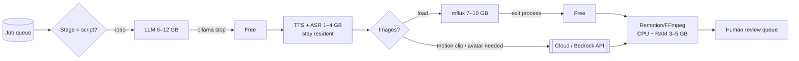

# 14 — Local Open-Source Models on One Mac (Apple M4 Pro, 24 GB)

> **Status:** current · **Updated:** 2026-10-16 · **Related:** [04 Pipeline architecture](04-content-pipeline-architecture.md), [15 Bedrock routing](../5-automation/15-bedrock-hybrid-routing.md), [16 MCP and agents](../5-automation/16-mcp-agent-orchestration.md)

> Status: research and proposal, as of **2026-10-16**. Licences and file sizes come from the Hugging Face API and the Ollama library pages that day. Repo activity comes from the GitHub API. **Very few published M4 Pro 24 GB benchmarks exist.** Every speed figure here is marked either **measured** (with its source) or **est.** (an estimate, ours or a third-party site's). Run the §9 smoke test on the real machine before you rely on any number.
>
> Scope: what can run **locally** for the pipeline in [04](04-content-pipeline-architecture.md). That means scripts, metadata, voice, captions, stills, music, and the cartoon rig from [10 §3.2](../archive/10-ai-cartoon-characters.md). Bedrock and cloud APIs are covered in another doc. Here they only appear as "send this step out" decisions.

---

## 1. TL;DR

- **On 24 GB you have about 16–20 GB of GPU memory to work with, and about 273 GB/s of bandwidth.** By default, macOS lets the GPU wire roughly two-thirds to three-quarters of RAM. `sudo sysctl iogpu.wired_limit_mb=19456` raises that to about 19 GB. That is the practical ceiling: macOS, FFmpeg and Remotion need the remaining ~5 GB. **Run one heavy model at a time.**
- **LLM: Qwen3.5-9B or Gemma 4 12B as the workhorse (6–8 GB at 4-bit), and gpt-oss-20b (about 12 GB) as the "smarter" pass.** All three are Apache-2.0. 27B dense models and 35B MoE models technically load but leave no headroom, so don't run them in production on this machine.
- **Runtime: Ollama ≥ 0.40.** Since 2026-09-25 it runs supported models on MLX by default on Apple Silicon. It exposes an OpenAI-compatible `/v1/chat/completions` endpoint with tool calling. `mlx_lm.server` and LM Studio are the alternatives.
- **Voice: Kokoro-82M through mlx-audio** (Apache-2.0, far faster than real time). Its preset voices aren't anyone's clone. **Qwen3-TTS VoiceDesign** (Apache-2.0) designs a new voice from a text description. Avoid F5-TTS (CC-BY-NC) and Higgs TTS 3 (non-commercial plus a creator grant that requires credit).
- **Captions: Parakeet-TDT v2 through parakeet-mlx** (English, CC-BY-4.0) or **mlx-whisper / whisper.cpp** (MIT). Both give word timestamps in seconds per Short.
- **Stills: Z-Image-Turbo or FLUX.2 [klein] 4B through mflux.** Both are Apache-2.0, and mflux can train a LoRA on either. **Not** FLUX.1-dev, FLUX.2-klein-9B, FLUX.2-dev or Qwen-Image-2.1, which are non-commercial or carry restrictive licences. Expect roughly 15–60 s per 1024 px image *(est.)*.
- **Video generation and AI lip-sync are not practical locally.** One measured M1 Max 64 GB run took **82 min for a 2 s Wan 2.2 14B clip**, and LTX-2 produced near-still or broken output on MPS. Send motion clips to a cloud API (avatars were removed 2026-10-16). Cartoon channels use the **Rhubarb + Remotion rig**, which needs no GPU.
- **Throughput *(est.)*: about 25–40 Shorts, or about 6–8 long-form videos, per 8-hour overnight batch**, run stage by stage. The full-scale target is about 10 Shorts plus 2.7 long-form a day (≈ 6–7 h), so it fits, with about 2× headroom for regenerations.

---

## 2. Memory and bandwidth reality

| Fact | Value | Source / note |
|---|---|---|
| M4 Pro memory bandwidth | **273 GB/s** (both the 16-core and 20-core GPU bins) | llama.cpp Apple Silicon table; Apple launch coverage |
| Default GPU-wired limit | About **⅔–¾ of RAM**, so **~16–18 GB** on 24 GB. Apple doesn't document it | Community sources disagree on the exact fraction. Check with `sysctl iogpu.wired_limit_mb` (0 = system default) |
| Raise it | `sudo sysctl iogpu.wired_limit_mb=19456` (≈ 19 GB). Resets at reboot. Revert with `=0` | mlx-lm README; leave **≥ 4–5 GB** for macOS |
| What spills over | If a model exceeds the wired limit it swaps or crawls, and MPS throws `MPS backend out of memory` | mlx-lm README ("model will likely be slow") |
| Measured LLM anchor (llama.cpp, Llama-2-7B Q4_0, M4 Pro 16-core GPU) | **Prompt processing 364 t/s · text generation 49.6 t/s** (Q8_0: 367 / 30.5) | **measured**, llama.cpp discussion #4167 |

**Rule of thumb.** Decoding is limited by memory bandwidth. Tokens/s ≈ 0.6–0.7 × 273 GB/s ÷ GB of weights read per token. The measured 7B Q4_0 figure (3.6 GB → 49.6 t/s) implies about 65% efficiency. So:

- a **dense 9B at 4-bit (~6 GB) → ~27–32 t/s**
- a **dense 27B (~16 GB) → ~10–12 t/s**
- an **MoE with ~3B active parameters (~2 GB read per token) → 50–80 t/s**, but you must still *hold* every expert in memory

Prompt processing (~350–450 t/s for 7–9B) is the hidden cost. A 10k-token research/fact-check prompt takes about **25–30 s** before the first output token *(est.)*.

**KV cache counts too.** A 9B model at 32k context adds several GB. In the pipeline, keep script contexts at **8–16k** (use `OLLAMA_CONTEXT_LENGTH=16384`).

---

## 3. LLMs for scripts, metadata and tool calling

| Model | Quant / file | Weights in RAM | Speed on M4 Pro 24 GB | Context | Tool calling / JSON | Licence | Verdict |
|---|---|---|---|---|---|---|---|
| **Qwen3.5-9B** (Feb 2026) | MLX 4-bit 6.0 GB / Ollama `qwen3.5:9b` | ~6 GB + KV | ~27–32 t/s *(est., bandwidth rule)* | 256K family spec (use 16K) | Native tool-call template, thinking on/off | Apache-2.0 | **Workhorse.** Scripts, hooks, titles, tags, JSON |
| **Gemma 4 12B-it** (May 2026) | Ollama `gemma4:12b` 7.7–8.0 GB (MLX/QAT) | ~8 GB | ~20–25 t/s *(est.)* | 256K | Function calling supported. Strong US-English prose | Apache-2.0 | **Workhorse alternative.** A/B test it against Qwen for voice and tone |
| **gpt-oss-20b** (Aug 2025, MoE ~3.6B active) | MXFP4, MLX 12.1 GB / Ollama ~13 GB | ~12–13 GB | ~40–64 t/s *(est.; two sites disagree)* | 128K | Very good tool use (harmony format). Reasoning-effort setting | Apache-2.0 | **"Smart pass"**: fact-check critic, outline, planner agent |
| Gemma 4 E4B | Ollama 6.1–9.5 GB | ~6–9 GB | fast *(est.)* | 128K | OK | Apache-2.0 | Classifier, moderation, similarity checks |
| Ministral 3 14B Instruct (Dec 2025) | MLX 4-bit 8.4 GB | ~8.5 GB | ~20 t/s *(est.)* | long | Good function calling | Apache-2.0 | Backup workhorse |
| Mistral Small 3.2 24B (Jun 2025) | Q4 ~14 GB | ~14 GB | ~12–15 t/s *(est.)* | 128K | Good | Apache-2.0 | Superseded by gpt-oss-20b at this RAM |
| Phi-4 14B / Phi-4-mini | Q4 ~9 GB / ~2.5 GB | | | 16K / 128K | Fair | MIT | Not needed. Older and weaker at prose |
| Llama 3.1 8B / 3.2 3B | Q4 ~5 / ~2 GB | | | 128K | OK | Llama Community (700M-MAU clause, attribution) | Dated. No reason to pick it in 2026 |
| Gemma 4 26B-A4B (MoE) | MLX 4-bit 15.3 GB / Ollama 16–19 GB | ~16 GB | ~28 t/s at 6-bit *(third-party est.)* | 256K | Good | Apache-2.0 | **Borderline.** Only with the limit raised and nothing else loaded |
| Qwen3-30B-A3B | MLX 4-bit 17.2 GB | ~17 GB | **61 t/s measured on an M4 Pro *48 GB*** (Qwen3-Coder variant, oMLX) | 256K | Good | Apache-2.0 | Too tight on 24 GB. Nothing else can stay resident |
| Qwen3.6-27B / **Qwen3.8-27B** (Aug 2026, dense) | MLX 4-bit 16.1 GB / Ollama 18 GB | 16–18 GB | ~10–12 t/s *(est.)* | 256K | Excellent agentic and tool use | Apache-2.0 | Best quality that *loads*, but too slow and tight. Use Bedrock for this tier |
| Qwen3.6-35B-A3B | MLX 4-bit 20.4 GB / Ollama 23–24 GB | > 20 GB | "32 t/s" (aggregator; likely swapping) | 256K | Excellent | Apache-2.0 | **Don't** on 24 GB |

### Runtimes

| Runtime | OpenAI-compatible API | Tool calling | Model management | Notes |
|---|---|---|---|---|
| **Ollama ≥ 0.40** (v0.40.5, 2026-10-14) | `http://localhost:11434/v1` | Yes (`tools` in chat completions) | `ollama stop`, `OLLAMA_KEEP_ALIVE`, `OLLAMA_MAX_LOADED_MODELS=1` | v0.40.0 (2026-09-25) runs supported architectures (qwen3.5/3.6/3.8, gemma4) **on MLX by default**. The March 2026 preview required "> 32 GB". **Verify MLX is actually used on 24 GB**: check `ollama ps` and the speed |
| **mlx-lm** (`mlx_lm.server`, v0.32.2) | `/v1/chat/completions` | Yes, for models whose tokenizer has a tool-call template | One model per process | README: "not recommended for production" (basic security only). Bind to 127.0.0.1 |
| **LM Studio** (MLX + llama.cpp engines) | `:1234/v1` | Yes | `lms load/unload`, JIT load with TTL | GUI plus `lms` CLI. Convenient for evaluating models |
| **llama.cpp** `llama-server` | `/v1` | Yes (`--jinja`) | Manual | GGUF, Metal backend. Most knobs, least convenient |
| vllm-mlx (community) | `/v1` | `--enable-auto-tool-choice` | | Young project. Watch it, but don't build on it yet |

**Pick:** use **Ollama** for the orchestrator. It is one daemon, does load/unload by API, and supports tool calling. Keep `mlx_lm.server` as the fallback for any model Ollama hasn't put on MLX yet.

**JSON safety:** whatever the runtime, validate every response against a Pydantic schema and retry up to twice. Small models occasionally break JSON. Turn thinking **off** for metadata and **on** for the fact-check critic.

---

## 4. TTS (US English narration)

| Model | Size | Speed on Apple Silicon | Voice design without cloning a real person | Licence | Verdict |
|---|---|---|---|---|---|
| **Kokoro-82M** (mlx-audio, 8/6/4-bit) | 82M, ~0.4 GB | RTF ≈ 0.02 on **M4 Max** (measured, short reply). Expect ≲ 5 s per 60 s of audio on M4 Pro *(est.)* | 54 preset voices (≈ 20 US-EN). Blend voice embeddings for a unique house voice | Apache-2.0 | **Default narrator.** Same engine as the 04 Budget tier |
| **Qwen3-TTS 1.7B VoiceDesign** (Jan 2026) | 1.7B, ~4 GB bf16 | Not benchmarked on Mac. Assume ~1× real time *(est.)* | **Yes**: describe the voice in text ("warm 40s male, Midwest, dry humour") | Apache-2.0 | **Per-channel signature voices.** Design once, save the reference, reuse it |
| VoxCPM2 (Apr 2026) | 2B, 48 kHz | n/a | Voice design plus continuation | Apache-2.0 | Alternative to Qwen3-TTS |
| Chatterbox / Chatterbox-Turbo (Resemble) | 0.35–0.5B | MPS supported. Speed not published | Emotion-exaggeration control. Built-in **PerTh watermark** | MIT | Good for expressive cartoon voices |
| Dia 1.6B (Nari) | 1.6B | mlx-audio | Two-speaker dialogue, non-verbal tags | Apache-2.0 | Two-host formats (Was It Legal? skits) |
| Sesame CSM-1B | 1B | mlx-audio | Conversational. Cloning-oriented | Apache-2.0 (Llama-3.2 backbone; verify) | Skip. Weaker as a narrator |
| Orpheus 3B | 3B | GGUF/MLX ports | 8 preset voices plus emotion tags | Apache-2.0 tag, but **fine-tuned from Llama-3.2-3B**, so the Llama licence applies | OK, but carries licence baggage |
| Kyutai TTS 1.6B | 1.6B | Streaming. Has an MLX port | Voice set from the Kyutai voices repo | CC-BY-4.0 (attribution). **Check each voice's licence** | Optional |
| Higgs Audio v2 (3B) / **Higgs TTS 3** (4B, Jun 2026) | 3–4B | mlx-audio | Cloning, control tokens | v2: Boson community licence, needs an expanded licence above **100k annual active users**. TTS 3: **non-commercial**, plus a free "Creator Use Grant" that requires **"Boson AI's Higgs Audio" credit** on every video | Avoid for 10 monetised channels |
| F5-TTS / F5-TTS-MLX | 0.3B | MLX port (stale since Mar 2025) | Cloning only | **CC-BY-NC-4.0 weights** | **No** (not commercial) |
| VibeVoice 1.5B (Microsoft) | 1.5B | | Long multi-speaker | MIT, but Microsoft pulled the repo in 2025 over misuse | Skip |

**Policy fit:** use only preset or designed voices, and never a clone of a real person. That keeps us clear of the impersonation rules in [11](../3-policy/11-avatar-and-ymyl-policy.md). Store each channel's voice as `brand_pack.voice = {engine, voice_id|ref_wav, speed}`.

---

## 5. ASR and word-level captions

| Tool | Model | Speed | Word timestamps | Licence | Verdict |
|---|---|---|---|---|---|
| **parakeet-mlx** (★987, active) | Parakeet-TDT-0.6B v2 (English) | **0.50 s vs 1.02 s for mlx-whisper turbo** on one short clip, **M4 24 GB** (measured, third-party). RTF ~54× (vllm-mlx docs, hardware not stated) | Yes (token/word) | Code Apache-2.0. Weights **CC-BY-4.0** (credit NVIDIA in docs) | **Default.** We already have the script text, so ASR only provides timing |
| **mlx-whisper** (mlx-examples) | whisper-large-v3-turbo | RTF ~14× (vllm-mlx docs) | `word_timestamps=True` | MIT | Fallback. Better on odd names |
| **whisper.cpp** (★54k, Metal) | large-v3-turbo / distil | Comparable to mlx-whisper (Bill Mill, Jan 2026) | `-ojf` / `--max-len 1` word JSON. Used by Remotion's caption template | MIT | Use if the renderer is Node/Remotion |
| Qwen3-ASR 1.7B + **Qwen3-ForcedAligner 0.6B** (Jun 2026) | | n/a | **Forced alignment** of known text, so timestamps are exact | Apache-2.0 | Best fit for "align our own script". Worth a try |
| Lightning Whisper MLX | | | | No licence file, **stale since May 2024** | **Don't** |

ASR needs about 1–3 GB, so it can share memory with the TTS stage.

---

> **Update 2026-10-16:** for this disk-constrained machine, §6–7 are superseded by [18](18-local-image-video-models.md), which uses 4-bit image models and Wan Turbo GGUF video.

## 6. Image generation (stills, thumbnails, character keyframes)

| Model | Params | Runs via | Memory (8-bit / 4-bit, est.) | Speed at 1024 px on M4 Pro | Licence (commercial?) | Verdict |
|---|---|---|---|---|---|---|
| **Z-Image-Turbo** (Tongyi, Nov 2025) / Z-Image base | 6B | mflux, ComfyUI, Draw Things | ~8–12 GB | 60–80 s at 9 steps in ComfyUI on a **Mac mini M4 Pro 24 GB** (blog range). mflux likely faster *(est. 30–60 s)* | **Apache-2.0** | **Default still model.** LoRA training in mflux |
| **FLUX.2 [klein] 4B** (Jan 2026) | 4B | mflux | ~6–9 GB | ~15–30 s *(est.; 4 steps)* | **Apache-2.0** | **Fast drafts, thumbnails.** LoRA training in mflux |
| FLUX.2 [klein] 9B | 9B | mflux | ~12 GB | | **Non-commercial** | No |
| FLUX.1 [schnell] | 12B | mflux, Draw Things | ~12 GB at 8-bit | Draw Things guide: ~30–45 s at 4 steps *(est.)* | Apache-2.0 | OK, but older than the two above |
| FLUX.1 [dev] / Krea-dev | 12B | mflux, Draw Things | ~12 GB | **~50 s at 20 steps (Q6_K, Draw Things, M4 Pro 24 GB)** (blog) | **FLUX.1 [dev] Non-Commercial Licence** (paid BFL licence for business use) | **No**, unless you buy the licence |
| FLUX.2 [dev] (Nov 2025) | 32B | | > 24 GB | | Non-commercial | No (too big as well) |
| FLUX 3 Image [klein] (gated, 2026-10-13) | | | | | "other", gated: **read before use** | Watch |
| Qwen-Image / Qwen-Image-2512 | 20B | mflux | ~20 GB at 8-bit; 4-bit needed | slow *(est. 2–4 min)* | Apache-2.0 | Best open text-in-image, but **too heavy on 24 GB**. Use the cloud for titles-in-image |
| **Qwen-Image-2.1** (Sep 2026) | 7.1B + 8B TE | mflux | ~10–14 GB | | **Qwen RESEARCH licence: non-commercial** | **No** |
| HiDream-I1 | 17B | ComfyUI | > 24 GB at fp16 | | MIT (Llama-3.1 text encoder, which carries the Llama licence) | Too heavy |
| SD 3.5 Large / Medium | 8B / 2.5B | ComfyUI, Draw Things | | | Stability Community (free under **$1M revenue**) | Usable fallback |
| SDXL + LoRAs | 3.5B | Draw Things, ComfyUI | ~7 GB | **20–40 s at 25 steps** (ComfyUI, M4 Pro 24 GB, blog) | CreativeML OpenRAIL++-M | Old, but the cartoon LoRA ecosystem is huge |

**Tools:**
- **mflux** (MLX, MIT, active 2026-10-16): Z-Image, FLUX.2, Qwen-Image, Krea 2 and more, `-q 8` / `-q 4` quantisation, and LoRA fine-tuning for Z-Image and FLUX.2.
- **Draw Things**: free Mac app, Metal FlashAttention, has an HTTP API. Often the fastest on Mac.
- **ComfyUI on MPS**: most flexible, slowest. Anything that uses FP8 fails on Metal (`Float8_e4m3fn` undefined).

**Character LoRA on Mac:** mflux can train a Z-Image or FLUX.2-klein-4B LoRA (gradient checkpointing available) on 20–30 character-sheet images. Expect **several hours per LoRA overnight** *(est.; no published M4 timings)*. ai-toolkit is CUDA-first. Train there only on a rented GPU (~$1–3 per LoRA, est.). Ten channels need about 15–25 LoRAs **once**, so a cloud GPU is fine.

---

## 7. Video generation, lip-sync and animation

| Model / tool | Mac path | Evidence | Licence | Verdict |
|---|---|---|---|---|
| Wan 2.2 TI2V-5B | mlx-video (stale since May 2026), ComfyUI MPS | ~17 min for 25 frames at 768×512 on M4 Pro 24 GB (*third-party estimate*). The umT5 encoder plus 5B weights at fp16 are tight on 24 GB | Apache-2.0 | **Not practical** at 300 Shorts a month. Fine as a one-off experiment |
| Wan 2.2 14B (T2V/I2V, GGUF Q4) | ComfyUI MPS | **82 min 45 s for a 2 s 832×480 clip on an M1 Max 64 GB** (measured, lilting.ch) | Apache-2.0 | **No** |
| LTX-2 / 2.3 (19B) | mlx-video, LTX-2-MLX (~25 GB RAM), ComfyUI GGUF | M1 Max: 1.3 s clips take 3–14 min, are **near-still or NaN** on MPS, and FP8 fails (measured, lilting.ch). The 4-bit MLX build "fits 32 GB" | LTX-2 Community: free under **$10M annual revenue** | **No** on 24 GB |
| HunyuanVideo 1.5 | ComfyUI | 14 GB VRAM with offload (CUDA) | Tencent community licence (territory clause) | No |
| CogVideoX 1.5-5B | diffusers MPS | | CogVideoX licence (registration) | No (dated) |
| LivePortrait | Official macOS requirements file | README: "maybe **20× slower** than RTX 4090". InsightFace detector is non-commercial (see 09 §4) | MIT code | Only for idle-motion base plates, and only with the MediaPipe swap |
| MuseTalk 1.5 / LatentSync 1.5–1.6 / InfiniteTalk | CUDA-first. No supported Mac path | LatentSync needs 8–18 GB VRAM; InfiniteTalk needs a 14B Wan base | MIT / Apache-2.0 (InsightFace caveat) | **Cloud GPU or API** ([09, archived](../archive/09-ai-avatar-presenters.md)) |
| **Rhubarb Lip Sync + Remotion (or Rive) rig** | CPU only | Deterministic. Rhubarb takes seconds per clip. Remotion renders on CPU cores | MIT-style / Remotion company licence | **Main local animation path** for cartoon channels ([10 §3.2](../archive/10-ai-cartoon-characters.md)) |

Ken Burns or parallax moves on stills (FFmpeg `zoompan`, Remotion) cover most faceless b-roll at no GPU cost.

---

## 8. Music

| Model | Mac | Evidence | Licence | Verdict |
|---|---|---|---|---|
| **ACE-Step 1.5** (Jan 2026, ★13.6k) | MPS listed as supported | **Two 100 s vocal songs in ~58 s on an M1 Max 64 GB** (one user, measured). v1.0 had an MPS noise bug | **MIT** | **Yes**: make a per-channel library of 30–50 instrumental beds once, then reuse them |
| ACE-Step v1 3.5B | MPS (fp32 only) | | Apache-2.0 | Superseded |
| Stable Audio Open 1.0 / Small | MPS | 47 s / 11 s clips | Stability Community (free under **$1M revenue**) | Stingers and SFX |
| MusicGen | | | **CC-BY-NC-4.0 weights** | **No** |
| MiniMax Music 3 (in mlx-audio) | MLX | | Check the model card | Verify first |

Music isn't per-video work. Generate the library in one night, then a human picks the keepers. That also avoids the risk in 04 §3 of bundled music taken from YouTube.

---

## 9. Local production profile for 24 GB

### 9.1 Principles

1. **One heavy model resident at a time.** Run the pipeline **stage by stage** (all scripts, then all audio, then all images, then all renders), not video by video. Each model then loads once per night instead of 40 times.
2. **Resident all day (~1–2 GB):** Kokoro, parakeet-mlx, Rhubarb, FFmpeg and Postgres/Redis. **Load and unload:** the LLM (6–13 GB), the image model (8–12 GB) and ACE-Step.
3. **Wired limit 19 GB, model budget ≤ 14 GB**, which leaves room for the KV cache, MLX buffers, Remotion's Chromium and the Finder.
4. **Daytime (interactive):** only the 9B LLM, for ideation and human-review edits. **Overnight:** the full batch, run under `caffeinate -dims` on mains power.
5. **Laptop thermals:** sustained GPU load on a MacBook Pro throttles more than on a Mac mini. Measure speed after 30 minutes, not after 30 seconds.

### 9.2 Nightly batch (memory budget)

```mermaid
gantt
    title Nightly batch on M4 Pro 24 GB (GPU wired limit ≈ 19 GB) — ESTIMATES
    dateFormat HH:mm
    axisFormat %H:%M
    section LLM (unload after)
    Qwen3.5-9B 4-bit ~6 GB — scripts + metadata (12 Shorts, 3 long)   :a1, 22:00, 60m
    gpt-oss-20b ~12 GB — fact-check critic + revisions               :a2, after a1, 45m
    section Audio (small, resident)
    Kokoro / Qwen3-TTS ~1–4 GB — narration                           :b1, after a2, 25m
    parakeet-mlx ~1 GB + Rhubarb (CPU) — word timings, visemes       :b2, after b1, 10m
    section Images (unload after)
    Z-Image-Turbo 8-bit ~10 GB — 72 Short + 150 long keyframes       :c1, after b2, 150m
    FLUX.2 klein 4B ~7 GB — thumbnails (3 per long)                  :c2, after c1, 15m
    section Render (CPU + media engine)
    Remotion rig + FFmpeg 1080x1920 / 1920x1080                      :d1, after c2, 90m
    QA prep — similarity hashes, upload to review queue              :d2, after d1, 15m
```





### 9.3 Per-video stage cost *(ESTIMATES, unvalidated; re-measure in week 1)*

| Stage | Short (45–60 s, ~6 stills) | Long-form (9 min, ~50 stills + stock) |
|---|---|---|
| LLM script + metadata (9B, ~3k out tokens + 8k prompt) | 2–3 min | 6–10 min (~12k out) |
| Critic / fact-check (gpt-oss-20b) | 1–2 min | 4–6 min |
| TTS (Kokoro) | < 10 s | ~1 min (Qwen3-TTS: ~10 min) |
| ASR + Rhubarb | < 15 s | 1–2 min |
| Images (Z-Image-Turbo ~40 s each, ~6 per Short) | ~4–6 min | ~30–40 min |
| Render (Remotion / FFmpeg) | 1–3 min | 8–15 min |
| **Total machine time** | **~10–15 min** | **~55–75 min** |

### 9.4 Daily throughput *(ESTIMATES)*

| Scenario | Shorts/day | Long-form/day | Machine hours | Fits one Mac? |
|---|---|---|---|---|
| Pilot (Batch A, 3 channels) | 3 | ~1 | ~1.5–2 h | Easily |
| Batch B (6 channels) | 6 | ~1.7 | ~3–3.5 h | Yes |
| **Full scale (10 channels): 300 Shorts + 80 long/month** | **10** | **~2.7** | **~4.5–6 h** | **Yes, overnight, with ~2× headroom for regenerations** |
| Max overnight (8 h), Shorts only | 30–45 | 0 | 8 h | Ceiling |
| Full scale with **local** AI video (Wan 5B, ~4 × 5 s clips per Short) | — | — | **> 24 h** | **No**. Send it to the cloud |

The real bottleneck is still **human review: ~75–85 h a month** ([12 §5](../2-channels/12-final-portfolio.md)), not the Mac.

### 9.5 Send to Bedrock or a cloud API instead

- **All AI motion clips** (I2V/T2V) and **realistic avatar lip-sync** (no longer used; [09, archived](../archive/09-ai-avatar-presenters.md) / [10 §3.1](../archive/10-ai-cartoon-characters.md)).
- **Final fact-check of YMYL scripts** (Credit & Cash, Was It Legal?, Home & Cover, Body Explained) with a frontier model plus grounding. A 9–20B local model is the drafter, not the last line of defence.
- **Long-context research** (> 32k tokens), **text-heavy thumbnails** (Qwen-Image-class models are too heavy here), and **LoRA training** on a rented GPU.
- **Fallback when the Mac is busy, throttled or down.** Keep every stage behind the same interface (OpenAI-compatible chat, `/v1/audio/speech`), so a stage can be redirected with a config change.

### 9.6 Install (recommended stack)

```bash
# base
xcode-select --install
brew install ffmpeg uv node git-lfs
sudo sysctl iogpu.wired_limit_mb=19456      # ~19 GB GPU; re-apply after reboot (LaunchDaemon) or set 0 to revert

# LLMs (Ollama ≥ 0.40 runs qwen3.5 / gemma4 on MLX by default)
brew install ollama && brew services start ollama
ollama pull qwen3.5:9b
ollama pull gemma4:12b
ollama pull gpt-oss:20b
launchctl setenv OLLAMA_MAX_LOADED_MODELS 1
launchctl setenv OLLAMA_KEEP_ALIVE 10m
launchctl setenv OLLAMA_CONTEXT_LENGTH 16384
ollama ps                                   # check which model is loaded and its size
ollama stop gpt-oss:20b                     # free the memory before the image stage

# Alternative LLM server (MLX directly)
uv tool install mlx-lm
mlx_lm.server --model mlx-community/Qwen3.5-9B-4bit --host 127.0.0.1 --port 8081

# TTS + ASR (OpenAI-compatible /v1/audio/speech and /v1/audio/transcriptions)
uv tool install --force mlx-audio --prerelease=allow
mlx_audio.server --host 127.0.0.1 --port 8000
uv tool install parakeet-mlx                # parakeet-mlx audio.wav --output-format json (word timings)
pip install mlx-whisper                     # fallback: mlx_whisper audio.wav --word-timestamps True

# Images
uv tool install --upgrade mflux --with hf_transfer
mflux-generate-z-image-turbo --prompt "..." --width 1024 --height 1024 -q 8 --seed 42   # check `mflux --help` for exact command names

# Rig + render (no GPU)
brew install rhubarb-lip-sync || echo "download the release from GitHub"
npx create-video@latest   # Remotion project; caption template uses whisper.cpp

# Music library (one night)
git clone https://github.com/ace-step/ACE-Step-1.5 && cd ACE-Step-1.5 && uv sync
```

**Week-1 smoke test:**
1. Run `ollama run qwen3.5:9b --verbose` and record eval tokens/s.
2. Generate 20 Kokoro minutes and 20 Z-Image stills, and time each.
3. Render 3 Shorts end to end.
4. Repeat after 30 min of load (thermals). Replace every *(est.)* in §9.3 with the measured number.

---

## 10. Don't do this on 24 GB

- **Don't keep the LLM and the image model loaded together.** 6–12 GB plus 8–12 GB exceeds the ~19 GB wired limit, and everything swaps.
- **Don't run 27B dense or 30–35B MoE models in production** (Qwen3.6/3.8-27B, Qwen3.6-35B-A3B, Gemma 4 31B). They "load" but run at ~10 t/s or swap. Use Bedrock for that quality tier.
- **Don't raise `iogpu.wired_limit_mb` above about 20 GB** on a 24 GB machine. macOS will kernel-panic or freeze under pressure.
- **Don't use 32K+ contexts** casually. The KV cache quietly eats 3–6 GB.
- **Don't try local AI video at volume** (Wan, LTX-2, Hunyuan). It takes tens of minutes to hours per few seconds of footage, and FP8 checkpoints fail on Metal.
- **Don't run Wan- or Hunyuan-based talking heads** (InfiniteTalk, HunyuanVideo-Avatar) on a Mac. Use the rig, or an API.
- **Don't use non-commercial weights on monetised channels:** FLUX.1-dev/Krea-dev, FLUX.2-dev, FLUX.2-klein-9B, Qwen-Image-2.1, F5-TTS, MusicGen, Higgs TTS 3 (outside its credit-required creator grant), or anything that auto-downloads InsightFace.
- **Don't clone a real person's voice or face**, even locally. Use Kokoro presets or Qwen3-TTS VoiceDesign.
- **Don't expose `mlx_lm.server` or Ollama on 0.0.0.0** without a proxy. They have only basic security.
- **Don't let the MacBook sleep** in the middle of a batch (`caffeinate`), and don't run batches on battery.
- **Don't trust any model's JSON without schema validation and a retry.**

---

## 11. Open questions to verify

1. Does Ollama 0.40.x actually use the MLX runner on a **24 GB** Mac (the March preview said > 32 GB)? Compare `ollama run --verbose` speed with `mlx_lm.generate`.
2. Real mflux seconds per image for Z-Image-Turbo and FLUX.2-klein-4B on this M4 Pro bin (16- or 20-core GPU).
3. Qwen3-TTS VoiceDesign speed on MLX, and whether its designed voices stay stable across 9-minute narrations.
4. The terms of the FLUX 3 Image [klein] licence (gated 2026-10-13), and of Krea 2 and MiniMax Music 3.
5. How long an mflux LoRA takes to train on 24 GB (steps × s/step).

---

## 12. Sources (visited 2026-10-16)

- llama.cpp Apple Silicon benchmarks (M4 Pro 273 GB/s, PP/TG): https://github.com/ggml-org/llama.cpp/discussions/4167
- mlx-lm README (wired limit) and SERVER.md (production warning): https://github.com/ml-explore/mlx-lm
- Wired-limit tweak: https://github.com/ivanopcode/devnote-override-macos-metal-vram-cap · https://llmconfigurator.com/en/guides/troubleshooting/increase-metal-vram-limit-apple-silicon · https://runaihome.com/blog/mps-backend-out-of-memory-fix-mac-2026/
- M4 Pro specs: https://www.thurrott.com/apple/312305/apple-announces-new-macbook-pros-with-m4-m4-pro-and-m4-max-chips · https://everymac.com/systems/apple/macbook_pro/specs/macbook-pro-m4-pro-12-core-cpu-16-core-gpu-14-2024-specs.html
- Ollama MLX preview (2026-03-30): https://ollama.com/blog/mlx · v0.40.0 release notes: https://github.com/ollama/ollama/releases/tag/v0.40.0
- Ollama library sizes: https://ollama.com/library/qwen3.8/tags · https://ollama.com/library/qwen3.6/tags · https://ollama.com/library/gemma4/tags
- Model cards: https://huggingface.co/Qwen/Qwen3.5-9B · https://huggingface.co/Qwen/Qwen3.8-27B · https://huggingface.co/Qwen/Qwen3.6-35B-A3B · https://huggingface.co/google/gemma-4-12B-it · https://huggingface.co/google/gemma-4-26B-A4B-it · https://huggingface.co/openai/gpt-oss-20b · https://huggingface.co/mistralai/Ministral-3-14B-Instruct-2512 · https://huggingface.co/mlx-community/Qwen3-30B-A3B-4bit
- Gemma 4 Apache-2.0 launch: https://the-decoder.com/googles-gemma-4-is-now-available-with-apache-2-0-licensing-for-the-first-time/
- M4 Pro LLM estimates *(third-party)*: https://llmcheck.net/models/gpt-oss-20b-on-m4-pro/ · https://willitrunai.com/can-run/qwen-3-30b-a3b-on-m4-pro-24gb · https://siliconscore.com/macs/mac-mini-m4-pro-24gb/ · https://siliconscore.com/models/qwen3-6-35b-a3b/ · oMLX measured (M4 Pro 48 GB): https://omlx.ai/benchmarks/fh0qhmnx
- r/LocalLLaMA M4 Pro 24 GB thread (snapshot): https://reddit.sentinel-team.org/posts/1s1wtpv/snapshots/2026-03-27T16%3A30%3A05.15591Z
- mlx-audio (TTS/STT list, server): https://github.com/Blaizzy/mlx-audio · Kokoro RTF on M4 Max: https://github.com/anirudhlath/alfred/issues/227 · https://www.runanywhere.ai/blog/metalrt-speech-fastest-stt-tts-apple-silicon
- TTS licences: https://huggingface.co/hexgrad/Kokoro-82M · https://huggingface.co/Qwen/Qwen3-TTS-12Hz-1.7B-VoiceDesign · https://huggingface.co/openbmb/VoxCPM2 · https://github.com/resemble-ai/chatterbox · https://huggingface.co/nari-labs/Dia-1.6B · https://huggingface.co/sesame/csm-1b · https://huggingface.co/canopylabs/orpheus-3b-0.1-ft · https://huggingface.co/kyutai/tts-1.6b-en_fr · https://huggingface.co/SWivid/F5-TTS · https://github.com/lucasnewman/f5-tts-mlx · https://huggingface.co/bosonai/higgs-tts-3-4b · https://huggingface.co/bosonai/higgs-audio-v2-tokenizer/discussions/8 · https://huggingface.co/microsoft/VibeVoice-1.5B
- ASR: https://github.com/senstella/parakeet-mlx · https://huggingface.co/nvidia/parakeet-tdt-0.6b-v2 · https://github.com/ggml-org/whisper.cpp · https://github.com/ml-explore/mlx-examples · https://localaimaster.com/blog/best-speech-to-text-mac · https://vllm-mlx.is-a.dev/benchmarks/audio/ · https://notes.billmill.org/dev_blog/2026/01/updated_my_mlx_whisper_vs._whisper.cpp_benchmark.html · https://huggingface.co/Qwen/Qwen3-ASR-1.7B-hf · https://github.com/mustafaaljadery/lightning-whisper-mlx
- Images: https://github.com/filipstrand/mflux · https://huggingface.co/Tongyi-MAI/Z-Image-Turbo · https://huggingface.co/black-forest-labs/FLUX.2-klein-4B · https://huggingface.co/black-forest-labs/FLUX.2-klein-9b-kv · https://huggingface.co/black-forest-labs/FLUX.1-schnell · https://huggingface.co/black-forest-labs/FLUX.1-dev · https://huggingface.co/black-forest-labs/flux-3-image-klein · https://huggingface.co/Qwen/Qwen-Image-2512 · https://huggingface.co/Qwen/Qwen-Image-2.1 · https://huggingface.co/HiDream-ai/HiDream-I1-Full · https://huggingface.co/stabilityai/stable-diffusion-3.5-large
- Mac image timings *(blogs)*: https://www.heyuan110.com/posts/ai/2026-02-15-mac-mini-local-image-generation/ · https://www.heyuan110.com/posts/ai/2026-02-15-draw-things-ultimate-guide/ · https://note.com/tamilab/n/n89032ac3645d?hl=en
- FLUX 3 status: https://datanorth.ai/news/black-forest-labs-releases-flux-3 · FLUX.2 klein training: https://docs.bfl.ai/flux_2/flux2_klein_training
- Video on Mac: https://lilting.ch/en/articles/ltx2-wan22-mac-local-video-gen · https://github.com/Blaizzy/mlx-video · https://gitblind.noratr.app/Acelogic/LTX-2-MLX · https://huggingface.co/gajesh/ltx-2.3-mlx-fp16 · https://willitrunai.com/video-models/wan-video-2-2-ti2v-5b · https://github.com/Wan-Video/Wan2.2 · https://github.com/Lightricks/LTX-2/blob/main/LICENSE · https://huggingface.co/tencent/HunyuanVideo-1.5
- Lip-sync/animation: https://github.com/KlingAIResearch/LivePortrait · https://github.com/bytedance/LatentSync · https://github.com/TMElyralab/MuseTalk · https://github.com/DanielSWolf/rhubarb-lip-sync · https://github.com/remotion-dev/remotion
- Music: https://github.com/ace-step/ACE-Step-1.5 · https://dev.to/bigkijimon/100-free-fully-local-ai-music-generation-on-an-m1-mac-ace-step-15-two-100-second-vocal-songs-3h1b · https://lilting.ch/en/articles/ace-step-1-5-music-generation · https://huggingface.co/stabilityai/stable-audio-open-1.0 · https://huggingface.co/facebook/musicgen-medium
- Runtimes: https://lmstudio.ai/docs · https://github.com/lmstudio-ai/mlx-engine · https://vllm-mlx.is-a.dev/guides/tool-calling/
