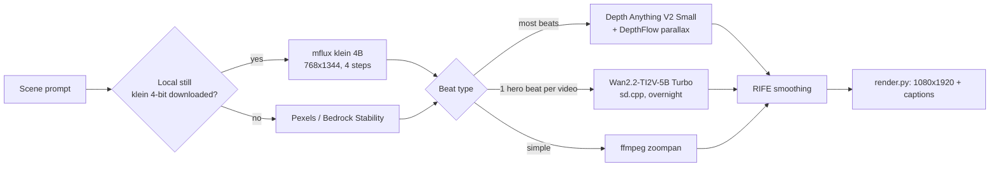

# 18 — Lightweight Local Image and Video Models (Open Source)

Status: current · Updated: 2026-10-16 · Related: [14](14-local-models-mac-m4.md), [04](04-content-pipeline-architecture.md), [15](../5-automation/15-bedrock-hybrid-routing.md)

This doc replaces doc 14's image and video picks for a disk-constrained Mac: an M4 Pro with 24 GB, about **10 GB free**, and a 10 GB floor to keep free. Three agents did the research in parallel (images, video, runtimes). Sizes come from the Hugging Face file-tree API. **No M4 Pro timings exist for these exact quants, so figures marked *(est.)* are extrapolations.**

## TL;DR

| Need | Pick | Download | Runtime | Speed *(est. unless marked)* | Licence |
|---|---|---|---|---|---|
| **Stills, default** | FLUX.2 klein 4B, 4-bit: `mflux-community/flux2-klein-4b-mflux-q4` | **4.6 GB** | mflux (MLX) | 15–30 s/image. 31.7 s measured on M1 Max | Apache-2.0 |
| Stills, best quality | Z-Image-Turbo, 4-bit: `mflux-community/z-image-turbo-mflux-q4` | 5.9 GB | mflux | 35–60 s/image | Apache-2.0 |
| Text-heavy thumbnails | ERNIE-Image-Turbo 8B, 3-bit: `mflux-community/ernie-image-turbo-mflux-q3` | 5.2 GB | mflux | 50–90 s/image | Apache-2.0 |
| **Motion, default** | 2.5D parallax: Depth Anything V2 **Small** + DepthFlow | **~0.1 GB** + pip | CoreML / GPU shader | seconds per clip | Apache-2.0 (model) · AGPL-3.0 (DepthFlow tool) |
| Real AI video (hero clips) | Wan2.2-TI2V-5B **Turbo** (4-step), GGUF Q4 + umT5 Q3 + TAE | **~6.0 GB** | stable-diffusion.cpp (Metal, 35 MB binary) | 2 s clip in 3–6 min; 5 s in 10–20 min. ~96 s for 13 frames measured on M2 24 GB | Apache-2.0 base, but the Turbo distill's licence is **unstated** |
| Smoothing | RIFE v4.x (`nihui/rife-ncnn-vulkan` / `hzwer/Practical-RIFE`) | ~0.03 GB | ncnn-Vulkan (MoltenVK) | seconds | MIT |

**Minimum local visual stack:** klein 4-bit plus parallax is **about 5.5 GB** including the mflux install (~0.7 GB). That needs about 16 GB free. Adding Wan Turbo brings it to **about 11.5 GB**, which needs about 22 GB free. Until then, `images=auto` falls back to Pexels and then Bedrock Stable Image Core.

## 1. Image models: 6 GB or less, commercial use

| Model / repo | Total download (components) | Licence | Text in image | 9:16 | LoRA | Verdict |
|---|---|---|---|---|---|---|
| FLUX.2 klein 4B 4-bit `mflux-community/flux2-klein-4b-mflux-q4` | 4.57 GB (transformer 2.15, Qwen3 TE 2.27, VAE 0.17) | Apache-2.0 | Fair: short words only | Yes | Yes | **Default** |
| Z-Image-Turbo 4-bit `mflux-community/z-image-turbo-mflux-q4` (= `filipstrand/Z-Image-Turbo-mflux-4bit`) | 5.89 GB (3.46 / 2.27 / 0.16) | Apache-2.0 | Good for short titles | Yes (720×1280 example) | Yes | Quality upgrade |
| ERNIE-Image-Turbo 8B 3-bit `mflux-community/ernie-image-turbo-mflux-q3` | 5.18 GB | Apache-2.0 | **Best in budget** (LongText-Bench 0.964 at bf16) | 768×1376 native | Yes | Thumbnails |
| Z-Image-Turbo GGUF `leejet/Z-Image-Turbo-GGUF` (Q3_K + Qwen3-4B Q3) | 5.55 GB | Apache-2.0 | as Z-Image | Yes | Yes | Use if you want one sd.cpp binary for images and video |
| FLUX 3 Image Klein 5.6B GGUF | ~6.1 GB | Commercial only **under $5M revenue** | Card warns it's weak | ? | via Base | Watch, 3 days old |
| FLUX.1-schnell Q4 GGUF | ~10 GB with T5 + CLIP | Apache-2.0 | Fair | | | Too big |
| SANA / SANA-Sprint | 6.5–9.7 GB | Card says "research purposes only" | Poor | | | Licence risk |
| SDXL-Turbo / SDXL-Lightning | 6.9 GB | Stability NC / OpenRAIL++ | Poor | 512 native (Turbo) | Huge ecosystem | Dated |
| SD3.5 Medium, Lumina 2.0, PixArt-Σ | ~10 GB+ (T5 encoders) | Mixed | Fair | | | Too big |
| Qwen-Image, HiDream, CogView4, Kolors, Krea 2 | >9 GB or non-commercial | | | | | Out |

**Resolution:** mflux needs multiples of 16, and 1080 isn't one. Render at **768×1344** (about 1 MP), then let `render.py` scale and crop to 1080×1920. Use 1344×768 for long-form.

## 2. Video: what actually runs on a 24 GB Mac

| Rank | Option | Download | Licence | Time per clip | Peak RAM | Notes |
|---|---|---|---|---|---|---|
| 1 | **2.5D parallax**: `apple/coreml-depth-anything-v2-small` + `BrokenSource/DepthFlow` | ~0.05–0.1 GB | Apache-2.0 (Small only; **Base/Large are CC-BY-NC**) · DepthFlow AGPL-3.0 (fine for rendering your own videos, but don't run it as a service) | seconds | <1 GB | Deterministic and never breaks. Camera dolly or orbit only, no subject motion |
| 2 | **Wan2.2-TI2V-5B Turbo GGUF** (`hum-ma/…-Turbo-GGUF` Q4_K_S, or the bundle `jc-builds/Wan2.2-TI2V-5B-Turbo-iOS`) | DiT 3.1 + umT5 2.9 + TAE 0.02 = ~6.0 GB | Base Apache-2.0. **Turbo upstream (`quanhaol/…`) states no licence.** Clean fallback: `FastVideo/FastWan2.2-TI2V-5B` (Apache) converted to GGUF | 3–6 min for 2 s *(est.)* · 13 frames in ~96 s measured on M2 24 GB | 8–11 GB *(est.)* | Real image-to-video from our still. Some oversaturation; the TAE decoder is softer. Max 1280×704, 121 frames |
| 3 | RIFE | ~0.03 GB | MIT | seconds | <2 GB | 2–4× frame rate. Smooths zoompan and Wan's 16–24 fps output |
| 4 | Wan2.1-T2V-1.3B + Self-Forcing / CausVid 4-step | 4.6–6 GB | Apache-2.0 | 2–4 min *(est.)* | ~6 GB | Text-to-video only; can't start from our still |
| 5 | FastMetal 1.3B/5B (MLX) | 13–17 GB (umT5 11.4 GB) | Apache-2.0 | 1.3B 480p 81 frames ~110 s, **measured on M4 Max** | 3.9–9.3 GiB | Fastest on Mac but over budget. Revisit if ~17 GB is freed |
| ✗ | LTX-Video 2B, FramePack, HunyuanVideo-I2V, CogVideoX, AnimateDiff, 3d-ken-burns (CC BY-NC-SA), LivePortrait (InsightFace NC) | over budget, weak motion, or licence problems | | | | Excluded |

**Nightly capacity** *(est.)*: parallax is effectively unlimited. Wan Turbo manages **10 × 2 s hero clips in about 0.5–1 h**, or 10 × 5 s in 2–3.5 h. **The plan: parallax for most beats, plus at most one Wan hero clip per video, rendered overnight in the GPU lane (doc 16 §4).**

## 3. Runtimes and disk traps

| Runtime | Install | Full-precision download first? | Coverage | Verdict |
|---|---|---|---|---|
| **mflux** (MLX) 0.23 | ~0.7 GB (now pulls torch ≥2.13) | **Yes, if you use `-q N`.** No with pre-quantized repos | Images (Z-Image, FLUX.2, ERNIE, Qwen-Image…), no video | **Images** |
| **stable-diffusion.cpp** (Metal) | 35 MB binary, no deps | No: GGUF files | Images and **video** (Wan 2.1/2.2, LTX, Hunyuan 1.5) | **Video**, and an image alternative |
| ComfyUI + GGUF | 1.5–2.5 GB (torch) | No | Widest | Heavier than needed |
| Draw Things CLI | ~0.27 GB | No (own .ckpt) | Broad | Viable, but GPL and its own format |
| mlx-video | small | Likely (needs conversion) | LTX-2, Wan | Watch |
| DiffusionKit | — | — | — | **Archived** |
| Core ML SD | small | Yes (conversion) | SD1–3 only | Stale |

**Disk traps, now fixed or avoided in code** (`studio/stages/images.py` VERSION 4):
1. **mflux `-q 8` on a base model id** downloads Z-Image at 32.9 GB or klein at about 16 GB before quantizing. The code now uses only pre-quantized `mflux-community/*-q4` repos and never passes `-q`.
2. **A render silently triggering a download.** The mflux engines now refuse to run unless the model is already in the HF cache, unless you set `STUDIO_ALLOW_MODEL_DOWNLOAD=1`. Download through `make models STAGE=image`, which checks disk space first.
3. `mflux-community/flux2-klein-4b-mflux-q8` is **17.1 GB** in total. Use the q4 build.
4. Download single files (`hf download repo FILE`), never whole repos: `Comfy-Org/Wan_2.2_ComfyUI_Repackaged` is 728 GB.
5. Use quantized text encoders: umT5-xxl Q4 is 3.66 GB against 11.4 GB at F16. Klein and Z-Image share **Qwen3-4B**, but each mflux repo bundles its own copy, so nothing is shared.
6. Wan 2.2 **A14B** means two 14B models. Use TI2V-5B.
7. Avoid conversion workflows (mlx-video, Core ML, `mflux-save`). They need the full weights first, so run them only on an external drive.

**More disk:** set `HF_HOME` (and `MFLUX_CACHE_DIR`) to an external SSD, or reclaim space with `hf cache scan` / `hf cache delete`. The old HF datasets on this machine (e.g. `lewtun/music_genres`, 9.1 GB) belong to the user, so only the user should delete them.

## 4. Implementation status

| Piece | Status |
|---|---|
| mflux klein / Z-Image engines (pre-quantized, download guard) | ✅ code + tests. Not run: model not downloaded |
| `auto` order: **local klein → Pexels → Bedrock Stability → mock** | ✅ local is skipped until its model is cached |
| Manifest: `flux2-klein-4b-q4` (default image), `z-image-turbo-q4` (optional), `depth-anything-v2-small`, `wan2.2-ti2v-5b-turbo-gguf` (optional, new `video` stage) | ✅ `make models-dry STAGE=video` |
| Parallax engine (DepthFlow), Wan via sd.cpp, RIFE | ⏳ **not built**. Next step once ~16–22 GB is free |

## 5. Open questions

1. Whether `mflux-generate-flux2 --model <hf-repo>` loads a pre-quantized repo directly, or needs `--base-model flux2-klein-4b`. Check `--help` after installing.
2. DepthFlow's CLI flags and whether it fetches its own depth model. Check that it doesn't pull a non-commercial Base/Large model.
3. Real M4 Pro timings for klein q4 and Wan Turbo, using `/usr/bin/time -l`. Record them in doc 14 §9.
4. Licence provenance of the Wan Turbo distill. If an Apache-only chain is required, switch to FastWan2.2.
5. sd.cpp's macOS release build targets macOS 26.6, but this machine runs 26.4. Check that it launches, or build from source.

## Sources

- mflux: https://github.com/filipstrand/mflux · https://pypi.org/project/mflux/ · https://huggingface.co/mflux-community
- Image repos: https://huggingface.co/mflux-community/flux2-klein-4b-mflux-q4 · https://huggingface.co/filipstrand/Z-Image-Turbo-mflux-4bit · https://huggingface.co/mflux-community/ernie-image-turbo-mflux-q3 · https://huggingface.co/baidu/ERNIE-Image-Turbo · https://huggingface.co/leejet/Z-Image-Turbo-GGUF · https://huggingface.co/unsloth/FLUX.2-klein-4B-GGUF · https://huggingface.co/black-forest-labs/flux-3-image-klein
- Timings: https://lilting.ch/en/articles/flux2-klein-4b-mflux-iris-m1-max · https://releases.drawthings.ai/p/quantify-z-image-turbo-efficiency · https://lilting.ch/en/articles/ltx2-wan22-mac-local-video-gen
- Rejected image models: https://huggingface.co/Efficient-Large-Model/Sana_Sprint_1.6B_1024px · https://huggingface.co/stabilityai/sdxl-turbo · https://huggingface.co/ByteDance/SDXL-Lightning · https://huggingface.co/stabilityai/stable-diffusion-3.5-medium · https://huggingface.co/Alpha-VLLM/Lumina-Image-2.0 · https://huggingface.co/city96/FLUX.1-schnell-gguf
- stable-diffusion.cpp: https://github.com/leejet/stable-diffusion.cpp (docs/wan.md, docs/z_image.md, docs/flux2.md, docs/quantization_and_gguf.md) · /releases · issues #1145, #1990, #1847 · PR #1731
- Video: https://huggingface.co/jc-builds/Wan2.2-TI2V-5B-Turbo-iOS · https://huggingface.co/hum-ma/Wan2.2-TI2V-5B-Turbo-GGUF · https://huggingface.co/quanhaol/Wan2.2-TI2V-5B-Turbo · https://huggingface.co/QuantStack/Wan2.2-TI2V-5B-GGUF · https://huggingface.co/city96/umt5-xxl-encoder-gguf · https://huggingface.co/FastVideo/FastMetal-5B-QAD · https://huggingface.co/gdhe17/Self-Forcing · https://huggingface.co/Lightricks/LTX-Video · https://github.com/jy0205/Pyramid-Flow · https://huggingface.co/ByteDance/AnimateDiff-Lightning
- Motion: https://huggingface.co/apple/coreml-depth-anything-v2-small · https://github.com/BrokenSource/DepthFlow · https://pypi.org/project/depthflow/ · https://github.com/sniklaus/3d-ken-burns · https://github.com/hzwer/Practical-RIFE · https://github.com/nihui/rife-ncnn-vulkan/releases · https://github.com/KwaiVGI/LivePortrait
- Other runtimes: https://github.com/city96/ComfyUI-GGUF · https://github.com/drawthingsai/draw-things-community · https://github.com/Blaizzy/mlx-video · https://github.com/argmaxinc/DiffusionKit · https://github.com/apple/ml-stable-diffusion
