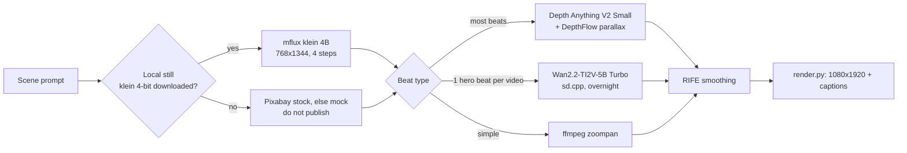

# 18 — Lightweight Local Image and Video Models (Open Source)

> **Implementation status:** follow [SETUP.md](../../SETUP.md) and the [current code](../../studio/) for supported setup, routing and resource guards; stack, retrieval, orchestration and capacity proposals below are historical plans, not evidence of implemented or validated behavior.

Status: current · Updated: 2026-10-16 · Related: [14](14-local-models-mac-m4.md), [04](04-content-pipeline-architecture.md), [15](../5-automation/15-bedrock-hybrid-routing.md)

This doc replaces doc 14's image and video picks for a disk-constrained Mac: an M4 Pro with 24 GB, about **10 GB free**, and a 10 GB floor to keep free. Three agents did the research in parallel (images, video, runtimes). Sizes come from the Hugging Face file-tree API. **No M4 Pro timings exist for these exact quants, so figures marked *(est.)* are extrapolations.**

## TL;DR

| Need | Pick | Download | Runtime | Speed *(est. unless marked)* | Licence |
|---|---|---|---|---|---|
| **Stills, default** | FLUX.2 klein 4B, 4-bit, **rendered at 544×960 and upscaled ×4 with Real-ESRGAN**, then scaled to 1080×1920 | **4.7 GB** | mflux + ESRGAN | **9–14 s/image**; full-res 1024² is ~20–25 s | Apache-2.0 + BSD-3 |
| Stills, fastest | the same + 2-step SANA-Sprint LoRA (`radames/FLUX.2-klein-Sana-Sprint`) | 5.5 GB | mflux `--lora-paths` | **5–8 s/image** | Apache-2.0 |
| Stills, smallest | klein 4B **3-bit** (`mflux-community/flux2-klein-4b-mflux-q3`) | **3.6 GB** | mflux | same speed; quality loss unmeasured | Apache-2.0 |
| Stills, best quality | Z-Image-Turbo, 4-bit: `mflux-community/z-image-turbo-mflux-q4` | 5.9 GB | mflux | 35–60 s/image | Apache-2.0 |
| Text-heavy thumbnails | ERNIE-Image-Turbo 8B, 3-bit: `mflux-community/ernie-image-turbo-mflux-q3` | 5.2 GB | mflux | 50–90 s/image | Apache-2.0 |
| **Motion, default** | 2.5D parallax: Depth Anything V2 **Small** + **our own shader** (moderngl/OpenCV, replacing AGPL DepthFlow), plus optional SAM2.1-tiny + LaMa layering | **~0.1–0.45 GB** | CoreML + GPU shader | under 2 s per clip (5–10 s layered) | Apache-2.0 + MIT |
| Real AI video (hero clips) | **FastWan2.2-TI2V-5B** (3-step DMD) GGUF q6_k + umT5 Q3 + TAE (`Green-Sky/FastWan2.2-TI2V-5B-FullAttn-GGUF`), replacing Turbo | ~7.1 GB (~5.8 at q4_K) | stable-diffusion.cpp (Metal) | **60–90 s** for 33 frames at 480×832, then RIFE to 65 frames | **Apache-2.0 throughout** |
| AI video, ≤4 GB | LingBot-Video-Dense-1.3B GGUF (Qwen3-VL-4B encoder) | 3.5 GB | stable-diffusion.cpp | 10–25 min/clip (not distilled) | Apache-2.0 |
| Smoothing | RIFE v4.x (`nihui/rife-ncnn-vulkan` / `hzwer/Practical-RIFE`) | ~0.03 GB | ncnn-Vulkan (MoltenVK) | seconds | MIT |

**Round 2 (smaller, faster, better):** **nothing beats klein 4B or Wan-5B on size, speed and quality at the same time.** The gains come from technique: render small and upscale, use a 2-step LoRA, generate half the frames and interpolate with RIFE, and use licence-clean replacements. See §5–6.

**Minimum local visual stack:** klein 4-bit + ESRGAN + depth is **about 4.8 GB** of models, plus the mflux install (~0.7 GB). That needs about 16 GB free. Adding FastWan brings it to **about 12 GB**, which needs about 22 GB free. Until then, `images=auto` falls back to Pixabay (replaced Pexels 2026-10-16) and then a mock placeholder marked "do not publish". There is no Bedrock image fallback since 2026-10-16 (Bedrock is text-only).



## 1. Image models: 6 GB or less, commercial use

| Model / repo | Total download (components) | Licence | Text in image | 9:16 | LoRA | Verdict |
|---|---|---|---|---|---|---|
| FLUX.2 klein 4B 4-bit `mflux-community/flux2-klein-4b-mflux-q4` | 4.57 GB (transformer 2.15, Qwen3 TE 2.27, VAE 0.17) | Apache-2.0 | Fair: short words only | Yes | Yes | **Default** |
| Z-Image-Turbo 4-bit `mflux-community/z-image-turbo-mflux-q4` (= `filipstrand/Z-Image-Turbo-mflux-4bit`) | 5.89 GB (3.46 / 2.27 / 0.16) | Apache-2.0 | Good for short titles | Yes (720×1280 example) | Yes | Quality upgrade |
| ERNIE-Image-Turbo 8B 3-bit `mflux-community/ernie-image-turbo-mflux-q3` | 5.18 GB | Apache-2.0 | **Best in budget** (LongText-Bench 0.964 at bf16) | 768×1376 native | Yes | Thumbnails |
| Z-Image-Turbo GGUF `leejet/Z-Image-Turbo-GGUF` (Q3_K + Qwen3-4B Q3) | 5.55 GB | Apache-2.0 | as Z-Image | Yes | Yes | Use if you want one sd.cpp binary for images and video |
| FLUX 3 Image Klein 5.6B GGUF | ~6.1 GB | Commercial only **under $5M revenue** | Card warns it's weak | ? | via Base | Watch, 3 days old |
| FLUX.1-schnell Q4 GGUF | ~10 GB with T5 + CLIP | Apache-2.0 | Fair | | | Too big |
| SANA / SANA-Sprint | 6.5–9.7 GB | Card says "research purposes only" | Poor | | | Licence risk |
| SDXL-Turbo / SDXL-Lightning | 6.9 GB | Stability NC / OpenRAIL++ | Poor | 512 native (Turbo) | Huge ecosystem | Dated |
| SD3.5 Medium, Lumina 2.0, PixArt-Σ | ~10 GB+ (T5 encoders) | Mixed | Fair | | | Too big |
| Qwen-Image, HiDream, CogView4, Kolors, Krea 2 | >9 GB or non-commercial | | | | | Out |

**Resolution:** mflux needs multiples of 16, and 1080 isn't one. Render at **768×1344** (about 1 MP), then let `render.py` scale and crop to 1080×1920. Use 1344×768 for long-form.

## 2. Video: what actually runs on a 24 GB Mac

| Rank | Option | Download | Licence | Time per clip | Peak RAM | Notes |
|---|---|---|---|---|---|---|
| 1 | **2.5D parallax**: `apple/coreml-depth-anything-v2-small` + `BrokenSource/DepthFlow` | ~0.05–0.1 GB | Apache-2.0 (Small only; **Base/Large are CC-BY-NC**) · DepthFlow AGPL-3.0 (fine for rendering your own videos, but don't run it as a service) | seconds | <1 GB | Deterministic and never breaks. Camera dolly or orbit only, no subject motion |
| 2 | **Wan2.2-TI2V-5B Turbo GGUF** (`hum-ma/…-Turbo-GGUF` Q4_K_S, or the bundle `jc-builds/Wan2.2-TI2V-5B-Turbo-iOS`) | DiT 3.1 + umT5 2.9 + TAE 0.02 = ~6.0 GB | Base Apache-2.0. **Turbo upstream (`quanhaol/…`) states no licence.** Clean fallback: `FastVideo/FastWan2.2-TI2V-5B` (Apache) converted to GGUF | 3–6 min for 2 s *(est.)* · 13 frames in ~96 s measured on M2 24 GB | 8–11 GB *(est.)* | Real image-to-video from our still. Some oversaturation; the TAE decoder is softer. Max 1280×704, 121 frames |
| 3 | RIFE | ~0.03 GB | MIT | seconds | <2 GB | 2–4× frame rate. Smooths zoompan and Wan's 16–24 fps output |
| 4 | Wan2.1-T2V-1.3B + Self-Forcing / CausVid 4-step | 4.6–6 GB | Apache-2.0 | 2–4 min *(est.)* | ~6 GB | Text-to-video only; can't start from our still |
| 5 | FastMetal 1.3B/5B (MLX) | 13–17 GB (umT5 11.4 GB) | Apache-2.0 | 1.3B 480p 81 frames ~110 s, **measured on M4 Max** | 3.9–9.3 GiB | Fastest on Mac but over budget. Revisit if ~17 GB is freed |
| ✗ | LTX-Video 2B, FramePack, HunyuanVideo-I2V, CogVideoX, AnimateDiff, 3d-ken-burns (CC BY-NC-SA), LivePortrait (InsightFace NC) | over budget, weak motion, or licence problems | | | | Excluded |

**Nightly capacity** *(est.)*: parallax is effectively unlimited. Wan Turbo manages **10 × 2 s hero clips in about 0.5–1 h**, or 10 × 5 s in 2–3.5 h. **The plan: parallax for most beats, plus at most one Wan hero clip per video, rendered overnight in the GPU lane (doc 16 §4).**

## 3. Runtimes and disk traps

| Runtime | Install | Full-precision download first? | Coverage | Verdict |
|---|---|---|---|---|
| **mflux** (MLX) 0.23 | ~0.7 GB (now pulls torch ≥2.13) | **Yes, if you use `-q N`.** No with pre-quantized repos | Images (Z-Image, FLUX.2, ERNIE, Qwen-Image…), no video | **Images** |
| **stable-diffusion.cpp** (Metal) | 35 MB binary, no deps | No: GGUF files | Images and **video** (Wan 2.1/2.2, LTX, Hunyuan 1.5) | **Video**, and an image alternative |
| ComfyUI + GGUF | 1.5–2.5 GB (torch) | No | Widest | Heavier than needed |
| Draw Things CLI | ~0.27 GB | No (own .ckpt) | Broad | Viable, but GPL and its own format |
| mlx-video | small | Likely (needs conversion) | LTX-2, Wan | Watch |
| DiffusionKit | — | — | — | **Archived** |
| Core ML SD | small | Yes (conversion) | SD1–3 only | Stale |

**Disk traps, now fixed or avoided in code** (`studio/stages/images.py` VERSION 4):
1. **mflux `-q 8` on a base model id** downloads Z-Image at 32.9 GB or klein at about 16 GB before quantizing. The code now uses only pre-quantized `mflux-community/*-q4` repos and never passes `-q`.
2. **A render silently triggering a download.** The mflux engines now refuse to run unless the model is already in the HF cache, unless you set `STUDIO_ALLOW_MODEL_DOWNLOAD=1`. Download through `make models STAGE=image`, which checks disk space first.
3. `mflux-community/flux2-klein-4b-mflux-q8` is **17.1 GB** in total. Use the q4 build.
4. Download single files (`hf download repo FILE`), never whole repos: `Comfy-Org/Wan_2.2_ComfyUI_Repackaged` is 728 GB.
5. Use quantized text encoders: umT5-xxl Q4 is 3.66 GB against 11.4 GB at F16. Klein and Z-Image share **Qwen3-4B**, but each mflux repo bundles its own copy, so nothing is shared.
6. Wan 2.2 **A14B** means two 14B models. Use TI2V-5B.
7. Avoid conversion workflows (mlx-video, Core ML, `mflux-save`). They need the full weights first, so run them only on an external drive.

**More disk:** set `HF_HOME` (and `MFLUX_CACHE_DIR`) to an external SSD, or reclaim space with `hf cache scan` / `hf cache delete`. The old HF datasets on this machine (e.g. `lewtun/music_genres`, 9.1 GB) belong to the user, so only the user should delete them.

## 4. Implementation status

| Piece | Status |
|---|---|
| mflux klein / Z-Image engines (pre-quantized, download guard) | ✅ code + tests. Not run: model not downloaded |
| `auto` order: **local mflux → Pixabay → mock** (Pixabay replaced Pexels 2026-10-16; Bedrock Stability removed 2026-10-16, Bedrock is text-only) | ✅ local is skipped until its model is cached |
| Manifest: `flux2-klein-4b-q4` (default image), `z-image-turbo-q4` (optional), `depth-anything-v2-small`, `wan2.2-ti2v-5b-turbo-gguf` (optional, new `video` stage) | ✅ `make models-dry STAGE=video` |
| **Configuration A installed (2026-10-16)**: Z-Image-Turbo q4 (5.5 GB on disk), Real-ESRGAN x4plus (67 MB), Depth Anything V2 Small (99 MB), own parallax renderer | ✅ **measured on M4 Pro**: Z-Image 576×1024 takes **~80 s/image** (first 84 s, warm 78.6 s; 12.6 GB footprint), 720×1280 takes 96–130 s. ESRGAN takes 4–6 s/image. Parallax takes ~3.5 s per 4 s clip. A real 6-scene Short takes ~6.5 min, almost all of it image generation |
| FastWan via sd.cpp, RIFE, SAM+LaMa layered parallax, parallax on MPS | ⏳ not built (FastWan doesn't fit the 12 GB budget alongside Z-Image) |

## 5. Open questions

1. ~~Whether mflux loads pre-quantized repos~~ **Resolved:** the q3/q4 cards document `--model <repo> --base-model flux2-klein-4b`, and the code uses that form.
2. DepthFlow's CLI flags and whether it fetches its own depth model. Check that it doesn't pull a non-commercial Base/Large model.
3. Real M4 Pro timings for klein q4 and Wan Turbo, using `/usr/bin/time -l`. Record them in doc 14 §9.
4. ~~Wan Turbo licence~~ **Resolved:** switched to FastWan2.2 (Apache throughout). Still to verify: whether sd.cpp's scheduler matches FastWan's DMD timesteps (1000/757/522).
5. sd.cpp's macOS release build targets macOS 26.6, but this machine runs 26.4. Check that it launches, or build from source.

## 5. Round 2: images (smaller, faster)

Only one measured anchor exists: klein 4B on an **M4 Max** at 1024² takes 10.9–11.6 s for 4 steps (fp16/int8/int4 all similar, so it's compute-bound; peak RAM 9.2–10.9 GiB). The M4 Pro has about half the GPU, which puts it at about 20–25 s. Lower bit depths save **disk, not time**.

| Option | Download | s/image on M4 Pro *(est.)* | Quality | Verdict |
|---|---|---|---|---|
| **klein q4 at 544×960 + Real-ESRGAN x4plus → 1080×1920** | 4.69 GB | **9–14** | Same model. ESRGAN sharpens edges and line art but adds no new detail | **New default** |
| + SANA-Sprint 2-step LoRA | 5.46 GB | **5–8** | Card says it matches 4-step detail, with a warmer, higher-contrast look | The only path to ≤8 s. A/B test it first |
| klein **q3** | 3.63 GB | same | Unmeasured loss | Smallest acceptable. A/B on 10 diagram prompts |
| klein GGUF Q2/Q3 + 2-bit Qwen3 + TAEF2 (sd.cpp) | 3.4–3.8 GB | slower than MLX | A 2-bit encoder hurts | No |
| SANA-Sprint 0.6B GGUF | **2.75 GB** (the only one ≤3 GB) | 2–5 if Metal works | GenEval 0.74, but weak text and fine structure; the card says "research purposes only" | Rejected: worse quality, licence ambiguity, unproven runtime |
| Z-Image q3 / ERNIE q3 | 4.6 / 5.2 GB | 25–40 / 50–90 | Better text and realism | Hero frames and text-heavy thumbnails only |

Watch list: **Iris-3B Turbo** (Apache, GenEval 0.82, CUDA only for now), **Apple Core AI** models (klein and an EDSR upscaler, but they need **macOS 27**), SnapGen++ (no public weights).

```bash
mflux-generate-flux2 --model mflux-community/flux2-klein-4b-mflux-q4 --base-model flux2-klein-4b \
  --width 544 --height 960 --steps 4 --guidance 1.0 --seed 42 --prompt "..." --output a.png
realesrgan-ncnn-vulkan -i a.png -o b.png -n realesrgan-x4plus      # or the Core ML / MLX port
ffmpeg -i b.png -vf scale=1080:1920:flags=lanczos c.png
# fastest: add --lora-paths radames/FLUX.2-klein-Sana-Sprint --lora-scales 1.0 --steps 2
```

## 6. Round 2: video (smaller, faster, licence-clean)

| Option | Download | Per 2–3 s clip *(est.)* | I2V | Licence | Verdict |
|---|---|---|---|---|---|
| **FastWan2.2-TI2V-5B-FullAttn GGUF** (q6_k; q4_K ≈ 2.9 GB DiT) + umT5 Q3_K_S + taew2_2 | 7.1 GB (≈5.8 at q4_K) | **60–90 s** at 3 steps, 33 frames, 480×832 | ✅ | **Apache throughout** | **Replaces Wan Turbo** |
| HummingbirdXT (AMD, 3-step DMD of TI2V-5B) | needs conversion → ≈5.8 GB | same | ✅ | Apache-2.0 | Alternative; no GGUF yet |
| Wan2.2-TI2V-5B Turbo (previous pick) | 6.0 GB | 80–120 s; the card recommends 8 steps, not 4 | ✅ | Distill repo has **no licence** | Dropped |
| FastMetal-1.3B (MLX) + **a pre-encoded motion-prompt bank** | ~1.5 GB at runtime (umT5 deleted after encoding) | ~30–40 s, **measured class** (M4 Max 45 s fast) | ❌ T2V only | Apache-2.0 | Fastest, but can't start from our still |
| **LingBot-Video-Dense-1.3B GGUF** | **3.53 GB** | 10–25 min (not distilled) | ✅ | Apache-2.0 | The only commercial I2V ≤4 GB. Overnight only |
| LTX-Video 2B distilled | 6.2 GB | fast | ✅ | Free under $10M revenue | Weaker than Wan-5B |

**Getting to ~60 s per clip:** generate 33 frames, interpolate to 65 with RIFE (measured on M4: ~1.4 s for 41→81 frames), and keep `sd-server` running so the weights stay loaded between clips. The only measured M4 Pro data point is 5B Q8, 33 frames at 480×480, 20 steps ≈ 5 min (sd.cpp PR #1731). A 3-step distill should take about a sixth of that.

**Licence-clean motion** (replaces AGPL DepthFlow):
1. **Our own parallax shader**: Depth Anything V2 Small (Core ML, Apache) plus about 150 lines of moderngl or OpenCV `remap` (depth-offset UV, dolly/orbit, edge dilation). Under 2 s per clip.
2. **Layered parallax**: add `apple/coreml-sam2.1-tiny` (0.08 GB) and `Carve/LaMa-ONNX` (~0.2 GB) to fill the gaps behind the foreground. About 5–10 s per still, and clearly better looking.
3. **RIFE** (MIT) for smoothing and as a frame-count lever. FILM (Apache) is for large motion only.

Rejected for licence: CausVid and Self-Forcing I2V/VACE GGUFs (CC-BY-NC-SA), Hummingbird-I2V 0.9B (AGPL), GIMM-VFI (non-commercial), Depth Pro (licence conflict), DepthFlow and parallax-maker (AGPL). Rejected for size or platform: SANA-Video, Kandinsky-6 Lite, LTX-2.x, TurboDiffusion (CUDA).

### Round 2 sources
- Images: https://huggingface.co/mlboydaisuke/FLUX.2-klein-4B-CoreAI · https://huggingface.co/ar9av/FLUX.2-klein-4B-mflux-4bit · https://huggingface.co/mflux-community/flux2-klein-4b-mflux-q3 · https://huggingface.co/radames/FLUX.2-klein-Sana-Sprint · https://huggingface.co/madebyollin/taef2 · https://huggingface.co/Ninnix96/Sana-Sprint-0.6B-1024px-GGUF · https://github.com/Loina-AI/stable-diffusion.cpp · https://github.com/apple/coreai-models · https://huggingface.co/speridlabs/iris-3b · https://snap-research.github.io/snapgenplusplus/ · https://huggingface.co/Comfy-Org/Real-ESRGAN_repackaged · https://huggingface.co/mlboydaisuke/Real-ESRGAN-x4-CoreML · https://huggingface.co/themindstudio/RealESRGAN-x4plus-mlx · https://derivative.ca/community-post/tutorial/coreml-upscaler/74428 · https://github.com/nordeim/ComfyUI-Mac-Silicon/blob/main/research/mlx-image-gen-mac-2026.md
- Video: https://huggingface.co/Green-Sky/FastWan2.2-TI2V-5B-FullAttn-GGUF · https://huggingface.co/amd/HummingbirdXT · https://huggingface.co/jboone100/FastWan2.2-TI2V-5B-MLX-q8 · https://haoailab.com/blogs/fastmetal/ · https://github.com/hao-ai-lab/FastVideo · https://huggingface.co/offgrid-ai/LingBot-Video-Dense-1.3B-GGUF · https://huggingface.co/robbyant/lingbot-video-dense-1.3b · https://huggingface.co/calcuis/ltxv-gguf · https://github.com/quanhaol/Wan2.2-TI2V-5B-Turbo · https://github.com/tianweiy/CausVid · https://huggingface.co/amd/AMD-Hummingbird-I2V
- Motion: https://huggingface.co/apple/coreml-sam2.1-tiny · https://huggingface.co/Carve/LaMa-ONNX · https://huggingface.co/depth-anything/Video-Depth-Anything-Small · https://github.com/google-research/frame-interpolation · https://github.com/GSeanCDAT/GIMM-VFI

## 7. Wan 2.1 1.3B (requested evaluation)

**It only does text-to-video**, so it can't animate our scene still. Use it for **generic cutaways** where matching the still's style doesn't matter (clouds, traffic, machinery, space), and keep FastWan2.2-5B for image-to-video hero shots.

| Way to run it | Download | Disk free needed | Per 2–3 s clip on M4 Pro | Licence |
|---|---|---|---|---|
| GGUF in stable-diffusion.cpp (Q8 DiT ~1.4 + umT5 Q3_K_S 2.86 + VAE 0.25) | ~4.5 GB | ~15 GB | 3–6 min *(est., undistilled)* | Apache-2.0 |
| **FastMetal-1.3B-QAD** (MLX, Apache): encode a bank of motion prompts once with `--prompt-embeds-cache`, then delete umT5 | 13.4 GB once (put it on an external SSD); **~1.5 GB** afterwards | ~24 GB during setup | **~30–40 s** *(est.; 45 s measured on M4 Max with `--fast`)* | Apache-2.0 |
| Wan2.1-Fun-1.3B-InP (the only 1.3B image-to-video) | ~4–5 GB + CLIP-H | ~15 GB | slow (50 steps, no clean distill) | Apache-2.0 |

Don't use the 1.3B speed-up distills: CausVid and Self-Forcing are **CC-BY-NC-SA** (non-commercial), and lightx2v's 1.3B has no licence. Manifest entry: `wan2.1-t2v-1.3b-gguf` (optional).

## 8. ~1 GB Stable Diffusion models (requested evaluation)

Three parallel agents covered models and sizes, Mac runtimes and speed, and licence and quality. **Every commercially usable option at about 1 GB is a 512 px model**, because 1024 px models' text encoders alone are 1–2 GB. So plan on rendering 512×896 and then upscaling with Real-ESRGAN. File sizes come from HF blob listings. **No SD timing exists on an M4 Pro, so the times below are estimates.**

| Pick | Download | Licence | Quality | M4 Pro per finished 9:16 still *(est.)* | Catch |
|---|---|---|---|---|---|
| **SDXS-512-DreamShaper** (1 step): `concedo/sdxs-512-tinySDdistilled-GGUF` Q8_0, or `akleine/sdxs-512` fp16 | **0.68–0.89 GB** | OpenRAIL++-M: commercial OK, with use restrictions | Prompt following beats SD1.5 (CLIP 32.8); softer detail | **~2–4 s** (1 step + upscale) | Duplicates subjects at non-square sizes; SDXS-1024 was never released |
| **Nitro-E 4-step Core ML** (AMD): `mlboydaisuke/Nitro-E-CoreML` | **0.99 GB** | MIT + Llama 3.2 Community | **Best under 1 GB**: GenEval 0.67 vs 0.43 for SD1.5, HPS 30.2 | a few s (Neural Engine) | 512×512 only; Swift pipeline; third-party conversion |
| SD1.5 Core ML 6-bit (Apple): `apple/coreml-stable-diffusion-v1-5-palettized` (TextEncoder + Unet + VAEDecoder only) | 0.88 GB | OpenRAIL-M | GenEval 0.43, weak | ~10–15 s for 25 steps | Fixed 512×512 unless you re-convert (needs torch); low maintenance |
| BK-SDM-Tiny-2M + TAESD | 0.90 GB | OpenRAIL-M (card says research use) | Weakest (FID 17.5) | fast | Not recommended |
| **Better quality, ~1.8 GB:** DreamShaper 8 / Juggernaut Reborn / CyberRealistic as GGUF Q8 + LCM-LoRA (135 MB) + TAESD (5 MB) in stable-diffusion.cpp | ~1.8–1.9 GB | OpenRAIL-M + civitai permissions (selling images and paid services allowed; Juggernaut/epiC need credit) | Good atmosphere and textures; mechanisms still wrong; no text | **~3–6 s** (5 steps, cfg 1, model kept loaded) | Not 1 GB. The SD1.5 GGUF barely shrinks (Q4 is 1.57 GB) |

**Runtime: stable-diffusion.cpp (Metal, 35 MB prebuilt).** It supports SD1.x/2.x, SDXS, BK-SDM, SD-Turbo, LCM/TCD samplers, `--taesd`, LoRA, `--upscale-model` and `sd-server` (which keeps the model loaded). Gotchas:
- use `--flash-attn on`, since `--diffusion-fa` is deprecated
- never use `--diffusion-conv-direct` on Metal, because it trips the GPU watchdog
- open bug #2149: batched CFG gives white images, so use `--batched-cfg off` or cfg 1

**Draw Things CLI** (`brew install draw-things-cli`, GPL-3) may be 10–30% faster; benchmark it against sd.cpp. Core ML on the Neural Engine is fast but needs fixed-shape conversion. diffusers/MPS needs torch and has NaN/black-image scheduler bugs. The MLX SD ports are frozen.

```bash
sd-cli -m models/sdxs-512-tinySDdistilled_Q8_0.gguf --steps 1 --cfg-scale 1 \
  -W 512 -H 896 --flash-attn on --batched-cfg off -p "..." \
  --upscale-model models/RealESRGAN_x2plus.pth -o out.png
ffmpeg -i out.png -vf scale=1080:1920:flags=lanczos broll.png
```
(Check that sd.cpp loads the concedo SDXS GGUF; its card targets KoboldCpp ≥1.107. Otherwise use `akleine/sdxs-512` fp16.)

**Quality and policy:**
- SD-class models get mechanisms wrong (part counts, warped machinery) and **can't render text**. Put all labels on as ffmpeg/ASS overlays.
- Use ~1 GB SD for **atmosphere and filler**. Keep **FLUX.2 klein 4B** for anything that must be structurally right: aircraft systems, house cutaways, multi-part machinery, thumbnails.
- To avoid YouTube's "inauthentic content" flag: SD stills should be ≤30% of runtime; mix in real charts and public-domain imagery (NASA/FAA/USACE/EIA); always add parallax; give each channel its own style LoRA, palette and seeds; and have a person check technical accuracy.
- Commercial-OK style LoRAs for SD1.5: Technical Blueprints (civitai 525611, 144 MB, credit), Isometric Chinese Architecture (63376, 72 MB), Vector illustration (60132, 25 MB). Re-check permissions before download.

**Avoid:**
- Deliberate (CC BY-NC-ND)
- SDXL-Turbo (non-commercial)
- SD-Turbo / SD3.5 unless registered (Stability Community: paid licence above $1M revenue)
- KOALA (paid ETRI licence)
- the Hyper-SD15 LoRAs (no licence tag)

**Licences:** OpenRAIL-M/++ allow commercial use and say "Licensor claims no rights in the Output". The use-based restrictions in Attachment A (no harmful disinfo, defamation, medical advice and so on) still apply.

### §8 sources
https://huggingface.co/IDKiro/sdxs-512-dreamshaper · https://huggingface.co/akleine/sdxs-512 · https://huggingface.co/concedo/sdxs-512-tinySDdistilled-GGUF · https://huggingface.co/mlboydaisuke/Nitro-E-CoreML · https://huggingface.co/amd/Nitro-E · https://huggingface.co/apple/coreml-stable-diffusion-v1-5-palettized · https://huggingface.co/nota-ai/bk-sdm-tiny-2m · https://huggingface.co/second-state/stable-diffusion-v1-5-GGUF · https://huggingface.co/madebyollin/taesd · https://huggingface.co/latent-consistency/lcm-lora-sdv1-5 · https://huggingface.co/segmind/Segmind-Vega · https://github.com/leejet/stable-diffusion.cpp (docs/lcm.md, taesd.md, esrgan.md, distilled_sd.md; issue #2149) · https://github.com/apple-aiml-research/ml-stable-diffusion · https://huggingface.co/blog/fast-mac-diffusers · https://formulae.brew.sh/formula/draw-things-cli · https://github.com/CompVis/stable-diffusion/blob/main/LICENSE · https://stability.ai/community-license-agreement · civitai model API pages 4201, 4384, 25694, 46422, 15003 · https://huggingface.co/XpucT/Deliberate

## Sources

- mflux: https://github.com/filipstrand/mflux · https://pypi.org/project/mflux/ · https://huggingface.co/mflux-community
- Image repos: https://huggingface.co/mflux-community/flux2-klein-4b-mflux-q4 · https://huggingface.co/filipstrand/Z-Image-Turbo-mflux-4bit · https://huggingface.co/mflux-community/ernie-image-turbo-mflux-q3 · https://huggingface.co/baidu/ERNIE-Image-Turbo · https://huggingface.co/leejet/Z-Image-Turbo-GGUF · https://huggingface.co/unsloth/FLUX.2-klein-4B-GGUF · https://huggingface.co/black-forest-labs/flux-3-image-klein
- Timings: https://lilting.ch/en/articles/flux2-klein-4b-mflux-iris-m1-max · https://releases.drawthings.ai/p/quantify-z-image-turbo-efficiency · https://lilting.ch/en/articles/ltx2-wan22-mac-local-video-gen
- Rejected image models: https://huggingface.co/Efficient-Large-Model/Sana_Sprint_1.6B_1024px · https://huggingface.co/stabilityai/sdxl-turbo · https://huggingface.co/ByteDance/SDXL-Lightning · https://huggingface.co/stabilityai/stable-diffusion-3.5-medium · https://huggingface.co/Alpha-VLLM/Lumina-Image-2.0 · https://huggingface.co/city96/FLUX.1-schnell-gguf
- stable-diffusion.cpp: https://github.com/leejet/stable-diffusion.cpp (docs/wan.md, docs/z_image.md, docs/flux2.md, docs/quantization_and_gguf.md) · /releases · issues #1145, #1990, #1847 · PR #1731
- Video: https://huggingface.co/jc-builds/Wan2.2-TI2V-5B-Turbo-iOS · https://huggingface.co/hum-ma/Wan2.2-TI2V-5B-Turbo-GGUF · https://huggingface.co/quanhaol/Wan2.2-TI2V-5B-Turbo · https://huggingface.co/QuantStack/Wan2.2-TI2V-5B-GGUF · https://huggingface.co/city96/umt5-xxl-encoder-gguf · https://huggingface.co/FastVideo/FastMetal-5B-QAD · https://huggingface.co/gdhe17/Self-Forcing · https://huggingface.co/Lightricks/LTX-Video · https://github.com/jy0205/Pyramid-Flow · https://huggingface.co/ByteDance/AnimateDiff-Lightning
- Motion: https://huggingface.co/apple/coreml-depth-anything-v2-small · https://github.com/BrokenSource/DepthFlow · https://pypi.org/project/depthflow/ · https://github.com/sniklaus/3d-ken-burns · https://github.com/hzwer/Practical-RIFE · https://github.com/nihui/rife-ncnn-vulkan/releases · https://github.com/KwaiVGI/LivePortrait
- Other runtimes: https://github.com/city96/ComfyUI-GGUF · https://github.com/drawthingsai/draw-things-community · https://github.com/Blaizzy/mlx-video · https://github.com/argmaxinc/DiffusionKit · https://github.com/apple/ml-stable-diffusion
