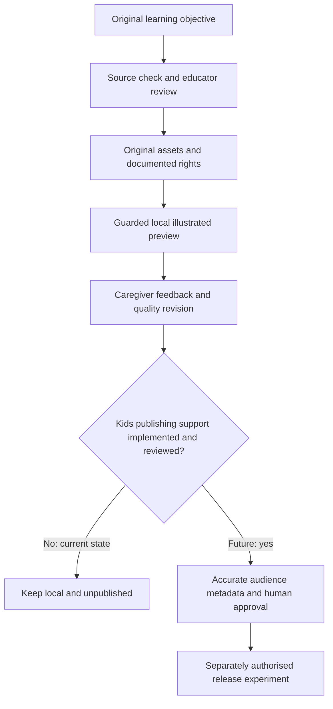

# 21 — Kids pilot: production, rights and publishing requirements

> Checked 2026-10-17. Applies to the proposed [Pocket Meadow pilot](../2-channels/20-pocket-meadow-question-club.md). This document does not enable kids publishing or change repository rules.

## Supported tools and missing capabilities

| Work | Existing tool or process | Practical limit |
|---|---|---|
| Script and storyboard | Bedrock text models or Claude Code, followed by source and educator review | Model agreement is not factual verification |
| Backgrounds and scene illustrations | Installed Z-Image-Turbo q4; Real-ESRGAN | Character consistency requires manual art direction; avoid regenerating characters unnecessarily |
| Spoken narration | Installed Kokoro | Spoken TTS is not a singing or music-production system |
| Captions and labels | Parakeet; ffmpeg/ASS overlays | Check pronunciation, timing and readability manually |
| Gentle motion | Existing parallax/zoompan | Camera motion over stills does not animate bodies, expressions or mouths |
| Editing | Existing ffmpeg pipeline | Preschool pacing requires a separate storyboard review; adult short-form defaults are not validated for this audience |
| Character animation and songs | Additional authoring, rigging, composition and performance work | Not implemented or benchmarked here; no new models are proposed |

The first deliverable is a local narrated picture story. CoComelon-style continuous 3D acting, choreography, consistent lip-sync and polished songs are not established capabilities of this setup. Start with one narrator and a small set of approved original assets. A recurring cast must not become a template that merely swaps objects without a meaningful new story.

All later real media runs must use `make guarded`, one heavy model at a time, with at least 10 GB free. Keep the existing offline q4 models, low-memory Z-Image controls and cache unloading. The guard samples pressure; it cannot guarantee no brief spikes. No model downloads, paid cloud visuals or AWS image/video generation are required by this plan.

## Accurate classification and quality

This preschool concept is **made for kids**. The repo currently requires `made_for_kids=False` and blocks publishing otherwise. Therefore keep the pilot local and unpublished; never label it not made for kids to pass the gate. Its release requires a separate, explicitly reviewed implementation that supports correct audience metadata while retaining human approval, hash binding and dry-run safeguards. Merely creating a YAML brand pack would not solve this.

YouTube distinguishes child-directed content from general-audience content using its actual subject matter, presentation and intended audience. A parent-facing title or description does not override child-directed substance. [Audience guidance](https://support.google.com/youtube/answer/9528076?hl=en).

YouTube's kids quality principles favour understandable, age-appropriate stories and meaningful learning. Confusing autogenerated sequences, misleading educational claims and sensationalism can impair distribution and monetisation. Meeting those principles does not guarantee YouTube Kids inclusion. [Official quality principles](https://support.google.com/youtube/answer/10774223?hl=en).

Made-for-kids content loses comments, notifications, cards/end screens and several monetisation features. Plan feedback and discovery without those features. [Feature restrictions](https://support.google.com/youtube/answer/9632097). Contextual ads remain possible; see [19](../1-strategy/19-kids-channel-opportunity.md) for dated eligibility and revenue assumptions.

## Rights and original songs

Keep a per-asset record of creator, source URL if any, licence and version/date, commercial permission and attribution, plus the final file used. Own or license the illustrations, script, composition, lyrics, master recording, performances and sound effects as applicable. Do not assume an old nursery rhyme makes someone else's recording or arrangement free to use.

A musical composition and its sound recording are separate works. For commissioned songs, document the rights to each and contributor permissions rather than assuming payment transfers ownership. [Copyright Office explanation](https://www.copyright.gov/register/pa-sr.html), [ownership and transfers](https://www.copyright.gov/title17/92chap2.html).

AI-tool commercial permission and copyright protection are different questions. Preserve human creative contributions and source files; do not promise exclusive rights over purely generated output. [Copyright Office AI findings](https://www.copyright.gov/newsnet/2025/1060.html).

Use spoken narration for the first prototype. A later song needs a human-reviewed melody, lyrics, recording and mix; no singing model is installed for this pilot. Do not clone an existing performer's voice. Any Pixabay asset must retain the project's provenance/attribution records; stock access alone does not establish exclusive character or music rights.
