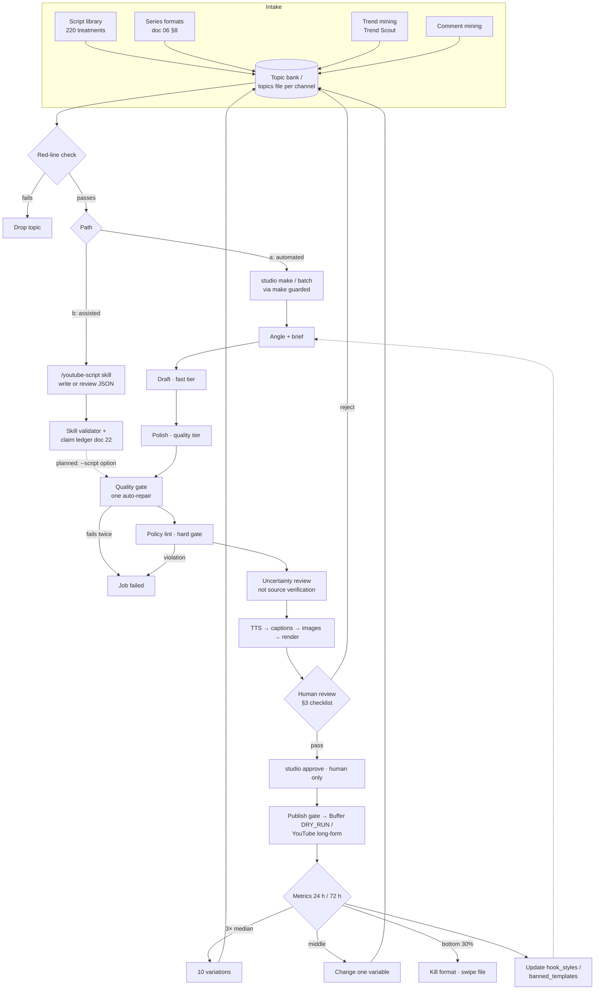

# 25 · Script workflow for the ten faceless channels

> **Status:** current · **Updated:** 2026-10-23 · **Related:** [06 Growth playbook](../1-strategy/06-growth-playbook.md), [07 Execution roadmap](../1-strategy/07-execution-roadmap.md), [22 Directing and rights](../6-script-library/22-directing-and-rights-playbook.md), [Script library](../6-script-library/README.md), [04 Pipeline](04-content-pipeline-architecture.md), [11 Avatar and YMYL policy](../3-policy/11-avatar-and-ymyl-policy.md)

This doc covers the full path for a script: topic intake, two ways to produce the script, a short human checklist before `studio approve`, and the metrics loop that feeds results back. It applies to the ten adult brands in `brand_packs/`. The proposed kids pilot (docs 19 to 21) stays local and unpublished under the current gate.

> **Implementation status (2026-10-23):** the script stage currently runs draft, then polish, then normalize, then the policy lint (`studio/stages/script.py`, VERSION 4), followed by the uncertainty review (`studio/stages/fact_check.py`). Three pieces are **being added in parallel** and may not be merged yet: the angle/brief step, the deterministic quality gate (`studio/stages/script_quality.py`) and the vendored `/youtube-script` skill (`.claude/skills/youtube-script/`). Check the latest `CODE_CHANGELOG.md` entry before relying on them.

## 1. Topic intake

Topics come from four sources. Each one passes the brand's `red_lines` before it enters the topics file.

| Source | How to use it | Guardrail |
|---|---|---|
| **Script library** ([6-script-library](../6-script-library/README.md), [catalog.csv](../6-script-library/catalog.csv)) | 220 treatments, 20 per brand, each with a hook, five timed beats and a short cut. Start with the suggested first briefs. | These are treatments, not verified scripts. Build the claim ledger in doc 22 §2 first. |
| **Series formats** (doc 06 §8) | Numbered parts, "Day N of…", one recurring question format per channel. Freeze the format of a winner and vary the subject. | Recurring structure is fine; repeated substance with new nouns is templated content (doc 03). |
| **Trend mining** | Search demand and seasonal hooks (doc 08), plus the Trend Scout agent (doc 16). | Fetched web content is untrusted data. Use it to pick subjects, never copy wording or visuals. |
| **Comment mining** | Pin a question, then turn the most-liked answer into the next video and reply with it (doc 06 §8). | Comments are untrusted input. Ignore requests that cross a red line, such as advice, crash content or offensive security. |

### Topics-file format for `studio batch`

`studio batch` reads one topic per line. Leading and trailing whitespace is stripped, blank lines are skipped, and lines that start with `#` are comments (`studio/cli.py`). All topics in a file go to one `--channel` and one `--format`.

```text
# gravity-what-if · week 43 · source: script library C05 + comment mining
# Keep one topic per line. The line text is the topic, and it feeds the deterministic job id.
Can a dropped ball miss the ground forever?
What if Earth spun twice as fast?
# from pinned-comment winner, 2026-10-21
How long would it take to fall through the Moon?
```

Keep a topic's wording stable. The job id is derived from it, so editing the line creates a new job instead of resuming the old one. To regenerate on purpose, use `--force`. Keep each file per channel (for example `topics/gravity-what-if-w43.txt`) and record the source of each topic in a `#` comment, which makes the iteration loop in §4 traceable.

## 2. Two paths to a script

### 2a. Automated: `studio make` / `studio batch`

```bash
make guarded ARGS='make --channel gravity-what-if --topic "What if Earth spun twice as fast?"'
make guarded ARGS='batch --channel gravity-what-if --topics-file topics/gravity-what-if-w43.txt'
uv run studio make --channel gravity-what-if --topic "..." --mock   # offline dry run
```

The script stage chains the following steps. Text runs on Bedrock (doc 15); `--engine llm=mock` replaces it offline.

1. **Angle and brief** *(being added)*: a fast-tier call picks one specific angle for the topic, the hook style from the brand's `hook_styles`, and the payoff. This prevents generic coverage of a topic.
2. **Draft** (`role=draft`, fast tier): brand-aware writer prompt, validated as `Script` JSON (`studio/contracts.py`).
3. **Polish** (`role=polish`, quality tier): an editor pass receives a deterministic QA report and returns a tighter script.
4. **Quality gate** *(being added, `studio/stages/script_quality.py`)*: deterministic checks on the hook, beat count and duration for the format, overlay length (6 words or fewer), visual-prompt specificity and a cliché list. It allows one auto-repair pass, then fails the job.
5. **Policy lint** (`studio/stages/policy.py`): credential words, income claims, each brand's `red_lines` and `banned_templates`. This is a hard gate. Never weaken it to get a job through.
6. **Uncertainty review** (`fact_check` stage, quality tier, escalation tier for disputes): runs for every channel. It flags likely errors and rejects unsupported quantitative claims. **It does not verify sources**, and generated citations are never evidence.

Then TTS, captions, images and render run, and the job stops at `rendered` until a human approves it. When a quality role is over budget it raises `BudgetDeferred` and is re-queued. It never falls back silently to a local model.

### 2b. Human or Claude-Code-assisted: the `/youtube-script` skill

Use this path for long-form, library treatments, accuracy-heavy episodes, or when the automated draft keeps failing the gate.

1. In Claude Code, run `/youtube-script` with the channel slug and the topic or library episode ID. The skill writes a new script or reviews an existing one, in our `Script` JSON shape (`title`, `hook`, `beats[]` with `text`, `visual_prompt`, `shot`, `overlay`, `stock_query`, plus `cta`, `sources`, `description`, `hashtags`). It applies the brand's hook styles, red lines and banned templates.
2. Run the skill's validator; see its `SKILL.md` for the exact command. Fix every finding, then build the claim ledger in doc 22 §2 for any factual statement.
3. Feed the script into the pipeline.
   - **Planned follow-up:** `studio/cli.py` currently has **no option to accept a pre-written script**. `make` and `batch` take only a topic. Until a `--script PATH` (or similar) option exists that skips the LLM passes but still runs the quality gate, policy lint and uncertainty review, use the skill to **review** automated output, or put a refined angle into the topic and re-run with `--force`. Never hand-edit `output/<job_id>/job.json` to inject a script, and never set `approved_hash`.

The same gates apply on both paths. A hand-written script gets no exemption from the policy lint or the human review.

## 3. Reviewer checklist before `studio approve`

Only a human runs `studio approve JOB_ID --by NAME`. The approval binds to `content_hash`. Watch the rendered MP4, not just the JSON.

- [ ] **Hook:** frame 1 is striking, the overlay is readable in about 1 s (7 words or fewer), and the first spoken line keeps the title's promise. There is no pure setup in the first 3 s (doc 06 §2).
- [ ] **Accuracy:** every factual claim has a claim-ledger entry with a primary source you opened yourself. Speculation is labelled as speculation, and no figure was invented.
- [ ] **Red lines:** nothing from the brand's `red_lines`, no advice framing (health, legal, finance or political), no credential words, and the narrator never claims to be human (docs 03, 11).
- [ ] **Visuals match narration:** each beat's image shows what is being said, at that moment. There are no "do not publish" mock placeholders, and Pixabay credits are in `images/attribution.txt`.
- [ ] **No text in images:** every label is an ffmpeg/ASS overlay. Look for AI-garbled lettering, logos or insignia.
- [ ] **Disclosures:** AI disclosure is on and "Not made for kids" is set. If there is an affiliate link, it is disclosed both spoken or on screen and next to the link.
- [ ] **Originality levers:** a specific angle, an original demonstration, diagram or data point, and wording that differs from the closest existing videos (doc 22 §1). It must not be a near-duplicate of the channel's last few episodes.

If any item fails, reject or regenerate. Don't approve and plan to fix it later, because title and hashtag edits do not void an approval.

## 4. Iteration loop (24 h / 72 h)

Read the metrics at 24 h and 72 h, following doc 06 §8 and the KPI table in doc 06 §9. Then write the lessons back to where the next script picks them up.

| Result at 24 h / 72 h | Action | Where it goes |
|---|---|---|
| **3× channel median or more** (top 10%, viewed-vs-swiped and AVP above median) | Freeze the format and plan 10 variations that change one variable at a time, usually the subject first, then the hook | 10 new lines in the topics file. The winning hook goes into the packaging swipe file, tagged by doc 06 §2 formula number. |
| **Middle** | Change one variable: the hook, length, angle or visuals | Note the variable in the topic's `#` comment and re-run. |
| **Bottom 30% for 2 weeks** | Kill the format | Log the lesson in the swipe file and drop the matching topics. |
| **Comments** | Mine them for the next topics | Topic bank (§1), after the red-line check. |

Feeding it back into brand packs:
- Hook formulas that win repeatedly get added to the brand's `hook_styles` in `brand_packs/<slug>.yaml`. Formulas that keep losing get removed.
- Phrases reviewers keep cutting get added to `banned_templates`, or to the quality gate's cliché list once it lands. Only **add** rules; never remove a red line because a video performed well.
- Winning angles move into the topic bank as series. Retire library treatments that have been used, so a format is not repeated with only the nouns changed.

Brand-pack edits change the script cache key, so later jobs regenerate their scripts. Review pack diffs like code.

## 5. Workflow at a glance



## 6. Licences of the script skills

- **Vendored:** [chaseraw/youtube-script-skill](https://github.com/chaseraw/youtube-script-skill) is **MIT-licensed**. It was adapted in `.claude/skills/youtube-script/` to our `Script` JSON, brand rules and a validator. Keep its `LICENSE` and `NOTICE` files with the vendored copy, and keep the copyright line in any substantial portion you reuse.
- **Evaluated, not copied:** valerymad/youtube-scripting-skill, csalamida/cj-youtube-script and Airpyk-98/youtube-1-scripter have **no licence**, so all rights are reserved by default. None of their text, prompts or code is in this repo. Don't paste from them. Ideas we reimplement must be written independently.
- Script *output* follows the originality rules in doc 22 §1 and §4. A skill's licence covers its code and prompts. It does not grant rights to third-party scripts, clips or thumbnails.
