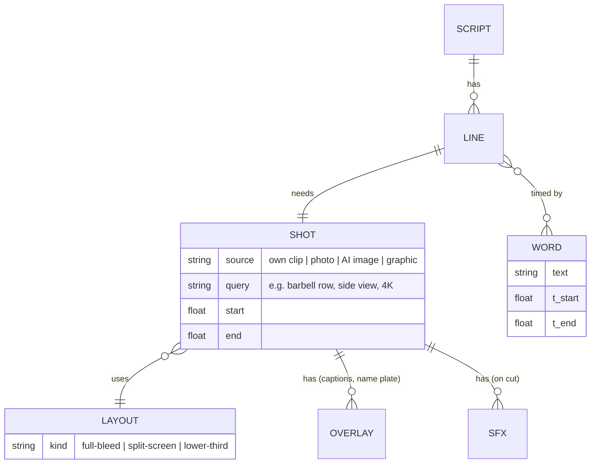
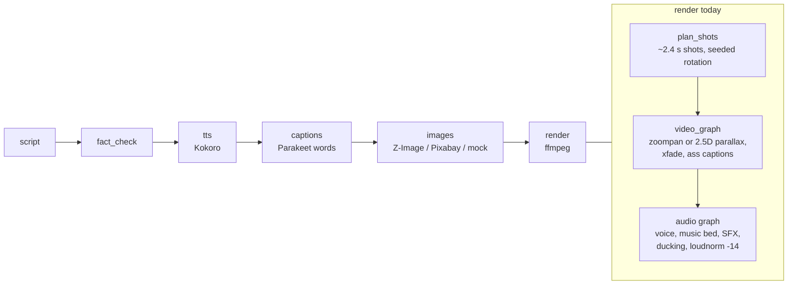
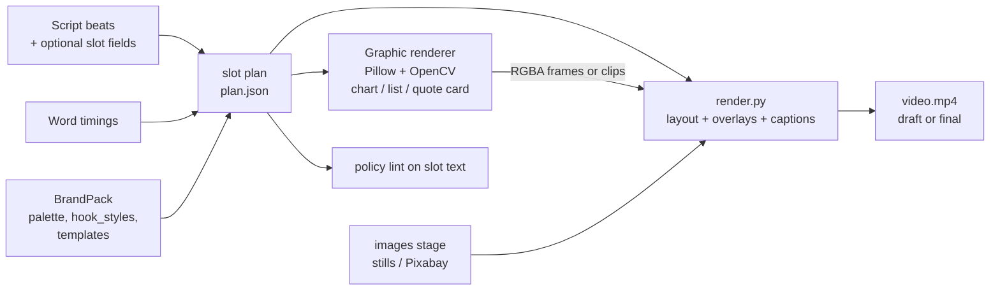

# 36 — Slot-based video technique (Slot Studio study)

> **Status:** research and design proposal · **Written:** 2026-10-28 · **Nothing in this
> doc is implemented.** It studies the public marketing site <https://slotstudio.app/>,
> maps the technique onto this repo, and proposes a build order. Publishing rules,
> policy lint, `make guarded` and the "no approvals by agents" rule are unchanged.

## 1. Evidence and its limits

Three read-only agents worked in parallel: product research, public front-end recon and a
map of this repo. The product is a paid download (about 105 MB, delivered by email after
payment), so its internals were **not** inspected. Everything below about internals is
either quoted from vendor copy (**observed**) or reasoned from it (**inference**).

| Source | What it gave | Confidence |
|---|---|---|
| Homepage, `/terms/`, `/privacy/`, `/refund/`, `/delivery/` | Product form, workflow, pricing, licence, requirements | High (vendor statements) |
| Public JS bundles (`core.js`, `10-hero.js`, `30-youtube.js`, `50-motion.js`) | The site has no client-side video rendering; WebGL is only a marketing demo | High |
| Two public sample MP4s (`ffprobe`) | 720×1280 at 30 fps, H.264, -14.6 LUFS, split-screen layout, caption style | High (measured) |
| Third-party reviews / HN / Reddit / Product Hunt | None found | n/a |
| Meaning of "slot" | Never defined on the site | **Low** (guess) |

## 2. What Slot Studio is

Not an app and not SaaS. It is a **folder of instructions and tooling that you add to the
Claude desktop app as a Project**. You type "make a video about X" and Claude drives
local tools on an Apple Silicon Mac: research, script, voice cleanup, clip sourcing,
motion graphics, captions, render. The renderer is **Remotion** (React), with three.js
for the 3D graphics (vendor FAQ + inference).

```mermaid
flowchart LR
    U[Creator types a request<br/>in the Claude Project] --> C[Claude orchestrates<br/>from the SlotStudio folder]
    C --> R[Research + script<br/>source under every claim]
    R -->|human approves| V[Voiceover<br/>own recording or ElevenLabs]
    V --> CL[Voice cleanup<br/>cut breaths, ums, restarts]
    CL --> SP[Shot plan<br/>which lines need a shot]
    SP --> SRC[Clip / photo sourcing<br/>YouTube, web, OpenAI images]
    SRC --> ED[Edit in Remotion<br/>graphics, captions, SFX]
    ED --> PV[1080p preview]
    PV -->|plain-language fixes| ED
    PV --> FR[Final 4K render<br/>+ 9:16 cuts + thumbnails<br/>+ publishing kit]
    FR --> UP[Human uploads]
```



Vendor-stated numbers (unverified): about 2–3 fps at 4K, "a 6-minute 4K video took about
95 minutes on an M5", per-video human time 1–2 hours, 40 GB free disk required.

## 3. The technique, decomposed

### 3.1 Data model (inference, medium confidence)

A script is broken into numbered lines. Each line carries a **shot spec**. Word-level
timestamps from the voiceover pin captions, graphics and sound effects to spoken words.
That is why "swap the clip at 2:14" only rebuilds one part: each shot is an independent
unit that reads its own JSON props.



"Slot" is probably a position on the timeline that gets filled by a clip, photo or
graphic. The vendor never says so. Treat that as a working definition only.

### 3.2 What the finished Short looks like (measured)

| Property | Value |
|---|---|
| Frame | 720×1280 preview, 30 fps, H.264 High (delivered up to 4K / 9:16) |
| Audio | AAC 48 kHz, **-14.6 LUFS integrated** |
| Layout | **Split screen**: speaker footage on the bottom half, a graphic scene on top |
| Captions | Bold, heavy sans, all caps, word-by-word highlight (yellow or blue active word), sitting at the seam between halves |
| Name plate | Lower-third for speakers, e.g. "NAME / TITLE" |
| Pacing | A cut or graphic every 2–3 s (vendor): 33 jump cuts, 144 SFX, 8 graphic scenes in a 1:25 Short |
| Graphic scenes seen | Starfield + word, numbered logic list, highlighted grid, engraving + serif quote card, stamp overlay |

```
┌──────────────────┐
│  GRAPHIC SCENE   │  ← top half: chart / list / quote card
│  (kinetic text)  │
├──────────────────┤
│ WORD  WORD  WORD │  ← captions at the seam, active word coloured
├──────────────────┤
│  FOOTAGE / ART   │  ← bottom half: clip or still
│  ▒ NAME PLATE ▒  │
└──────────────────┘
        1080×1920
```

## 4. What this repo has today



| Slot Studio capability | Here today | Gap |
|---|---|---|
| Word-level timing | Parakeet captions (`captions.py`) | None |
| Cut every 2–3 s | `MAX_SHOT_S` ≈ 2.4 s (`render.py`) | None |
| Word-highlight captions | `Word` and `Card` ASS styles | Needs bold all-caps highlight style and seam position |
| SFX on cuts, -14 LUFS | SFX bus and loudnorm exist | Rule for placing a hit per cut |
| Per-line shot plan | `Beat.shot`, `Beat.stock_query` | No layout, graphic type or emphasis words |
| Split screen, lower-third | **None** (full-bleed only) | New ffmpeg overlay/scale graph |
| Motion-graphic scenes | **None** | Largest gap |
| Layout chosen by template | **None**: transitions and motion are seeded rotation | Template or plan file |
| Preview then revise one part | Stage cache exists per stage, not per shot | Draft render mode, per-shot cache |
| Voice breath/um cleanup | **None** (TTS is generated, so rarely needed) | Only for real voiceovers |
| YouTube clip sourcing | **None, deliberately** | Do not build (section 6) |

Closest existing "slot" code: `scripts/kids_song/scenes.py` (`SceneSpec`, `layout()` places
characters by framing) and Pond Studio's ordered `Scene` list (`studio/web/models.py`).

## 5. Proposed design

### 5.1 Decision: no Remotion

Remotion would add a headless browser and a Node dependency, and needs a paid licence for
companies of 4+ people. It is also slow (the vendor's own 2–3 fps at 4K). Instead draw
graphic scenes with **Pillow + OpenCV** (as the kids pipeline does) and composite in the
existing **ffmpeg** renderer. At 1080×1920 this is cheap and keeps one rendering path.

### 5.2 Architecture



Proposed optional fields (all default to today's behaviour so existing jobs keep working):

```yaml
# per beat (sketch, not final)
layout: full-bleed | split-top-graphic | lower-third
graphic: none | bar-chart | numbered-list | quote-card
emphasis: [word, word]        # captions highlight these
caption_style: word-highlight | card
```

`plan.json` records, per beat: start/end from the TTS timings, layout, graphic spec,
caption style and the SFX hit time. It is a pure function of script + timings + brand, so it
can be unit-tested without ffmpeg and hashed into the stage cache key.

### 5.3 Build order

```mermaid
gantt
    dateFormat  X
    axisFormat  step %s
    section Plan
    1 Slot plan + optional Beat fields (contracts, tests)  :a1, 0, 1
    section Render
    2 Layouts: split screen, lower-third, highlight captions :a2, 1, 2
    3 Graphic templates: bar chart, list, quote card         :a3, 2, 3
    section Verify
    4 --mock video, then one guarded real run                :a4, 3, 4
```

Reasonable first graphic templates for a data channel such as `car-cost-truth`: bar chart
(numbers from the script), numbered list, quote card.

### 5.4 Files that would change

| File | Change | Owner rule (AGENTS.md) |
|---|---|---|
| `studio/contracts.py` | Optional `Beat` fields, optional `BrandPack.templates` | Orchestrator-only; flag before editing |
| `studio/stages/render.py` | Read plan, layouts, bump `VERSION` | Edit & Render role |
| `studio/stages/captions.py` | Highlight style, seam position | Edit & Render role |
| `studio/stages/slotplan.py` (new) | Plan builder (pure function) | New file |
| `studio/stages/graphics/` (new) | Pillow/OpenCV scene drawers | New files |
| `studio/pipeline/runner.py` | Only if a separate `template` stage is chosen | Orchestrator-only |
| `tests/` | See section 7 | Offline only |
| `CODE_CHANGELOG.md` | Entry with each code commit | Orchestrator-only |

Alternative integration points that were considered:

| Option | Summary | Verdict |
|---|---|---|
| A. Template layer inside render | Declarative template read by `render.py` | **Recommended** with B's plan file as step 1 |
| B. New `template` stage between images and render | Emits `plan.json` | Cleaner testing, but touches stage order |
| C. Extend Pond Studio (`studio/web`) | Reuse scenes, UI and queue | Separate Pillow renderer, kids-flavoured; channel videos would not benefit |

## 6. Constraints and risks

- **No YouTube clip sourcing.** Slot Studio downloads third-party clips and relies on
  commentary fair use ("you're responsible for what you publish"). Its own showcase reuses
  celebrity interview clips. That conflicts with the reused-content risk in docs 03, 11 and
  17, and Pixabay is this project's only stock source. **Not adopted.**
- **Templated output risk.** `AGENTS.md` says to avoid templated or mass-produced output.
  A template feature must give consistent structure with **original content in each slot**,
  and the policy lint (`studio/stages/policy.py`, `red_lines`, `banned_templates`) must run on
  slot text. Do not weaken it.
- **Overlay rules.** No text inside AI images; all labels are ffmpeg/ASS overlays. The
  existing 6-word overlay cap applies to slot text.
- **Runs.** Real media runs only through `make guarded`. No model downloads. Keep 10 GB disk
  free. A re-render voids approval (`content_hash`), and agents never run `studio approve`
  or set `approved_hash`.
- **Vendor numbers are marketing.** Throughput ("30–50 long-form videos a month") and render
  times are unverified.

## 7. Tests to add (all offline, no models, no `.env`)

1. Plan builder is deterministic and frame-exact against word timings (elastic slot lengths,
   minimum lengths, xfade fit): extend `tests/test_render_edit.py`.
2. Optional fields validate and default to today's behaviour: contracts and brand-pack tests.
3. Filtergraph **string** snapshots for split-screen, lower-third and highlight captions
   (no ffmpeg run).
4. ASS output for slot text: position, style, 6-word overlay cap.
5. Policy lint covers slot text (credential words, income claims, `banned_templates`).
6. Cache invalidation: a plan or `VERSION` change re-renders; a re-render voids approval.
7. `--mock` end-to-end for both `short` and `long` formats.

## 8. Open questions

1. Scope of the first pass: steps 1 to 4, or review this doc first?
2. First channel and topic for the `--mock` video (suggested: `car-cost-truth`).
3. Is the split-screen layout wanted for faceless channels, where the bottom half would be a
   still or Pixabay clip rather than speaker footage?

## 9. Sources

- <https://slotstudio.app/> and `/terms/`, `/privacy/`, `/refund/`, `/delivery/` (read 2026-10-28)
- Public sample MP4s from the same site, probed with `ffprobe` (scratch copies were kept
  outside the repo)
- Repo map: `studio/contracts.py`, `studio/stages/render.py`, `studio/stages/captions.py`,
  `studio/pipeline/runner.py`, `scripts/kids_song/scenes.py`, `studio/web/models.py`
