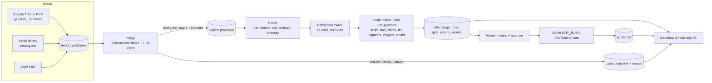

# 37 — Trend-driven topic pipeline, tracking DB and dashboard

> **Status:** design proposal · **Written:** 2026-10-29 · **Nothing here is implemented.**
> Inputs: two read-only research passes (platform limits and sources, verified 2026-10-29;
> repo map). Items marked UNVERIFIED could not be confirmed from a primary source. Publishing
> stays behind the human approval gate and `DRY_RUN`; the fact-check and policy gates are not
> loosened to raise throughput.

## 1. The request and the reality check

Request: pick topics from Google Trends (by search volume and relevancy), produce up to 1,000
reels a day with scripts, fact checks, descriptions and royalty-free images, publish to YouTube,
Instagram and Facebook automatically, track everything in SQLite, with a dashboard and no code
per video.

| Constraint | Finding | Source |
|---|---|---|
| YouTube uploads | `videos.insert` has its own default quota of **100 calls/day per API project** (resets midnight PT). Higher needs an audit. | developers.google.com/youtube/v3/determine_quota_cost |
| Instagram API | **100** API-published posts per rolling 24 h per account (page also says 50 for carousels, so use 50 to be safe) | developers.facebook.com/docs/instagram-platform/content-publishing |
| Facebook Reels API | **30** Reels per Page per 24 h | developers.facebook.com/documentation/video-api/guides/reels-publishing |
| Buffer | Instagram help lists 50 posts/24 h; API limits per plan (free 600/day) | support.buffer.com, developers.buffer.com/guides/api-limits.md |
| Policy at volume | YouTube "inauthentic content" (renamed 2025-07-15) targets template-made, repetitive videos; consequences include demonetisation and termination of **all** channels, and evading it with new channels is itself a violation. Meta limits reach and monetisation for unoriginal/repetitive content. | support.google.com/youtube/answer/1311392 |
| Local render speed | About 6.5 min per Short with local AI images (CODE_CHANGELOG); weights are removed, so stock-only. Strictly one job at a time under the resource guard. | repo |
| Fact gate | Rejects any digit or number word in a script and any unsourced claim; live-news topics fail by design | `studio/stages/fact_check.py` |

**Conclusion.** 1,000/day is not feasible within platform policy: at the hard caps it would
need about 10 YouTube projects, 10-20 Instagram accounts and 34 Facebook Pages posting
near-identical templated output, which is the pattern the policies penalise. This Mac also
cannot render that many. The design therefore has a **configurable daily cap, default 20**,
spread over distinct-niche channels (your docs already plan about 10-30/day).

## 2. Architecture



Principles:
- `output/<job>/job.json` stays the source of truth. The SQLite DB is an **index and audit log**
  that `studio track sync` can rebuild.
- All trend text is **untrusted data**, used only to choose subjects; the picker LLM gets no
  tools and no write access.
- A job that fails `fact_check` or `policy` is recorded `rejected_by_gate` with the issues and
  **never retried with a looser rule**.

## 3. Topic triage (the "false stuff" filter)

Trends are mostly breaking news, sports and people. Each candidate is classified:

| Class | Action |
|---|---|
| `evergreen_explainer` | Allowed, assigned to a channel by niche match with a confidence threshold |
| `news_event` | Rewritten into a timeless mechanism angle with names, scores, dates and numbers stripped (e.g. "why a star player's absence changes how a team plays"), otherwise rejected. The raw trend term is kept only as `source_term` in the DB, never in the topic string. |
| `ymyl_or_sensitive` | Rejected: health, legal, finance, politics/elections, disasters, deaths, crime |
| `person_or_brand` | Rejected: named living people, private individuals, minors, trademarks the niche red lines forbid |
| `unsafe` | Rejected: hoax-prone, kids content, anything needing numbers to be meaningful |

The word filter (`studio/topics/blocklists.py`) is **critical-only**: politics/elections, medical,
crypto and finance advice, death and violence, minors, gambling and adult, and hoaxes. Sports,
celebrities, brands and breaking-news wording are not word-filtered; the LLM classes, the name
heuristic, brand red lines and the unchanged fact-check and policy gates handle them.

Cheap deterministic pre-checks run first (reusing `policy.lint` and the fact-check quantity
regex read-only) so doomed topics cost no render time. Hard rules: never target the kids brand
`plinkety-pond`; skip trend feeds for `accuracy_critical` channels unless the topic is clearly
mechanism-only. Expect a low pass rate and report it on the dashboard instead of tuning the gate.

## 4. Data sources

| Source | Use | Risk |
|---|---|---|
| `trends.google.com/trending/rss?geo=US` | Primary. Fields: title, `ht:approx_traffic` (coarse, e.g. "2000+"), `pubDate`, up to 3 news items. Returned 10 items on 2026-10-29. | No documented terms or SLA; can disappear. No sort-by-volume in the feed. |
| Official Google Trends API | Not usable: invite-only alpha, no public docs | n/a |
| pytrends / scraping the UI | Do not use: archived 2025-04-17, 429s, "automated queries" are prohibited in Google's terms | ToS |
| YouTube `videos.list chart=mostPopular` | Optional second signal, 1 quota unit per call | Needs a Data API key |
| Wikipedia pageviews | Optional (CC0, needs a descriptive User-Agent) | Rate limits changing in 2026 |
| Reddit | Do not use for a monetised pipeline without a commercial agreement | Terms |

## 5. Images at volume

Order: Pixabay (the existing client; 100 req/60 s, 24 h response cache, files downloaded, never
hotlinked) then Wikimedia Commons (descriptive User-Agent, per-item licence; BY and BY-SA need
credit and BY-SA is share-alike, so keep an `assets` row per image with creator, licence and
URL). Pexels needs a prominent link and has 200 req/h. Pixabay forbids recognisable trademarks
and restricts recognisable people, so a human review of the frames stays in the checklist.
Basketball-style niche subjects have very thin stock coverage (seen in the Warriors draft), so
pick channels whose subjects stock libraries actually cover.

## 6. SQLite schema (`output/pipeline.sqlite`, WAL, read-only for the dashboard)

| Table | Key columns |
|---|---|
| `trend_candidates` | id, term, source, region, volume, raw_json, fetched_at; unique(term, source, day) |
| `topics` | id, candidate_id, channel, format, topic_text, topic_hash unique, class, angle, status (proposed, approved_for_batch, rejected, queued, done), reject_reason, safety_json |
| `batches` | id, name, config_path, config_sha256, started_at, finished_at, mock, status |
| `jobs` | job_id, batch_id, topic_id, channel, format, status, current_stage, error, workdir, content_hash, approved_hash, approved_by, approval_valid |
| `stage_runs` | job_id, stage, version, status (ok, failed, cached, skipped), seconds, error |
| `gate_results` | job_id, gate (topic_triage, policy, fact_check, publish_gate), passed, issues_json |
| `publishes` | job_id, platform, target (buffer_dry_run, buffer, youtube_private), idem_key, remote_id, status |
| `assets` | job_id, kind, source, source_id, creator, licence, page_url, local_path |
| view `spend_rollup` | llm spend per job via ATTACH of `ledger.sqlite` |

`publishes` mirrors the existing `publish_posts` and `youtube_uploads` tables; it does not replace them.

## 7. Config-driven batches (no code per video)

```yaml
# config/batches/2026-w44.yaml  (sketch)
name: oct-w44
format: short
daily_cap: 20                 # hard ceiling across all channels
per_channel:
  gravity-what-if: 3
  megabuild-blueprint: 3
sources: [library, trends]    # trends go through triage first
engines: {images: pixabay}
mock: false
```

It expands into the existing `{channel, topic, format}` day-plan shape, so `studio batch`
and the Prefect flows work unchanged. CLI sketch: `studio topics fetch|triage|list|pick`,
`studio batch-config FILE [--mock] [--dry-run]`, `studio track sync|report`. `studio approve`
stays human-only and unchanged.

## 8. Dashboard (v1 read-only)

New router in `studio/web/` (inherits its loopback and token protection), reading
`pipeline.sqlite` and `output/*/job.json`. Pages: **Pipeline** (jobs, stage, video preview,
approval validity from `verify_approval`, not the stored flag), **Topics** (candidates, triage
class, rejection reasons), **Gates** (fact-check and policy failures with their issues),
**Publish** (dry-run and private-upload rows, "approved but not uploaded"), **Cost and capacity**
(LLM spend, Pixabay requests, memory pressure, disk), **Batches** (history, config hash).

An Approve button would be a new approval path (doc 30: "no approval endpoints"). v1 shows a
copy-paste `studio approve JOB --by NAME` hint instead. If a button is wanted later it must be a
human-initiated, session-bound POST that requires typing the first 12 characters of the content
hash, records the logged-in owner, is disabled for kids brands, and never publishes.

## 9. Build phases

1. Tracking DB plus `studio track sync` and the read-only dashboard over existing jobs (useful immediately).
2. Trend intake (RSS, mockable) and triage with the deterministic filters and tests.
3. Picker, batch-config runner, per-channel caps and dedupe.
4. LLM triage and angle rewrite (uses the `ideation` role; backend via opencode or claude-code, since the Bedrock profile belongs to your employer).
5. Publish-status tracking (Buffer dry-run, YouTube private) and capacity page.

Shared files (`contracts.py`, `config.py`, `pyproject.toml`) need an Orchestrator decision;
new modules go in `studio/topics/`, `studio/pipeline/tracking.py`, `studio/web/dashboard_api.py`.

## 10. Risks and unknowns

- Account termination risk from high-volume templated output is the main business risk; keep
  caps, angle diversity and the human review checklist.
- Low fact-gate pass rate on evergreen rewrites; track it, do not tune it.
- The RSS feed is unofficial and returned only 10 items in one fetch; re-test before relying on it.
- Unconfirmed: Meta AI-label rules, Instagram originality thresholds, Buffer ToS on automation,
  YouTube API field for the AI-disclosure setting, Trends API quotas.
- Throughput: stock-only, serial, about a few hundred Shorts per day at the very most.
- Two sources of truth (job.json vs SQLite): job.json wins; `track sync` rebuilds.
