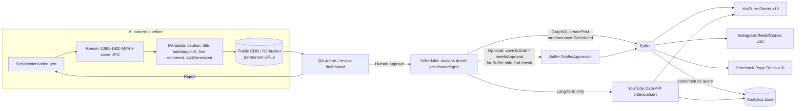

# 05 — Distribution via Buffer

> **Status:** current · **Updated:** 2026-10-16 · **Related:** [04 Pipeline architecture](../4-production/04-content-pipeline-architecture.md), [16 MCP and agents](16-mcp-agent-orchestration.md), [03 Platform policies](../3-policy/03-platform-policies-and-risks.md)

> Research date: 2026-10-16. Scope: 10 faceless AI channels × YouTube / Instagram / Facebook (~25–30 Buffer "channels"), with Buffer as the single publishing control plane.
> Legend: **[V]** = verified on a Buffer-owned page (site, help center, developer docs) during this research. **[3P]** = third-party source only. **[?]** = could not confirm; check before relying on it.

---

## 1. TL;DR

| Question | Answer |
|---|---|
| Is there a usable API? | **Yes.** In May 2026 Buffer launched a new **GraphQL public API** at `https://api.buffer.com`, on every plan including Free, with an MCP server and a CLI. It is still labelled **beta**, and some operations are marked `@experimental` or `@preview`. [V] |
| Can the API post video? | **Yes.** `createPost` takes `assets: [{ video: { url, thumbnailUrl, metadata: { thumbnailOffset, title } } }]`. Media must be at a **public, permanent URL**, because there is no upload endpoint. [V] |
| YouTube Shorts? | **Yes.** Up to 3 minutes, 10 GB, 1:1 or 9:16. [V] |
| YouTube long-form? | **No.** Buffer's help center says *"We do not support long-form YouTube videos at this time."* [V] This is the biggest gap for the project. |
| IG Reels / carousels / Stories | All supported. Stories and carousels do have limits (see §3). [V] |
| FB Reels / Pages | Supported on Pages. **Personal profiles cannot be connected.** Groups are notification-only. [V] |
| Cost for 30 channels | About **$135/mo on Essentials** or **$195/mo on Team**, billed monthly. Annual billing is roughly 17% cheaper. [3P, base rates V] |
| Recommended path | Pipeline → our own QA queue → Buffer GraphQL `createPost` (Shorts, Reels, FB Reels) **plus** the native YouTube Data API for any long-form video. Zapier, Make and n8n are optional glue, not the core path. |

---

## 2. Plans and pricing

The Buffer pricing page [V] lists Free, Essentials and Team. Prices are **per connected channel**. Each social account counts as one channel, so a single brand's YT, IG and FB use 3 channels.

| Plan | Price/channel (1–10) | Users | Scheduled posts/channel | Approvals | API keys / req per 24h / per 30d |
|---|---|---|---|---|---|
| Free | $0 (max 3 channels) | 1 | 10 | No | 1 / 250 / 3,000 |
| Essentials | $6 monthly, $5 annual [3P]. The pricing page showed "$5" [V] | 1 | Unlimited (5,000 fair-use cap) | No | 3 / 250 / 7,500 |
| Team | $12 monthly, $10 annual [3P]. The pricing page showed "$10" [V] | Unlimited | Unlimited (5,000 fair-use cap) | **Yes**, plus custom roles | 5 / 500 / 15,000 |

Every plan has a limit of 100 requests per 15 minutes [V].

Features that matter here and need **Essentials or higher** [V]: first-comment scheduling, custom video covers, channel groups, hashtag manager, unlimited insights history and reports. Team adds approval workflows, custom permissions and branded reports.

**Volume tiers.** The Buffer page [V] says channels above 10 are cheaper but does not list the rates. A third-party breakdown dated 2026-08 [3P] gives these marginal monthly rates:

| Channels | Essentials | Team |
|---|---|---|
| 1–10 | $6 | $12 |
| 11–25 | $4 | $4 |
| 26–50 | $3 | $3 |
| 51+ | $1 | $2 |

**Cost for this project** (monthly billing, using the 3P tier table):

| Channels | Essentials | Team | Notes |
|---|---|---|---|
| 20 (10 brands × IG+FB) | $100 | $160 | |
| 25 | $120 | $180 | 3P annual figures: $100 / $150 |
| **30 (10 × YT+IG+FB)** | **$135** | **$195** | Annual is about $113 / $163 [?] |

**Recommendation:** Start on **Essentials** (one operator, with the QA gate in our own pipeline; see §6). Upgrade to **Team** if a second human reviewer needs Buffer's native approval flow, or if the 250 requests/day API budget gets tight. Confirm final prices at checkout, because the annual-discount wording on Buffer's own page is inconsistent [V].

---

## 3. Capability matrix (network × feature)

| Feature | YouTube | Instagram | Facebook |
|---|---|---|---|
| Account type required | Channel **owner** must log in with Google. Brand-account managers can't connect [V] | **Business or Creator** account for auto-publish. Personal accounts are notification-only [V] | **Pages only**. Personal profiles are not supported. Groups are notification-only [V] |
| Short vertical video | **Shorts**: ≤3 min, ≤10 GB, 1:1 or 9:16, mov/mp4/mpg/avi/webm [V] | **Reels**: 3 s–15 min, <300 MB, MP4/MOV, 9:16 recommended. All feed video is published as Reels [V] | **Reels**: 3–90 s, ≤1 GB, 9:16, MP4/MOV/AVI/M4V [V] |
| Long-form video | **Not supported** [V] | n/a (Reels up to 15 min) | Standard video posts ≤1 GB. A 9:16 upload becomes a Reel [V] |
| Stories | n/a | Yes. Music, stickers, links and product tags force **notification** mode [V] | Yes, 3–90 s, ≤1 GB [V] |
| Carousels | n/a | Yes, up to 10 items. **No mixed image+video** in one carousel [V] | [?] |
| Videos per post | 1 [V] | 1 per Reel [V] | 1 [V] |
| Title | Title field, 100 chars, auto-filled from the first caption line. API: `metadata.youtube.title` [V] | n/a | Reel title via `FacebookPostMetadata.title` [V] |
| Description / caption | 5,000 chars [V] | 2,200 chars, **max 5 hashtags** per post [V] | Text field |
| YouTube tags (keyword tags) | **Not exposed** in the UI article or the API `YoutubePostMetadataInput` [V] | — | — |
| Privacy / category / made-for-kids | API: `privacy`, `categoryId`, `madeForKids`, `notifySubscribers`, `license`, `embeddable` [V]. The UI help says the category can't be changed [V], so the API may be ahead of the UI [?] | — | — |
| AI-content disclosure | API `isAiGenerated` on YouTube and Instagram metadata [V]. **Set this to true** for this project | same | [?] |
| First comment | n/a | Yes, auto-publish only, 2,196 chars [V] | Yes, `FacebookPostMetadataInput.firstComment` [V] |
| Thumbnail / cover | **No custom thumbnail for Shorts** [V] | Frame picker ("Edit Thumbnail"). API: `thumbnailOffset` (ms) or `thumbnailUrl` [V] | API `thumbnailUrl` exists. Whether FB honours it is [?] |
| Collaborators | — | Up to 3, needs a FB-Page-linked connection [V] | — |
| Daily cap (Buffer side) | 10/day if YT email is unverified, otherwise no cap [V] | **50 per 24 h** (posts+stories+reels) [V] | [?]. Read it via the API `dailyPostingLimits` query [V] |
| Analytics | Views/likes/comments per Short. Channel stats refresh about every 3 days [V] | Full insights for Professional accounts. Reels watch-time metrics added 2026-09 [V] | Pages only. Reels metrics only appear in Sent-post metrics [V] |
| Library music | Not available for auto-published Shorts [V] | Licensed audio queries are experimental in the API (2026-09/10) [V] | — |

**Gotchas**
1. **No long-form YouTube.** Any 8–20 min faceless video has to go through the YouTube Data API directly (§7), or through a different tool such as Publer.
2. Instagram can connect via **Instagram Login** or a **linked FB Page**. The FB Page route is needed for collaborators, locations and Reel music [V]. For 10 brands, set up 10 FB Pages + 10 IG Business accounts, link them, and connect IG via FB.
3. YouTube **brand accounts**: the person who connects must be the channel *owner* [V]. Plan Google-account ownership carefully, ideally one owner identity that controls all 10 brand channels.
4. If the IG aspect ratio is out of range, or the channel setting "notifications by default" is on, the post silently falls back to **notification** (manual) publishing [V]. The pipeline must render to exactly 9:16 at 1080×1920.
5. Buffer transcodes video to H.264 MP4 at max 1920×1080 [V]. Upload at 1080×1920 to avoid a second generation of compression.
6. Media URLs must remain public **until publish time**. **Do not use S3 pre-signed URLs**, Drive or Dropbox links [V]. Use R2 or Cloudinary public URLs, or a public CDN path, with a lifecycle rule of 14+ days.
7. **The API is beta.** On 2026-05-12 the asset input format changed and older mutations broke [3P], and fields are being added and removed monthly [V changelog]. Pin to the documented schema and run a nightly smoke test (§6).

---

## 4. Buffer API (GraphQL public API) — status and usage

**Status [V]:** Announced on 2026-05-27, available on all plans. It is GraphQL with a typed schema, a playground (`developers.buffer.com/explorer.html`), a changelog and a roadmap. Operation maturity is flagged with `@experimental`, `@preview` and `@stable`. The **legacy REST API** has been closed to new apps since 2019 and will be **fully retired on 2027-02-01**, with brownouts on 2026-11-11 and 2026-12-09 [V]. **Do not build on legacy REST, or on any tool still using it.**

**Auth [V]:**
- **API key** (Settings → API, Bearer token). It acts as the account owner across all organizations and channels, with no per-org scoping. Keep it server-side.
- **OAuth 2.0 Authorization Code + PKCE** (`auth.buffer.com/auth`, `/token`) for third-party apps. Scopes: `posts:read|write`, `ideas:read|write`, `account:read|write`, `snippets:read|write`, `offline_access`. Tokens last about 1 h, and refresh tokens are single-use and rotating. For our own pipeline, an **API key is sufficient**.

**Rate limits [V]:** 100 requests per 15 min. Per 24 h: 250 (Free/Essentials) or 500 (Team). Per 30 days: 3k / 7.5k / 15k. The API returns HTTP 429 with `Retry-After`, and `RateLimit` / `RateLimit-Policy` headers. Query cost is capped at 175k points, depth 25 and 30 aliases. **MCP and AI-assistant calls share the same bucket.** For higher limits, email developersupport@buffer.com.

**Budget check:** 30 channels × 2 posts/day = 60 `createPost` calls/day. Add one batched status poll every 30 min (48/day) and you get about **110/day**, which fits Essentials (250). That is roughly 3,300/month, under 7,500. **Never poll per post.** Use `posts(channelIds: [...])` filtered queries. Note that the API takes **one request per channel**, with no multi-channel fan-out [V].

**What it can do [V]:** create text, image, video, threaded, draft and scheduled posts. It can also list channels, organizations and posts, read post metrics, create Ideas, and manage Tags (experimental). As of 2026-10-15 a `ChannelAction.approvePosts` permission exists in the changelog.

**Key `createPost` input fields [V]:** `channelId`, `text`, `assets[]`, `mode` (`addToQueue`, `shareNext`, `shareNow`, `customScheduled`), `dueAt` (ISO-8601 UTC, used with `customScheduled`), `schedulingType` (`automatic` or `notification`), `saveToDraft`, **`needsApproval`** (required boolean), `tagIds`, `ideaId`, and `metadata.{youtube|instagram|facebook}`.

```graphql
mutation {
  createPost(input: {
    channelId: "IG_CHANNEL_ID"
    text: "Caption… #hashtag"
    schedulingType: automatic
    mode: customScheduled
    dueAt: "2026-10-20T13:30:00.000Z"
    needsApproval: false
    assets: [{ video: { url: "https://cdn.example.com/b03/2026-10-20.mp4",
                        thumbnailUrl: "https://cdn.example.com/b03/2026-10-20.jpg" } }]
    metadata: { instagram: { type: reel, shouldShareToFeed: true,
                             firstComment: "Link in bio", isAiGenerated: true } }
  }) {
    ... on PostActionSuccess { post { id dueAt } }
    ... on MutationError { message }
  }
}
```
*The enum literal `reel` and the exact nesting of `metadata` are inferred from the type names. Check them in the Explorer before coding [?].*

**Not available via the API (as far as verified):** creating or editing **posting-schedule time slots** [?]. These appear to be UI-only, so with the API use `customScheduled` + `dueAt` and let our scheduler own the timing. Also not available: binary media upload, YouTube keyword tags, and long-form YouTube.

---

## 5. Integration options (pipeline → Buffer)

| Option | Video? | Automation-grade? | Verdict |
|---|---|---|---|
| **Buffer GraphQL API** (direct, API key) | Yes, via public URL | Yes. Typed, rate-limited, beta | **Primary path** |
| **Buffer CLI** | Yes (same API) | Good for cron/scripts | Fine for prototypes. Same quota |
| **Buffer MCP server** | Same API | For agent/LLM-driven ops | Useful for a "Claude operator" console. Shares the quota |
| **Zapier** (Buffer app: "Add to Queue", video upload) [V help, 3P detail] | Yes | Polling triggers (15 min on free tier) and no post lookup [3P] | OK as a fallback, but adds cost and latency |
| **Make** (native Buffer integration) [V] | [?] | Moderate | Fallback |
| **n8n** (listed "via API" by Buffer, no dedicated node) [V] | Via HTTP node → GraphQL | Good if already using n8n | Use the HTTP Request node against the GraphQL API |
| **Buffer Ideas** (API `createIdea`) [V] | Ideas hold media | Semi-manual | Good "inbox" for human curation, but adds a manual step to schedule |
| **Drafts** (`saveToDraft: true`) [V] | Yes | Yes | **Good QA gate on Essentials** |
| RSS feeds (RSS → Buffer via Zapier/IFTTT) | Links, not native video | Weak | Not suitable for native Reels/Shorts |
| Email-to-Buffer / CSV bulk upload | [?] Not confirmed in the current 2026 docs | Manual | Skip |
| **Browser automation** (Playwright on publish.buffer.com) | Technically | **Fragile, likely ToS breach, account risk** | **Do not use**. The API makes it unnecessary |

---

## 6. Recommended architecture and approval gate



- **QA gate placement.** Put the primary human gate in **our own dashboard** before calling `createPost`. It works on any plan and keeps Buffer as a dumb, reliable publisher. On Team, also submit with `needsApproval: true` (or `saveToDraft: true` on Essentials) during the first 4–6 weeks, so a second reviewer can approve inside Buffer's Approvals tab. Approvers get email notifications, and rejected drafts return to Drafts [V].
- **Idempotency.** Store the Buffer `post.id` against our `content_id`, and never re-submit if an id exists. Handle `MutationError` (typed in the body, not HTTP status) [V].
- **Health checks.** Run a nightly `channels` query to detect channels that need a reconnect/refresh (expired tokens are a common failure). Also run a schema smoke test against the Explorer, because the beta API changes monthly.
- **Timezones.** Each Buffer channel has its own timezone [V]. Keep all API `dueAt` values in UTC and set every channel to the same timezone to avoid confusion.

---

## 7. Queue model and staggered schedule

**Buffer queue model [V]:** each channel has weekly recurring **time slots**, with one post per slot. `addToQueue` fills the next free slot, and `shareNext` jumps to the front. You can't use the queue without slots. Posting goals (1×/3×/5×/custom per week) auto-create slots. Only owners and Full Posting Access users can edit schedules.

**Recommendation:** since slot editing isn't confirmed in the API, **use `customScheduled` + `dueAt` from our own grid**. Use `addToQueue` only as a fallback when slots were configured once by hand in the UI. If you use queue mode, set the slots below in the UI one time per channel.

**Sample daily grid (times in US Eastern; 10 brands × 3 platforms; 1 Short/Reel per platform per day).** Brands are staggered in 15–20 min steps, and each brand's three platforms are offset so no two posts from the same brand land in the same hour. This also spreads API calls.

| Brand | YouTube Shorts | Instagram Reel | Facebook Reel | IG Story (optional) |
|---|---|---|---|---|
| B01 | 07:00 | 12:00 | 18:00 | 20:30 |
| B02 | 07:20 | 12:20 | 18:20 | 20:45 |
| B03 | 07:40 | 12:40 | 18:40 | 21:00 |
| B04 | 08:00 | 13:00 | 19:00 | 21:15 |
| B05 | 08:20 | 13:20 | 19:20 | 21:30 |
| B06 | 11:00 | 16:00 | 09:00 | 21:45 |
| B07 | 11:20 | 16:20 | 09:20 | 22:00 |
| B08 | 11:40 | 16:40 | 09:40 | 22:15 |
| B09 | 14:00 | 17:00 | 10:00 | 22:30 |
| B10 | 14:20 | 17:20 | 10:20 | 22:45 |

- Add ±0–7 min random jitter per post so the account network doesn't look machine-synchronized.
- Ramp-up for new channels: weeks 1–2 at 3/week per platform, weeks 3–4 at 5/week, then daily. Stay well under IG's 50/24h cap [V].
- If you post twice a day, add a second column at +6 h on the same offsets.
- Long-form YT (via the native API), if used: 1–2/week per brand, at 15:00 on Tue/Thu/Sat, staggered 20 min per brand.

---

## 8. Analytics

Buffer **Insights** [V]: per-channel summary vs. prior period, a per-post table, a metrics chart and AI "Takeaways". Unlimited history requires Essentials or higher. Reports, custom UTMs and the performance overview need Essentials+, and branded reports need Team. The API exposes **post metrics** and an aggregate/quarterly report (`get-post-metrics`, `aggregate-post-metrics`) [V], so we can pull metrics into our own store for cross-brand dashboards. Limits: YouTube channel stats refresh about every 3 days, and FB Reels/Stories aren't in the FB analytics dashboard [V]. For serious YT analytics, also pull the **YouTube Analytics API** directly.

---

## 9. Alternatives and fallbacks (if Buffer can't cover a need)

| Tool | Automation API | Long-form YT | Rough cost for ~30 accounts | Notes |
|---|---|---|---|---|
| **Buffer** (primary) | GraphQL beta, API key/OAuth, MCP, CLI [V] | **No** | $135–195/mo | Best UI and approvals for the price. API is young |
| **Publer** | REST API, Business/Enterprise only. Video incl. Reels/Shorts/Stories, titles, custom thumbnails, async job polling [V docs] | Yes (standard uploads) [V docs] | [?] about $8–10 per account/mo on Business [3P] | Strongest "Buffer-like" fallback with mature API video support |
| **Metricool** | API on Advanced plan, free MCP [3P] | [?] | About €43+/mo for Advanced (15 brands) [3P] | Strong analytics, priced by brand |
| **Later** | No public API confirmed [?] | — | — | Not suitable for automation |
| **Hootsuite** | REST API needs developer/partner approval. Publishing API reportedly **can't post to YouTube** [3P] | No | Expensive | Not recommended |
| **Ayrshare** | Mature REST API for developers. One profile = several networks [3P] | [?] | Business about $599/mo for 30 profiles [3P] | Pure API, no human UI. Costly |
| **upload-post.com** | API on all plans. One profile = one account per platform [3P] | [?] | Professional $50/mo (25 profiles), Advanced $147 (75) [3P] | Cheap API-first fallback. Watch the daily caps |
| **YouTube Data API (native)** | `videos.insert` with resumable upload, full title/tags/category/thumbnail control | **Yes** | Free | Unaudited projects upload **private-only** until the compliance audit passes. Upload quota is disputed in 2026 (1,600 units of 10k/day vs. a new dedicated bucket) [3P]. Start the audit early |
| **Instagram Graph API (native)** | Content Publishing API (Reels, carousels, stories) for Business/Creator accounts | n/a | Free | Needs Meta app review. Comparable 24h publish cap [?] |

**Fallback plan:** (1) Buffer handles all short-form across 30 channels. (2) The native YouTube Data API handles long-form, starting its audit on day 1. (3) If the Buffer beta API proves unstable, or a needed feature is missing (e.g. FB custom covers, YT tags), keep the same pipeline interface and swap the publisher adapter to **Publer** (UI + API) or **upload-post** (API-only).

---

## 10. Verified vs. unconfirmed

**Verified on Buffer-owned pages:**
- The GraphQL API exists on all plans, along with its auth model and rate limits.
- The `createPost` input fields, including `needsApproval`, `saveToDraft` and per-network metadata.
- Media must be public URLs.
- Legacy REST retires on 2027-02-01.
- Shorts-only YouTube support.
- IG/FB specs and limits.
- The approval workflow is Team-only.
- The queue/slot model.
- Base plan features.

**Third-party only:**
- Volume-tier per-channel rates and annual totals.
- The May 2026 asset-format breaking change.
- All competitor pricing.
- YouTube Data API quota numbers.

**Could not confirm:**
- Exact GraphQL enum literals (`PostType` values) and `metadata` nesting syntax.
- Whether posting-schedule slots can be managed via the API.
- Whether FB honours `thumbnailUrl`.
- FB carousel support and FB daily caps.
- Whether Zapier/Make Buffer apps have moved off legacy REST before the 2027 sunset.
- Whether CSV bulk upload or email-to-Buffer exist today.
- Whether the API `categoryId`/`privacy` fields take effect for Shorts, given the UI says category can't be changed.

---

## Sources

- https://buffer.com/pricing
- https://buffer.com/resources/buffer-api-is-here/
- https://buffer.com/resources/legacy-rest-api-retired/
- https://developers.buffer.com
- https://developers.buffer.com/guides/authentication.html
- https://developers.buffer.com/guides/api-limits.html
- https://developers.buffer.com/guides/posts-and-scheduling.html
- https://developers.buffer.com/guides/hosting-media.html
- https://developers.buffer.com/examples/create-video-post.html
- https://developers.buffer.com/reference.html
- https://developers.buffer.com/changelog.html
- https://support.buffer.com/articles/using-youtube-shorts-with-buffer-Jl8iR6jIck.md
- https://support.buffer.com/article/616-uploading-and-sharing-links-to-videos
- https://support.buffer.com/article/554-using-instagram-with-buffer
- https://support.buffer.com/article/657-scheduling-instagram-posts-and-reels
- https://support.buffer.com/article/555-using-facebook-with-buffer
- https://support.buffer.com/articles/managing-and-approving-draft-posts-57li7M8tDA
- https://support.buffer.com/articles/setting-up-your-timezones-and-posting-schedules-P4iSag90Fl
- https://support.buffer.com/articles/integrating-and-automating-with-third-party-apps-4xmbCh457S
- https://buffer.com/resources/how-to-schedule-youtube-shorts/
- https://napoleoncat.com/blog/buffer-pricing/ (3P pricing tiers)
- https://supergood.ai/api-report-card/buffer (3P API scorecard)
- https://kompozy.io/news/buffer-legacy-api-retirement (3P)
- https://joel.is/posts/1771967349/ (Buffer CEO post on the API beta)
- https://hackceleration.com/resources/integrations/zapier/buffer (3P Zapier detail)
- https://publer.com/docs/create-posts/content-types/video-posts
- https://publer.com/docs/overview
- https://www.ayrshare.com/pricing.md
- https://docs.upload-post.com/resources/pricing-and-limits
- https://www.upload-post.com/pricing-comparison
- https://socialk.it/en/compare/metricool-vs-publer (3P)
- https://supergood.ai/api-report-card/hootsuite (3P)
- https://outlierkit.com/resources/youtube-api-quota/ (3P YouTube quota)
- https://postproxy.dev/blog/automate-youtube-uploads/ (3P)
