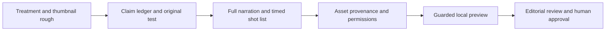

# 22 — Directing, retention, thumbnails and rights

> Editorial plan · 2026-10-17 · [Library index](README.md). These are original script treatments: exact opening/closing lines, selected narration, timed story outlines and shot briefs. They are not complete timed voice-over manuscripts or cleared production assets. Evidence and permissions must be checked before production.

## 1. The creative approach

The useful lesson from MrBeast is to make the promise understandable and deliver an experience worth the click. TIME's interview/profile describes his focus on enticing thumbnails, establishing expectations in the opening ten seconds and retention. We adapt those broad principles to original educational stories; we do not reproduce his scripts, footage, challenge designs, branding or likeness. [TIME interview, February 2024](https://time.com/collections/time100-leadership-series/6693255/mrbeast-interview/).

The rules below are this project's editorial choices, not a verified formula from MrBeast or a guarantee of virality.

| Device | How to direct it | Honest execution |
|---|---|---|
| Immediate promise | Show the central object or result in the first shot; explain the question without an intro montage | The opening and thumbnail must describe the actual episode |
| Visible stakes | A budget comparison, a failed paper design or a workflow that loses formatting | Use illustrative scenarios or measured experiments, labelled correctly; never invent a real person's loss |
| Attention magnet | A specific unresolved question with a scheduled answer | Give useful partial answers throughout; no empty "watch until the end" |
| Escalation | Add a constraint that changes the explanation | New evidence changes the viewer's model; louder music alone is not escalation |
| Re-engagement | A new angle, counterexample or visual demonstration when the question changes | Timing follows comprehension; no mandatory frantic cut interval |
| Payoff | Return to the opening object and explain it | Resolve every material promise in the same video |
| Emotional relevance | Curiosity, relief, discovery or appreciation of an everyday mechanism | Avoid shame, fearbait, false urgency and fake expert authority |

Vary the underlying story: reverse-engineer a mystery; compare alternatives with equal assumptions; follow one object through a system; predict then demonstrate; or climb a constraint ladder. Recurring formatting helps production, but repeated substance does not become original because its nouns change.

Originality here means independently drafted expression, demonstrations and compositions; it does not claim nobody has covered the same scientific or business topic. Before filming, search the proposed title and premise, note the closest existing explanations and document what your demonstration adds. Do not borrow their narration, visual sequence or thumbnail arrangement.

## 2. From treatment to a shootable script

1. Select a treatment whose core demonstration is feasible with owned artwork, original recordings and the installed tools. Any proposed experiment must be completed and documented before narrating its result as observed.
2. Build a claim ledger: claim, primary source URL and exact supporting section/table, access date, assumptions, uncertainty and intended wording. Source registers in the channel files are research starting points; a broad agency homepage is not claim verification.
3. Write the full narration to the selected runtime. Keep separate columns for time, spoken words, shot/asset, overlay, sound and evidence reference. The five beats are structural blocks, not five excessively long static shots. Rehearse and time the read; expand or shorten the episode instead of padding it.
4. Create a thumbnail rough and the first ten seconds together. Check whether the opening immediately honours the image/title promise. Reject a treatment if the only appealing packaging would misrepresent it.
5. Record original demos or commission required graphics. Scripted cross-sections, moving maps, screen highlights and rigged characters are authoring tasks; the current still-image renderer does not automatically implement every planned shot.
6. Source-check narration, visual dimensions, captions and thumbnail separately. A diagram labelled illustrative must not be presented as footage of an actual building, event, person or measurement.
7. Make one guarded local preview. Keep model downloads disabled, one heavy model at a time, green-pressure monitoring and at least 10 GB free. Review before scaling. Nothing in this library authorises approval or publication.

## 3. Thumbnail direction

Each episode proposes A/B concepts, not generated image files or proven winners. Use one main subject and a legible contrast: inside/outside, expected/observed, hidden/visible or one controlled variable. Optional text is **0–3 words**, applied later as an overlay. All AI image prompts must include **no text**; no generated labels, logos or watermarks.

Create original compositions. Do not trace another creator's thumbnail, borrow a celebrity face, invent an experiment score, manufacture an alarming warning screen or depict an unreal engineering failure as evidence. For illustrative comparisons, show conceptual differences honestly. Do not imply a product endorsement.

For eligible public adult long-form videos, YouTube Studio can test up to three title/thumbnail options and evaluates watch time. Shorts, private videos and made-for-kids content are ineligible for this feature. Kids A/B concepts here are **adult-caregiver review alternatives**, not a claim that the platform can test them. No clear winner is a valid result. [Official A/B-testing guidance](https://support.google.com/youtube/answer/16391400?hl=en).

Compare thumbnail understanding at small display size: can an adult describe its truthful question without reading a paragraph? For the preschool concept, favour calm recognisable objects over exaggerated emotional faces, alarm symbols or sensory overload.

A draft thumbnail image prompt can use: `Original explanatory illustration of [episode-specific subject], [A or B composition], one focal subject, [brand palette], clear silhouette at small size, uncluttered background, no text, no logo, no watermark, no celebrity or recognisable copyrighted character.` Add only the chosen short overlay during editing. Describe the object and framing concretely; do not request another creator’s style or reuse their reference thumbnail. Produce a 16:9 thumbnail rough separately from a vertical first-frame/cover concept, and check each platform’s current requirements before export.

## 4. Copyright risk reduction

No workflow can promise zero claims or strikes. Use original scripts, owned/commissioned visuals, permitted recordings and documented licences. Changing a clip's crop, speed, narration or colour is not permission. Crediting someone or writing a disclaimer does not itself create fair use; there is no safe number of copied seconds. [YouTube fair-use guidance](https://support.google.com/youtube/answer/9783148?hl=en).

| Asset | Required evidence before use |
|---|---|
| Original artwork, diagrams and footage | Source/project files, author and creation record; contributor agreement where applicable |
| Screen recording | Own demo account/test data; review software terms and embedded third-party material; no real personal data |
| Pixabay stock | Exact asset URL, contributor, saved licence/date, relevant permissions, attribution record; stock licences do not automatically clear visible brands, people or property for every use; check the [Pixabay licence](https://pixabay.com/service/license-summary/) |
| Music/SFX | Rights for the composition and recording as applicable, licence scope, attribution and claim-handling evidence; default to no music if unresolved |
| Public-agency data/media | Verify the specific work, credit and restrictions; third-party material and logos may have different rights |
| AI-generated art/voice | Model/tool licence, inputs, prompt and edits; review outputs for recognisable characters, trademarks or real-person imitation |

Build a per-episode asset manifest containing asset ID, file/hash, origin URL or author, licence/version/date, permission evidence, attribution, territory/platform restrictions and reviewer. A research page is permission to learn facts, not permission to copy its charts or images. Rebuild diagrams from verified facts in an original composition.

A Content ID claim and a copyright strike are different; a claim typically does not itself produce a strike. Do not dispute automatically or assert rights without evidence. If a human later uploads through an authorised workflow, platform checks are an additional screen, not a clearance guarantee. This task performs no upload. [YouTube copyright strikes](https://support.google.com/youtube/answer/2814000?hl=en).

AI commercial-use permission does not establish exclusive copyright in every output. Keep records of substantive human writing, selection, arrangement and editing. [US Copyright Office AI report](https://www.copyright.gov/ai/).

## 5. Evergreen does not mean never recheck

Keep the question durable while refreshing its evidence. Mechanisms and fictional scenarios usually age better than current prices, rankings or tool releases. Recheck cost assumptions, software versions, security guidance, Google documentation and empirical claims before every shoot; record the reference date on numerical overlays. Correct the central explanation if the evidence changes.

For preschool work, verify the demonstrated outcome, developmental fit and safe materials with an educator and adult caregivers. The kids pilot remains local and unpublished under the current gate; never use false audience metadata to pass it. See [21](../4-production/21-kids-pilot-production.md).

## 6. Editorial selection and measurement

Score each candidate 0–2 for durable relevance, understandable promise, distinctive visual proof, evidence readiness, asset-rights readiness and Mac production feasibility. This is an internal triage scale, not a predicted algorithm score. Prioritise verified evidence and feasible original assets before spectacle.

Start with a few episodes per brand, not 220 simultaneous renders. Record production hours and compare retention, satisfied viewing, returning viewers and views per production hour within the same format. Do not infer revenue from clicks alone. Use [portfolio lengths](../2-channels/12-final-portfolio.md#21-video-length-and-virality-potential) as starting experiments and revise from actual viewing behaviour.
