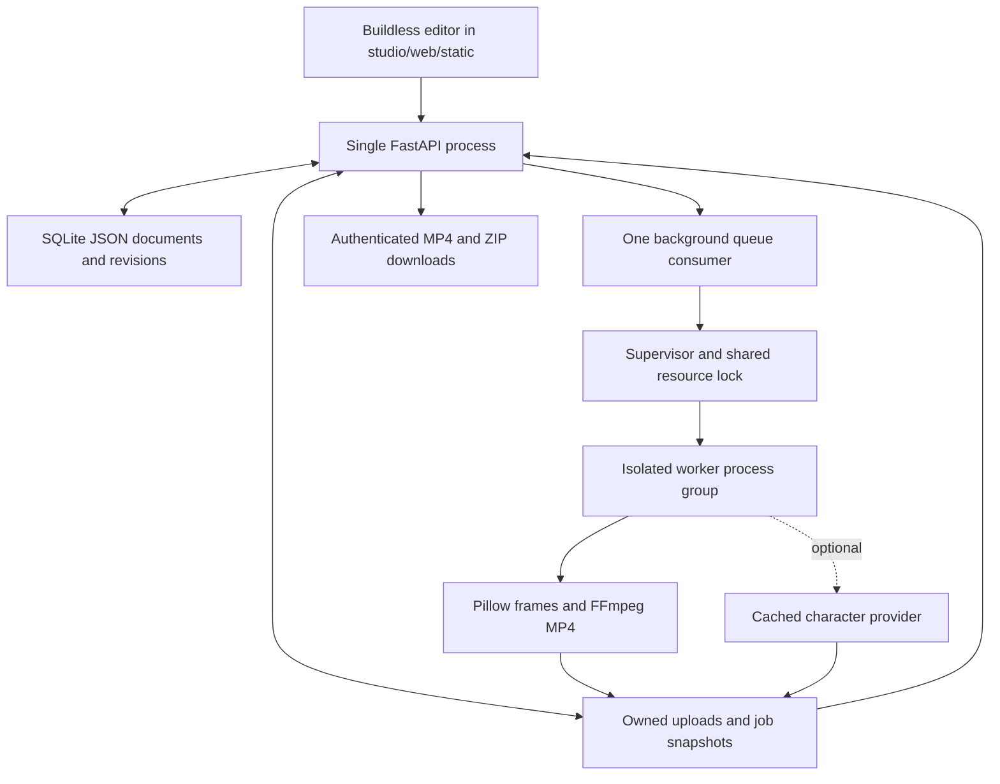

# 29 · Original nursery web studio plan

## Outcome and boundaries

Give an adult creator a local workspace for original Plinkety Pond stories that can later run on a personal EC2 host. The functional MVP produces editable, repeatable 2D scenes and real MP4 files. Full 3D film quality, expressive character acting and convincing original singing require separate creative and technical work; a `final` resolution setting promises dimensions, not that quality bar.

Use original characters, scripts, melodies, recordings and artwork with documented rights. Do not copy CoComelon/Moonbug/Pinkfong characters, songs, logos, voices or likenesses. Generated character prompts prohibit text; captions are renderer overlays. Bedrock stays text-only and is absent from the image path.

## Architecture

The API records a project snapshot and trusted asset paths before launching a worker. Worker progress/results use atomic JSON files; the API stores job state in SQLite. Run one application process: multiple API workers would each create their own queue and recovery logic. Do not scale replicas over the same data directory.

The supervisor serializes real work with the shared guarded-run lock, limits CPU pools to three threads and samples resources every second. macOS uses system pressure; Linux uses available memory and cgroup v2 budgets. A cgroup v1 memory controller is rejected as unknown rather than silently ignored. Per-job `worker.resources.jsonl` records pressure and disk samples, including refused starts. Unknown/unsafe telemetry or less than 10 GB free stops/refuses work. Cancellation owns the whole worker process group, including FFmpeg. Sampling cannot guarantee every spike is prevented; never bypass a stop.

## Delivery phases and evidence

The web suite passes 109 offline tests, including real small FFmpeg fixture renders. Browser create/edit/save and character screens passed. A live app render was refused at yellow macOS pressure; no live export or AI inference success is claimed.

| Phase | Present in source | Acceptance still required |
| --- | --- | --- |
| 1 · Saved editor | FastAPI CRUD, SQLite persistence, stale-save 409, deterministic three-scene starter, buildless HTML/CSS/JS editor | Four-character starter and browser create/edit/save verified; complete upload/review browser acceptance remains |
| 2 · Real local video | Procedural illustrations, motion, overlay captions, FFmpeg encode, guide instrumental, WAV/MP3 input, progress/cancel | Guarded sample MP4 playback, uploaded-audio sync/listen check, cancellation cleanup and pressure evidence on target host |
| 3 · Review/export | Five review fields, revision-bound readiness, MP4/poster/ZIP routes | Inspect downloaded media and ZIP contents; verify stale render and guide-audio draft labels in browser |
| 4 · CPU hosting | Dockerfile, Compose, Caddy example, hash-pinned small dependency lock without ML runtimes | Build/run on personal Linux/EC2, persistence restore, authentication, resource-stop checks; narrowly trusted HTTPS proxy handling is unit-tested; real TLS deployment remains unverified |
| 5 · Optional generation | Offline mflux character adapter; lazy Linux Diffusers/CUDA adapter; API provider selection | Installed-library/CLI validation, explicit model provisioning authorization, target GPU memory/quality measurements and integration validation |

Projects permit 1–24 scenes of 1–15 seconds, at most 120 seconds total and 1–8 characters. Render sizes are 640×360 draft or 1920×1080 final, reversed for portrait. These bounds control workload; they do not establish acceptable render time or memory use.

The current API schema accepts `illustration`, `mflux` and `diffusers` character jobs (see doc 30). mflux requires macOS, its executable and already cached pre-quantized klein q4 weights; availability checks do not prove inference. `.venv-web` intentionally excludes ML packages. The Linux Diffusers adapter is present in `providers.py`; actual CUDA inference and integration remain unvalidated. The CPU container does not include torch, Diffusers, mflux or weights.

No model installation or download was performed for this work. Missing models must report unavailable; rendering must never fetch them. Any later installation needs a new explicit request, the approved model dry-run/download workflow and the disk floor. Do not assume historical local installs remain available.

## Completion checks and deferred work

The orchestrator should run the offline web suite (`make test-web`) after integration, then check the browser flow and one bounded guarded render. Record actual duration, encoder, pressure samples, free disk, audio mode and visible defects. Test restart recovery and backup restoration. The web dependencies are isolated in `.venv-web`. Docker daemon was unavailable, so container build/run and EC2 deployment were not tested. A wheel build verified the frontend assets are packaged.

Keep these distinct from MVP acceptance: original sung performances, lyric/phoneme alignment, rigged 3D production, long episode pacing, cross-shot model consistency, GPU optimization, multi-user access and remote/distributed workers. No revenue, virality or feature-film quality claim follows from a successful render.

The app never creates a human approval or posts content. Review checks are creator notes. Export metadata keeps made-for-kids and AI disclosure true; private YouTube upload requires the existing separate human-reviewed path and final manual publishing. See [API contract](30-api-contract.md) and [deployment runbook](31-ec2-runbook.md).
