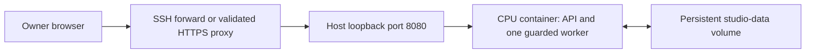

# 31 · Personal EC2 deployment runbook

These are deployment instructions for the supplied CPU image. EC2 has not been deployed or benchmarked for this app. No AWS calls, account/profile inspection, installs or model downloads were performed by the docs role.

## Account and host preparation

Use a personal AWS account separate from the employer. Never use this machine's `bamboo.*`, `default` profiles or `~/.aws`, and never copy the repository `.env`, credentials or model caches into the image. This CPU app needs no Bedrock, S3 or other AWS API credentials. If later integrations require AWS access, provision a dedicated least-privilege instance role in the personal account; do not embed access keys.

Provision a Linux host with Docker Engine/Compose and persistent encrypted storage. Size it from measured CPU renders, leaving room for the host, the container and growing media; no instance type, throughput or cost has been validated. Use cgroup v2 when container memory limits apply; cgroup v1 memory telemetry fails closed. Keep at least 10 GB free on both repository and data filesystems. Restrict SSH ingress to the owner's address and leave port 8080 closed in the security group.

Transfer a reviewed source checkout without secrets or generated media. The build installs Python dependencies and OS packages over the network; runtime model downloads remain disabled. Review `infra/web/requirements.lock`, `Dockerfile`, `compose.yaml` and the build exclusions before building.

## CPU container with private access

On the host, from the repository root, set a long random token through a non-echoing prompt (at least 24 characters):

```sh
read -r -s -p 'Studio access token: ' STUDIO_WEB_TOKEN
export STUDIO_WEB_TOKEN
export STUDIO_WEB_ALLOWED_HOSTS=localhost,127.0.0.1
docker compose -f infra/web/compose.yaml up -d --build
```

Use these commands in Bash. The token is entered interactively and must not be placed in command history, URLs, screenshots or logs. Do not print resolved Compose configuration containing it. Docker administrators can inspect container environment; this is a single-owner host.

Compose maps `127.0.0.1:8080:8080`, persists `/data/web-studio` in `studio-data`, runs as UID 10001 and applies 3 CPU / 6 GiB / 256 PID limits. These are configuration values, not measured safe capacity. FFmpeg and Pillow work without an ML stack; the native CPU route is also available on Linux with Python, FFmpeg, a suitable isolated web environment and `python -m studio.web --host 127.0.0.1 --port 8080`.

From the owner's laptop:

```sh
ssh -N -L 8080:127.0.0.1:8080 PERSONAL_USER@PERSONAL_EC2_HOST
```

Open <http://127.0.0.1:8080> and unlock using the token. SSH encrypts the remote connection. Non-loopback app binding requires a token of at least 24 characters even when Docker publishes only to loopback. Host validation uses exact names through `STUDIO_WEB_ALLOWED_HOSTS`; wildcards and URLs are invalid.



## Optional HTTPS: trusted proxy configuration

`infra/web/Caddyfile.example` sketches a host-installed reverse proxy forwarding to loopback. Replace its example domain, configure DNS/certificates and add that exact domain to `STUDIO_WEB_ALLOWED_HOSTS`. Keep 8080 private and restrict HTTPS to the intended owner/private network. A Caddy container would need different upstream networking; the example assumes Caddy runs on the host.

Forwarded headers are disabled by default. Set `STUDIO_WEB_TRUSTED_PROXY_IPS` only to the exact source IP of your reverse proxy (for native host Caddy this is typically `127.0.0.1`; Docker may see its bridge gateway instead). Do not use wildcards, subnets or all proxies. The app validates a list of at most eight literal IP addresses. Unit tests verify trusted HTTPS origin/session handling, Secure cookies and rejection of foreign origins/untrusted forwarding. Do not expose the upstream port to other callers that can impersonate the trusted proxy.

A real HTTPS deployment has not been tested. Confirm the source address on your host and verify session creation, save/upload/cancel, playback/downloads and foreign-Origin rejection over TLS. Keep SSH forwarding as the default until this acceptance check passes.

## Operate, back up and recover

- Check `/api/health`, unlock, then inspect `/api/system` for disk/pressure/provider availability. A health response alone does not prove rendering is safe.
- Start with a short draft and owned audio. Verify playback, cancellation and ZIP metadata before larger work. Never raise limits or bypass the guard to force completion after a resource stop.
- Persist and back up the entire data root: `studio.sqlite3` plus its SQLite sidecars, `assets/` and `jobs/`. Stop the app cleanly for a consistent filesystem backup, retain the named volume and restore it on a test host before relying on it. Do not use `down -v` during routine maintenance.
- Use `docker compose -f infra/web/compose.yaml stop` for maintenance and `up -d` to restart. Restart marks interrupted queued/running jobs failed; submit a new job. In-memory sessions expire on restart; unlock again.
- Keep a reviewed prior image and a matching data backup before upgrades. Roll back the image and compatible data together if a future schema change requires it. No schema migration or rolling-upgrade guarantee is provided.

## Optional GPU path

The supplied image is CPU-only. A Linux CUDA image, driver/runtime setup, optional torch/Diffusers installation, licensed local model directory (`STUDIO_WEB_DIFFUSERS_MODEL`) and end-to-end provider validation require separate work. No CUDA inference or hardware benchmark was performed on the Mac. Model/library existence is not proof of GPU availability, VRAM fit, character consistency or green resource pressure.

mflux is a macOS optional cached-model path, not an EC2 Linux dependency. Neither path authorizes downloading weights now. Bedrock image/video generation is excluded. Real singing and full 3D animation remain separate production capabilities, not benefits automatically supplied by a GPU host.

The web app exports review packages only. Human approval remains outside the app; kids content uses YouTube private upload with accurate made-for-kids and AI disclosure, followed by a human's final manual publish action. See [plan](29-web-studio-plan.md) and [contract](30-api-contract.md).
