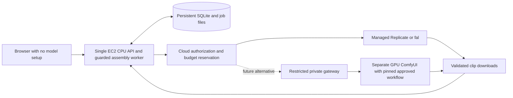

# 34 · Generation providers and deployment research

**Checked 2026-10-25 against official public documentation.** This is desk research,
not authenticated service verification, a price guarantee or permission to spend.
No model install, paid API invocation, cloud deployment or real media generation was
performed. [Doc 33](33-universal-video-workflow.md) describes the workflow;
[doc 32](32-creator-contract.md) and the canonical schema remain authoritative.

## 1. Recommended division of responsibility

Use an optional free-only OpenCode CLI for text planning and managed open-weight Wan
inference for cloud video, behind an operator-controlled billing gate. Keep the
ordinary user in the browser: idea, style, characters, plan, generation and download.
Provider credentials and approved model mappings belong to deployment configuration.
This is an architecture recommendation, not proof the adapter works or an instruction
to activate it. Cloud stays off; no budget has been chosen.

| Option | User installation burden | Operator work | Evidence boundary |
| --- | --- | --- | --- |
| OpenCode planner | None when hosted with the app | Install/pin CLI separately, isolate configuration, validate free-only behavior | CLI found on this Mac's PATH; no version or planning call tested |
| Replicate Wan | None; inference is managed | Private credentials, billing gate, strict adapter, cost and recovery tracking | Official model/API documentation read; no authenticated prediction |
| fal Wan | None; inference is managed | Same controls plus a distinct queue/schema adapter | Official schema and queue docs read; no request submitted |
| Private ComfyUI on EC2 GPU | None only if an operator has prepared the server | GPU, drivers, dependencies, approved weights and pinned workflows | Architecture alternative only; not deployed or benchmarked |

“No install for the user” means a prepared hosted service. It does not mean no operator
setup, no network, no account, no data transfer or no inference charges. A CPU EC2 web
host can orchestrate a managed provider; it does not acquire local video inference
just because the app runs there. Existing CPU packaging remains untested on EC2;
see [doc 31](31-ec2-runbook.md).

## 2. OpenCode CLI: free planning has limits

The official CLI documents `opencode run`, model selection and `--format json`.
That format is an event stream; the adapter must extract text and validate it against
`VideoPlan`, rather than assume the entire stdout is plan JSON. Model listing is an
operator concern; the creator form must not expose model wiring.
[OpenCode CLI](https://opencode.ai/docs/cli/) (checked 2026-10-25).

The former Zen docs now redirect to Console model documentation. The observed pricing
table labels Big Pickle and several other entries free, with limited-time availability;
free-tier chat models require OpenCode. No durable free quota or this account's access
was verified. Privacy differs across offerings: some free services retain data or use
it for improvement. The docs also mention auxiliary models for session titles; choosing
a free main model alone is insufficient evidence that every request is free. Pin an
operator-reviewed free-only allowlist, disable paid auxiliaries, and fail visibly to
the labelled template if that cannot be established. Never silently choose a paid model.
[Official models, free offerings and privacy](https://opencode.ai/v2/docs/console/models/)
(checked 2026-10-25).

The CLI is a coding agent with filesystem/tool capabilities, not an inherently isolated
text endpoint. Use a dedicated empty working directory and clean configuration, no
workspace rules, plugins, MCP servers, shell commands, file attachments or inherited
credentials. Deny all tools and validate actual effective behavior. A JSON-only prompt
is not a security boundary. The official permission system supports deny policies;
the app must prove isolation with offline adversarial fixtures before enabling it.
[OpenCode permissions](https://opencode.ai/docs/permissions/) (checked 2026-10-25).

This review only used `command -v opencode`, which found an executable on PATH.
It did not invoke the CLI, inspect authentication or read its configuration. Presence
does not establish version compatibility, free model access, no auxiliary billing,
correct JSON, tool isolation or plan quality. Bound runtime/output, sanitize failures,
and report `planner="template"` whenever fallback is used. Treat brief text and model
output as untrusted data; no external content can grant tool permissions.

The subsequently inspected `creator_planner.py` pins CLI version `1.19.4`, builds an
isolated environment with denied tools, parses a zero-price catalog, selects the same
free model for main and auxiliary use, bounds subprocess output/time and validates
event text before returning a plan. Those are implementation observations; its header's
CLI-verification report was not independently reproduced by this docs role. The new
`VideoPlan.characters` field defaults to an empty list. Automatic proposed cast with
brief-cast precedence is the requested workflow; template auto-casting and use of
proposed identities in shot prompts still required verification at the inspected
snapshot. No reference-image conditioning was observed.

## 3. Replicate Wan: managed inference candidate

The documented model is `wan-video/wan-2.2-t2v-fast`, an optimized Wan 2.2 A14B
text-to-video service. Its official listing exposes prompt, frames, aspect ratio,
resolution and seed controls, with 81 frames and 16 fps among the defaults. The model
page lists **$0.05 per output video at 480p** and **$0.10 at 720p**. These are observed
public prices, not a billed quote. Server-side selection should keep safety checking
enabled and exclude user-supplied LoRA URLs. Endpoint inputs do not belong in the brief.
[Model and pricing](https://replicate.com/wan-video/wan-2.2-t2v-fast)
(checked 2026-10-25).

Replicate's July 31, 2025 announcement also quotes those resolution prices and roughly
30-second inference for its optimized service. That historical latency is vendor
reporting, not this app's queue-inclusive benchmark or an SLA.
[Replicate launch announcement](https://replicate.com/blog/wan-22/)
(published 2025-07-31; checked 2026-10-25).

The documented asynchronous prediction API returns an ID for later status/output
retrieval. Persist the ID before polling and derive allowed API destinations from a
fixed adapter, not arbitrary URLs from the response. Bound polling and treat creation
timeouts as uncertain submissions, never automatic retries. A known-ID cancellation
attempt cannot promise that remote work or billing stopped.
[Prediction lifecycle and submission](https://replicate.com/docs/topics/predictions/create-a-prediction)
(checked 2026-10-25).

Output URLs are temporary delivery mechanisms, not the application's storage layer.
Replicate documents automatic removal of API prediction inputs/outputs after about an
hour by default. Download approved output promptly, validate/decode it, and retain
owned artifacts and hashes; don't store raw provider logs or signed URLs in public
errors. Data-retention configuration and actual account behavior still need review.
[Replicate data retention](https://replicate.com/docs/topics/predictions/data-retention)
(checked 2026-10-25).

The model schema page returned a partial dynamic page in direct browsing; search-indexed
content from the official listing exposed more inputs. Treat those observations as
documentation research, not live schema validation. Before billing is enabled, verify
the exact adapter payload, output shape, frame/duration accounting and rate limits
against the current official service in a separately authorized integration check.

## 4. fal Wan: managed alternative

`fal-ai/wan/v2.2-a14b/text-to-video` is a distinct endpoint. Its current public listing
quotes **$0.04 per video second at 480p**, **$0.06 at 580p** and **$0.08 at 720p**,
with billable video seconds calculated at 16 fps. A site link to try similar models
free in Sandbox does not establish free production API use. No recurring free video
allowance was verified.
[fal model and pricing](https://fal.ai/models/fal-ai/wan/v2.2-a14b/text-to-video)
(checked 2026-10-25).

The documented input includes prompt, frames, output fps, resolution, aspect ratio,
seed and safety controls; output includes a video file object. Its input and output
safety switches are separate, so the adapter must deliberately enable both. Interpolation
can alter output fps, and the displayed fps must not be used to reduce billable-frame
estimates. Do not reuse a Replicate payload unchanged.
[fal model schema](https://fal.ai/models/fal-ai/wan/v2.2-a14b/text-to-video/api)
(checked 2026-10-25).

The async queue uses request IDs with status/result retrieval and cancellation.
Persist the request ID and normalize safe status information into the app's existing
job contract. Keep keys on the backend and use bounded polling; public webhooks would
require additional authentication and replay handling outside the current routes.
[fal async queue](https://fal.ai/docs/documentation/model-apis/inference/queue)
(checked 2026-10-25).

This is an alternative for an operator to validate, not an automatic second provider
after an uncertain Replicate timeout. Automatic fallback could buy duplicate clips.

## 5. Cost planning without a spending decision

The following is arithmetic on observed prices, not a purchased quote. Assume three
roughly five-second clips for a 15-second video, one accepted attempt each:

| Candidate | Illustrative video inference subtotal |
| --- | --- |
| Replicate fast 480p | 3 × $0.05 = $0.15 |
| Replicate fast 720p | 3 × $0.10 = $0.30 |
| fal 480p | 15 × $0.04 = $0.60 |
| fal 720p | 15 × $0.08 = $1.20 |

Sources are the pricing links in §§3–4. Real accounting can differ: 81 frames at
16 fps is 5.0625 seconds, and provider duration rules, supported settings or prices
may change. Budget from the provider's billable units, round conservatively, include
all intended attempts and reserve headroom. Two complete attempts approximately double
these illustrative inference totals. These comparisons do not establish equal quality.
Hosting, storage, transfer, audio and enhancement are additional costs. Failed jobs,
cancel races and unobserved results must be reconciled rather than assumed free.

Do not infer a budget choice from these examples. The current schema's zero cap is
the default, cloud must remain disabled without operator authorization, and a request
cannot enable billing. Enforce job and deployment caps before submission. Provider
IDs, reservations, observed charges and uncertainty should ultimately persist in
SQLite as proposed in doc 33; directory event logs alone are not a complete spend ledger.

## 6. ComfyUI server on EC2: greater operator burden

Official ComfyUI documentation supplies Wan 2.2 text/image-to-video workflows with
model-file preparation. That is useful for a reproducible private GPU service, but
does not provide a preconfigured server with no setup. The operator would pin a
reviewed workflow, dependencies and approved model files outside runtime, then expose
only application-controlled prompt substitutions to users.
[Official Wan 2.2 workflow](https://docs.comfy.org/tutorials/video/wan/wan2_2)
(checked 2026-10-25).

The self-hosted API accepts workflows at `POST /prompt`, returns `prompt_id`, and
provides queue/history and WebSocket progress. It also exposes broad management
operations, including interruption. Put an authenticated restricted gateway in front;
never expose raw workflow execution or a shared global interrupt to ordinary users.
Map cancellation only to the app's owned execution.
[ComfyUI server routes](https://docs.comfy.org/development/comfyui-server/comms_routes)
(checked 2026-10-25).

Upstream Wan examples report at least 80 GB VRAM for the documented A14B single-GPU
invocation, versus 24 GB for its 5B hybrid example with offloading. These are distinct
configurations, not measured capacity requirements for a chosen ComfyUI build; a
24 GB Mac's unified memory is not equivalent to 24 GB dedicated CUDA VRAM. Wan2.2's
repository provides the upstream license to review alongside each dependency/adapter.
[Wan2.2 upstream code, examples and license](https://github.com/Wan-Video/Wan2.2)
(checked 2026-10-25).

Use a separate GPU host if this alternative is approved; the supplied CPU image does
not supply CUDA or Wan weights. Provision through a personal account, never this
machine's employer profiles. GPU capacity, drivers, VRAM, persistent encrypted storage,
idle shutdown, backups and a measured cost per accepted clip all remain operator work.
EC2 pricing depends on region/instance/runtime and transfer; no current instance quote
or GPU availability was obtained.
[AWS EC2 on-demand pricing](https://aws.amazon.com/ec2/pricing/on-demand/)
(checked 2026-10-25).

This option requires separately authorized provisioning and weight acquisition. No
deployment, downloads or installs are authorized now. Retain the shared supervisor,
non-green pressure stop, disk floor and disabled runtime downloads on the app host;
a remote GPU needs its own proven resource controls, not a bypass of the Mac's stop.

## 7. Quality, rights and validation before production

Open weights do not guarantee free hosting, safe output, cleared third-party assets,
commercial rights for every component, or consistent characters. Presets must describe
original aesthetics rather than copyrighted franchises. Text-to-video shots can drift
in face, clothing, proportions and geography; repeating descriptions or seeds is only
a mitigation. Reference-conditioned video is a future option requiring original or
licensed references and an explicit asset contract. Do not imply a text-only endpoint
already accepts a character reference pack.

Keep current audio promises modest: the schema now admits narration, but macOS `say`
and Linux `espeak-ng` were announced and not present in the inspected creator media
code at review time. Audible system speech, timing and availability still need tests;
there is no singing implementation claimed here. Generative music, singing, lip sync,
character-reference ingestion and neural upscaling remain separate production work.
An animatic or system voice is useful draft tooling, not guaranteed finished quality.

Before claiming readiness, the parent must verify contract integration, offline mocked
planner/provider fixtures, same-origin access, cancellation/resource stops, revision
binding, stale saves, protected downloads, restart behavior and spend reconciliation.
A later explicitly authorized live test must record selected service/version, input
settings, provider IDs, billable cost, actual source/output dimensions, audible track,
artifact hashes and human visual review. Public docs, CLI presence and passing mocks
cannot substitute for that evidence. Never claim end-to-end verification from this report.

Publishing remains outside the creator app. Human review must cover originality,
rights, safety, factual claims, accurate audience classification and AI disclosure.
Kids projects remain YouTube-only with the separate reviewed private-upload path;
agents cannot approve or publish. No guaranteed quality, revenue or reach is offered.
