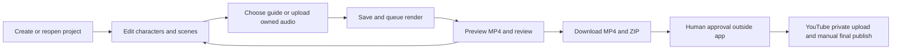

# Video Studio and Pond Studio

A local-first creator app for an original nursery channel: save stories, edit scenes and characters, upload owned audio, render an MP4, and download a review package. Plinkety Pond must have its own characters, music and visual identity; CoComelon is a genre reference, never an IP source.

## General short-video creator

Open **http://127.0.0.1:8080/create** for the broader prompt-to-video app. It takes an idea, style, duration, audience, platforms and optional character descriptions. It tracks projects, shot plans, jobs and spending reservations in the same SQLite database while preserving the nursery editor’s contracts. See [33 · User workflow](33-universal-video-workflow.md), [32 · Creator API](32-creator-contract.md) and [34 · Research](34-generation-research.md).

Managed AI motion requires a configured provider and enabled server budget. A local animatic is labelled as a timing preview, never a completed anime/live-action generation. No cloud generation has been billed or verified here.

## Start locally

**Ubuntu:** follow [35 · Installation and developer CLIs](35-ubuntu-setup.md), or run `bash scripts/setup/50-ubuntu.sh --with-dev --run`. This uses the lightweight web profile rather than the Apple Silicon model dependencies.

From the repository root, with the existing project Python environment and FFmpeg available:

```sh
make deps-web
make web
```

Open <http://127.0.0.1:8080>. `deps-web` creates an isolated `.venv-web`; it does not replace the existing model environment. The buildless HTML/CSS/JavaScript frontend lives in `studio/web/static`. No Node build is required. The isolated web dependencies are installed in this checkout; no model weights were downloaded.

## Current scope

Source inspection on 2026-10-25 found project CRUD, revision checks, uploads, queued render/character jobs, cancellation, review fields, MP4 downloads and ZIP packages in the backend. Pillow and FFmpeg produce real bounded 2D animation with a procedural instrumental guide or uploaded WAV/MP3. Guide audio contains no singing; narration fields do not create speech.

The frontend includes project, character, storyboard, upload, job and export flows in `app.js`. Browser checks verified opening the editor, creating a project, editing and saving scenes, and the character screen. The starter contains four original otters. Offline tests cover uploads, revision checks, rendering, ranges, export packages, cancellation and resource stops. Live end-to-end export remains unverified: the Mac reported yellow pressure and the supervisor correctly refused the render. See [29 · Plan](29-web-studio-plan.md) for the remaining acceptance checks.



Review readiness requires all five review checks, uploaded real audio and a render matching the saved revision. Saving edits makes older renders ineligible. A draft ZIP can still be downloaded; a ZIP or review checkbox is never publishing approval.

Projects, job records and assets default to `output/web-studio` (`STUDIO_WEB_DATA_DIR` overrides it). Back up the whole data directory, including SQLite and media. Interrupted queued/running jobs become failed after restart; create a new job rather than expecting automatic replay.

- [29 · Product and delivery plan](29-web-studio-plan.md)
- [30 · API and worker contract](30-api-contract.md)
- [31 · EC2 runbook](31-ec2-runbook.md)

No web approval or posting endpoints exist. Kids output stays accurately made for kids with AI disclosure; the reviewed publishing path is YouTube private only, with a human making the final publish decision in YouTube Studio. No EC2 deployment, model download, GPU benchmark or guaranteed green-pressure result is claimed here.
