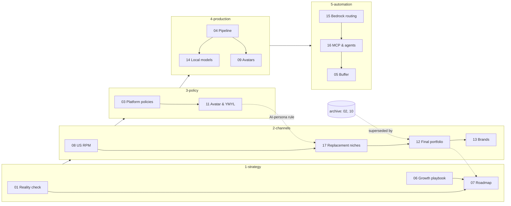

# Multi-Channel AI Content Automation: Plan

> **Status:** current · **Updated:** 2026-10-16 · Master index for the planning docs.

This plan covers 10 faceless channels across YouTube, Instagram and Facebook, produced by an AI pipeline and published through Buffer. The research was done on 2026-10-16. Prices and policies change, so check the "verify" items in each doc before you rely on them. Docs keep their number prefix (01–17) as a stable ID, so citations like "04 §5" still work after the move into folders.

## Start here

1. Read [12 — Final portfolio](2-channels/12-final-portfolio.md): the 10 channels, presenters, stack, disclosure and budget.
2. Then [13 — Channel brands](2-channels/13-channel-brands.md): names, handles and brand packs.
3. Then [07 — Execution roadmap](1-strategy/07-execution-roadmap.md): the dated plan and decisions still open.
4. Before producing anything, skim [03](3-policy/03-platform-policies-and-risks.md) and [11](3-policy/11-avatar-and-ymyl-policy.md) for the red lines.
5. Building the pipeline? Go to [4-production](4-production/README.md) and [5-automation](5-automation/README.md), then the code (see Implementation).
6. [archive/](archive/README.md) holds superseded docs. Don't plan from them.

## Key findings

- **Goal, reframed.** 1M followers in a week is about 0% for a new account (01 §1). **1M combined views in week 1** is the stretch goal (250k committed); real milestones are 10k followers in month 1 and the first monetisable channel by month 3.
- **The biggest risk is platform policy, not tooling.** YouTube's "inauthentic content" rule and Meta's unoriginal-content crackdown target templated faceless AI; one termination can spread to all of an owner's channels (03).
- **Automated, with a person in the loop.** Per-channel brand packs, fact-checks, a cross-channel similarity check, human review before publishing, AI disclosure on.
- **The money is in long-form.** Shorts/Reels build audience; revenue comes from long-form YouTube, affiliates, products and eventually channel sales (02 §3, 06 §10).
- **Buffer handles short-form only** (GraphQL API, beta May 2026). **Long-form goes through the YouTube Data API** (05).
- **No AI-persona sensitive topics.** YouTube demonetises a whole channel where an AI persona gives health, legal, finance or political advice, disclaimers notwithstanding (11), so the finance/legal channels were replaced (17). The two avatars only host tutorials.
- **Model split (updated 2026-10-16):**
  - **Text** runs on **Bedrock**, using an API key: Haiku 5.5 for drafts, Sonnet 5.5 for polish and fact-checks, Opus 5.5 for disputes. It costs about $23.50/month at full scale. **Claude Code headless** (`claude -p`) is the alternative.
  - **Audio runs locally on the M4 Pro**: Kokoro TTS and Parakeet captions, installed (about 2.7 GB). A 36 s Short takes about 10 s.
  - **Visuals**: Pexels stock first, then Bedrock Stable Image Core ($0.04/image). Local Z-Image will be added once disk allows.
  - **AI video and lip-sync** use cloud APIs. They aren't practical locally (14 §7).
- **Bedrock for judgement, not volume** (15): Sonnet 5.5 polish and fact-check, Opus 5.5 for disputes, about $25–30/month, behind one LiteLLM gateway.
- **Agents only where they help** (16): Trend Scout and Fact-Checker are Strands agents; rendering and publishing are plain code queued by Prefect. **Nothing publishes without human approval.**
- **Cost** *(est.)*: about **$550–700/month** cash plus 55–65 h/month of review and screen recording (12 §5).

## The 10 channels (final brands, from [12](2-channels/12-final-portfolio.md) and [13](2-channels/13-channel-brands.md))

Each channel covers its own subject domain, aims at **US AdSense value**, and stays **outside YouTube's AI-persona sensitive topics**. The 5 finance and legal channels were removed on 2026-10-16 and replaced by the niches chosen in [17](2-channels/17-replacement-niches.md).

| # | Brand | Handle (YT/IG/FB) | Niche | Presenter | US long-form RPM *(est.)* | Batch |
|---|---|---|---|---|---|---|
| 1 | Square Foot Money | @squarefootmoney | Real estate market data, mortgages | Faceless charts | $5–13 | C |
| 2 | Software Shortcut | @softwareshortcut | AI and SaaS tutorials | AI avatar "Jules" | $5–14 | B |
| 3 | Business Model Files | @businessmodelfiles | How US companies make money | Faceless | $5–12 | A (pilot) |
| 4 | Car Cost Truth | @carcosttruth | Cost of owning a car | Faceless | $5–12 | C |
| 5 | Gravity What If | @gravitywhatif | Space and physics hypotheticals | Faceless | $6–15 | A (pilot) |
| 6 | Megabuild Blueprint | @megabuildblueprint | Engineering megaprojects | Faceless 3D cutaways | $6–14 | A (pilot) |
| 7 | Lock Screen Logic | @lockscreenlogic | Cybersecurity and privacy (defensive) | Faceless screen recordings | $5–12 | B |
| 8 | Furnace to Faucet | @furnacetofaucet | How home systems work + repair costs | Faceless 3D cutaways | $4–10 | C |
| 9 | Wing and Turbine | @wingandturbine | Aviation and how planes work | Faceless 3D diagrams | $5–11 | B |
| 10 | Rank Test Lab | @ranktestlab | Small-business marketing and SEO experiments | AI avatar "Theo" | $6–13 | C |

YouTube handles and .com domains looked free on 2026-10-16. **Instagram and Facebook are unverified.** Claim everything on the same day.

## How the docs relate

## 1-strategy: goals and plan ([folder](1-strategy/README.md))

- [01 — Reality check and goals](1-strategy/01-reality-check-and-goals.md): growth base rates, the probability-weighted outcome table, North Star metrics.
- [06 — Growth playbook](1-strategy/06-growth-playbook.md): hooks, retention, packaging, cross-posting, the experiment loop, KPIs, monetisation.
- [07 — Execution roadmap](1-strategy/07-execution-roadmap.md): phased Gantt from 19 Oct 2026, checklists, targets, budget, open decisions.

## 2-channels: what we publish ([folder](2-channels/README.md))

- [12 — Final portfolio](2-channels/12-final-portfolio.md): **the decision**: 10 channels × presenter × stack × disclosure × budget.
- [13 — Channel brands](2-channels/13-channel-brands.md): 10 brand packs (handles, taglines, palettes, starter titles, availability checks).
- [17 — Replacement niches](2-channels/17-replacement-niches.md): why the 5 YMYL channels went, the 18-niche scoring and the final picks.
- [08 — High-CPM US niches](2-channels/08-high-cpm-us-niches.md): US RPM by niche, attracting US viewers, posting times, seasonality.

## 3-policy: red lines ([folder](3-policy/README.md))

- [03 — Platform policies and risks](3-policy/03-platform-policies-and-risks.md): per-platform rules, risk register, pre-launch checklist, "safe to publish?" flowchart.
- [11 — Avatar and YMYL policy](3-policy/11-avatar-and-ymyl-policy.md): verified AI-persona rules, per-niche rules, disclaimer templates, US law.

## 4-production: making the videos ([folder](4-production/README.md))

- [04 — Content pipeline architecture](4-production/04-content-pipeline-architecture.md): repo comparison (fork MoneyPrinterTurbo), vendor pricing, reference architecture, cost per video.
- [14 — Local models on M4 Pro 24 GB](4-production/14-local-models-mac-m4.md): what runs locally, licences, install commands, nightly batch, throughput.
- [18 — Lightweight local image and video models](4-production/18-local-image-video-models.md): open-source image and video models of 6 GB or less, runtimes (mflux, stable-diffusion.cpp), disk traps. Supersedes 14 §6–7.
- [09 — AI avatar presenters](4-production/09-ai-avatar-presenters.md): HeyGen, Hedra and open-source avatar models, licence traps, persona spec, avatar QA.

## 5-automation: routing, agents, publishing ([folder](5-automation/README.md))

- [05 — Distribution via Buffer](5-automation/05-distribution-buffer.md): Buffer API and pricing, the 30-profile schedule, fallbacks (Publer, upload-post).
- [15 — Bedrock hybrid routing](5-automation/15-bedrock-hybrid-routing.md): local vs Bedrock per step, quotas, budget tiers, LiteLLM gateway, spend guard.
- [16 — MCP and agent orchestration](5-automation/16-mcp-agent-orchestration.md): MCP servers, agent vs plain-code roles, Strands/Prefect, `.mcp.json`, security.

## archive: superseded ([folder](archive/README.md))

- [02 — Niche selection](archive/02-niche-selection.md): the original 19-niche matrix and portfolio, replaced by 12 and 13.
- [10 — AI cartoon characters](archive/10-ai-cartoon-characters.md): character consistency and rigs; no cartoon channels in the final portfolio.

## Doc status

| Doc | Status | Last updated |
|---|---|---|
| 01 Reality check and goals | reference | 2026-10-16 |
| 02 Niche selection | archived | 2026-10-16 |
| 03 Platform policies and risks | current | 2026-10-16 |
| 04 Content pipeline architecture | current | 2026-10-16 |
| 05 Distribution via Buffer | current | 2026-10-16 |
| 06 Growth playbook | current | 2026-10-16 |
| 07 Execution roadmap | current | 2026-10-16 |
| 08 High-CPM US niches | reference | 2026-10-16 |
| 09 AI avatar presenters | current | 2026-10-16 |
| 10 AI cartoon characters | archived | 2026-10-16 |
| 11 Avatar and YMYL policy | current | 2026-10-16 |
| 12 Final portfolio | current | 2026-10-16 |
| 13 Channel brands | current | 2026-10-16 |
| 14 Local models on M4 Pro | current | 2026-10-16 |
| 15 Bedrock hybrid routing | current | 2026-10-16 |
| 16 MCP and agent orchestration | current | 2026-10-16 |
| 17 Replacement niches | reference | 2026-10-16 |

**current** = plan from it · **reference** = research a current doc rests on · **archived** = superseded, kept for history.

## Implementation

The plan is being built in this repo:

- [`SETUP.md`](../SETUP.md) at the repo root: install and run instructions (start there).
- [`studio/`](../studio/): the Python pipeline (stages, LLM routing, flows, publishing), following 04, 14, 15 and 16.
- [`brand_packs/`](../brand_packs/): one YAML per channel, built from the brand packs in 13.
- [`scripts/setup/`](../scripts/setup/): machine setup, including the local model manifest (14).

## Open questions to verify

1. Whether the YPP thresholds really change on 1 Feb 2027, and Meta's March 2026 originality update. These are backed only by press and blogs (03 §9). The AI-persona and Instagram profile-label claims are now verified (11 §1).
2. Whether Buffer's `isAiGenerated` actually sets each platform's AI label. Make a test post per platform in Phase 0 (12 §4).
3. How YouTube treats disclosed AI hosts and cartoon personas. Watch the Creator Insider video linked in 11 §1.
4. Buffer's per-channel price for more than 10 channels (05 §2).
5. Instagram and Facebook availability for the 10 handles, and trademark clearance (13 §6).
6. Your Bedrock account's actual quotas, and a first real Bedrock call (15 §8). No key is configured yet.
7. Whether posts scheduled through the API get less reach. No source confirms or rules this out, so test it in the pilot (06 §7).
