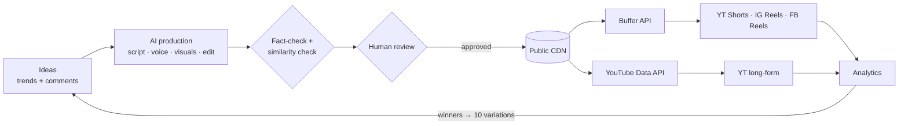

# Multi-Channel AI Content Automation: Plan

This plan covers 10 faceless channels across YouTube, Instagram and Facebook, produced by an AI pipeline and published through Buffer. The research was done on 2026-10-16. Prices and policies change, so check the "verify" items in each doc before you rely on them.

## The plan in brief

- **The goal, reframed.** 1M followers in a week isn't realistic: about 0% for a new account. Only people who were already famous have done it (01 §1). **1M combined views in week 1 is a realistic stretch goal** (250k is the commitment). The real milestones are 10k followers in month 1 and the first channel eligible for monetisation by month 3.
- **The biggest risk is platform policy, not tooling.** YouTube's "inauthentic content" rule (July 2025) and Meta's crackdown on unoriginal content target exactly this model: templated, mass-produced faceless AI. YouTube has terminated such channels in batches, and one termination can spread to all of an owner's channels (03).
- **So the pipeline is automated, with a person in the loop.** Each channel gets its own brand pack. Scripts are fact-checked, a similarity check runs across channels, a person reviews before anything is published, and AI disclosure is turned on.
- **The money is in long-form.** Shorts and Reels build the audience but pay pennies per 1,000 views. Revenue comes from long-form YouTube, affiliate links, products and, eventually, selling channels (02 §3, 06 §10).
- **Buffer handles short-form only.** Its new GraphQL API (beta, May 2026) can post Shorts, Reels and FB Reels from code. **Long-form YouTube must go through the YouTube Data API directly** (05).
- **The portfolio stays out of YouTube's AI-persona sensitive topics.** YouTube's verified rule (July 2026) removes monetisation from a whole channel where an AI persona gives health, legal, finance or political advice, and disclaimers don't change that (11). So the finance and legal channels were dropped (17). The two avatars only host tutorials.
- **The stack is local-first on a Mac M4 Pro with 24 GB** (14):
  - Qwen3.5-9B / Gemma 4 12B write scripts, through Ollama's MLX backend.
  - Kokoro does the voice, parakeet-mlx the captions, Z-Image / FLUX.2 klein the images and ACE-Step the music. All are licensed for commercial use.
  - Rendering happens overnight, stage by stage.
  - Video generation and lip-sync aren't practical on the Mac, so they go to cloud APIs.
- **Limited Bedrock is used for judgement, not volume** (15). Claude Sonnet 5.5 polishes scripts and fact-checks the finance and legal channels, and Opus 5.5 settles disputed claims, all for about $25–30 a month. One LiteLLM gateway sits in front of both local models and Bedrock.
- **Agents, MCP and tool calling** (16): only the Trend Scout and Fact-Checker are tool-using agents (Strands Agents). Rendering and publishing are plain code, queued by Prefect. Buffer's official MCP is read-only, and **nothing publishes without a human approval**.
- **Cost** *(est.)*: about **$550–700 a month** in cash with the local-first stack, plus about 55–65 h of review and screen-recording time for 3 tutorial channels (12 §5).

## The 10 channels (final brands, from [12](12-final-portfolio.md) and [13](13-channel-brands.md))

Each channel covers its own subject domain, aims at **US AdSense value**, and stays **outside YouTube's AI-persona sensitive topics** (health, legal, finance advice, politics). The 5 finance and legal channels were removed on 2026-10-16 and replaced by the niches chosen in [17](17-replacement-niches.md).

| # | Brand | Handle (YT/IG/FB) | Niche | Presenter | US long-form RPM *(est.)* | Batch |
|---|---|---|---|---|---|---|
| 1 | Square Foot Money | @squarefootmoney | Real estate market data, mortgages | Faceless charts | $5–13 | C |
| 2 | Software Shortcut | @softwareshortcut | AI and SaaS tutorials | AI avatar "Jules" | $5–14 | B |
| 3 | Business Model Files | @businessmodelfiles | How US companies make money | Faceless | $5–12 | A (pilot) |
| 4 | Car Cost Truth | @carcosttruth | Cost of owning a car | Faceless | $5–12 | C |
| 5 | Gravity What If | @gravitywhatif | Space and physics hypotheticals | Faceless | $6–15 | A (pilot) |
| 6 | Megabuild Blueprint | @megabuildblueprint | Engineering megaprojects | Faceless 3D cutaways | $6–14 | A (pilot) |
| 7 | Lock Screen Logic | @lockscreenlogic | Cybersecurity and privacy (defensive) | Faceless screen recordings | $5–12 | B |
| 8 | Furnace to Faucet | @furnacetofaucet | How home systems work + repair costs | Faceless 3D cutaways | $4–10 | C |
| 9 | Wing and Turbine | @wingandturbine | Aviation and how planes work | Faceless 3D diagrams | $5–11 | B |
| 10 | Rank Test Lab | @ranktestlab | Small-business marketing and SEO experiments | AI avatar "Theo" | $6–13 | C |

YouTube handles and .com domains looked free on 2026-10-16. **Instagram and Facebook are unverified.** Claim everything on the same day.

## System overview

The full version is in [07 §6](07-execution-roadmap.md#6-end-to-end-system).

## Documents

| Doc | Read it for |
|---|---|
| [01 — Reality check and goals](01-reality-check-and-goals.md) | Growth base rates, what MrBeast actually did, the probability-weighted outcome table, the North Star metrics |
| [02 — Niche selection](02-niche-selection.md) | The 19-niche scoring matrix, RPM by niche, the 10-channel portfolio, rejected niches |
| [03 — Platform policies and risks](03-platform-policies-and-risks.md) | Rules per platform, red lines, the risk register, the pre-launch checklist, the "safe to publish?" flowchart |
| [04 — Content pipeline architecture](04-content-pipeline-architecture.md) | A comparison of open-source repos (fork MoneyPrinterTurbo), vendor pricing, the reference architecture, cost per video |
| [05 — Distribution via Buffer](05-distribution-buffer.md) | Buffer's capabilities and API, pricing, the posting schedule for 30 profiles, fallbacks (Publer, upload-post) |
| [06 — Growth playbook](06-growth-playbook.md) | Hooks, retention, packaging, algorithm notes, cross-posting rules, the experiment loop, KPIs, monetisation |
| [07 — Execution roadmap](07-execution-roadmap.md) | Phased Gantt chart from 19 Oct 2026, checklists, targets, budget, decisions still open |
| [08 — High-CPM US niches](08-high-cpm-us-niches.md) | US RPM by niche, attracting US viewers, posting times, seasonality |
| [09 — AI avatar presenters](09-ai-avatar-presenters.md) | HeyGen, Hedra and other APIs, open-source models and their licence traps, persona spec, avatar QA |
| [10 — AI cartoon characters](10-ai-cartoon-characters.md) | Keeping characters consistent, rig + AI hybrid, character bible, staying out of "made for kids" (*reference only; no cartoon channels in the final portfolio*) |
| [11 — Avatar and YMYL policy](11-avatar-and-ymyl-policy.md) | Verified AI-persona rules, rules per niche, disclaimer templates, US law |
| [12 — Final portfolio](12-final-portfolio.md) | **The decision:** 10 channels × presenter × stack × disclosure settings × budget |
| [13 — Channel brands](13-channel-brands.md) | 10 brand packs: handles, taglines, bios, palettes, logo ideas, starter titles, availability checks |
| [14 — Local models on M4 Pro 24 GB](14-local-models-mac-m4.md) | What runs locally (LLM, TTS, ASR, image, music), licences, install commands, nightly batch, throughput |
| [15 — Bedrock hybrid routing](15-bedrock-hybrid-routing.md) | Local vs Bedrock for each step, quotas, budget tiers, LiteLLM gateway, spend guard |
| [16 — MCP and agent orchestration](16-mcp-agent-orchestration.md) | MCP servers, agent vs plain-code roles, Strands/Prefect, `.mcp.json`, security, speed playbook |
| [17 — Replacement niches](17-replacement-niches.md) | Why the 5 YMYL channels were removed, the 18-niche scoring, policy screen, production feasibility, final picks |

## Open questions to verify

1. Whether the YPP thresholds really change on 1 Feb 2027, and Meta's March 2026 originality update. These are backed only by press and blogs (03 §9). The AI-persona and Instagram profile-label claims are now verified (11 §1).
2. Whether Buffer's `isAiGenerated` actually sets each platform's AI label. Make a test post per platform in Phase 0 (12 §4).
3. How YouTube treats disclosed AI hosts and cartoon personas. Watch the Creator Insider video linked in 11 §1.
4. Buffer's per-channel price for more than 10 channels (05 §2).
5. Instagram and Facebook availability for the 10 handles, and trademark clearance (13 §6).
6. Real M4 Pro throughput, whether Ollama's MLX backend works on 24 GB, and your Bedrock account's actual quotas (14 §11, 15 §8).
7. Whether posts scheduled through the API get less reach. No source confirms or rules this out, so test it in the pilot (06 §7).
